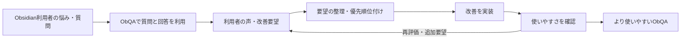
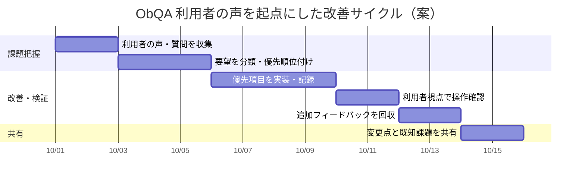

# Task_005：ObQAユーザーフィードバックによる改善

## 1. メタ情報

- **動画タイトル**: 【Obsidian × AIエージェント】悩みを解決してくれるObsidian特化型Q&Aサイト「ObQA」が更に使いやすくて便利なサイトに進化！
- **URL**: https://www.youtube.com/watch?v=Hy_GWpN09rE
- **動画投稿日**: 2026-09-30（YouTube概要欄の表示）
- **ノート作成日**: 2026-09-30
- **Status**: 🟡 暫定（YouTube字幕・全文文字起こしを取得できず、公開概要とチャプターに基づく）
- **Cockpit**: [[Cockpit_MOC]]

## 2. エグゼクティブサマリー

- Obsidian特化型Q&Aサイト「ObQA」を、利用者の声を反映して改善する内容が主題。
- 公式チャプターは、使い方と届いた声の振り返り、改善の実演、使いやすさの向上、まとめへ進む構成。
- 全文字幕は取得できていないため、以下の要約・タスク案はタイトル、概要欄、チャプター名からの暫定整理。

## 3. 概念モデル

動画タイトル・概要欄・目次から読み取れる「利用者の声を改善へつなぐ」流れを図示する。実際の発言内容や具体的な機能変更は、文字起こし未取得のため確定していない。

[link](https://docs.google.com/document/d/1pDRzzZzT2a2jggsOQokihs5k1lbITOEcsgxQT7W5OuU/edit?tab=t.0)

## 4. タスク抽出と選定理由

以下は動画の公式チャプターに示された改善サイクルを実務タスクに展開した**提案**であり、動画内で明示されたToDo一覧ではない。着手目安は動画日を起点にした案。

| タスク名 | 優先度 | 着手目安 | 選定理由（なぜこのタスクが必要か） |
|---|---|---|---|
| 利用者の声・質問・つまずきを収集する | P1 | 2026-10-01 | 改善の入力となる実際の利用者課題を把握し、作り手側の思い込みを減らすため。 |
| 要望を分類し、影響度と対応コストで優先順位を付ける | P1 | 2026-10-03 | 複数の声を実行可能な改善項目に変換し、限られた開発時間を重要課題へ配分するため。 |
| 最優先の改善を実装し、変更点を記録する | P1 | 2026-10-06 | 公式目次の「利用者の声を反映させよう」という実演テーマを、追跡できる変更として形にするため。 |
| 利用者視点で操作確認し、再度フィードバックを集める | P1 | 2026-10-10 | 改善が実際の使いやすさにつながったかを検証し、次の改善サイクルへ戻すため。 |
| 改善内容と既知の課題を共有する | P2 | 2026-10-13 | 何が変わったかを利用者に伝え、期待値と今後の要望を明確にするため。 |

## 5. 実行スケジュール

日付はチャプターから導いた**実行計画案**であり、動画内で確定した期限ではない。各工程は前工程の成果に依存する。

[Link](https://docs.google.com/document/d/1AB3SAAcwsV4aJmAyYO5YHNIVlNQOBWmNZpk7-GUBpkw/edit?tab=t.0)

## 6. タイムスタンプ付き要点まとめ

YouTubeの公式チャプター名と概要欄から構成を整理した。全文文字起こしに基づく詳細要約ではない。

| タイムスタンプ | 公式チャプター | 要点 |
|---|---|---|
| 00:00 | 導入 | Obsidian利用者の悩みを扱うQ&Aサイト「ObQA」と、利用者の声を反映するテーマを提示。詳細な導入内容は未確認。 |
| 01:16 | 「ObQA」の使い方のおさらいと届いている声 | サイトの使い方を振り返り、利用者から届いた反応・要望を取り上げる章。具体的な声は文字起こし未取得のため不明。 |
| 05:31 | 実演：利用者の声を反映させよう | 要望をサイト改善へつなぐ実演パート。変更対象や実装内容の詳細は未確認。 |
| 10:21 | 「ObQA」視聴者の皆さんがより使いやすいサイトへ | 視聴者・利用者にとっての使いやすさ向上を扱う章。具体的な改善項目は未確認。 |
| 13:35 | 本日のまとめ | 動画の主題をまとめる章。結論の詳細は未確認。 |
| 14:50 | アフタートーク | 本編後の補足トーク。内容は未確認。 |

## 取得状況と留意点

- YouTubeページで動画タイトル、チャンネル、投稿日表示、概要欄、公式チャプターを確認した。
- プレーヤーは「字幕を利用できません」と表示。字幕APIからもトラックを取得できず、外部文字起こしサービスはYouTube側の字幕取得ブロックを返した。
- よってこのノートは**全文文字起こしの取得・分析結果ではなく、公開メタ情報に基づく暫定整理**。具体的な発言、機能名、実装手順を推測で補っていない。
- 全文の内容に基づく改訂が必要な場合は、字幕テキストまたは文字起こしを追加してから要約・タスクを更新する。