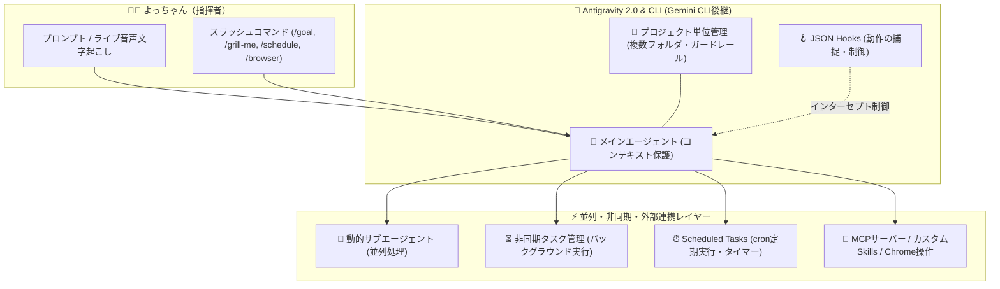

---
tags:
  - tech_ai/antigravity
  - tech_ai/cli
  - category/notebooklm_summary
  - category/obsidian_hub
aliases:
  - Antigravity 2.0 CLI 要約
  - Google Antigravity 2.0 開発者ドキュメント要約
created: 2026-11-16
status: active
source_notebook_id: b3897155-e1b2-46a8-8df3-dfe8ccfb1989
source_url: https://notebooklm.google.com/notebook/b3897155-e1b2-46a8-8df3-dfe8ccfb1989
---

# 🚀 Google Antigravity 2.0 & CLI 要約ノート（3大要点）

> [!info] 関連ハブ・親ノート（MOC連携）
> - 親ダッシュボード: [[Cockpit_MOC]] ([Cockpit_MOC.md](../00_Dashboard/Cockpit_MOC.md))
> - 情報ソース: **NotebookLM「Google Antigravity 2.0 開発者ドキュメント」** (`b3897155-e1b2-46a8-8df3-dfe8ccfb1989`)
> - 関連概念: [[LoopEngineering]] / [[MCP]] / [[Skills]]

---

## 📌 コアエッセンス（抽象：1行要約）

> [!abstract] 抽象（核となる設計思想）
> **Antigravity 2.0 & CLI** は、従来の「単一リポジトリ・IDE内包型エディタ」から脱却し、**「複数フォルダを束ねるプロジェクト単位のエージェント統括基盤」＋「自律・並列・スケジュール駆動のCLI/スラッシュコマンド体系」** へと進化した次世代エージェントOS環境である。

---

## 🧭 全体アーキテクチャ図解

---

## 🔑 NotebookLMから抽出した「3つの最重要ポイント」（具体）

### 要点1：アーキテクチャの刷新（IDE統合型から独立した「エージェント管理アプリ」への進化）

> [!tip] ポイント①：単一リポジトリ縛りから「プロジェクト単位」＆「デュアル運用」へ
> - **スタンドアロンアプリへの独立**: Antigravity 1.0 は VS Code ベースの IDE 内に「Agent Manager」を内包していたが、**Antigravity 2.0** では IDE から完全に切り離された独立デスクトップアプリ（Windows / macOS / Linux 対応）として刷新された。
> - **リポジトリ単位から「プロジェクト（Project）単位」への拡張**: 従来の単一ワークスペース（1リポジトリ）縛りを超え、複数フォルダーを束ねる **「プロジェクト単位」** でエージェントを管理可能。プロジェクトごとに固有のエージェント設定やアクセス権限（ガードレール）を適用しつつ、横断的な情報アクセスを実現する。
> - **IDEとのデュアル運用（Dual-Wielding）**: コード編集は [[VS Code]] や Antigravity IDE で行い、エージェント群の統括・オーケストレーションは Antigravity 2.0 / CLI で行う「二刀流（デュアル運用）」ワークフローが標準推奨されている。

---

### 要点2：並列・自律処理を実現するマルチエージェント＆非同期タスク管理機構

> [!important] ポイント②：メインのコンテキストを汚さず、裏側で並列・定期実行を回す
> - **動的サブエージェント（Dynamic Subagents）**: メインエージェントが状況に応じて専門サブエージェントを自律的・動的に生成・呼び出す。特化タスクを分離することで、**メインエージェントのコンテキストウィンドウ汚染を防ぎ、高速な並列処理を実現**する。
> - **非同期タスク管理（Asynchronous Task Management）**: 時間のかかるビルド・スクレイピング・検証コマンドをバックグラウンドで非同期実行し、メインの対話や別タスクをブロックせずに進行できる。
> - **Scheduled Tasks（スケジュール実行）**: 手動トリガーだけでなく、cron 形式での定期実行やワンオフのタイマー実行を自動トリガー可能（[[LoopEngineering]] の「外側ループ」に直結）。
> - **JSON Hooks による挙動制御**: JSON 形式でフックを定義し、エージェントのツール呼び出しや動作をインターセプト（捕捉）してきめ細かくガード・カスタマイズできる。

---

### 要点3：CLI・スラッシュコマンド体系と自律型開発ワークフロー

> [! note] ポイント③：「Gemini CLI」後継の軽量・高速制御と4大スラッシュコマンド
> - **Antigravity CLI（`agy`）の立ち位置と実行能力**: 「[[Gemini CLI]]」の後継となる軽量・高速なコマンドラインツール。システムコマンド実行、ファイル読み書き、Web検索、Chromeブラウザ操作、[[MCP]]（Model Context Protocol）サーバーやカスタム [[Skills]] との連携、アーティファクト生成を直接コントロールする。
> - **ライブ音声文字起こし入力**: 音声をそのまま送るのではなく、リアルタイムでテキストへ文字起こししながらプロンプト指示を組み立てることが可能。

#### 🛠 ワークフローを制御する主要スラッシュコマンド一覧

| スラッシュコマンド | 役割・動作仕様 | ループエンジニアリングでの活用場面 |
| :--- | :--- | :--- |
| **`/goal`** | 途中で人間への確認を挟まず、**指定したゴールが完全に達成されるまで自律して走り切る** | 内側ループ（自律実装・Jev自己修復の完走） |
| **`/grill-me`** | 実装着手前に、**エージェント側からユーザーへ逆質問**を行い要件・設計の不明点を徹底的に擦り合わせる | 構想フェーズ（Think Before Coding の強化） |
| **`/schedule`** | タスクの **ワンタイム予約実行や cron 定期実行スケジュール** を設定する | 外側ループ（定期監視・日報出力・メール監査） |
| **`/browser`** | エージェントによる **ブラウザ操作プリミティブの利用を明示的に指示・制御** する（自動判断ミスを防止） | Web検証・スクレイピング・UIテスト |

---

## 🔍 よっちゃん流ハイブリッド診断（核・質・特・欠 ／ 方・移・拡・新）

| 区分 | 観点 | 診断・評価内容 |
| :--- | :--- | :--- |
| **内部構造** | **核（Core）** | IDEから独立した「マルチエージェント＆非同期タスク統括OS（CLI＋スタンドアロン）」 |
| **内部構造** | **質（Quality）** | 動的サブエージェントによるコンテキスト分離と JSON Hooks による高い制御性 |
| **内部構造** | **特（Trait）** | `/goal`（完全自律）と `/grill-me`（事前対話）による「自律性スライダー」の明示的切り替え |
| **内部構造** | **欠（Deficit）** | 複数フォルダ（Project）横断時の権限境界設計や、長時間 `/goal` 実行時のトークン消費管理が課題 |
| **未来進化** | **方（Direction）** | 人間が都度プロンプトを打つ運用から、`/schedule` × `/goal` による完全自律ループ運用への移行 |
| **未来進化** | **移（Mobility）** | GUIに依存しない CLI 基盤により、ローカルバッチ・タスクスケジューラ・リモート環境へ自在に移植可能 |
| **未来進化** | **拡（Scalability）** | [[NotebookLM]] スキル・[[Obsidian]] 状態管理・Jev 3層監査器を CLI から一気通貫でオーケストレーション可能 |
| **未来進化** | **新（Novelty）** | エディタ中心（Software 1.0/2.0）から「エージェント群の指揮所（Cockpit）」を中心とする開発パラダイムへの転換 |
