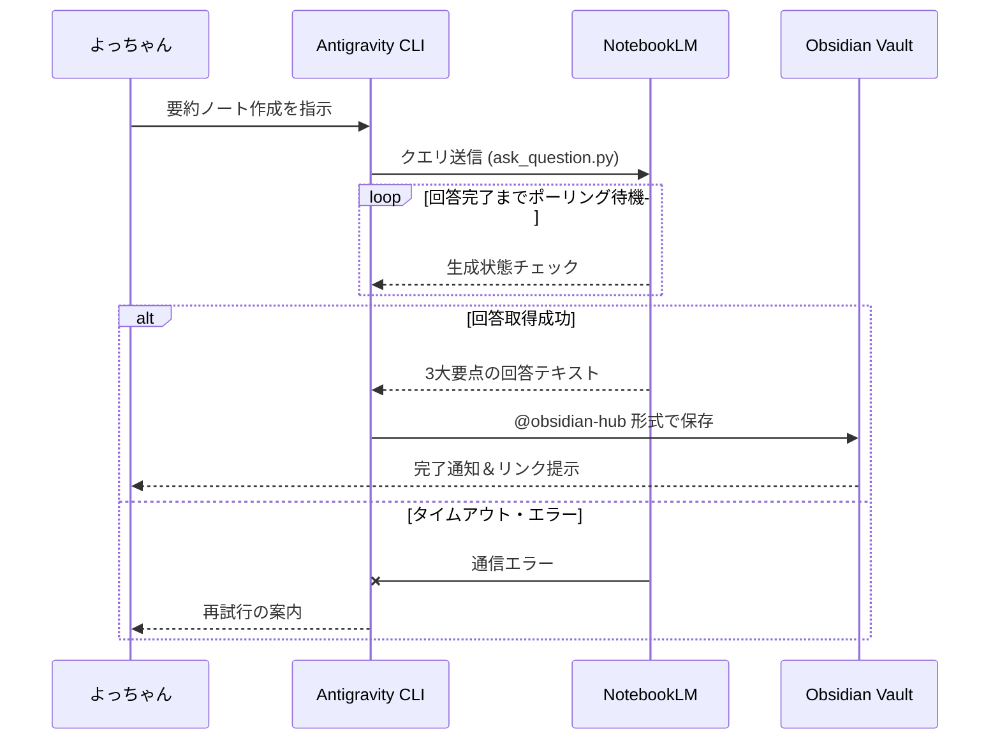

---
tags:
  - tech_ai/mermaid
  - category/visualization
  - category/notebooklm_summary
  - category/obsidian_hub
aliases:
  - Mermaid 要約
  - Mermaid 図解・基本構文ガイド
created: 2026-11-16
status: active
source_notebook_id: b277d4bb-e147-4b5a-86d7-f2fc926499ca
source_url: https://notebooklm.google.com/notebook/b277d4bb-e147-4b5a-86d7-f2fc926499ca
---

# 📊 Mermaid 図解・構文マスター要約ノート（3大要点）

> [!info] 関連ハブ・親ノート（MOC連携）
> - 親ダッシュボード: [[Cockpit_MOC]] ([Cockpit_MOC.md](../00_Dashboard/Cockpit_MOC.md))
> - 情報ソース: **NotebookLM「mermaid」** (`index-12` / `b277d4bb-e147-4b5a-86d7-f2fc926499ca`)
> - 関連ノート・概念: [[LoopEngineering]] / [2026-11-02_技術書読解の視覚化（図形・表）.md](../LoopEngineering/2026-11-02_技術書読解の視覚化（図形・表）.md)

---

## 📌 コアエッセンス（抽象：1行要約）

> [!abstract] 抽象（核となる設計思想）
> **Mermaid** は、Markdownライクなテキスト記法から多様なダイアグラムを即座に描画するツールであり、**「① 空間構造（フローチャート）」「② 時系列の相互作用（シーケンス図）」「③ 階層化・視覚装飾（subgraph / style / init）」** の3要素を組み合わせることで、複雑なシステム設計や思考プロセスを一目で伝わる構造図へ変換できる。

---

## 🔑 NotebookLMから抽出した「3つの最重要ポイント」（具体）

### 要点1：空間と処理フローを描く「フローチャート（`graph` / `flowchart`）」構文

> [!tip] ポイント①：方向（TD/LR）× ノード形状（括弧）× 接続線（矢印）の3点セット
> - **図の流れる方向の設定**:
>   - `TD`（上から下）、`BT`（下から上）、`LR`（左から右）、`RL`（右から左）を宣言直後に指定する。
> - **括弧の種類によるノード形状の使い分け**:
>   - `[四角形]`：標準プロセス・要素
>   - `([角丸四角形])`：開始・終了・イベント
>   - `{ひし形}`：条件分岐（Yes/No判定）
>   - `[(データベース)]`：DB・ストレージ（円柱型）
> - **接続線と高度な連結**:
>   - 矢印の種類：`-->`（実線矢印）、`---`（実線）、`-.->`（点線矢印）、`==>`（太線強調矢印）、`--テキスト-->`（ラベル付き矢印）。
>   - 効率的な記述：`A & B --> C`（1対多・多対1の並列接続）や `A --> B --> C`（連鎖記述）でコードを簡潔に保つ。

#### 💻 フローチャート実践コード＆描画プレビュー

```mermaid
%%{init: {'theme': 'default'}}%%
flowchart LR
    subgraph Input["1. 入力レイヤー"]
        A(["ユーザー要求"])
        DB[("Obsidian DB")]
    end

    subgraph Process["2. 判定・処理レイヤー"]
        B["テキスト解析"]
        C{"Jev監査パス?"}
    end

    A & DB --> B --> C
    C -- "Yes (承認)" ==> D(["完了・保存"])
    C -. "No (差戻し)" .-> B

    style D fill:#d4edda,stroke:#28a745,stroke-width:2px
```

---

### 要点2：時系列のやり取りと制御構造を描く「シーケンス図（`sequenceDiagram`）」構文

> [!important] ポイント②：参加者（participant）× メッセージ矢印 × 制御ブロック（loop / alt / opt）
> - **参加者の定義とエイリアス**:
>   - `participant ID as 表示名` で登場人物やシステムコンポーネントを定義し、記述量を削減しつつ可読性を高める。
> - **メッセージ矢印の使い分け**:
>   - `->>`：同期メッセージ・リクエスト（実線＋塗りつぶし矢印）
>   - `-->>`：応答・レスポンス（点線矢印）
>   - `-x`：非同期・失敗・エラー切断（X付き実線）
> - **制御構造ブロックによるロジック表現**:
>   - `loop ... end`：繰り返し処理（ポーリングやリトライループ）
>   - `alt ... else ... end`：条件分岐（正常系と異常系の分岐）
>   - `opt ... end`：特定条件のみのオプション処理

#### 💻 シーケンス図実践コード＆描画プレビュー



```
sequenceDiagram
    participant User as よっちゃん
    participant CLI as Antigravity CLI
    participant NLM as NotebookLM
    participant Vault as Obsidian Vault

    User->>CLI: 要約ノート作成を指示
    CLI->>NLM: クエリ送信 (ask_question.py)

    loop 回答完了までポーリング待機
        NLM-->>CLI: 生成状態チェック
    end

    alt 回答取得成功
        NLM-->>CLI: 3大要点の回答テキスト
        CLI->>Vault: @obsidian-hub 形式で保存
        Vault-->>User: 完了通知 & リンク提示
    else タイムアウト・エラー
        NLM-xCLI: 通信エラー
        CLI-->>User: 再試行の案内
    end
```

### 再現のポイント

- **participant定義:** 表示名を日本語・スペース付きのまま保つため、`as` エイリアスを指定しています。
    
- **矢印の使い分け:** 実線（`->>`）、点線（`-->>`）、エラーのバツ印矢印（`-x`）を画像の通り再現しています。
    
- **制御ブロック:** `loop`（ポーリング待機）と `alt` / `else`（成功・エラー分岐）の構造をそのまま記述しています。

---

### 要点3：全図表に共通する「構造化・装飾・インタラクション（補助構文）」と分割原則

> [!note] ポイント③：subgraphグループ化・テーマ変更・クリックリンク・分割設計で「読める図」にする
> - **サブグラフによる構造化（`subgraph`）**:
>   - `subgraph タイトル ... end` で関連ノードを境界枠で囲み、レイヤーや責務の境界を視覚化する。
> - **テーマ設定と個別スタイリング**:
>   - 全体テーマ：`%%{init: {'theme': 'forest'}}%%`（`default`, `dark`, `forest`, `neutral` 等）で図全体のトーンを一括変更。
>   - 個別強調：`style ノード名 fill:#f9f,stroke:#333,stroke-width:2px` で重要ノード（ボトルネックやゴール）を色分け強調。
> - **コメントとハイパーリンク連携**:
>   - コメント：行頭に `%%` を記述して設計メモを残す。
>   - リンク付与：`click ノード名 href "URL"` でノード自体をクリック可能なリンクにする。
> - **他図表への展開と「分割の原則」**:
>   - クラス図（`classDiagram`）、状態遷移図（`stateDiagram-v2`）、ER図（`erDiagram`）、マインドマップ等も同じ思想で記述可能。
>   - **実践の鉄則**：1つの図に詰め込みすぎず、複雑化した場合は**可読性を保つために適切な粒度へ分割して作成する**。

#### 🛠 Mermaid 主要構文クイックリファレンス表

| カテゴリ | 目的・用途 | 構文パターン |
| :--- | :--- | :--- |
| **基本宣言** | 図の種類の指定 | `flowchart TD`, `sequenceDiagram`, `stateDiagram-v2`, `erDiagram` |
| **ノード形状** | 意味に応じた形 | `[四角]`, `([角丸])`, `{ひし形}`, `[(DB円柱)]` |
| **接続・矢印** | 関係と強度の表現 | `-->`（通常）, `-.->`（点線）, `==>`（太線強調）, `A & B --> C`（並列） |
| **グループ化** | モジュール・境界表現 | `subgraph 名前` 〜 `end` |
| **装飾・制御** | テーマ・色・コメント | `%%{init: {'theme': 'forest'}}%%`, `style ID fill:#...`, `%% コメント` |

---

## 🔍 よっちゃん流ハイブリッド診断（核・質・特・欠 ／ 方・移・拡・新）

| 区分 | 観点 | 診断・評価内容 |
| :--- | :--- | :--- |
| **内部構造** | **核（Core）** | テキスト（コード）を単一の真実（Single Source of Truth）として図解を生成する Diagrams as Code 基盤 |
| **内部構造** | **質（Quality）** | `subgraph` と `style` による視覚的メリハリと、`loop`/`alt` による論理制御の正確性 |
| **内部構造** | **特（Trait）** | LLMが直接生成・修正しやすく、Obsidianやブラウザ日報（HTML）でそのままレンダリング可能 |
| **内部構造** | **欠（Deficit）** | ノード数が多すぎるとレイアウトが崩れやすいため、ドキュメント推奨の「分割設計」が不可欠 |
| **未来進化** | **方（Direction）** | 技術書読解・業務フロー設計・AI日報のすべてを「文章ではなくまずMermaid図解＋表」で構造化する標準運用 |
| **未来進化** | **移（Mobility）** | Markdownテキストのため Git管理・Obsidian・HTML日報・スライド生成へ劣化なく移植可能 |
| **未来進化** | **拡（Scalability）** | `@mindmap` スキルや `export_daily_antigravity_log.py`（ズーム・全画面機能付き日報）とのシームレス連携 |
| **未来進化** | **新（Novelty）** | 「人間が手で図を描く」から「AIが構造をコンパイルして図を出力し、人間が全体像を直観把握する」体験への進化 |
