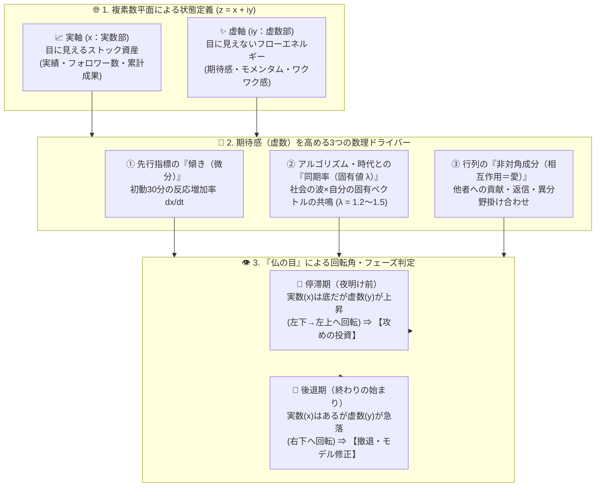
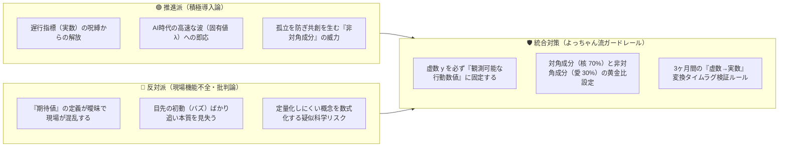

---
tags:
  - math_science/optimization
  - math_science/complex_analysis
  - math_science/linear_algebra
  - category/notebooklm_summary
  - category/obsidian_hub
aliases:
  - 数理の目と愛で読み解く、ビジネスと人生の最適化設計図 要約
  - 数理の目と愛 ビジネスと人生の最適化設計図
created: 2026-11-16
status: active
source_notebook_id: 70740618-cfb4-4cc1-a6f5-d4e5835463e4
source_url: https://notebooklm.google.com/notebook/70740618-cfb4-4cc1-a6f5-d4e5835463e4
---

# 🧭 数理の目と愛で読み解く、ビジネスと人生の最適化設計図（3大要点）

> [!info] 関連ハブ・親ノート（MOC連携）
> - 親ダッシュボード: [[Cockpit_MOC]] ([Cockpit_MOC.md](../00_Dashboard/Cockpit_MOC.md))
> - 情報ソース: **NotebookLM「数理の目と愛で読み解く、ビジネスと人生の最適化設計図」** (`index-13` / `70740618-cfb4-4cc1-a6f5-d4e5835463e4`)
> - 関連ノート・概念: [[LoopEngineering]] / [[複素関数論]] / [[線形代数]] / [[微分方程式]]

---

## 📌 コアエッセンス（抽象：1行要約）

> [!abstract] 抽象（核となる設計思想）
> ビジネスや人生の成果を「目に見える実績（実数 $x$）」だけで判断せず、**「目に見えない期待感・モメンタム（虚数 $iy$）」を含めた複素数平面 $z = x + iy$ で捉え、微分（傾き）・固有値（波との共鳴）・非対角成分（他者との相互作用＝愛）によって人生と事業の軌道を最適化する設計図**である。

---

## 🧭 全体構造図解（複素数平面×固有値×「仏の目」フェーズ判定）

---

## 🔑 NotebookLMから抽出した「3つの最重要ポイント」（具体）

### 要点1：複素数平面 $z = x + iy$ による「実績（実数）」と「期待値（虚数）」の統合定義

> [!tip] ポイント①：目に見える「実数資産」の前に、目に見えない「虚数エネルギー」が動く
> - **実軸（$x$：実数部）＝「コンテンツの質・実績（ストック資産）」**:
>   - フォロワー数、ストック記事数、過去の売上や累計インプレッションなど、すでに顕在化して積み上がった「目に見える資産」。
> - **虚軸（$y$：虚数部）＝「期待感・モメンタム（フロー資産）」**:
>   - 「次は何を発信・創造するのか」という周囲のワクワク感、アルゴリズムや時代の空気への適合度、トレンドの波など、まだ実像（実数）になる前の「目に見えない予兆エネルギー」。
> - **設計図の核心**:
>   - 実数（結果）だけを見て一喜一憂するのではなく、実数が動く前段階である **虚数（期待値・エネルギーの質）を観測・制御する** ことが最適化の第一歩となる。

---

### 要点2：見えない期待感（虚数）を数値化・増幅する「3つの数理アプローチ」

> [!important] ポイント②：微分（傾き）× 固有値（共鳴）× 非対角成分（相互作用・愛）
> 1. **先行指標の「傾き（微分 $\frac{dy}{dt}$）」を測る**:
>    - 単なる累計数（「いいね」の総数など）ではなく、**初動（投稿後30分以内など）の反応増加率（傾き）** を計算する。傾きがプラスで急であるほど、虚数軸（期待値）のエネルギーが高いと判定できる。
> 2. **時代の波・アルゴリズムとの「同期率（固有値 $\lambda$）」を高める**:
>    - プラットフォームや社会が今求めている「固有値」に対し、自分の専門性（固有ベクトル）がどれだけ一致（共鳴）しているかを係数化する。
>    - 同期率が高いほど固有値 $\lambda$ が `1.2` や `1.5` へと跳ね上がり、指数関数的な拡散・成長が起きる。
> 3. **行列の「非対角成分（相互作用＝愛）」を増やす**:
>    - 自分一人で完結する活動（対角成分 $a_{ii}$）だけに閉じず、**他者への返信・支援・異分野との掛け合わせといった「非対角成分（相互作用 $a_{ij}$）」** に時間とエネルギーを注ぐ。
>    - この「他者との関わり（愛・相互作用）」がコミュニティやチーム全体の固有値を引き上げ、期待値を非線形に増幅させる。

---

### 要点3：「仏の目（俯瞰視点）」による回転角・フェーズ判定と意思決定

> [!note] ポイント③：実数（現在地）と虚数（勢い）の相関（回転角）で「攻め」と「撤退」を見極める
> 実数（実績）と虚数（期待値）の2軸を相関させて俯瞰する **「仏の目」** を持つことで、現在どのフェーズにいるかを正確に察知し、最適なアクションを選択できる。

#### 📊 「仏の目」によるフェーズ判定マトリクス

| フェーズ | 実数部 ($x$：実績) | 虚数部 ($y$：期待感) | 複素平面上の回転・数理的評価 | 具体的な意思決定（アクション） |
| :--- | :---: | :---: | :--- | :--- |
| **🌅 停滞期（夜明け前）** | 底・低い | **上昇中 ($\uparrow$)** | 回転角が **左下から左上** へ向かう局面。目に見える数字はまだ出ていないが、初動の傾きや共鳴が育っている状態。 | **【攻めの投資】** 諦めずにリソースを集中投下し、実数化（ブレイクスルー）まで継続する。 |
| **🚀 成長・拡大期** | **上昇中 ($\uparrow$)** | **高い ($\uparrow$)** | 固有値 $\lambda > 1$ で虚数のエネルギーが実数（実績）へと次々に変換されている状態。 | **【非対角成分の拡大】** 他者との共創・還元を増やし、系全体の固有値をさらに高める。 |
| **🌇 後退期（終わりの始まり）** | 高い・維持 | **急落 ($\downarrow$)** | 回転角が **右下** へ向かう局面。過去の遺産で数字（実数）は残っているが、期待感や時代の同期率が失われている状態。 | **【撤退・モデル修正】** 実績の数字に慢心せず、速やかにピボット（構造改革・新モデル移行）を行う。 |

---

## 🔍 よっちゃん流ハイブリッド診断（核・質・特・欠 ／ 方・移・拡・新）

| 区分 | 観点 | 診断・評価内容 |
| :--- | :--- | :--- |
| **内部構造** | **核（Core）** | 複素数（実数×虚数）・微分（変化率）・線形代数（固有値×非対角成分）を統合した人生・ビジネスの状態空間モデル |
| **内部構造** | **質（Quality）** | 「愛（他者との関わり）」を精神論に留めず、行列の「非対角成分（相互作用項）」として数理的に定式化している点 |
| **内部構造** | **特（Trait）** | 遅行指標（実数）の罠を回避し、先行指標（虚数・微分の傾き）で意思決定を行う「仏の目」のフレームワーク |
| **内部構造** | **欠（Deficit）** | 虚数部（期待感・同期率）の観測プロキシ変数はドメイン（SNS、不動産、AI開発）ごとに具体的な定義が必要 |
| **未来進化** | **方（Direction）** | 日常のKPI管理を「実数（結果）のみ」から「実数＋虚数（初動傾き・相互作用量）」の2軸ダッシュボードへ進化させる |
| **未来進化** | **移（Mobility）** | SNS運用だけでなく、賃貸管理（入居者満足度の予兆検知）やAIプロダクト開発にもそのまま適用可能 |
| **未来進化** | **拡（Scalability）** | Python（SymPy / Plotly）やフェルミ推定スキル（`@fermi-estimation`）と連携し、固有値・3ヶ月予測シミュレーションへ展開可能 |
| **未来進化** | **新（Novelty）** | 「数理の目（冷徹な構造解析）」と「愛（非対角成分による共鳴）」を1つの数式モデルに融合させた独自の哲学 |

---

## 🌐 1. 【外部視点との比較】既存フレームワークとの独自性・補完関係

> [!info] 外部フレームワークとの位置づけ
> 本モデル（複素数・線形代数・微分の統合モデル）は、既存のビジネス管理手法を否定するものではなく、**既存手法が見落としがちな「位相（タイミング）」「共鳴（固有値）」「利他的相互作用（非対角成分）」を数理的に補完する上位レイヤー**として機能する。

| 比較軸 | ① 一般的なKPI管理（OKR / PDCA） | ② 行動経済学（プロスペクト理論・ナッジ） | ③ システムダイナミクス（因果ループ・ストック&フロー） | ④ 本数理モデル（数理の目と愛：$z=x+iy$・固有値・非対角成分） |
| :--- | :--- | :--- | :--- | :--- |
| **観測対象** | **実数（$x$）のみ** （売上・フォロワー数・成約数などの遅行指標） | **人間の認知バイアス・感情の歪み** （損失回避・現在バイアスなど） | **ストックとフローの遅延・フィードバックループ** | **実数（$x$：実績）＋ 虚数（$iy$：期待感・予兆エネルギー）** の2次元複素平面 |
| **時間軸と変化の捉え方** | 過去〜現在のスナップショット比較（差分 $\Delta x$） | 意思決定の瞬間における心理的選択確率 | 時間遅れ（Delay）を伴う非線形な増減 | **初動の微分（傾き $\frac{dy}{dt}$）と複素平面上の「回転角（位相）」** による先行予兆検知 |
| **他者・環境との関係性** | 個別部門・個人の目標達成率（対角成分 $a_{ii}$ 中心） | 「個人」対「選択アーキテクチャ（環境）」 | 変数間の正負のフィードバック（$+$ / $-$） | **社会の波との共鳴（固有値 $\lambda$）× 他者との相互作用（非対角成分 $a_{ij}$＝愛）** |
| **限界・盲点** | 数字（実数）が落ちてから気づくため、撤退やピボットが手遅れになる | 短期的な行動誘導には強いが、長期的な事業・人生の軌道設計には不向き | ループ図が複雑化しやすく、「今すぐ何をすべきか」の直観的判断が難しい | 虚数（期待感・同期率）のプロキシ変数設計に一定の抽象化・翻訳スキルが必要 |
| **本モデルとの補完関係** | KPIを「実軸 $x$」に据えつつ、先行指標として「虚軸 $y$」を横に並べることでPDCAの遅れを解消する | 行動経済学の「期待・感情」を虚数部 $y$ の設計に組み込み、初動の傾きを高める | ストックを実軸 $x$、フローの勢いを虚軸 $y$ に対応させ、複素平面の回転としてシンプルに可視化する | **3手法の「数値管理」「心理」「構造ループ」を1つの複素ベクトル・行列演算へ統合** |

---

## ⚖️ 2. 【強みと弱み（長所・短所）】実務・日常適用時のリアルな評価

> [!tip] 強み（Pros）：実務や日常の意思決定における強力なメリット
> 1. **「夜明け前（停滞期）」の早すぎる撤退を防げる**:
>    - 実数（売上・成約・フォロワー）がまだ底であっても、虚数（初動の反応率・問い合わせの温度感・非対角の感謝量）が上向いていれば「今は左下から左上へ回転中である」と確信して**攻めの投資を継続できる**。
> 2. **「終わりの始まり（後退期）」の慢心をいち早く察知できる**:
>    - 過去の実績（実数 $x$）が高くても、虚数 $y$（期待感・時代との同期率 $\lambda$）が急落している場合、「右下への回転」として早期に検知し、**致命傷を負う前にピボット・撤退を断行できる**。
> 3. **「利他・貢献（愛）」を自己犠牲ではなく「系全体の固有値最大化」として合理化できる**:
>    - 他者への返信、丁寧なサポート、異分野とのコラボレーションを「非対角成分 $a_{ij}$ の強化」と定義するため、感情論ではなく**数理的に最も合理的な成長戦略として「愛のある行動」を選択できる**。

> [!warning] 弱み（Cons）：測定誤差・主観バイアスなどの弱点と注意点
> 1. **虚数部（$y$：期待感）の「希望的観測バイアス（主観の混入）」**:
>    - 実際には市場から求められていない（単なる独りよがり）にもかかわらず、「今はまだ夜明け前で、見えない期待値（虚数）は貯まっているはずだ」と都合よく自己正当化し、サンクコストを積み増すリスクがある。
> 2. **プロキシ（代替指標）の測定ノイズと初期サンプル不足**:
>    - 「投稿後30分の傾き」や「同期率」は、母数が極端に少ない初期段階や外部要因（時間帯・季節変動）によって大きくブレるため、単発の微分値だけで判断すると誤判定を起こしやすい。
> 3. **非対角成分（相互作用）の「過剰分散（器用貧乏化）」リスク**:
>    - 自分の核となる専門性（対角成分 $a_{ii}$・固有ベクトル）が固まる前に、他者との関わり（非対角成分 $a_{ij}$）ばかりを増やすと、リソースが散漫になり実数化（成果の定着）が遅れる。

---

## 🥊 3. 【推進派 vs 反対派の視点】導入の是非とリスク対策（Jev的ガードレール）

| 立場 | 主張・根拠 | 現場で起きる現象（シナリオ） | 🛡️ 機能不全を防ぐ「具体策・ガードレール」 |
| :--- | :--- | :--- | :--- |
| **🟢 推進派の視点** （積極導入すべき理由） | **「実数しか見ない経営・個人は、変化の激しいAI時代に取り残される」** ・生成AIや市場トレンドの周期が月単位で変わる中、結果（実数）が出てから動くのでは遅すぎる。 ・微分の傾きと固有値（同期率）を見ることで、最小の労力で最大のレバレッジ（$\lambda > 1.2$）を得られる。 | ・日々の発信や新企画で「初動の反応速度」と「他者との共鳴」を重視するようになり、停滞感の中でも迷わず実験を回せる。 ・顧客や仲間への丁寧な対応（非対角成分）が自然と増え、長期的な信頼残高が蓄積する。 | **【推進力の維持】** [[Cockpit_MOC]] や日報（`export_daily_antigravity_log.py`）に「今日の実数成果」と「今日の虚数（仕込み・共鳴）」の2行記録を標準組み込みする。 |
| **🔴 反対派の視点** （批判・機能不全リスク） | **「定性的な『期待』や『愛』を数理用語で飾ると、現実逃避の言い訳になる」** ・虚数 $y$ や固有値 $\lambda$ は会計上の売上のように一意に定まらないため、測定者の主観でいくらでも操作できてしまう。 ・初動30分の傾きばかり追うと、扇情的で浅いアウトプットに流れる危険がある。 | ・「実数はゼロだけど虚数は上がっているから大丈夫」と主張して赤字や未達を放置する。 ・他者へのリプライや交流（非対角成分）ばかりに時間を奪われ、肝心のプロダクト開発や本業（対角成分）が空洞化する。 | **【3つの確定的ガードレール】** ① **プロキシの厳密定義**：虚数 $y$ は主観ではなく「初動30分の反応率」「返信速度」「具体的な相談件数」など客観カウント可能な数値に限定する。 ② **タイムラグ上限（デッドライン）の設定**：「虚数 $y$ が上昇していても、**30日〜90日以内に実数 $x$ への変換兆候が1%も出なければモデル自体を修正する**」という撤退条件（Fast-Fail）を設ける。 ③ **対角7：非対角3の原則**：自分のコア業務・専門性磨き（対角成分）に7割、他者との相互作用・異分野連携（非対角成分）に3割のリソース配分を守る。 |

---

## ✅ 4. 【検証アクションと進捗トラッカー】実務3領域での実験ステップ

> [!important] Goal-Driven 検証プロトコル
> 本設計図を「知識」で終わらせず、よっちゃんの3大実務領域（**①情報発信・技術アウトプット、②不動産賃貸管理、③Antigravity × Jev 開発**）において実際に複素平面・固有値・非対角成分が機能するかを検証するトラッカー。

### 領域A：情報発信・SNS・技術ノート作成（複素平面 $z = x + iy$ 実験）
- [ ] **Step A-1（虚数プロキシの定義）**：発信・アウトプットにおける「実数 $x$（累計PV・フォロワー・完成ノート数）」と「虚数 $y$（初動30分の反応傾き・ブックマーク率・引用コメント熱量）」の計測シートを定義する
- [ ] **Step A-2（固有値 $\lambda$ の同期実験）**：現在のAIトレンドの波（例：`Antigravity 2.0`、`Loop Engineering`、`NotebookLM連携`）と自分の固有ベクトル（`数理モデリング × 不動産実務自動化`）を掛け合わせたテーマで3本アウトプットし、通常テーマとの初動傾き（$\frac{dy}{dt}$）の倍率を比較する
- [ ] **Step A-3（非対角成分 $a_{ij}$ の投入）**：一方的な発信（対角成分）だけでなく、他者の知見への具体的なフィードバックや異分野概念（例：`複素関数 × 賃貸管理`）の架け橋となるアクションを週3回実施し、反応の変化を記録する

### 領域B：不動産賃貸管理・入居者対応（予兆検知と「仏の目」フェーズ判定）
- [ ] **Step B-1（入居者満足度の虚数観測）**：「契約更新率・稼働率（実数 $x$）」が落ちる前の先行指標として、「問い合わせメールの文面温度感・初期レスポンスまでの時間・共用部の微細な乱れ（虚数 $y$ の傾き）」をトリアージボット（`mail_triage_bot.py`）の監査ログから抽出する
- [ ] **Step B-2（非対角成分＝愛の実装検証）**：冬期凍結や騒音・設備修繕の問い合わせに対し、単なる事務的回答（対角成分）ではなく、Jev監査器で磨いた「安全への配慮・ねぎらい・予防アドバイス（非対角成分 $a_{ij}$）」を添えた返信を行い、その後のクレーム再発率・退去率の低下を検証する
- [ ] **Step B-3（「仏の目」による物件・業務フェーズ診断）**：管理物件や業務フローを「🌅夜明け前（攻めの投資）」「🚀拡大期」「🌇終わりの始まり（モデル修正）」の3フェーズに分類し、見直すべき業務を1つ特定する

### 領域C：Antigravity × Jev 自律ループ開発（数理モデルのコード実装）
- [ ] **Step C-1（固有値・3ヶ月予測シミュレータの試作）**：Python（`NumPy` / `Plotly`）または `@fermi-estimation` を使い、現在の実数 $x_0$・虚数の傾き $\frac{dy}{dt}$・同期率 $\lambda$・非対角相互作用 $a_{ij}$ を入力すると「複素平面上の回転軌道と3ヶ月後の実数予測レンジ」を3D/2D可視化するスクリプトを試作する
- [ ] **Step C-2（Jev監査への「実数・虚数」評価軸の組み込み）**：日々の日報（`export_daily_antigravity_log.py`）や週次レビューにて、「今週積み上げた実数（成果物）」と「今週仕込んだ虚数（新しい実験・スキル連携・非対角の種まき）」を自動集計・可視化する

