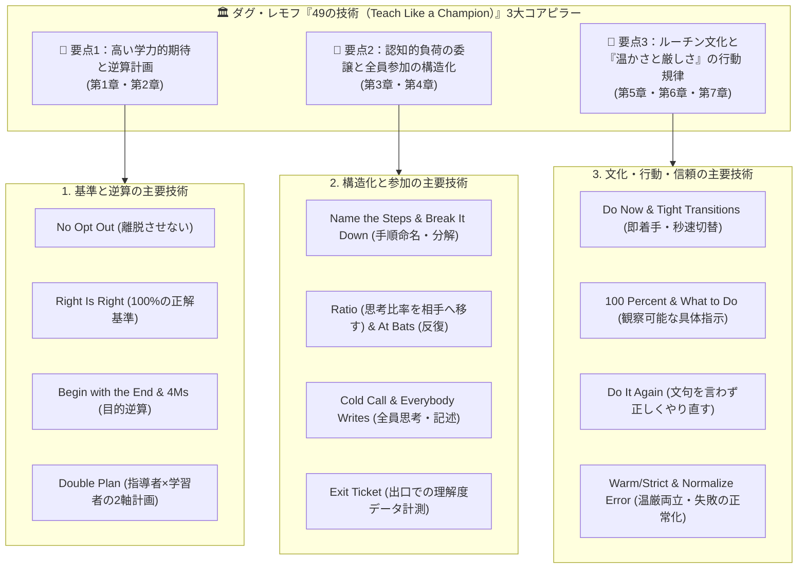
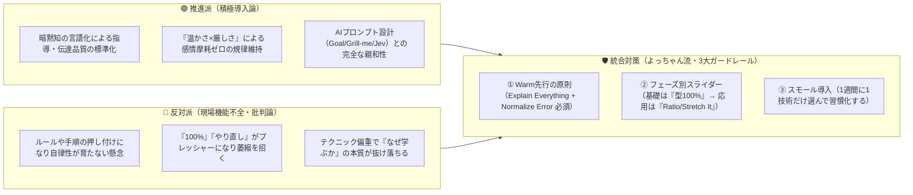

---
tags:
  - general_reading/education
  - category/methodology
  - category/notebooklm_summary
  - category/obsidian_hub
aliases:
  - 最高の教師をつくる49の技術 設計書
  - Teach Like a Champion 最強の指導メソッド
created: 2026-11-16
status: active
source_notebook_id: bb965eb8-2d26-4f88-8b46-0ae550627b13
source_url: https://notebooklm.google.com/notebook/bb965eb8-2d26-4f88-8b46-0ae550627b13
---

# 🎓 最高の教師をつくる49の技術：最強の指導メソッド 実践設計書

> [!info] 関連ハブ・親ノート（MOC連携）
> - 親ダッシュボード: [[Cockpit_MOC]] ([Cockpit_MOC.md](../00_Dashboard/Cockpit_MOC.md))
> - 情報ソース: **NotebookLM「最高の教師をつくる49の技術：最強の指導メソッド」** (`index-15` / `bb965eb8-2d26-4f88-8b46-0ae550627b13` / 原著：ダグ・レモフ『Teach Like a Champion』)
> - 関連ノート・概念: [[LoopEngineering]] / [2026-11-16_数理の目と愛_ビジネスと人生の最適化設計図_要約.md](./2026-11-16_数理の目と愛_ビジネスと人生の最適化設計図_要約.md)

---

## 📌 コアエッセンス（抽象：1行要約）

> [!abstract] 抽象（核となる設計思想）
> 卓越した指導（教育・マネジメント・AIエージェント統括）とは、カリスマ性や精神論ではなく、**「① 100%の基準を妥協しない高い期待設定」「② 目的から逆算し認知負荷を相手へ移す構造化計画」「③ 観察可能な行動指示と『温かさと厳しさ（Warm/Strict）』を両立する環境文化」** という再現可能な49のマイクロ技術（型）の集積である。

---

## 🧭 全体構造図解（7大領域×3大コアピラーの体系）

---

## 🔑 NotebookLMから抽出した「3つの最重要ポイント」（具体）

### 要点1：「だいたい合っている」で妥協しない高い期待設定と逆算設計（第1章・第2章）

> [!tip] ポイント①：基準を100%に固定し、「活動」ではなく「測定可能なゴール（4Ms）」から逆算する
> - **第1章：高い学力的期待を設定する（5技術）**
>   1. **ノー・オプト・アウト (`No Opt Out`)**：「わからない」で終わらせず、ヒントや他者の回答を経由してでも、**最後は必ず本人の口から正解を言わせて完結**させる。
>   2. **ライト・イズ・ライト (`Right Is Right`)**：「だいたい合っている（70点）」を教師が勝手に補完して丸にせず、**100%正確な定義・回答になるまで基準を下げずに導く**（Jev監査の二値ゲートと同型）。
>   3. **ストレッチ・イット (`Stretch It`)**：正解した直後に「なぜそうなる？」「別解は？」「より厳密な条件は？」と追質問し、限界を一段引き上げる。
>   4. **フォーマット・マターズ (`Format Matters`)** ＆ **ウィズアウト・アポロジー (`Without Apology`)**：単語の断片ではなく完全な文章・正しい構文で回答させ、「難しいけれど退屈だけど…」といった言い訳（謝罪）を一切せずに課題の価値を堂々と提示する。
> - **第2章：学力を確実に伸ばす計画（6技術）**
>   1. **目的から始める (`Begin with the End`)** ＆ **4つのM (`4 Ms`)**：「明日何をやるか（活動）」ではなく「何ができるようになるか（目的）」から逆算し、目標を **Manageable（管理可能）・Measurable（測定可能）・Made first（最優先作成）・Most important（最重要）** の4基準で定義する。
>   2. **最短ルート (`Shortest Path`)** ＆ **ダブル・プラン (`Double Plan`)**：目標達成に最もシンプルで直接的な手段を選び（Karpathy流 `Simplicity First`）、自分の行動だけでなく「その瞬間、相手（生徒・部下・AI）が何をしているか」を並列設計する。
>   3. **ポスト・イット (`Post It`)** ＆ **地図を描く (`Draw the Map`)**：ゴールを常に可視化し、物理的・環境的な動線を事前に設計する。

---

### 要点2：認知的負荷を相手に移し、全員を思考に参加させる授業構造（第3章・第4章）

> [!important] ポイント②：指導者がしゃべりすぎず「考える比率（Ratio）」を相手に移し、小さなステップと出口計測で定着させる
> - **第3章：授業の構造化と提供（10技術）**
>   1. **ステップを命名する (`Name the Steps`)** ＆ **分解する (`Break It Down`)**：複雑なスキルは覚えやすい名前のついた小さなステップに分解し、つまずいた箇所は最小単位の要素に切り分けて自力到達を支援する。
>   2. **比率 (`Ratio`)** ＆ **打席に立つ (`At Bats`)**：「考える・話す・書く」という認知的負荷を指導者から学習者へ移し（Ratio）、頭で理解した後に十分な回数の反復練習（At Bats）を行わせる。
>   3. **理解度のチェック (`Check for Understanding`)** ＆ **出口チケット (`Exit Ticket`)**：主観ではなく客観データ（全員の回答や終了前1問テスト）で理解度をリアルタイム計測し、不十分なら即座に軌道修正する。
>   4. **ザ・フック (`The Hook`)**、**板書＝ノート (`Board = Paper`)**、**巡回する (`Circulate`)**、**立場を明確にする (`Take a Stand`)**。
> - **第4章：生徒を授業に参加させる（6技術）**
>   1. **コールド・コール (`Cold Call`)** ＆ **ウェイト・タイム (`Wait Time`)**：挙手していない相手にも予測不能かつ温かく指名することで全員の当事者意識を保ち、質問後は3〜5秒の「考える間（Wait Time）」を置いて回答の質を高める。
>   2. **全員が書く (`Everybody Writes`)**：発言や議論の前にまず「全員に自分の考えを書き出させる」ことで、思考の整理とアウトプット品質を劇的に引き上げる。
>   3. **コール・アンド・レスポンス (`Call and Response`)**、**ペッパー (`Pepper`)**、**ベガス (`Vegas`)**。

---

### 要点3：摩擦ゼロのルーチン文化と「温かさと厳しさ（Warm/Strict）」の規律（第5章・第6章・第7章）

> [!note] ポイント③：否定形ではなく「観察可能な具体行動（What to Do）」で指示し、感情を乱さずその場でやり直す
> - **第5章：強固な教室文化の構築（8技術）**
>   - **ドゥ・ナウ (`Do Now`)** ＆ **迅速な移行 (`Tight Transitions`)**：開始と同時に指示待ちなしで着手できる短い課題を用意し、フェーズ切り替えを数秒のルーチンに標準化して時間ロスをゼロにする。
>   - **入室ルーチン (`Entry Routine`)**、**バインダーの管理 (`Binder Control`)**、**SLANT**（集中姿勢）、**オン・ユア・マーク (`On Your Mark`)**、**着席時の合図 (`Seat Signals`)**、**プロップス (`Props`：瞬時の称賛)**。
> - **第6章：行動への高い期待の設定と維持（7技術）**
>   - **何をすべきか (`What to Do`)**：「騒ぐな」「ミスするな」という曖昧な否定形ではなく、**「今すぐ何を見るか・どう手を動かすか」という具体的・観察可能な肯定指示**を出す。
>   - **100パーセント (`100 Percent`)** ＆ **もう一度やり直す (`Do It Again`)**：ルール遵守を100%求め、不十分な場合は説教する代わりに**「ただちに最初から正しくやり直す（Do It Again）」** ことで行動を定着させる（自己修復Healerループと同型）。
>   - **強い声 (`Strong Voice`)**、**細部にこだわる (`Sweat the Details`)**、**しきい値 (`Threshold`)**、**警告なし (`No Warnings`)**。
> - **第7章：人格と信頼の構築（7技術）**
>   - **厳しさと温かさ (`Warm/Strict`)** ＆ **情緒の恒常性 (`Emotional Constancy`)**：「高い基準を絶対に曲げない厳しさ」と「相手への敬意・愛情に満ちた温かさ」は対立せず同時に成立する。指導者は感情の波を排し、常に一定の穏やかさで対処する。
>   - **的確な賞賛 (`Precise Praise`)** ＆ **間違いをノーマライズする (`Normalize Error`)**：漠然と褒めず「どの手順・行動が良かったか」を具体的に褒め、失敗は学習の当然のプロセスとして安心感を与える（＋ **ポジティブな枠組み `Positive Framing`**、**喜びの要素 `The J-Factor`**、**すべてを説明する `Explain Everything`**）。

---

## 🔍 よっちゃん流ハイブリッド診断（核・質・特・欠 ／ 方・移・拡・新）

| 区分 | 観点 | 診断・評価内容 |
| :--- | :--- | :--- |
| **内部構造** | **核（Core）** | 熟練指導者の暗黙知を「誰でも再現・監査可能な49のマイクロ行動技術（アルゴリズム）」へ分解した指導体系 |
| **内部構造** | **質（Quality）** | 「目的逆算（4Ms）→ ステップ命名 → 反復（At Bats）→ 出口検証（Exit Ticket）」の閉ループ品質保証が極めて堅牢 |
| **内部構造** | **特（Trait）** | `Warm/Strict`（温かさと厳しさの共存）と `What to Do`（観察可能な具体指示）により、心理的安全性と高規律を両立 |
| **内部構造** | **欠（Deficit）** | 49技術を一度に全部適用しようとすると指導者・現場ともにパンクするため、段階的導入（1週間に1〜2技術）が必須 |
| **未来進化** | **方（Direction）** | 人間への指導だけでなく、**AIエージェントへのプロンプト・スキル設計（LLM Psychology制御）の標準作法**へ昇華 |
| **未来進化** | **移（Mobility）** | 教育現場から「不動産入居者へのルール案内」「社内マネジメント」「Jev自己修復ループ設計」へそのまま移植可能 |
| **未来進化** | **拡（Scalability）** | `Right Is Right`（第1層二値監査）＋ `Do It Again`（自動Healer再生成）＋ `Exit Ticket`（検証テスト）としてコード化可能 |
| **未来進化** | **新（Novelty）** | 「人間を伸ばす最強の教育技術」と「AIエージェントを100%機能させるシステム設計」が完全に同型であることの発見 |

---

## 🌐 1. 【外部視点との比較】既存フレームワークとの独自性・補完関係

> [!info] 外部フレームワークとの位置づけ
> ダグ・レモフの『49の技術』は、抽象的な教育哲学やコーチング理論と異なり、**「秒単位の具体的な振る舞い・声かけ・環境設計」まで解像度を落とした実行プロトコル（Software 1.0/2.0のハイブリッド仕様書）** である点に最大の独自性がある。

| 比較軸 | ① 一般的なビジネスコーチング（GROWモデル等） | ② 応用行動分析（ABA：ABC分析・強化理論） | ③ AIプロンプト＆ループエンジニアリング（Karpathy流） | ④ 本メソッド（ダグ・レモフ『49の技術』） |
| :--- | :--- | :--- | :--- | :--- |
| **基本アプローチ** | 質問によって相手の内発的な気づき・自律性を引き出す | 先行条件(A)→行動(B)→結果(C)の連鎖を操作し行動変容を起こす | 明確なシステム制約・Few-shot例・監査ゲート（Jev）で出力を制御する | **高期待の設定 × 構造化された手順教授 × 即時フィードバック＆再実行** |
| **指示の具体性** | 抽象度が高め（「どうしたい？」「何ができる？」） | 観察可能な行動単位に分解するが、知識教授の構造は手薄 | トークン単位・JSONスキーマ単位で厳密に定義（曖昧さを排除） | **`What to Do`（観察可能な行動指示）と `Name the Steps`（手順命名）で迷いをゼロにする** |
| **未達・エラー時の対応** | 内省を促し、次回の行動計画を再設定する | 強化子の調整やスモールステップ化（シェイピング）を行う | Fast-Failで差し戻し、エラー理由を添えて再生成（Healer）を回す | **`No Opt Out`（離脱不可）・`Break It Down`（要素分解）・`Do It Again`（即座にやり直し）** |
| **感情・関係性の扱い** | 傾聴・共感・受容（Warm中心） | 客観的・機械的な強化スケジュール（Neutral） | 非感情的・論理的（LLM Psychologyに基づく構造制御） | **`Warm/Strict`（温かさと厳しさの同時両立）＆ `Emotional Constancy`（情緒の恒常性）** |
| **本メソッドとの補完関係** | 基礎スキルが定着した上級者にはコーチング（`Stretch It`）へ移行する | ABAの理論的裏付けを、現場で即使える49の具体スキルとして実装している | **人間向け指導の49技術は、そのままAIエージェントのシステムプロンプト＆Jev監査設計のチェックリストになる** | **「初心者の基礎定着」から「上級者の応用伸長」までをシームレスに繋ぐ実践ハブ** |

---

## ⚖️ 2. 【強みと弱み（長所・短所）】実務・日常適用時のリアルな評価

> [!tip] 強み（Pros）：実務や日常の意思決定・指導における強力なメリット
> 1. **「なぜできないのか（能力不足 vs 指示の曖昧さ）」を即座に切り分けられる**:
>    - `What to Do`（観察可能な具体指示）と `Name the Steps`（ステップ命名）を徹底することで、相手が動けない原因が「反抗や能力不足」ではなく「指示側の構造化不足」であったことに気づき、即座に改善できる。
> 2. **70点の妥協（なあなあ運用）を排除し、組織・システムの基準を100%に保てる**:
>    - `Right Is Right`（100%正解まで妥協しない）と `Do It Again`（不十分ならその場でやり直す）により、ミスや曖昧な成果物が下流工程へ流出するのを水際で防げる。
> 3. **怒りや感情的消耗（バーンアウト）をゼロにできる**:
>    - `Emotional Constancy`（情緒の恒常性）と `Warm/Strict`（温かく、かつ厳格に）をルール化しているため、クレーム対応や指導場面でイライラせず、「淡々と温かく、基準通りにやり直してもらう」運用が可能になる。

> [!warning] 弱み（Cons）：適用時の弱点・誤用リスクと注意点
> 1. **「厳しさ（Strict）」だけを切り取ると、マイクロマネジメント・威圧的統制に陥る**:
>    - 第7章の `Warm`（温かさ・敬意・`Normalize Error`・`Explain Everything`）を抜きにして、第1章・第6章の `100 Percent` や `No Warnings` だけを振りかざすと、相手の心理的安全性が崩壊し、思考停止の指示待ち人間を生む。
> 2. **創造的・探索的タスク（0→1フェーズ）への過剰適用リスク**:
>    - 正解が明確な基礎スキル習得には無類の強さを発揮するが、正解のないブレインストーミング初期に `Right Is Right` や `Shortest Path` を強く求めすぎると、自由な発想（非対角成分のゆらぎ）を潰してしまう。
> 3. **49技術の「全部盛り」による認知オーバーロード**:
>    - 指導者側が一度に多くの技術を使おうとすると不自然になり、本来の目的（`Begin with the End`）を見失う。

---

## 🥊 3. 【推進派 vs 反対派の視点】導入の是非とリスク対策（運用ガードレール）

| 立場 | 主張・根拠 | 現場で起きる現象（シナリオ） | 🛡️ 機能不全を防ぐ「3つの運用ガードレール」 |
| :--- | :--- | :--- | :--- |
| **🟢 推進派の視点** （積極導入すべき理由） | **「優しさだけでは人もAIも動かない。『明確な構造』こそが最大の愛である」** ・曖昧な指示を出して後から怒る方がはるかに残酷であり、最初に `4Ms`（測定可能なゴール）と `What to Do`（具体行動）を示す方が相手は安心して力を発揮できる。 ・反復（`At Bats`）と即時フィードバック（`Exit Ticket`）が最短で成果を出す。 | ・新人のオンボーディング、入居者への案内文、AIへのスキル定義（`SKILL.md`）のすべてで「一発で伝わる・迷わない」状態が実現する。 ・感情的な叱責が消え、建設的な改善ループ（`Do It Again`）が文化として定着する。 | **【推進力の最大化】** 49技術の中から「対人コミュニケーション用」「自分自身の習慣化用」「AIエージェント制御用」のコア技術を厳選してテンプレート化する。 |
| **🔴 反対派の視点** （批判・機能不全リスク） | **「管理主義的であり、相手の自由な思考や主体性を奪うリスクがある」** ・`100 Percent` や `Cold Call` を信頼関係がない状態で使うと、監視・詰問のように受け取られ、反発や離脱を招く。 ・手順（`Name the Steps`）だけを暗記させると、想定外の事態に弱いマニュアル人間になる。 | ・形式的なルール遵守ばかりが目的化し、現場の空気（`The J-Factor`：喜び）が失われてギスギスする。 ・注意ややり直し指示が「否定」と受け取られ、モチベーションが低下する。 | **【3つの確定的ガードレール】** ① **「理由の説明（`Explain Everything`）」と「失敗の正常化（`Normalize Error`）」のセット運用**：厳しい基準（`Right Is Right`）を求める時は、必ず「なぜその基準が必要か（相手の安全や成長のため）」を添え、途中のミスは歓迎する。 ② **自律性スライダー（Ratioの段階的移行）**：初期（基礎固め）は指導者主導でステップを明示し、定着したら速やかに `Ratio`（考える比率）と `Stretch It`（応用質問）へ比重を移す。 ③ **「的確な賞賛（`Precise Praise`）」3：修正1の比率**：やり直し（`Do It Again`）を求める以上に、正しくできた具体行動を即座に言語化して称賛する。 |

---

## ✅ 4. 【検証アクションと進捗トラッカー】実務3領域での実験ステップ

> [!important] Goal-Driven 検証プロトコル
> ダグ・レモフの指導メソッドを、よっちゃんの3大実務領域（**①情報発信・教育ノート作成、②不動産賃貸管理・入居者対応、③Antigravity × Jev 自律開発**）へトランスファー（移植）し、その効果を検証するトラッカー。

### 領域A：情報発信・技術解説・学習ノート作成（構造化教授法の適用）
- [ ] **Step A-1（`The Hook` ＋ `Begin with the End` の導入）**：技術ノートや発信記事の冒頭3行に、必ず「読者の興味を惹く問い（The Hook）」と「この記事を読むと何ができるようになるか（4Msゴール）」を明記するフォーマットを試す
- [ ] **Step A-2（`Name the Steps` ＋ `Board = Paper` の実践）**：複雑な数理モデルやPython実装を解説する際、3〜5個の「覚えやすい名前付きステップ」に分解し、そのままコピー＆ペーストで手元のノート・コードとして使える構成（Board = Paper）にする
- [ ] **Step A-3（`Exit Ticket` の組み込み）**：作成した要約・設計書の末尾に、理解度と即行動をテストする「1分チェック問題・実験タスク（Exit Ticket）」を必ず1つ配置する

### 領域B：不動産賃貸管理・入居者コミュニケーション（`Warm/Strict` × `What to Do` の実装）
- [ ] **Step B-1（否定形から `What to Do` への書き換え実験）**：入居者向けの案内文や騒音・ゴミ出し・冬期水抜き等の注意喚起において、「〜しないでください（否定形）」をすべて排除し、**「具体的にいつ・どのバルブを・どう操作するか（観察可能な肯定行動：What to Do）」** に書き換えて反応・遵守率を比較する
- [ ] **Step B-2（`Warm/Strict` ＋ `Explain Everything` のJev監査基準化）**：クレーム返信・契約更新案内のJev監査プロンプトにおいて、「入居者への温かい共感・ねぎらい（Warm）」と「契約ルール・費用負担境界の100%明確な提示（Strict & Right Is Right）」および「なぜその手順が必要かの理由説明（Explain Everything）」が両立しているかをチェック項目として検証する

### 領域C：Antigravity × Jev エージェント設計（49技術のAIオーケストレーション応用）
- [ ] **Step C-1（`No Opt Out` × `Right Is Right` × `Do It Again` のループ検証）**：AIエージェントやJev自己修復Healerに対し、「70点の曖昧な出力を許容せず（Right Is Right）、エラー箇所を最小単位に分解してフィードバックし（Break It Down）、100%基準を満たすまで自動でやり直させる（Do It Again / No Opt Out）」という指導構造をシステムプロンプトへ明示的に組み込む
- [ ] **Step C-2（`Double Plan` による人間×AI協働ワークフロー設計）**：新しい自動化タスクを計画する際、「AIエージェントが裏で何を実行するか（`/goal`, `/schedule`）」と「よっちゃんがどのタイミングで何を判断するか（HUMAN_REVIEW）」の2列を併記する `Double Plan` 表を作成して運用する
