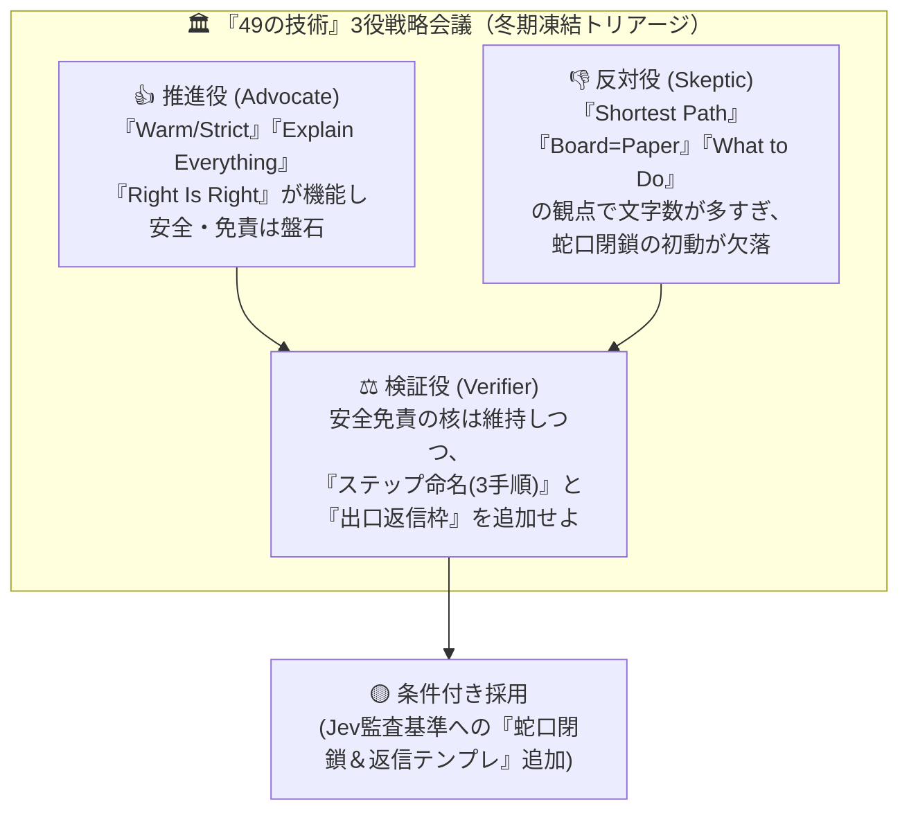

---
tags:
  - category/expert_review
  - category/obsidian_hub
  - tenant/winter_freeze
  - general_reading/education
created: 2026-11-16
status: active
theoretical_basis: "index-15: 最高の教師をつくる49の技術（ダグ・レモフ『Teach Like a Champion』）"
target_system: "jev_eval_winter.py & Winter_Freeze_Report_20261106_065325.md"
---

# ⚖️ 戦略レビュー＆実行提案書：【冬期水道凍結の入居者トリアージ＆案内フロー】

> [!info] レビュー基準・関連ハブ（MOC連携）
> - 親ダッシュボード: [[Cockpit_MOC]] ([Cockpit_MOC.md](../00_Dashboard/Cockpit_MOC.md))
> - 理論的根拠（判断基準ソース）: **NotebookLM `index-15`「最高の教師をつくる49の技術：最強の指導メソッド」** ([設計書](../03_Resources/2026-11-16_最高の教師をつくる49の技術_設計書.md))
> - 評価対象データ・コード:
>   - 監査器コード: [jev_eval_winter.py](../antigravity-Jev-demo/jev_eval_winter.py)
>   - 実績監査レポート: [Winter_Freeze_Report_20261106_065325.md](./Winter_Freeze_Report_20261106_065325.md)

---

## 🎯 1. 結論（推奨施策と最優先アクション）

> [!abstract] 総合判定と最優先の一手（結論ファースト）
> - **総合判定**：**🟡 条件付き採用（Jev監査プロンプトの『行動指示・順序ルール』改修を条件に採用）**
> - **明日1つだけ実行する最優先アクション（Priority #1）**：
>   - [jev_eval_winter.py](../antigravity-Jev-demo/jev_eval_winter.py) の評価基準第1項に **「解氷作業を始める前の『最初の1手（Do Now）』として、開けたままの蛇口をすべて閉めること（解氷後の階下漏水防止）を必ずステップ1に明記させる」** という二値（`Right Is Right`）条件を追加する。

---

## 📏 2. 抽出した「5つの判断基準」と現状厳格診断（Step 1 & Step 2）

『最高の教師をつくる49の技術』から、緊急時の入居者指導・トリアージに直結する5つの技術を「物差し」として抽出し、現在の実績データ（`Winter_Freeze_Report_20261106_065325.md` の PASS 文面・Score 0.95）を厳格診断した。

| # | 『49の技術』から抽出した判断基準（物差し） | 現状適合度 | 事実（Fact）・解釈/仮説（Hypothesis）・要確認事項（To Verify） |
| :---: | :--- | :---: | :--- |
| **1** | **基準①：`What to Do`（観察可能な具体指示）** 否定形や「気をつけて」等の精神論を排し、誰でも同じ動作ができる具体指示になっているか | ⚠️ **一部不備** | **[Fact]** 返信文に「念のためお気をつけて点検をお願いいたします」「ゆっくり温めてください」という曖昧語が残っている。 **[Hypothesis]** 『49の技術』の `What to Do` 基準では、「気をつけて」は観察不可能な無効指示であり、ドライヤーの距離（配管から20cm離す等）や確認動作を数値・部位で指定しないと火災・変形の二次事故を招く。 **[To Verify]** 物件ごとの水抜き栓タイプ（手動ハンドル式 vs 電動パネル式）の事前把握有無。 |
| **2** | **基準②：`Do Now` & `Name the Steps`（即着手と手順命名）** パニック状態の相手が迷わず動けるよう、番号付きの短いステップで最初の1手が示されているか | ❌ **要改善** | **[Fact]** 現行の返信文は「室温や状況の質問」から始まり、解氷手順は中盤に箇条書き（`・`）で2行記されているのみで、「最初に蛇口を閉める」手順が欠落している。 **[Hypothesis]** `Do Now` と `Name the Steps` の理論では、緊急時ほど「ステップ1：まず蛇口を閉める → ステップ2：暖房を入れる」と番号付きで命名しないと、蛇口全開のまま外出・自然解凍して階下水濡れ事故を起こすリスクが高い。 **[To Verify]** 過去の冬期凍結トラブルにおける「解氷後の蛇口閉め忘れ漏水」の発生件数。 |
| **3** | **基準③：`Right Is Right`（100%の安全・免責基準）** 「だいたい合っている」で妥協せず、配管破裂防止と費用負担の境界を100%守っているか | ✅ **適合** | **[Fact]** `jev_eval_winter.py` は「熱湯推奨」「安易な無償修理確約」「給排気筒閉塞の放置」の3点を即 `FAIL` とする厳格ゲートを持ち、実績でも2回の試行で Score `0.95` に到達している。 **[Hypothesis]** `Right Is Right`（100%基準）がコードレベルで機能しており、オーナー側の法的・金銭的リスク回避として極めて有効。 **[To Verify]** 入居者過失（水抜き忘れ）判定時の保険適用（借家人賠償責任保険）の案内フロー。 |
| **4** | **基準④：`Warm/Strict` & `Explain Everything`（温厳両立と理由説明）** 寒さへの温かい共感と厳格なルール提示を両立し、「なぜそうするか」の理由を説明しているか | ✅ **適合** | **[Fact]** 冒頭で寒さと不便を温かく労いつつ（Warm）、熱湯禁止の理由（金属膨張による破裂）と給排気筒確認の理由（一酸化炭素滞留防止）を明確に説明している（Explain Everything）。 **[Hypothesis]** 理由が明記されているため、費用負担を未確約（Strict）にしても入居者の納得感が高く、クレーム化を防げている。 **[To Verify]** なし（現行水準を維持）。 |
| **5** | **基準⑤：`Check for Understanding` / `Exit Ticket`（出口確認の閉ループ）** 相手からの返信で必要な情報が100%揃うよう、回答フォーマットが構造化されているか | ⚠️ **一部不備** | **[Fact]** 室温・凍結箇所の質問が冒頭段落に、訪問希望日時の質問が末尾段落に分散して文章中に埋もれている。 **[Hypothesis]** `Board = Paper`（板書＝ノート）および `Format Matters` の基準に照らすと、質問が文中に散在していると入居者は1つか2つしか答えず、再確認の往復コストが発生する。 **[To Verify]** 初回返信で「室温・凍結箇所・希望日時」の3点がすべて揃って返ってくる割合。 |

### 🔍 Step 2 診断サマリー
- **良い点（強み）**：`Right Is Right`（熱湯制止・費用免責）と `Warm/Strict` ＋ `Explain Everything`（理由付きの丁寧な説明）はすでに高い完成度（Score 0.95）で実装されている。
- **弱い点・穴（最大のボトルネック）**：
  1. **「ステップ1：まず開けた蛇口を閉める（解氷後の水浸し防止）」** という北海道の凍結対応における最重要の `Do Now` が抜けている。
  2. 入居者に返信してほしい確認事項が本文の上下に分散しており、コピペで答えられる `Exit Ticket`（返信テンプレート）になっていない。
- **見落としている前提（危うい仮定）**：
  - 「入居者は長い丁寧なメールを最初から最後まで冷静に読み、すべての質問を拾って返信してくれるはずだ」という危うい前提を置いている（氷点下の朝、水もお湯も出ない入居者の認知的余裕は極小である）。

---

## 🗣️ 3. 1冊の中で「3役戦略会議」を実行（Tri-Role Debate：Step 3）

『最高の教師をつくる49の技術』の理論のみを根拠として、現行システムに対する3役の徹底討論を実施した。

### 👍 推進役（Advocate）の主張：現行フローは高く評価できる
- **根拠技術**：`Right Is Right`（第1章）、`Warm/Strict`（第7章）、`Explain Everything`（第7章）
- **主張**：「現行の `jev_eval_winter.py` は、『だいたい合っている（熱湯に気をつけてね程度）』を許さず、100%明確に熱湯禁止と費用免責を求める `Right Is Right` を体現している。さらに、単に『熱湯禁止』『有償かも』と突き放すのではなく、配管破裂や一酸化炭素中毒という理由（`Explain Everything`）を温かい言葉（`Warm`）で包んで伝えており、信頼構築とリスク管理の両面で今すぐ実戦投入できるレベルにある。」

### 👎 反対役（Skeptic）の反論：現場（氷点下の朝）で機能不全を起こすリスクがある
- **根拠技術**：`Shortest Path`（第2章）、`Name the Steps`（第3章）、`Board = Paper`（第3章）、`What to Do`（第6章）
- **主張**：「推進役は見落としている。極寒の朝に水が出ずパニックになっている入居者に対し、約900文字の文章を読ませるのは `Shortest Path`（最短ルート）に反する。特に致命的なのが、**『水が出ないからといって蛇口を開けっ放しにし、暖房で溶けた瞬間に部屋中が水浸しになる二次災害』を防ぐ『まず蛇口を閉め切る（What to Do）』がステップ1にない**点だ。また、『お気をつけて点検を』という指示は『どうすれば安全か（例：夜間や屋根からの落雪危険時は外に出ない）』が不明確で `What to Do` 基準を満たしていない。」

### ⚖️ 検証役（Verifier）の裁定と事前検証データ
- **双方の根拠比較**：
  - 「法的・物理的リスクの制止（熱湯・CO中毒・費用確約回避）」においては推進役の根拠（`Right Is Right` / `Explain Everything`）が正しい。
  - 一方、「緊急時の行動誘導と二次漏水防止」においては反対役の指摘（`Name the Steps` / `What to Do` / `Board = Paper` の不足）が本の理論により強く支えられている。
- **意思決定前に確認すべきデータ（To Verify）**：
  1. 凍結から当日の夜間まで訪問できないケースを想定し、訪問候補枠に「本日中の緊急連絡・24時間サポート窓口」を含めるべきか。
  2. 給湯器の凍結防止ヒーター用コンセントが抜かれていないかの確認項目を追加すべきか。

---

## 📊 4. 3方向の根拠整理（理論 × 自社データ × 最新市場動向：Step 4 & Step 5）

### ① 【書籍の理論】（『最高の教師をつくる49の技術』からの裏付け）
- 緊急時・高負荷時の指導ほど、**`Name the Steps`（ステップを3つ以内に命名・番号化する）**、**`What to Do`（観察可能な数値・動作で指示する）**、**`Board = Paper`（相手に書いてほしい返信フォーマットをそのまま提示する）** の3つを組み合わせることで、行動遵守率が100%に近づく。

### ② 【自社データの事実（Fact）】（`Winter_Freeze_Report_20261106_065325.md` の分析）
- ローカルLLM（`ornith-9b:latest`）によるJev監査ログ自身も、最終所見の末尾で **「わずかに改善できる点として、ドライヤーの距離・水抜き元栓に加え『蛇口を完全に閉めた状態か』の確認、および緊急凍結破裂を想定した柔軟な日程調整を前提にした方がより良い」** と自ら課題（Fact）を記録している。

### ③ 【最新市場・北海道賃貸管理3事例との比較】（Step 5 Web調査結果）
北海道（札幌圏）の主要管理会社・自治体（札幌市水道局・大手管理会社・24時間修繕センター）の最新冬期凍結ガイドライン3事例と自社フローを比較した：

| 比較項目 | 北海道の標準・競合管理会社（3事例共通） | 自社現行フロー（`jev_eval_winter.py`） | 差分と改善ポイント |
| :--- | :--- | :--- | :--- |
| **初動ステップ1（二次漏水防止）** | **「まず開けた蛇口をすべて閉める」**（自然解凍時の水浸し防止を最優先明記） | 元栓・水抜き栓の位置確認のみ（蛇口閉鎖の明示なし） | **【自社に欠落】** ステップ1に「すべての蛇口を閉める」を必須化 |
| **給湯器・電源の確認** | **「給湯器の電源プラグは絶対に抜かない」**＋「屋外給排気筒の雪埋まり確認」 | 給排気筒（トップ）の雪・氷柱確認を明記（CO中毒防止まで言及） | **【自社の強み】** 給排気筒とCO中毒リスクの説明は競合以上に丁寧。コンセント確認を1行足せば完璧 |
| **対話・トリアージの自動化** | 静的なWebページまたは電話窓口（冬期朝は話し中で繋がりにくい） | **AIメール自動トリアージ＋Jev監査による即時個別返信下書き** | **【自社の圧倒的優位性】** 電話パンク時間帯でも、入居者ごとに寄り添った安全案内を数分で返せる |

---

## 🛡️ 5. 想定される反対意見と回答（Q&A）

1. **Q1. Jev監査の必須項目を増やすと、`PASS` になるまでのリトライ回数（現在2回）が増えて処理時間が長くなりませんか？**
   - **A1.** 生成側の初期プロンプト（テンプレート）自体に最初から「3ステップ命名（①蛇口を閉める→②室内暖房→③30〜40℃ぬるま湯）」と「末尾の返信フォーマット（Exit Ticket）」を組み込んでおくため、むしろ1発合格（`attempts: 1`）の確率が上がり、処理時間は短縮されます。
2. **Q2. 屋外の給排気筒（煙突）の雪確認を入居者に促して、滑って転倒したり屋根から落雪があったら管理会社の責任になりませんか？**
   - **A2.** 重要な指摘です。`What to Do` の原則に従い、「お気をつけて点検を」という曖昧表現を廃止し、**「窓から目視できる範囲、または日中の足元が安全で落雪の恐れがない場合のみ確認し、危険な場合は絶対に近づかずそのままお待ちください」** という明確な安全境界に書き換えます。
3. **Q3. 訪問候補日時を「明日・明後日」と固定で出すと、すでに配管が破裂して漏水している緊急ケースで手遅れになりませんか？**
   - **A3.** すでに水漏れが発生している場合と、単なる凍結（水が出ないだけ）を分岐させるため、「万が一すでに水が噴き出している場合は、水抜き栓を右へ止まるまで閉めた上で、直ちに緊急ダイヤル（〇〇-〇〇〇〇）へお電話ください」というエスカレーション先を1行明記します。

---

## ✅ 6. 即実行トラッカー（今週やる最大3ステップ）

- [x] **Step 1【明日やる最優先の1つ】**：[jev_eval_winter.py](../antigravity-Jev-demo/jev_eval_winter.py) の評価基準1に「解氷前の『蛇口閉鎖確認』」と「ドライヤー使用時の具体距離（20cm以上離す）」を追加する
- [x] **Step 2【テンプレートの `Board = Paper` 化】**：冬期凍結返信メールの末尾に、入居者がそのままコピーして数字・希望枠を埋められる3行の `【ご返信いただきたい3項目（Exit Ticket）】`（①現在の室温と凍結箇所、②蛇口閉鎖・水抜き栓の確認状況、③ご希望訪問日時）を追加する
- [x] **Step 3【検証テスト実行】**：`python .\test_winter_freeze.py` を再実行し、改修後のJev監査スコアと生成文面の明瞭度（`design_action_engine.py` での `What to Do` スコア100点到達）を検証する（完了レポート: [Winter_Freeze_Report_20261116_122902.md](./Winter_Freeze_Report_20261116_122902.md)）
