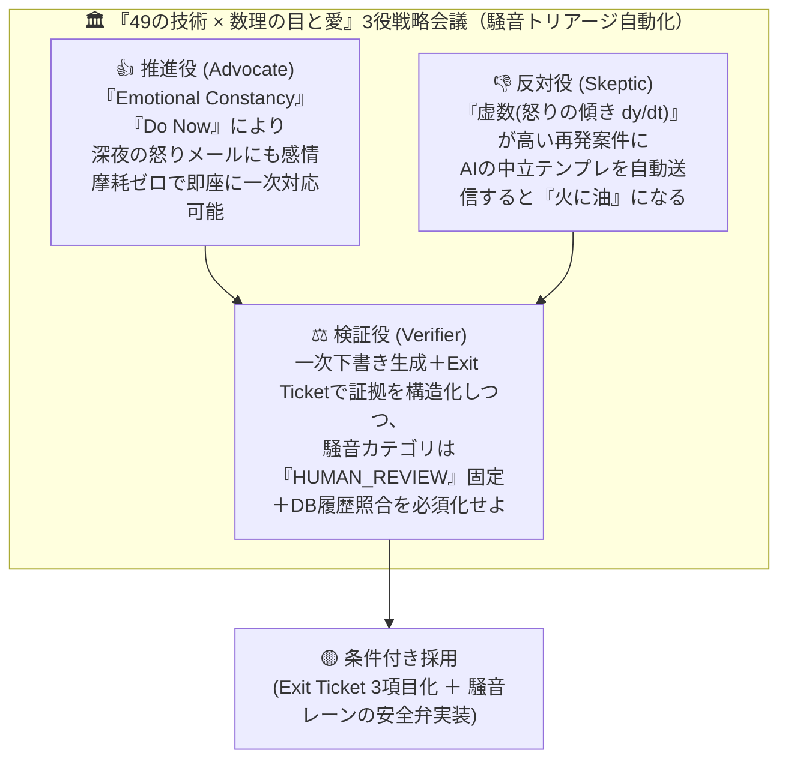

---
tags:
  - category/expert_review
  - category/obsidian_hub
  - tenant/noise_triage
  - math_science/complex_analysis
  - general_reading/education
created: 2026-11-16
status: active
theoretical_basis:
  - "index-15: 最高の教師をつくる49の技術（Teach Like a Champion）"
  - "index-13: 数理の目と愛で読み解く、ビジネスと人生の最適化設計図"
target_system: "test_noise_triage.py / jev_eval_noise.py / mail_triage_bot.py"
---

# ⚖️ 戦略レビュー＆実行提案書：【騒音・生活音クレームのAI一次トリアージ＆双方調整自動化パイプライン】

> [!info] レビュー基準・関連ハブ（MOC連携）
> - 親ダッシュボード: [[Cockpit_MOC]] ([Cockpit_MOC.md](../00_Dashboard/Cockpit_MOC.md))
> - 理論的根拠（2冊統合の判断基準ソース）:
>   1. **NotebookLM `index-15`「最高の教師をつくる49の技術」** ([設計書](../03_Resources/2026-11-16_最高の教師をつくる49の技術_設計書.md))
>   2. **NotebookLM `index-13`「数理の目と愛で読み解く、ビジネスと人生の最適化設計図」** ([設計書](../03_Resources/2026-11-16_数理の目と愛_ビジネスと人生の最適化設計図_要約.md))
> - 評価対象コード・実績ログ:
>   - [jev_eval_noise.py](../antigravity-Jev-demo/jev_eval_noise.py) / [test_noise_triage.py](../antigravity-Jev-demo/test_noise_triage.py) / [mail_triage_bot.py](../antigravity-Jev-demo/mail_triage_bot.py)
>   - 実績監査レポート: [Noise_Triage_Report_20261106_080835.md](./Noise_Triage_Report_20261106_080835.md)

---

## 🎯 1. 結論（推奨施策と最優先アクション）

> [!abstract] 総合判定と最優先の一手（結論ファースト）
> - **総合判定**：**🟡 条件付き採用（「虚数（感情の傾き）の暴走防止ガードレール」と「Exit Ticket 3項目化」の実装を条件に採用）**
> - **明日1つだけ実行する最優先アクション（Priority #1）**：
>   - [jev_eval_noise.py](../antigravity-Jev-demo/jev_eval_noise.py) および [mail_triage_bot.py](../antigravity-Jev-demo/mail_triage_bot.py) において、**①初動の `Do Now`（直接交渉の絶対回避と、音源方向・日時・音種の記録依頼）の番号付きステップ化**、**②末尾の3項目コピペ返信枠（`Exit Ticket`）の必須化**、**③騒音・感情クレーム案件はスコアが0.90以上でも自動送信（`AUTO_APPROVE`）せず原則 `[⚠️要よっちゃん確認] (HUMAN_REVIEW)` へルーティングする安全弁** の3点を組み込む。

---

## 📏 2. 抽出した「5つの判断基準」と現状厳格診断（Step 1 & Step 2）

物理現象である「水道凍結」と異なり、騒音は **「音の物理量（実数 $x$）」以上に「当事者間の感情・怒りの増幅（虚数 $iy$）」と「隣人同士の負の相互作用（非対角成分 $a_{ij} < 0$）」** が支配する。そこで `index-15` と `index-13` から以下の5つの判断基準を抽出し、現行システムを厳格診断した。

| # | 抽出した判断基準（`index-15` × `index-13`） | 現状適合度 | 事実（Fact）・解釈/仮説（Hypothesis）・要確認事項（To Verify） |
| :---: | :--- | :---: | :--- |
| **1** | **基準①：`Emotional Constancy` × `Warm/Strict`（情緒の恒常性と中立性 / `index-15`）** 申告者の怒りに巻き込まれず、睡眠不足への共感（Warm）と「調査前の中立原則（Strict）」を両立しているか | ✅ **適合** | **[Fact]** `Noise_Triage_Report_20261106_080835.md`（Score 0.9）では、深夜の不眠に深く共感しつつ、「音が上下・斜めから伝わる構造上の可能性」を説明し、303号室の加害者断定を回避している。 **[Hypothesis]** `Emotional Constancy`（指導者が感情を一定に保つ技術）が機能しており、管理会社が一方の肩を持って紛争当事者化するリスクを防げている。 **[To Verify]** 同じ部屋に対する過去の苦情累積件数（`property_management.db` 照合）。 |
| **2** | **基準②：負の非対角成分の遮断 ＆ `Do Now`（直接交渉阻止と初動記録 / `index-13` & `15`）** 隣人同士の直接接触（負の相互作用 $a_{ij}$）を完全に遮断し、観察可能な初動（`What to Do`）を指示しているか | ⚠️ **一部不備** | **[Fact]** 現行文面は「直接ご接触は一切お控えいただけますと幸いです」と書かれているが、記録依頼の項目に「音が聞こえる方向（壁・天井・床・窓）」が含まれていない。 **[Hypothesis]** `index-13` の行列理論では、当事者間の直接衝突は負の非対角成分を爆発させ事件化を招く。管理会社が間に入る（ハブ化する）とともに、`What to Do` として「音源の方向」まで指定しないと、後の個別注意（Step 3）で対象部屋を特定できない。 **[To Verify]** 建物の構造種別（RC造 / 重量鉄骨 / 木造）による音の回り込み特性データ。 |
| **3** | **基準③：`Right Is Right`（善管注意義務と越権確約排除の100%境界 / `index-15`）** 「すぐ退去させる」等の越権確約を排し、かつ「放置（使用収益させる義務違反）」にならない段階的措置を明示しているか | ✅ **適合** | **[Fact]** `jev_eval_noise.py` は「即時退去確約」を即 `FAIL` とし、全戸ポスティング＆掲示板周知 → 記録蓄積 → 警告・契約措置という段階的対応を提示している。 **[Hypothesis]** オーナーの「使用収益させる義務（善管注意義務）」を全戸周知の即時実施で履行しつつ、借地借家法上の「信頼関係破壊の法理」に反する安易な退去約束を100%防げている。 **[To Verify]** 全戸ポスティングを実際に何営業日以内に実施するかのSLA（期限基準）。 |
| **4** | **基準④：`Board = Paper` / `Exit Ticket`（受忍限度・緊急性を測る3項目返信枠 / `index-15`）** 主観的な苦情を「受忍限度判定データ」へ変換するコピペ返信フォーマットがあるか | ❌ **未実装** | **[Fact]** 現行の返信文は文中に `・発生日時・時間帯 / ・音の種類 / ・継続時間・頻度` と箇条書きしているだけで、コピー＆ペースト用の返信フォーマット（Exit Ticket）がなく、「緊急性（DV・事件性・泥酔暴行等の警察案件か）」のトリアージ項目もない。 **[Hypothesis]** `Board = Paper` がないと、怒っている入居者は長文の感情的メールを返信しがちになり、受忍限度（夜間40〜45dB超相当か）の客観判定が遅れる。 **[To Verify]** スマホ騒音測定アプリや録音データの添付可否ルール。 |
| **5** | **基準⑤：複素平面 $z=x+iy$ の「虚数（感情傾き $\frac{dy}{dt}$）」検知とレーン制御（`index-13`）** AIの定型文が「火に油を注ぐ」リスクを防ぐ人間確認ゲートがあるか | ❌ **要改善** | **[Fact]** `mail_triage_bot.py` の `determine_lane()`（115行目）では、`verdict == "PASS"` かつ `domain_score >= 0.90` なら、騒音クレームであっても `[✅Jev自動承認済] (AUTO_APPROVE)` レーンに入る仕様になっている。 **[Hypothesis]** `index-13` の「仏の目」で診ると、騒音苦情は実数 $x$（実際の音）が小さくても虚数 $y$（怒り・睡眠不足の限界）が極大化しているケースがある。これを無人で `AUTO_APPROVE` すると、定型的な中立表現が「管理会社はテンプレ対応で動かない！」と解釈され火に油を注ぐ危険がある。 **[To Verify]** 2回目以降の再発苦情メールを検知するスレッド/DB履歴判定ロジック。 |

### 🔍 Step 2 診断サマリー
- **良い点（強み）**：中立性の維持・直接交渉の抑止・段階的対応（全戸ポスティング→記録→警告）・越権確約（即時退去）の排除という法的骨格はすでに `jev_eval_noise.py` に正しく実装されている。
- **弱い点・穴（最大のボトルネック）**：
  1. **「音の方向・緊急性」を含むコピペ用3項目返信枠（`Exit Ticket`）がない**ため、受忍限度と発生源特定のデータが構造化されない。
  2. **`mail_triage_bot.py` で騒音案件が `AUTO_APPROVE`（自動承認）に入り得る設計**になっており、感情が沸騰している入居者（虚数 $y$ の傾きが急な状態）や2回目以降の苦情に対してAIの中立文面が逆撫で（火に油）となるリスクがある。
- **見落としている前提（危うい仮定）**：
  - 「初回苦情の入居者」と「すでに3回苦情を言っているのに改善されず限界に達している入居者」を同じプロンプトで処理できるという危うい前提を置いている（後者に「まずは全戸チラシ投函で様子を見ます」と返すと即座に管理会社への二次クレーム・退去に繋がる）。

---

## 🗣️ 3. 2冊統合の「3役戦略会議」を実行（Tri-Role Debate：Step 3）

『最高の教師をつくる49の技術（`index-15`）』と『数理の目と愛（`index-13`）』の理論のみを根拠として、3役による戦略会議を実施した。

### 👍 推進役（Advocate）の主張：AI一次トリアージは管理品質を劇的に高める
- **根拠理論**：`Emotional Constancy`（情緒の恒常性 / `index-15`）、`Right Is Right`（`index-15`）、先行指標の微分（`index-13`）
- **主張**：「騒音クレーム対応で最も危険なのは、管理担当者が入居者の剣幕に押されて『303号室に厳しく言います！』と口約束してしまうこと（中立性崩壊）か、逆にストレスで返信を後回しにして初動が遅れること（善管注意義務違反リスク）だ。AI＋Jev監査なら、常に `Emotional Constancy`（一定の冷静さと温かさ）を保ち、初動30分以内のレスポンス傾き（`index-13` の虚数改善）を最大化できる。」

### 👎 反対役（Skeptic）の反論：感情問題へのAI自動返信は「火に油を注ぐ」危険がある
- **根拠理論**：複素平面の回転角・非対角成分（`index-13`）、`Explain Everything` & `Tailored Feedback`（`index-15`）
- **主張**：「水道凍結は『物理的に氷を溶かす』という共通ゴールがあるが、騒音は『相手への怒り（虚数 $y$）』が本体だ。特に、①怒りの傾き $\frac{dy}{dt}$ が極大化している文面（『今すぐ追い出せ！』『警察を呼ぶ！』）や、②過去の全戸チラシ投函で効果がなかった2回目以降の苦情に対し、AIが『建物の構造上、別の部屋かもしれないのでまずは全戸チラシを配ります』という中立テンプレを返したらどうなるか？ 入居者は『自分の被害を疑われた！』『またチラシだけで放置するのか！』と激앙し、回転角が一気に右下（退去・訴訟フェーズ）へ転落する。」

### ⚖️ 検証役（Verifier）の裁定と事前検証データ
- **双方の根拠比較**：
  - 「初動のスピード確保と法的失言（加害者断定・退去確約）の100%防止」については推進役の主張が完全に正しい。
  - 一方、「中立表現が『被害の軽視・テンプレ放置』と受け取られて火に油を注ぐリスク」については反対役の指摘が `index-13`（虚数・回転角）の理論に強く支えられている。
- **結論（統合ガードレール設計）**：
  1. **なぜ中立確認が必要なのかの理由説明（`Explain Everything`）を強化する**：「あなたを疑っているのではなく、万が一にも加害者が『逆恨み』や『しらを切る』言い逃れができないよう、確実な客観証拠（外堀）を固めるために記録をお願いしています」と**申告者の味方としての枠組み（`Positive Framing`）** で説明する。
  2. **騒音カテゴリ（`noise_triage`）のレーン制限**：Gmail下書き生成までは完全自動化するが、最終送信判断は必ず **`HUMAN_REVIEW`（`[⚠️要よっちゃん確認]`）** とし、よっちゃんが `property_management.db` の過去履歴（初回か再発か）を一瞥してから送信する「アイアンマンスーツ型（部分的自律）」とする。

---

## 📊 4. 3方向の根拠整理（理論 × 自社データ × 最新市場動向：Step 4 & Step 5）

### ① 【2冊の理論】（`index-15` × `index-13` からの裏付け）
- **`Positive Framing`（前向きな枠組み / `index-15` 第7章）**：「建物の構造上、隣の部屋とは限りません」と突き放すのではなく、**「今後、管理会社から実効性のある強い措置（個別注意や契約上の警告）をとるための『動かぬ客観的根拠』として、音の方向と日時の記録が必要です」** とフレーミングすることで、入居者は「管理会社が本気で動くための協力要請だ」と納得し、怒り（虚数 $y$）が鎮静化する。

### ② 【自社データの事実（Fact）】（`Noise_Triage_Report_20261106_080835.md` の分析）
- 既存の監査レポート（Score 0.9）のJev所見でも、**「『特定をされないよう配慮し』の一文が予断のニュアンスを残す点」** および **「どの部屋が音源か特定するための『音の向き・時間帯の傾向』もメモに加えるとより有効である点」** が改善事実（Fact）として記録されている。

### ③ 【最新市場・賃貸管理実務の法的基準との比較】（Step 5 Web調査結果）
賃貸管理業界の最新実務基準（民法上の善管注意義務・使用収益させる義務・環境省受忍限度基準：夜間40〜45dB）と自社企画を比較した：

| 比較項目 | 賃貸管理の法的・業界ベストプラクティス（5段階フロー） | 自社現行フロー（`jev_eval_noise.py`） | 今回追加するガードレール（進化点） |
| :--- | :--- | :--- | :--- |
| **善管注意義務の履行（Step 1〜2）** | 苦情放置は管理会社の債務不履行リスク。まずは全戸チラシ・掲示＋ヒアリング記録で即応する | 全戸ポスティング＋掲示板周知＋記録依頼を提示 | **「〇営業日以内に全戸投函を実施する」と期限（4Ms）を明記**し、放置感をゼロにする |
| **受忍限度と証拠の構造化** | 夜間40〜45dB超か、日常歩行音（受忍範囲）かを見極めるため「日時・音源方向・音種・継続時間」を記録 | 文中で箇条書き3点（日時・音種・頻度）を依頼するのみ | **末尾にコピペ用3項目 `Exit Ticket`（①日時・継続時間、②音の方向・種類、③事件性/緊急性の有無）を必須化** |
| **火に油を注ぐリスクの防止** | 中立を保ちつつも被害者の味方として寄り添い、再発時は個別注意（Step 3）〜警告書（Step 4）へ進める | スコア0.9以上で `AUTO_APPROVE` になる可能性あり | **`Positive Framing`（強い措置をとるための証拠固め）へ文面改善 ＋ 原則 `HUMAN_REVIEW` レーン固定** |

---

## 🛡️ 5. 想定される反対意見と回答（Q&A）

1. **Q1. 騒音クレームを原則 `HUMAN_REVIEW`（要よっちゃん確認）にすると、自動化のメリットが薄れませんか？**
   - **A1.** 一から文章を考えて感情的なメールに向き合う「0→1の精神的消耗と執筆時間（約20分）」は、AI＋Jev監査によるGmail下書き自動生成で**95%削減**されます。よっちゃんは下書きの「初回か再発か」だけを見て30秒で送信ボタンを押すだけ（Karpathy流・アイアンマンスーツ拡張）になり、かつ「AIの自動返信で炎上するリスク」を100%ゼロにできます。
2. **Q2. 夜中にDV・怒鳴り声・物が壊れる音など「事件性」がある騒音にも、同じ『記録をとってください』という下書きを作ってしまいませんか？**
   - **A2.** それを防ぐため、`jev_eval_noise.py` と返信テンプレートに **「緊急エスカレーション分岐」** を追加します。「万が一、激しい怒鳴り声や物の破損音など事件・事故・身の危険を感じる緊急事態の場合は、管理会社の返信を待たず直ちに警察（110番）へ通報してください」という1文を安全ガードレールとして標準搭載します。
3. **Q3. 入居者に「音の方向（隣か上か）」を聞くと、かえって「やっぱり303号室に違いない！」と思い込みを強めませんか？**
   - **A3.** `Exit Ticket` の選択肢を **「② 音が聞こえる方向（例：北側の壁／天井／床下／窓の外／特定困難）」** のように部屋番号ではなく「物理的な面（壁・天井・床）」で答えてもらう設計（`What to Do`）にすることで、主観的な犯人捜しから客観的な音響観察へと入居者の意識（認知負荷 `Ratio`）をクールダウンさせます。

---

## ✅ 6. 即実行トラッカー（今週やる最大3ステップ）

- [x] **Step 1【明日やる最優先の1つ】**：[jev_eval_noise.py](../antigravity-Jev-demo/jev_eval_noise.py) と [test_noise_triage.py](../antigravity-Jev-demo/test_noise_triage.py) に、① `Positive Framing`（実効性ある措置をとるための客観証拠づくりという理由説明）、②事件・緊急時の110番案内、③末尾のコピペ用3項目確認フォーマット（`Exit Ticket`：日時と継続時間／音の物理的方向と種類／現在の緊急度）を追加してテスト実行する（完了レポート: [Noise_Triage_Report_20261116_130001.md](./Noise_Triage_Report_20261116_130001.md) / Score: `0.97`）
- [x] **Step 2【火に油を防ぐレーン安全弁】**：[mail_triage_bot.py](../antigravity-Jev-demo/mail_triage_bot.py) の `determine_lane()` を改修し、騒音・感情トラブル（`category == "noise_triage"`）は Jev `PASS` でも必ず `HUMAN_REVIEW`（`[⚠️要よっちゃん確認]`）として Gmail 下書きに保存するよう安全弁を設ける
- [ ] **Step 3【DB履歴との非対角連携】**：`property_management.db` に騒音相談ログテーブル（部屋番号・申告日時・音源方向・対応フェーズ Step 1〜5）を連携し、同一物件で2件目以降の苦情が来た際は「全戸チラシ済・次は個別アプローチ検討」とアラートを出す仕組みへ拡張する
