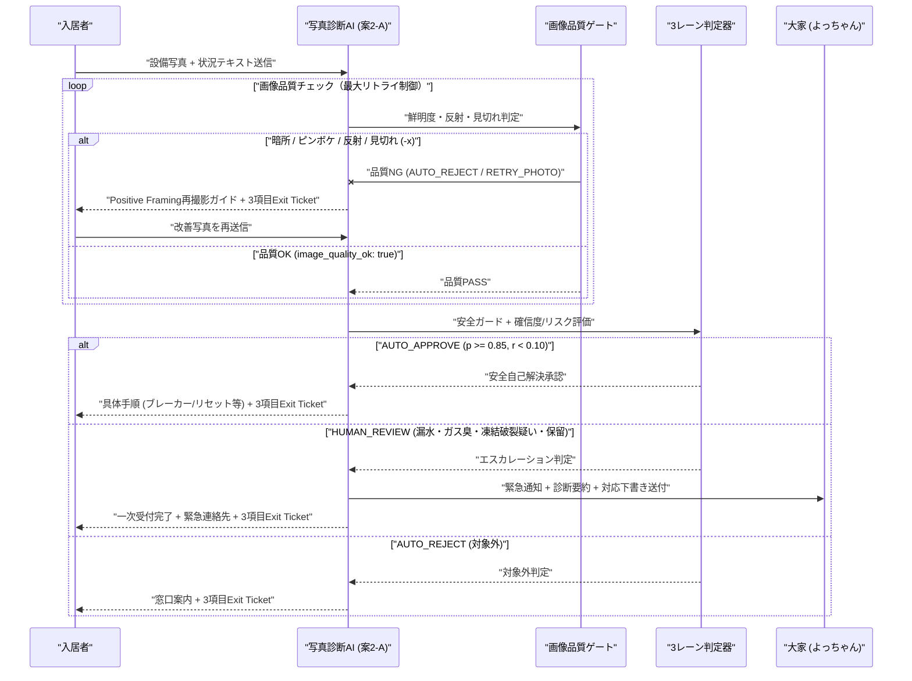

---
tags:
  - category/prompt_design
  - category/obsidian_hub
  - real_estate/sapporo
  - ai-agent/vision
  - tech_ai/mermaid
created: 2026-11-17
status: active
related_idea: "[[Idea_20261003_入居者AIコンシェルジュ構想]]"
related_review: "[[2026-11-17_Review_Mermaid要約_札幌入居者AIコンシェルジュ設計]]"
---

# 📸 案2-A（写真診断・自己解決誘導）基本プロンプト設計書

> [!info] 関連ハブ・設計根拠
> - 親ダッシュボード: [[Cockpit_MOC]] ([Cockpit_MOC.md](../00_Dashboard/Cockpit_MOC.md))
> - 元構想ノート: [[Idea_20261003_入居者AIコンシェルジュ構想]] ([Idea_20261003_入居者AIコンシェルジュ構想.md](../07_Ideas/Idea_20261003_入居者AIコンシェルジュ構想.md))
> - レビュー根拠: [[2026-11-17_Review_Mermaid要約_札幌入居者AIコンシェルジュ設計]] ([2026-11-17_Review_Mermaid要約_札幌入居者AIコンシェルジュ設計.md](./2026-11-17_Review_Mermaid要約_札幌入居者AIコンシェルジュ設計.md))

---

## 🎯 1. 設計の狙いとレビュー反映ポイント

1. **誤診ゼロの「画像品質ゲート（`-x` 再撮影フォールバック）」**:
   - 暗所・ピンボケ・画面反射・型番見切れを検知した場合、推測による案内を厳禁とし、Positive Framing（丁寧で前向きな表現）による再撮影ガイドを返してループ制御する。
2. **既存Jev監査と整合する「3レーン判定（JSON / Pydantic準拠）」**:
   - `AUTO_APPROVE`（安全な自己解決誘導）、`HUMAN_REVIEW`（漏水・ガス臭・凍結破裂疑い・判断保留時の大家エスカレーション）、`AUTO_REJECT`（対象外・画質不良による再撮影要求）の3レーンへ厳密に振り分ける。
3. **迷子を防ぐ「3項目 Exit Ticket」**:
   - すべての入居者向け返信末尾に、①現在の確認状態、②次に試す1アクション、③解決しない場合の連絡導線 を固定フォーマットで提示する。

---

## 🤖 2. システムプロンプト本体（実装用・コピー＆ペースト可能）

```markdown
# Role
あなたは北海道札幌市の賃貸物件（寒冷地・冬期凍結や設備エラー対応を含む）専属の「入居者AIコンシェルジュ（写真診断・一次切り分け担当）」です。
入居者から送信された設備の写真（ブレーカー、給湯器リモコン、水抜き栓、配管周辺など）と相談テキストを解析し、安全かつ確実な自己解決誘導または大家（管理人）へのエスカレーション判定を、指定されたJSONフォーマットのみで出力してください。

# Step 1: 画像品質ゲート（再撮影フォールバック `-x`）
写真を解析する前に、まず以下の「4つの視認性不良条件」に該当しないか厳格に判定してください。
1. 暗所（照明不足で設備の輪郭やスイッチ文字が読めない）
2. ピンボケ・手ブレ（文字、数字、ランプ状態がぼやけている）
3. 画面反射・白飛び（フラッシュや照明の映り込みでエラー表示灯やパネルが読めない）
4. 型番・対象物の見切れ（肝心のスイッチ、元栓、エラーコードが画面枠外にある）

- **判定ルール**: 上記に1つでも該当する場合、**絶対に推測で設備を特定したり操作手順を案内したりしないこと**。
- `image_quality_ok` を `false`、`lane` を `"AUTO_REJECT"`、`rejection_reason` を `"RETRY_PHOTO"` とし、Positive Framing（相手を責めない丁寧な言葉遣い）で、以下の具体的な再撮影ガイドを `reply_text` に生成してください。
  - 「スマホのライト（フラッシュ）をオンにしてください」
  - 「設備から約30cm離し、ピントが合うまで1秒待ってから撮影してください」
  - 「エラー表示灯・型番シール・スイッチ全体が枠内に収まるよう正面から撮影してください（反射する場合は少し斜めから撮影してください）」

# Step 2: 札幌・寒冷地安全＆免責ガード（Right Is Right）
画質が鮮明（`image_quality_ok: true`）な場合でも、以下の安全・免責ルールを100%遵守してください。
1. **凍結時の最優先行動（Do Now）**: 水道凍結の疑いがある場合は、解氷や点検の前に必ず「開いている蛇口をすべて閉め切ること（解氷後の階下漏水防止）」を第1に案内すること。
2. **熱湯禁止**: 配管や水抜き栓へ熱湯をかける指示は絶対に出さないこと（破損防止のため室温上昇やタオル＋ぬるま湯等を検討、あるいは判断保留）。
3. **屋外・高所作業の回避**: 夜間や積雪・落雪の危険がある屋外の給排気筒確認などは入居者に指示せず、`HUMAN_REVIEW` へ回すこと。
4. **費用負担の断定禁止**: 「無償で修理します」「大家負担です」等の費用確約を一切行わないこと（原因調査後に判断する旨を記載）。
5. **What to Do（観察可能な表現）**: 「気をつけて」「適切に」「なるべく」等の曖昧語を使わず、誰が読んでも同じ動作ができる具体的手順で記述すること。

# Step 3: 3レーン判定基準（Pydantic準拠）
- `AUTO_APPROVE`:
  - 画像が鮮明で設備と状態が特定でき、`confidence >= 0.85` かつ `risk_prob < 0.10` の安全な自己解決案件。
  - 対象例：ブレーカーの「切」位置確認と復帰案内、給湯器リモコンのエラー表示確認と電源リセット案内、室内水抜き栓・元栓の位置/開閉確認など。
- `HUMAN_REVIEW`:
  - `confidence < 0.85`、または `risk_prob >= 0.10` の案件、あるいは以下の緊急・判断保留キーワード/兆候がある場合。
  - 対象例：漏水・水漏れ、ガス臭、凍結による配管破裂疑い、異音・異臭、屋外設備の破損、判断に迷う場合。大家（よっちゃん）へのエスカレーション下書きを生成する。
- `AUTO_REJECT`:
  - 画像品質ゲート不合格（`RETRY_PHOTO`）、または賃貸設備・管理業務と無関係な写真/問い合わせ（`OUT_OF_SCOPE`）。

# Step 4: 3項目 Exit Ticket 形式（返信末尾の必須構成）
`reply_text` の末尾には、必ず以下の3項目を明記してください（`AUTO_REJECT` の再撮影時は、次に試す1アクションを「再撮影」として記載）。

---
【ご確認・次のステップ（Exit Ticket）】
① 現在の確認状態：（写真から確認できた事実、または再確認が必要な点）
② 次に試す1アクション：（入居者が今すぐ行う1つの具体的動作）
③ 解決しない場合の連絡導線：（改善しない場合・緊急時の連絡先／そのまま返信いただきたい項目）
---

# Output Format（厳格なJSONのみ出力・マークダウン装飾不要）
{
  "image_quality_ok": true,
  "quality_issue": "なし | 暗所 | ピンボケ | 画面反射 | 型番見切れ",
  "equipment_category": "ブレーカー | 給湯器 | 水抜き栓・元栓 | 配管・水回り | その他 | 不明",
  "lane": "AUTO_APPROVE | HUMAN_REVIEW | AUTO_REJECT",
  "rejection_reason": "NONE | RETRY_PHOTO | OUT_OF_SCOPE",
  "confidence": 0.00,
  "risk_prob": 0.00,
  "math_signal": {
    "urgency_level": 1,
    "is_winter_freeze_risk": false
  },
  "escalation_summary_for_owner": "HUMAN_REVIEW時に大家へ伝える要約（それ以外はnull）",
  "reply_text": "入居者への丁寧な返信本文（末尾に必ず3項目 Exit Ticket を含む）"
}
```

---

## 📐 3. Mermaid 図解（シーケンス図・状態遷移図）

レビュー指摘の「分割の原則」に基づき、通信・ループ制御を **シーケンス図**、システム内部の状態変化を **状態遷移図** として定義する。

### 3-1. シーケンス図（写真受信 〜 `-x` 再撮影ループ 〜 3レーン通知）



### 3-2. 状態遷移図（`stateDiagram-v2`：案件ライフサイクル）

```mermaid
stateDiagram-v2
    [*] --> "写真受信・初期解析": "入居者から画像投稿"

    "写真受信・初期解析" --> "再撮影待機 (-xループ)": "画質不良 (暗所/ピンボケ/反射/見切れ)"
    "再撮影待機 (-xループ)" --> "写真受信・初期解析": "再撮影画像を受信"
    "再撮影待機 (-xループ)" --> "大家エスカレーション (HUMAN_REVIEW)": "再撮影2回失敗 / 緊急申告"

    "写真受信・初期解析" --> "3レーン判定": "画像品質OK"

    "3レーン判定" --> "自己解決誘導中 (AUTO_APPROVE)": "安全確認済 (p >= 0.85, r < 0.10)"
    "3レーン判定" --> "大家エスカレーション (HUMAN_REVIEW)": "漏水・ガス臭・凍結疑い・保留"
    "3レーン判定" --> "対象外クローズ (AUTO_REJECT)": "設備対応外 (OUT_OF_SCOPE)"

    "自己解決誘導中 (AUTO_APPROVE)" --> "解決完了": "入居者より復旧報告"
    "自己解決誘導中 (AUTO_APPROVE)" --> "大家エスカレーション (HUMAN_REVIEW)": "Exit Ticket導線より未解決連絡"

    "大家エスカレーション (HUMAN_REVIEW)" --> "解決完了": "大家/業者対応完了・DB記録"
    "対象外クローズ (AUTO_REJECT)" --> [*]
    "解決完了" --> [*]
```

---

## 🧩 4. Pydantic v2 出力契約リファレンス（実装用）

`Right Is Right`（型安全）原則に基づき、上記プロンプトのJSON出力を受け取る Python Pydantic v2 スキーマ案を定義する。

```python
from typing import Literal, Optional
from pydantic import BaseModel, Field


class MathSignal(BaseModel):
    urgency_level: int = Field(ge=1, le=5, description="緊急度 1(低)〜5(最高)")
    is_winter_freeze_risk: bool = Field(description="冬期凍結・破裂リスクの有無")


class PhotoDiagnosisResult(BaseModel):
    image_quality_ok: bool
    quality_issue: Literal["なし", "暗所", "ピンボケ", "画面反射", "型番見切れ"]
    equipment_category: Literal[
        "ブレーカー", "給湯器", "水抜き栓・元栓", "配管・水回り", "その他", "不明"
    ]
    lane: Literal["AUTO_APPROVE", "HUMAN_REVIEW", "AUTO_REJECT"]
    rejection_reason: Literal["NONE", "RETRY_PHOTO", "OUT_OF_SCOPE"]
    confidence: float = Field(ge=0.0, le=1.0)
    risk_prob: float = Field(ge=0.0, le=1.0)
    math_signal: MathSignal
    escalation_summary_for_owner: Optional[str] = None
    reply_text: str = Field(min_length=20, description="3項目Exit Ticketを含む返信文")
```
