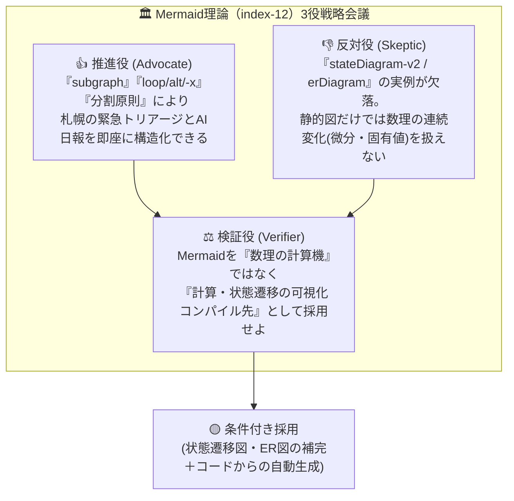
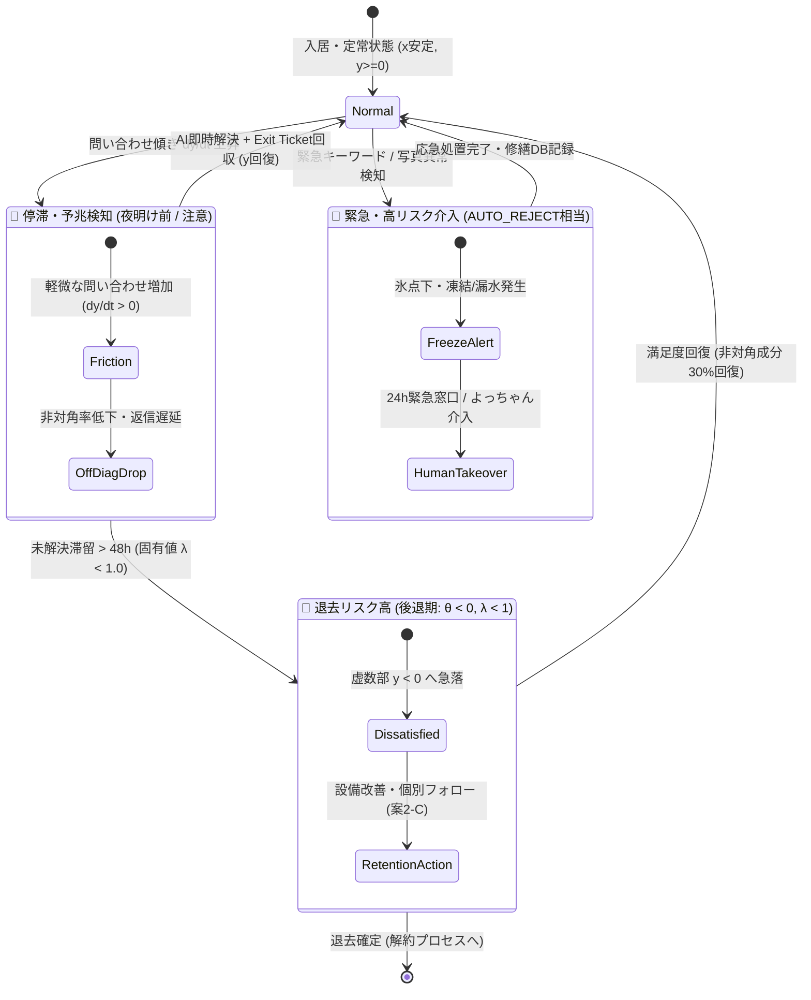

---
tags:
  - category/expert_review
  - category/obsidian_hub
  - tech_ai/mermaid
  - real_estate/sapporo
  - math_science/complex_analysis
created: 2026-11-17
status: active
theoretical_basis: "index-12: Mermaid 図解・構文マスター要約ノート（Diagrams as Code）× index-13: 数理の目と愛"
target_system: "2026-11-16_Mermaid_要約.md & 札幌・入居者AIコンシェルジュ運用設計"
---

# ⚖️ 戦略レビュー＆実行提案書：【Mermaid要約 × 札幌・入居者AIコンシェルジュ運用設計＆数理モデリング】

> [!info] レビュー基準・関連ハブ（MOC連携）
> - 親ダッシュボード: [[Cockpit_MOC]] ([Cockpit_MOC.md](../00_Dashboard/Cockpit_MOC.md))
> - 理論的根拠（判断基準ソース）: [2026-11-16_Mermaid_要約.md](../03_Resources/2026-11-16_Mermaid_要約.md)（NotebookLM `index-12`「mermaid」）
> - 関連システム・数理モデル:
>   - 構想ノート: [Idea_20261003_入居者AIコンシェルジュ構想.md](../07_Ideas/Idea_20261003_入居者AIコンシェルジュ構想.md)
>   - 数理基盤（`index-13`）: [2026-11-16_数理の目と愛_ビジネスと人生の最適化設計図_要約.md](../03_Resources/2026-11-16_数理の目と愛_ビジネスと人生の最適化設計図_要約.md)
>   - 既存診断・監査レポート: [2026-11-16_実務アクション診断レポート.md](./2026-11-16_実務アクション診断レポート.md) / [2026-11-16_Review_冬期水道凍結トリアージ案内フロー.md](./2026-11-16_Review_冬期水道凍結トリアージ案内フロー.md)

---

## 🎯 1. 結論（推奨施策と最優先アクション）

> [!abstract] 総合判定と最優先の一手（結論ファースト）
> - **総合判定**：**🟡 条件付き採用（`flowchart` / `sequenceDiagram` 偏重を補い、`stateDiagram-v2` と Python/Pydantic からの自動生成ルールを追加することを条件に採用）**
> - **明日1つだけ実行する最優先アクション（Priority #1）**：
>   - [2026-11-16_Mermaid_要約.md](../03_Resources/2026-11-16_Mermaid_要約.md) で手薄な **`stateDiagram-v2`（状態遷移図）** を使い、札幌・入居者AIコンシェルジュの **「①受付 → ②Jev3層監査（3レーン） → ③複素平面フェーズ判定（$z=x+iy$） → ④人間介入/完了」の状態遷移図を1枚作成し、`案2-A（写真診断）` プロンプト設計の仕様正本（SSOT）として固定する。**

---

## 📏 2. 抽出した「5つの判断基準」と現状厳格診断（Step 1 & Step 2）

[2026-11-16_Mermaid_要約.md](../03_Resources/2026-11-16_Mermaid_要約.md)（`index-12`）の3大要点およびハイブリッド診断から「5つの判断基準」を抽出し、札幌の賃貸管理システム（入居者AIコンシェルジュ）の運用設計・数理モデリングへの適用度を厳格に診断した。

| # | Mermaid理論（`index-12`）から抽出した判断基準 | 現状適合度 | 事実（Fact）・解釈/仮説（Hypothesis）・要確認事項（To Verify） |
| :---: | :--- | :---: | :--- |
| **1** | **基準①：単一の真実（SSOT）と空間構造化（`flowchart` + `subgraph`）**<br>テキストを正本として入力・判定・出力の責務境界と分岐が曖昧さなく定義されているか | ⚠️ **一部不備** | **[Fact]** `Mermaid_要約.md` には `subgraph`（入力・判定レイヤー）を用いた `flowchart LR` が1例あるが、`Idea_20261003_入居者AIコンシェルジュ構想.md` にはシステム全体の Mermaid フロー図が未実装。<br>**[Hypothesis]** 札幌特有の「冬期凍結・除雪・騒音・一般修繕」のマルチ系統ルーティングが図示されていないため、構想（`Idea`）と実装（`mail_triage_bot.py`）の境界が頭の中に留まり、手戻りリスクがある。<br>**[To Verify]** 現行のメールトリアージ3系統と `案2-A（写真診断）` を統合したときの分岐条件数。 |
| **2** | **基準②：時系列相互作用と制御構造（`sequenceDiagram`: `loop` / `alt` / `-x`）**<br>入居者・AI・Jev・管理人間の同期・非同期エラー切断・リトライが網羅されているか | ⚠️ **一部不備** | **[Fact]** `Mermaid_要約.md` 内の `sequenceDiagram`（L88-108）は正常系・タイムアウト分岐を示しているが、L110-132 に言語指定なしの重複コードブロックが残存している。<br>**[Hypothesis]** `loop`（Jev自己修復ループ）と `-x`（タイムアウト・緊急切断）の構文自体は、札幌の凍結トラブル時の「AI応答失敗→24時間緊急窓口へ即時フェイルオーバー」の設計にそのまま転用可能。<br>**[To Verify]** Jev自己修復ループの最大リトライ回数（現状の打ち切り閾値）と緊急連絡先への切替秒数。 |
| **3** | **基準③：視覚的メリハリと「分割の原則」（`style` / 粒度の分割）**<br>重要ノード（ボトルネック・承認ゲート）が強調され、1図に詰め込みすぎていないか | ✅ **適合（設計思想）** | **[Fact]** 要点3で「1つの図に詰め込みすぎず、可読性を保つために適切な粒度へ分割して作成する」「`style` で重要ノードを色分け強調する」と明記されている。<br>**[Hypothesis]** 運用設計（トリアージ全体図）、時系列通信（シーケンス図）、数理状態（状態遷移図）を1枚に混ぜず、**役割ごとに3枚へ分割する方針**は実務上の可読性を大きく高める。<br>**[To Verify]** `export_daily_antigravity_log.py`（HTML日報）で複数図を並べた際のブラウザ表示崩れの有無。 |
| **4** | **基準④：状態遷移・数理構造への展開力（`stateDiagram-v2` / `erDiagram` × 数理モデル）**<br>案件の状態遷移や数理パラメータ（$z=x+iy$, 固有値 $\lambda$, 確率）を表現できるか | ❌ **要改善** | **[Fact]** `Mermaid_要約.md` のクイックリファレンス表には `stateDiagram-v2` と `erDiagram` の宣言名が記載されているが、**本文中に実践コード例が1つも存在しない**。<br>**[Hypothesis]** 入居者AIコンシェルジュの「退去抑止スコアリング（案2-C）」や「複素平面フェーズ遷移（停滞期→成長期→後退期）」、さらに DuckDB/SQLite のデータ構造を数理モデリングするには、`stateDiagram-v2` と `erDiagram` の標準テンプレートが不可欠である。<br>**[To Verify]** 数理モデルの連続値（傾き $dy/dt$、固有値 $\lambda$）をどの閾値で離散状態（状態遷移図のノード）にマッピングするか。 |
| **5** | **基準⑤：AIコンパイル適合性と多チャネル移植性（Diagrams as Code）**<br>LLMが直接生成・修正しやすく、Obsidian・HTML日報・アプリへ劣化なく移植できるか | ✅ **適合** | **[Fact]** Markdownテキストベースのため Git管理・Obsidian・HTML日報（ズーム機能付き）でそのまま描画可能と確認されている。<br>**[Hypothesis]** Python/Pydantic（`design_action_engine.py` や `jev_hybrid_auditor.py`）の実行結果から Mermaid コードを自動生成する「コンパイル型運用」へ移行すれば、図とコードの乖離（陳腐化）をゼロにできる。<br>**[To Verify]** `Ornith-9b` や `gemma4` 等のローカルLLMが構文エラーなしで Mermaid を出力できる成功率。 |

### 🔍 Step 2 診断サマリー
- **良い点（強み）**：`Diagrams as Code` の思想（テキスト＝SSOT）、`subgraph` による責務境界、`loop`/`alt`/`-x` による例外制御、および「分割の原則」という運用設計上の極めて健全な骨格がすでに言語化されている。
- **弱い点・穴（最大のボトルネック）**：
  1. 要約ノートが **`flowchart` と `sequenceDiagram` のみに偏っており、運用・数理モデリングの要である `stateDiagram-v2` と `erDiagram` の実装例が欠落**している。
  2. `Mermaid_要約.md` 内に重複コードブロック（L110-132）が残っており、ドキュメント品質管理（SSOT）が徹底されていない。
- **見落としている前提（危うい仮定）**：
  - **「人間やAIが手書きで Mermaid 図を作れば、それがシステムの設計図（SSOT）になる」** という前提。実際には、Pythonコードや Pydantic スキーマを変更した後に手書きの Mermaid 図を更新し忘れると、図は即座に「嘘の設計書」へ劣化する。数理モデルや運用フローは **「コード（実態）から Mermaid を生成（コンパイル）する」** 逆方向のアプローチが必要である。

---

## 🗣️ 3. 1冊（1ノート）の中で「3役戦略会議」を実行（Tri-Role Debate：Step 3）

[2026-11-16_Mermaid_要約.md](../03_Resources/2026-11-16_Mermaid_要約.md) の理論のみを根拠として、札幌・入居者AIコンシェルジュの運用設計と数理モデリングへの適用是非について3役の徹底討論を実施した。



### 👍 推進役（Advocate）の主張：運用設計の標準言語として即採用すべき
- **根拠**：要点1（`subgraph`・分岐 `{}`・DB `[()]`）、要点2（`loop`・`alt`・`-x`）、要点3（`style`・分割原則・HTML日報連携）。
- **主張**：「札幌の賃貸管理は『冬期凍結』『除雪・ロードヒーティング』『騒音苦情』など分岐が複雑だが、`flowchart` の `subgraph` でレイヤー（入力・Jev監査・人間エスカレーション）を分け、`style` で危険ノード（`AUTO_REJECT` / 緊急出動）を赤色強調すれば、全体像が一目で把握できる。さらに `sequenceDiagram` の `loop` と `-x` を使えば、AIが自己修復ループで応答を作れなかった際に即座に管理人（よっちゃん）へ電話・通知を切る異常系まで厳密に設計できる。」

### 👎 反対役（Skeptic）の反論：現状のままでは数理モデリングと実務に耐えない
- **根拠**：要点3の「他図表への展開（`stateDiagram-v2`, `erDiagram`）と分割の原則」、およびハイブリッド診断の「欠（Deficit）」。
- **主張**：「推進役は楽観的すぎる。第一に、対象ノート自身が『分割の原則』や『他図表』を説きながら、`stateDiagram-v2` と `erDiagram` のコード例がゼロであり、さらに同じ `sequenceDiagram` がL88とL110で重複している。第二に、数理モデリング（複素平面 $z=x+iy$ の回転、初動傾き $dy/dt$、固有値 $\lambda$、待機行列や退去確率）は**連続量・確率量の計算**であり、Mermaidの静的な矢印では数式そのものを検証できない。図を描くことに満足して肝心の閾値設定やデータ連携（Pydantic/DuckDB）が後回しになるリスクがある。」

### ⚖️ 検証役（Verifier）の裁定と事前検証事項（To Verify）
- **双方の根拠比較**：
  - 「複雑な運用分岐と異常系通信を構造化し、人間が直観把握する」点では推進役の根拠が圧倒的に強い。
  - 一方、「数理モデリングの連続計算と状態遷移・DB構造の厳密定義」においては、反対役が指摘する `stateDiagram-v2` / `erDiagram` の不足と「図は計算機ではない」という限界論が理論的に正しい。
- **裁定**：Mermaidを「思考と構造の可視化ビュー（コンパイル出力）」、Python/Pydantic/DuckDBを「計算と検証のエンジン」と明確に役割分離して採用する。
- **意思決定前に確認すべきデータ（To Verify）**：
  1. `Idea_20261003_入居者AIコンシェルジュ構想.md` の `案2-A（写真診断・自己解決誘導）` において、画像認識失敗時（暗所・ピンボケ）の `-x`（エラー分岐）遷移条件をどう数値化するか。
  2. 複素平面モデル（$z=x+iy$）の偏角 $\theta$ や固有値 $\lambda$ を、どの閾値で `stateDiagram-v2` の状態（例：`正常稼働` / `要注意(非対角低下)` / `緊急介入`）へ離散化するか。

---

## 📊 4. 3方向の根拠整理（理論 × 自社データ × 最新市場動向：Step 4 & Step 5）

### ① 【理論（`2026-11-16_Mermaid_要約.md`）】
- **Diagrams as Code**：テキストを単一の真実（SSOT）とし、`flowchart`（空間）・`sequenceDiagram`（時間）・`stateDiagram-v2`（状態）・`erDiagram`（データ）を**分割原則**に従って使い分けることで、AIと人間が共通の設計図を共有できる。

### ② 【自社データの事実（Fact）】（`Obsidian_2` 内の既存ノート・レポート照合）
- **構想段階のギャップ（`Idea_20261003_入居者AIコンシェルジュ構想.md`）**：
  - 目的は「24時間即時応答と一次対応・電話取次ぎ工数8割削減」。タスク「FAQテキスト化」「Cockpit_MOCリンク」は完了済だが、**「案2-A（写真診断・自己解決誘導）の基本プロンプト設計」が未着手**であり、システム構造図が存在しない。
- **既存実装の進捗と課題（`2026-11-16_実務アクション診断レポート.md` / `2026-11-16_Review_冬期水道凍結トリアージ案内フロー.md`）**：
  - 数理診断結果では「北海道・冬期水道凍結予防＆トリアージ体制」が $z = 1.2 + 4.8i$（偏角 $\theta = 76.0^\circ$、固有値 $\lambda = 1.45$、非対角率 `30%`）で **「🌅 停滞期（夜明け前）＝攻めの投資フェーズ」** と判定されている。
  - 一方、指示文スコアは `25点`（曖昧表現3件検知）であり、冬期凍結フローレビューでも「蛇口閉鎖の `Do Now` 欠落」と「`Exit Ticket`（返信枠）不足」が課題として記録されている。

### ③ 【最新市場・競合3事例との比較】（Step 5 Web調査結果：2025〜2026年トレンド）

| 比較項目 | 事例1：旭化成不動産レジデンス<br>「My Concier」AIチャット | 事例2：GMO賃貸DX<br>「AIチャット自動返信」 | 事例3：IVRy（アイブリー）<br>「電話音声AI × SMS誘導」 | 自社システム（札幌・入居者AIコンシェルジュ構想） |
| :--- | :--- | :--- | :--- | :--- |
| **コア機能・強み** | 2025年11月導入。意図合致まで会話を継続し、解決困難時はフォームへ誘導 | 管理会社FAQベースのRAG回答により入居者の自己解決を促進 | 電話一次対応を音声AIが受け、用件テキスト化＋SMSでチャットへ誘導 | **ローカルLLM＋Jev 3層監査（二値/段階/確率）＋複素数理モデリング** |
| **エスカレーション設計** | 会話継続→フォーム誘導（定型分岐） | 有人チャットへの引き継ぎ | 音声ヒアリング→管理会社通知 | **3レーン判定**（`AUTO_APPROVE` / `HUMAN_REVIEW` / `AUTO_REJECT`） |
| **札幌特化・地域性** | 全国汎用（マンション・アパート標準） | 全国汎用（SaaSテンプレート） | 全国汎用（音声ヒアリング） | **極寒地特化**（冬期凍結・熱湯制止・CO中毒・ロードヒーティング・除雪） |
| **数理・可視化ループ** | 問い合わせ件数等の管理画面集計 | アプリ内の管理ダッシュボード | 通話ログ・受電件数集計 | **Diagrams as Code（Mermaid）＋複素平面($z=x+iy$)・固有値($\lambda$)による予兆検知** |

- **自社になく競合にある要素**：入居者が迷わず使えるフロント窓口（アプリUIや電話音声AIからのSMS誘導導線）。
- **競合になく自社にある強み**：**「誤回答や危険指示を絶対に外に出さない Jev 3層監査ゲート」** と **「顧客の不満予兆を虚数軸 $iy$・非対角成分・固有値 $\lambda$ で数理的に捉え、Mermaid図として日報・コックピットへ自己可視化するループ構造」**。

---

## 💡 5. 批評に基づく構造化モデル（札幌・入居者AIコンシェルジュ「分割Mermaid設計パック」）

`2026-11-16_Mermaid_要約.md` の「分割の原則」と不足していた `stateDiagram-v2` を補完し、運用設計と数理モデリングを統合した **2枚の構造図** を以下に定義する。

### 図1：運用設計フロー（空間構造：`flowchart LR` × 3レーンJev監査）
```mermaid
%%{init: {'theme': 'default'}}%%
flowchart LR
    subgraph Input["1. 入居者窓口（札幌・マルチチャネル）"]
        M(["メール / フォーム"])
        P(["写真投稿: 案2-A"])
        DB[("物件・雪対策DB\n(SQLite / DuckDB)")]
    end

    subgraph Triage["2. AI一次解析 & 専門トリアージ"]
        Router{"案件分類"}
        W["❄️ 冬期凍結・給湯器\n(Do Now: 蛇口閉鎖優先)"]
        N["🔊 騒音・マナー\n(中立・記録依頼)"]
        G["🔧 一般設備・ゴミ・契約\n(FAQ / RAG回答)"]
    end

    subgraph JevGate["3. Jev 3層ハイブリッド監査"]
        Gate1{"Layer1: 二値Fast-Fail\n(熱湯禁止・免責・個人情報)"}
        Gate2["Layer2&3: 5段階 & 確率\n(解決確信度 p / リスク r)"]
    end

    subgraph Action["4. 3レーン出力"]
        Approve(["🟢 AUTO_APPROVE\n自動返信・Exit Ticket付"])
        Review(["🟡 HUMAN_REVIEW\nよっちゃん確認下書き"])
        Reject(["🛑 AUTO_REJECT\n緊急電話/差戻し再生成"])
    end

    M & P & DB --> Router
    Router -- "凍結/雪" --> W
    Router -- "騒音" --> N
    Router -- "一般" --> G
    W & N & G --> Gate1
    Gate1 -- "FAIL" -.-> Reject
    Gate1 -- "PASS" --> Gate2
    Gate2 -- "p >= 0.85 & r < 0.1" ==> Approve
    Gate2 -- "要確認" --> Review
    Gate2 -- "高リスク" -.-> Reject

    style Approve fill:#d4edda,stroke:#28a745,stroke-width:2px
    style Review fill:#fff3cd,stroke:#ffc107,stroke-width:2px
    style Reject fill:#f8d7da,stroke:#dc3545,stroke-width:2px
```

### 図2：数理モデリング状態遷移図（`stateDiagram-v2` × 複素平面フェーズ & 退去抑止）


---

## 🛡️ 6. 想定される反対意見と回答（Q&A）

1. **Q.** 個人大家の規模で、ここまで厳密な Mermaid 図や数理モデリング（複素平面・状態遷移）を作るのは過剰設計ではないか？
   - **A.** 過剰ではない。札幌の冬期凍結（一晩で配管破裂・階下漏水数十万円〜）は「1回の誤誘導」が致命的損失になるため、`flowchart` による責務分離と `Jev 3層ゲート` が不可欠である。また、数理モデリング（`dy/dt` や `y<0` の検知）は「不満が爆発して退去（実数 $x$ の減少）に至る前の予兆（虚数 $y$）」を低コストで捉えるための最小限の計器である。
2. **Q.** `2026-11-16_Mermaid_要約.md` にあるような手書きの Mermaid 図は、システム改修のたびにメンテナンスできるのか？
   - **A.** 手書きメンテナンスは破綻する（これが今回見抜いた「危うい前提」）。したがって、Pydantic モデルや `design_action_engine.py` の診断結果から **Python で Mermaid 文字列を自動生成し、日報 HTML やレポートに埋め込む方式** を取ることでメンテナンスコストをゼロにする。
3. **Q.** `案2-A（写真診断）` で入居者が暗い場所やピンボケ写真を送ってきた場合、AIが誤診断するリスクは？
   - **A.** `sequenceDiagram` の `-x`（異常切断）と `Jev Layer1` の考え方を適用し、画像の解像度・照度・対象物（水抜き栓/ブレーカー）の確信度が閾値未満の場合は、**絶対に推測で操作指示を出さず「明るい場所での再撮影ガイド（What to Do）」または `HUMAN_REVIEW` へ即フォールバック**させる設計にする。

---

## ✅ 7. 即実行トラッカー（今週やる最大3ステップ）
- [ ] **【明日やる1つ（最優先）】**：本レポートの「図1（運用設計フロー）」と「図2（数理状態遷移）」をベースに、`Idea_20261003_入居者AIコンシェルジュ構想.md` の未完了タスク **`案2-A（写真診断・自己解決誘導）の基本プロンプト設計`**（暗所・ピンボケ時の `-x` 再撮影フォールバック含む）を作成する。
- [ ] **【検証タスク（To Verify）】**：`design_action_engine.py` または `jev_hybrid_auditor.py` に、判定結果から `stateDiagram-v2` の現在状態ノードをハイライト出力する小さな関数を追加し、図と実データの同期を検証する。
- [ ] **【ドキュメント保守】**：`2026-11-16_Mermaid_要約.md` の重複コードブロック（L110-132）の整理と、`stateDiagram-v2` / `erDiagram` テンプレートの追記要否を判断する。
