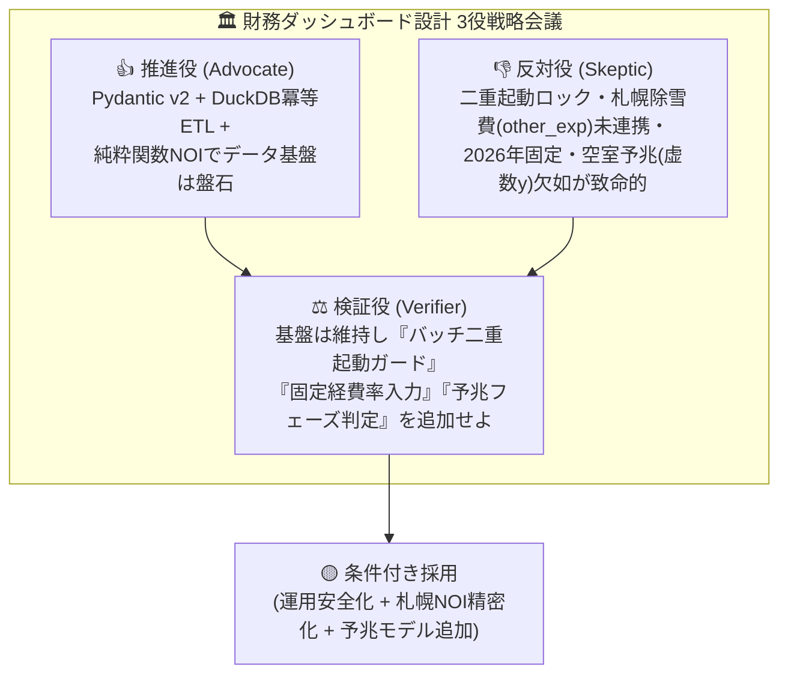
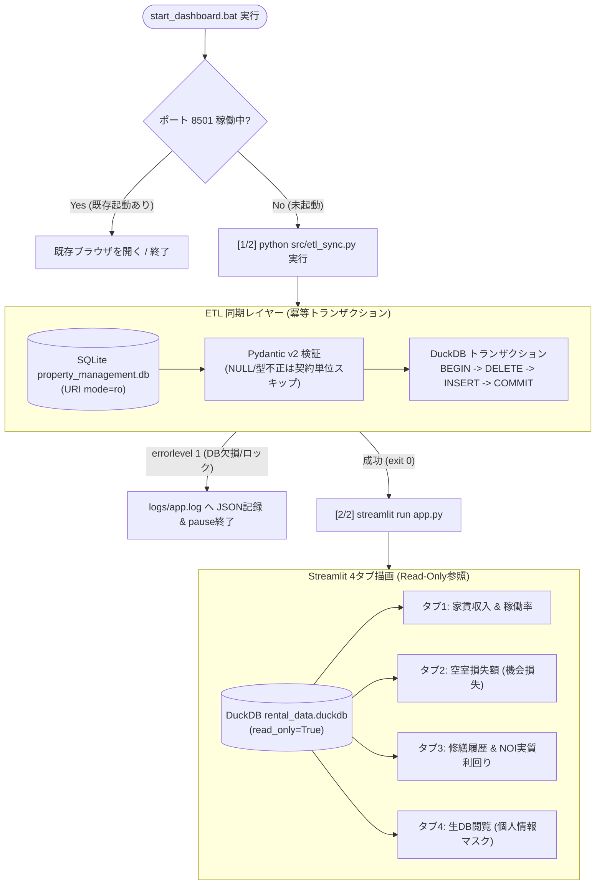

---
tags:
  - category/expert_review
  - category/obsidian_hub
  - real_estate/sapporo
  - tech_ai/duckdb_streamlit
  - math_science/complex_analysis
created: 2026-11-17
status: active
theoretical_basis: "GEMINI.md (@duckdb-streamlit-pipeline) × index-13 (数理の目と愛：複素平面・微分・固有値)"
target_system: "start_dashboard.bat, src/etl_sync.py, src/db.py, src/models_finance.py, src/repair_db.py, src/yield_calc.py, app.py"
---

# ⚖️ 戦略レビュー＆実行提案書：【start_dashboard.bat ＆ 財務・NOI利回りダッシュボード設計】

> [!info] レビュー基準・関連ハブ（MOC連携）
> - 親ダッシュボード: [[Cockpit_MOC]] ([Cockpit_MOC.md](../00_Dashboard/Cockpit_MOC.md))
> - 理論的根拠（判断基準ソース）:
>   - パイプライン設計規範: [GEMINI.md](../GEMINI.md)（`@duckdb-streamlit-pipeline`：Pydantic v2型安全・Read-Only保護・構造化ログ・自律検証）
>   - 数理モデリング基盤（`index-13`）: [2026-11-16_数理の目と愛_ビジネスと人生の最適化設計図_要約.md](../03_Resources/2026-11-16_数理の目と愛_ビジネスと人生の最適化設計図_要約.md)
> - 評価対象コード群:
>   - 起動バッチ: [start_dashboard.bat](../start_dashboard.bat)
>   - ETL・DB・型契約: [etl_sync.py](../src/etl_sync.py) / [db.py](../src/db.py) / [models_finance.py](../src/models_finance.py) / [repair_db.py](../src/repair_db.py)
>   - 数理計算・UI: [yield_calc.py](../src/yield_calc.py) / [app.py](../app.py)

---

## 🎯 1. 結論（推奨施策と最優先アクション）

> [!abstract] 総合判定と最優先の一手（結論ファースト）
> - **総合判定**：**🟡 条件付き採用（型安全と冪等ETLの骨格は極めて優秀だが、二重起動ガード・札幌実務経費の算入・空室予兆の虚数指標追加を条件に本番運用）**
> - **明日1つだけ実行する最優先アクション（Priority #1）**：
>   - [start_dashboard.bat](../start_dashboard.bat) の `[1/2]` ETL同期の前に **「ポート `8501` の占有チェック（`netstat -ano | findstr :8501`）と既存起動時のブラウザ案内・二重起動抑止」** を追加し、Streamlit稼働中の DuckDB ファイルロック競合（ETL失敗）を根絶する。

---

## 📏 2. 抽出した「5つの判断基準」と現状厳格診断（Step 1 & Step 2）

`@duckdb-streamlit-pipeline`（`GEMINI.md`）と『数理の目と愛』（`index-13`）から「5つの判断基準」を抽出し、札幌賃貸経営の実務運用と数理モデリングの両面から現行コードを厳格に診断した。

| # | 抽出された判断基準（物差し） | 現状適合度 | 事実（Fact）・解釈/仮説（Hypothesis）・要確認事項（To Verify） |
| :---: | :--- | :---: | :--- |
| **1** | **基準①：元データ保護と型安全（`Right Is Right`）**<br>SQLite `mode=ro`・DuckDB `read_only=True` と Pydantic v2 で境界が守られているか | ✅ **適合** | **[Fact]** `etl_sync.py` は `file:...?mode=ro` で SQLite を開き、`RentalRecordInput` で全件検証。`db.py` と `repair_db.py` の参照系は `read_only=True` で接続し、`logs/app.log` へ JSON 1行ログを記録している。<br>**[Hypothesis]** 元データ破壊リスクは極めて低く、型契約（`models_finance.py`）が SSOT として機能している。<br>**[To Verify]** `app.py:430` でタブ描画ごとに `initialize_sample_repairs(DEFAULT_DB_PATH)`（書込接続）を呼ぶ設計が、将来の実データ運用時にロックや不要IOを生まないか。 |
| **2** | **基準②：実務運用耐性①（二重起動・ポート競合・ETL失敗制御）**<br>Windowsバッチからの再実行時にDBロックやポート競合を起こさず安全に制御できるか | ❌ **要改善** | **[Fact]** `start_dashboard.bat` は無条件で `src\etl_sync.py`（DuckDB 書込）を実行し、成功後に `streamlit run app.py` を起動するのみで、ポート `8501` の稼働確認や多重起動ロックがない。<br>**[Hypothesis]** ダッシュボードを起動したまま再度バッチを叩くと、①既存 Streamlit との DuckDB ロック競合で ETL が失敗（`errorlevel 1`）、または ②別ポート（8502）で二重起動する事故が起きる。<br>**[To Verify]** Windows 環境下で Streamlit 起動中に `etl_sync.py` を同時実行した際の DuckDB ロック挙動。 |
| **3** | **基準③：実務運用耐性②（欠損値耐性とハードコード排除）**<br>NULL・年跨ぎ・未登録物件に対してシステムが止まらず、実態に即した値で動くか | ⚠️ **一部不備** | **[Fact]** `etl_sync.py` は契約単位の `None` チェックと Pydantic 検証で不正行をスキップし同期を継続する一方、`db.py:356` の `fetch_monthly_rental_summary` は `rental_records` に1件でも NULL があると `DatabaseOperationError` で集計全体を停止する。また `etl_sync.py:34` は `2026-01〜12` 固定、`models_finance.py:16` は5物件価格がハードコード（未登録は `30,000,000` 円フォールバック）。<br>**[Hypothesis]** 2027年への年跨ぎ時に手動修正漏れが起きるリスクと、新規物件追加時に一律3,000万円で利回りが歪むリスクがある。<br>**[To Verify]** 2027年以降の対象月自動生成ルールと、物件取得価格の DB/CSV 外出し可否。 |
| **4** | **基準④：NOI計算の実務精密性（札幌賃貸特有の経費反映）**<br>修繕費だけでなく、札幌の固定費（除雪・ロードヒーティング・管理費・税金）が反映されているか | ⚠️ **一部不備** | **[Fact]** `yield_calc.py:58` は `noi = gross_revenue - total_repair_cost - other_exp` を計算できるが、`app.py:432` の呼び出しでは `other_expenses` 引数が渡されておらず `0円` として計算されている。<br>**[Hypothesis]** 札幌の賃貸経営で重い「冬期除雪費・ロードヒーティング光熱費・管理委託費・固定資産税」が `0円` のまま実質利回り（`net_yield_pct`）が出るため、実態より過大評価（錯覚）する恐れがある。<br>**[To Verify]** 物件別の固定運営経費率（例：家賃収入の15〜20%＋冬期除雪実費）の基準値。 |
| **5** | **基準⑤：数理モデリング（遅行指標 $x$ × 空室予兆の虚数指標 $iy$）**<br>過去実績だけでなく、傾き $\frac{dy}{dt}$・更新接近・非対角成分で空室・修繕予兆を検知できるか | ❌ **未実装** | **[Fact]** 現行の `app.py`・`db.py`・`yield_calc.py` はすべて過去の「家賃収入・空室損失・修繕費・NOI」（実数部 $x$）の集計・可視化に留まり、時間微分（修繕頻度の変化率）や更新月（`renewal_date`）接近に基づく予兆アラートがない。<br>**[Hypothesis]** 『数理の目と愛』の理論に照らすと、実数 $x$（空室発生）が顕在化する前に、虚数部 $iy$（修繕増加傾き $\frac{dy}{dt} > 0$・冬期凍結件数・更新3ヶ月前フラグ）を検知して「警戒フェーズ」へ遷移させる数理モデルが不可欠。<br>**[To Verify]** `property_management.db` 内の `renewal_date` と修繕履歴・AIコンシェルジュ問い合わせ件数の相関。 |

### 🔍 Step 2 診断サマリー
- **良い点（強み）**：`models_finance.py` を単一の型契約（SSOT）とし、SQLite `mode=ro` 抽出 → Pydantic v2 バリデーション → DuckDB トランザクション（`DELETE + INSERT`）→ 構造化 JSON ログという **データ工学的な堅牢性** は極めて高い。
- **弱い点・穴（最大のボトルネック）**：
  1. `start_dashboard.bat` の **二重起動・ポート競合・DuckDBロック対策の欠如**。
  2. `app.py` 側で `other_expenses`（札幌の除雪費・管理費・公租公課）が未連携のため、**NOI（実質利回り）が過大表示される**。
  3. 数理モデリングが **遅行指標（実数 $x$）のみ** であり、空室・修繕の予兆（虚数 $iy$・警戒フェーズ）を捉えられていない。
- **見落としている前提（危うい仮定）**：
  - 「よっちゃんは毎回ダッシュボードを閉じてから `start_dashboard.bat` を押し、かつ年度が変わらない（2026年固定）前提」および「修繕費だけを引けば実質利回り（NOI）として意思決定に使える」という前提。

---

## 🗣️ 3. 3役戦略会議の要点（推進・反対・検証：Step 3）

`@duckdb-streamlit-pipeline` と『数理の目と愛（`index-13`）』の理論を根拠に、3役による討論を実施した。



### 👍 推進役（Advocate）の主張：基盤アーキテクチャはそのまま活かすべき
- **根拠**：`GEMINI.md`（型安全・元データ保護・純粋関数分離）。
- **主張**：「`etl_sync.py` は SQLite を `mode=ro` で保護し、欠損行をスキップしつつ JSON ログを残す堅牢なパイプラインだ。`yield_calc.py` も状態を持たない純粋関数（`calculate_net_yield_summaries`）として切り出されており、`other_expenses` 引数もすでにインターフェースに用意されている。土台を作り直す必要はなく、入力を足すだけで即座に進化できる。」

### 👎 反対役（Skeptic）の反論：実務の現場と数理モデルでは「穴」が放置できない
- **根拠**：`GEMINI.md`（自律検証・実務耐性）＆『数理の目と愛』（実数 $x$ と虚数 $iy$・後退期検知）。
- **主張**：「推進役はコードの美しさしか見ていない。実務ではブラウザを開いたままバッチを再実行して DuckDB がロックされる事故が必ず起きる。さらに深刻なのは数理面だ。札幌の物件で除雪・ロードヒーティング・固定資産税を `0円` として算出した NOI は実務判断を誤らせる。また、『空室になってから（実数 $x$ の減少）』損失額を棒グラフで眺めても手遅れであり、更新3ヶ月前や修繕急増（傾き $\frac{dy}{dt}$）から『警戒フェーズ』を鳴らす虚数軸のモデルがない。」

### ⚖️ 検証役（Verifier）の裁定と要確認事項（To Verify）
- **双方の根拠比較**：
  - データ基盤としての設計品質（推進役）は事実として確認できるが、運用安全（二重起動）と数理実務（札幌固定費＋空室予兆）の欠損指摘（反対役）がより決定的な改善ポイントである。
- **事前検証事項（To Verify）**：
  1. `start_dashboard.bat` 起動時に `netstat -ano | findstr :8501` で既存プロセスを検知した場合、ETL をスキップしてブラウザを開くか、それとも確認プロンプトを出すか。
  2. 空室予兆スコア（虚数軸 $iy$）の入力として、どのデータ（①`renewal_date` までの残月数、②直近3ヶ月の修繕費増加率、③入居者AIコンシェルジュからの問い合わせ件数）を接続するか。

---

## 📐 4. 運用フロー図 ＆ 異常系含む状態遷移図（Mermaid 構造化）

### 4-1. 起動 〜 ETL 〜 Streamlit描画フロー図（`flowchart TD`）



### 4-2. 異常系（ポート競合・ETL失敗・警戒フェーズ）を含む状態遷移図（`stateDiagram-v2`）

```mermaid
stateDiagram-v2
    [*] --> "待機中 (未起動)": "初期状態"

    "待機中 (未起動)" --> "ポート競合検知 (既存稼働中)": "バッチ実行 & 8501使用中"
    "ポート競合検知 (既存稼働中)" --> "正常稼働中 (ダッシュボード表示)": "既存URLへ誘導・二重ETL回避"

    "待機中 (未起動)" --> "ETL同期実行中": "バッチ実行 & 8501空き"
    "ETL同期実行中" --> "ETL異常停止 (ROLLBACK)": "SQLite欠損 / DuckDBロック / 全件不正"
    "ETL異常停止 (ROLLBACK)" --> "待機中 (未起動)": "logs/app.log確認・修復"

    "ETL同期実行中" --> "正常稼働中 (ダッシュボード表示)": "同期成功 (部分スキップはWARNINGログ)"

    state "正常稼働中 (ダッシュボード表示)" {
        [*] --> "安定フェーズ (x安定, y>=0)"
        "安定フェーズ (x安定, y>=0)" --> "警戒フェーズ (空室・修繕予兆)": "更新接近 / 修繕増加率 dy/dt > 閾値 / NOI低下"
        "警戒フェーズ (空室・修繕予兆)" --> "空室損失発生フェーズ (実数x減少)": "退去確定 / 募集長期化"
        "警戒フェーズ (空室・修繕予兆)" --> "安定フェーズ (x安定, y>=0)": "更新合意 / 予防修繕完了"
        "空室損失発生フェーズ (実数x減少)" --> "安定フェーズ (x安定, y>=0)": "新規入居契約 & ETL再同期"
    }

    "正常稼働中 (ダッシュボード表示)" --> [*]: "Streamlit停止"
```

---

## 📊 5. 3方向の根拠整理（理論 × 自社データ × 最新市場動向：Step 4 & Step 5）

### ① 【理論根拠】
- **『`@duckdb-streamlit-pipeline`』**: 単一型契約・Read-Only分離・JSON構造化ログ・pytest/headless自動検証。
- **『数理の目と愛（`index-13`）』**: 遅行指標（実数 $x$: 確定した空室損失・NOI）だけでなく、変化率の傾き $\frac{dy}{dt}$ と予兆（虚数 $iy$）で「後退期（終わりの始まり）」を早期検知する。

### ② 【自社コード・実績の事実（Fact）】
- `etl_sync.py` は `DEFAULT_TARGET_MONTHS` が 2026年固定であり、`app.py` の `calculate_net_yield_summaries` は `other_expenses` 未指定（0円）で動作中。
- `db.py` は集計時 NULL 検知で即停止、`repair_db.py` は北海道・札幌の実情に即した修繕サンプル（水抜き栓、FF式給湯器、融雪マット等）を保持している。

### ③ 【最新市場・競合3事例との比較】（Step 5 Web調査結果）

| 比較項目 | 事例1：ビズアナオーナー<br>（CBIT） | 事例2：イエリーチ<br>（ネクサスエージェント） | 事例3：GMO賃貸DX<br>オーナーアプリ | 自社システム（`start_dashboard.bat` ＋ DuckDB/Streamlit） |
| :--- | :--- | :--- | :--- | :--- |
| **データ取込・同期** | 収支報告書PDFを送付・アップロードし自動データ化 | オーナー自身で物件情報・収支を登録連携 | 管理会社基幹システムから自動リアルタイム配信 | **ローカル SQLite (`mode=ro`) → Pydantic検証 → DuckDB 冪等ETL** |
| **NOI・利回り分析** | 複数管理会社の収支グラフ化・経営分析 | 中長期キャッシュフロー計算・市場価格査定 | 月別収支・稼働状況のリアルタイム閲覧 | **物件別 NOI・表面/実質利回り・空室機会損失の純粋関数算出** |
| **AI・予兆・運用連携** | 過去実績の可視化中心 | 売却・買い増しシミュレーション | 修繕見積もり承認チャット | **入居者AIコンシェルジュ（`案2-A` 等）のログ・数理予兆と直結可能** |

- **自社になく競合にある要素**：中長期の売却査定・複数年の自動キャッシュフロー予測（イエリーチ）、固定費・税金を含む自動収支レポート化（ビズアナオーナー）。
- **競合になく自社にある強み**：**「個人情報が外部に出ない完全ローカル完結」「Pydantic v2 による100%型保証」「入居者AIコンシェルジュ（凍結・騒音・修繕ログ）と財務NOIを同じ数理モデル上で直結できる拡張性」**。

---

## 🛡️ 6. 想定される反対意見と回答（Q&A）

1. **Q.** `DEFAULT_TARGET_MONTHS` の2026年固定や `DEFAULT_PROPERTY_PRICES` のハードコードは、テスト用だからこのままで良いのでは？
   - **A.** 実務運用に入る前に必ず外出しすべき。特に年跨ぎで2027年に入ると `etl_sync.py` が2026年データしか展開しなくなるため、実行時の現在年（`datetime.now().year`）基準の動的生成に変えるだけで将来の不具合を防げる。
2. **Q.** `db.py` の `missing_count > 0` で全体をエラー停止させる仕様は厳しすぎないか？
   - **A.** `etl_sync.py` 側で NULL レコードを事前スキップしているため、通常運用では `rental_records` に NULL は入らない。仮に外部から不正データが混入した場合に「誤った NOI や稼働率をオーナーに見せない（`Right Is Right`）」ための安全装置として妥当である。
3. **Q.** 空室予兆検知（虚数軸 $iy$）はどうやってシンプルに始めるべきか？
   - **A.** 複雑な機械学習は不要。まずは `models_finance.py` / `yield_calc.py` に、①更新月（`renewal_date`）まで90日以内、②直近3ヶ月の修繕費増加、③AIコンシェルジュ問い合わせ頻度の3指標から算出する軽量な **「警戒スコア（0.0〜1.0）」** を純粋関数で追加するところから始めるのが最もシンプルで効果的である。

---

## ✅ 7. 即実行トラッカー（今週やる最大3ステップ）
- [ ] **【明日やる1つ（最優先）】**：[start_dashboard.bat](../start_dashboard.bat) に `netstat -ano | findstr ":8501"` による二重起動・DuckDBロック防止ガードを追加する。
- [ ] **【札幌NOI精密化】**：`models_finance.py` と `app.py` に物件別の固定運営経費（除雪費・ロードヒーティング・管理費等の `other_expenses`）を反映し、実態に即した実質利回りを算出する。
- [ ] **【検証タスク（To Verify）】**：`etl_sync.py` の対象年月（`2026` 固定）の動的化と、変更後の `pytest tests/ -v` ＆ `streamlit run app.py --server.headless true` の自律検証をパスさせる。
