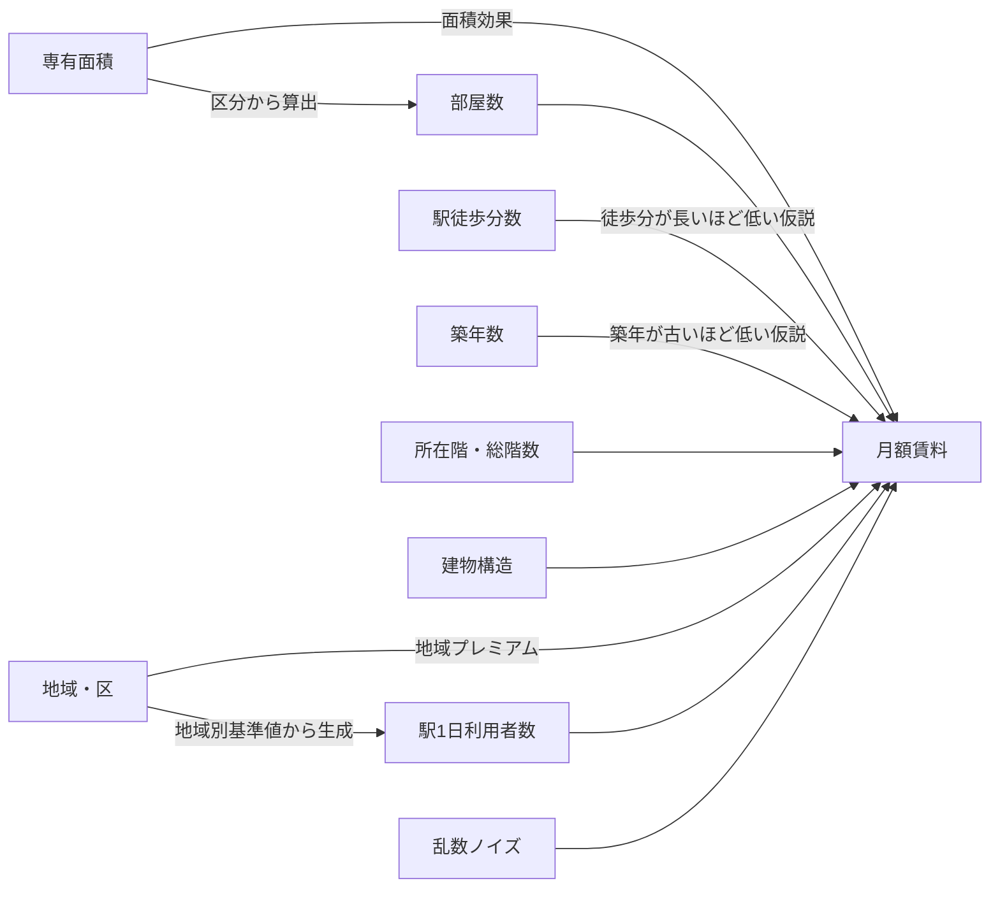
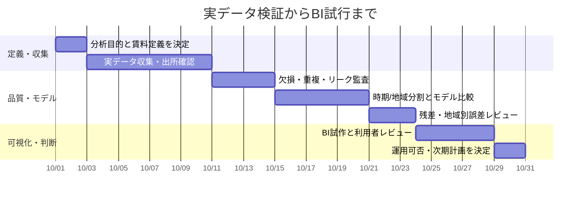

# 複合分析レポート：東京5区の不動産賃料モデル（合成サンプル500件）

- **Status**: ✅ 完了
- **作成日**: 2026-09-30
- **分析対象**: [regression_sample_500.csv](../04_Data/raw/regression_sample_500.csv)
- **分析スクリプト**: [analyze_regression.py](../04_Data/scripts/analyze_regression.py)
- **対話型BI**: [regression_dashboard.html](../05_Outputs/dashboards/regression_dashboard.html)
- **適用アプローチ**: ポータル No.3「多変量重回帰分析 ✕ BIダッシュボード構築」および No.61「Karpathy流ハイブリッド診断 ✕ Obsidian自動保存」

## 1. 現状の要約とデータ整理

### 要約

このCSVは不動産賃料モデルの**合成サンプル**であり、実在物件の相場データではない。500行・10列（説明変数9列、目的変数 `monthly_rent_yen` 1列）を確認した。欠損セル0、完全重複行0で、補完や行削除は行っていない。

| 指標 | 結果 |
|---|---:|
| 件数 / 列数 | 500行 / 10列 |
| 学習 / テスト | 400行 / 100行（固定seed、80/20分割） |
| 月額賃料 平均 / 中央値 | 193,984円 / 192,500円 |
| 月額賃料 最小 / 最大 | 45,000円 / 388,000円 |
| 欠損 / 完全重複 | 0 / 0 |

### 列の整理

| 区分 | 列 | 内容 |
|---|---|---|
| 数値特徴 | `area_sqm` | 専有面積（m²） |
| 数値特徴 | `station_walk_min` | 駅徒歩分数 |
| 数値特徴 | `building_age_years` | 築年数 |
| 数値特徴 | `floor_number`, `total_floors` | 所在階、建物総階数 |
| 数値特徴 | `rooms` | 間取りの部屋数 |
| 数値特徴 | `station_daily_passengers_10k` | 駅の1日利用者数（万人単位） |
| カテゴリ特徴 | `building_structure` | RC / Steel / Wood |
| カテゴリ特徴 | `ward` | Edogawa / Nerima / Setagaya / Shibuya / Shinjuku |
| 目的変数 | `monthly_rent_yen` | 月額賃料（円） |

カテゴリは学習データ内で基準値（構造はRC、地域はEdogawa）を設けてワンホット化し、数値特徴の標準化量も学習データだけから計算した。分割後に前処理を当てており、テスト情報の漏洩を避けている。

### データ上の留意点

- データは既知の加算式と乱数ノイズから生成された合成値で、現実の市場データを代表しない。
- `rooms` は `area_sqm` の範囲から生成されており、独立した測定特徴ではない。面積との強い相関を含む。
- 駅利用者数は地域ごとの基準値をもとに生成されており、地域とアクセス指標は独立ではない。
- したがって、以下の「仮説」は生成データ内での予測関係を検証したもので、現実世界の因果効果や賃料設定の根拠とは区別する。

## 2. 原因分析と3つの仮説

重回帰はQR分解による最小二乗法で推定した。比較は同じ固定80/20分割で行い、さらに学習データ上の5-fold交差検証を実施した。説明変数群を一つずつ除くアブレーションで、テストRMSEがどれだけ増えるかを寄与の目安とした。これは統計的有意性検定ではない。

| 仮説 | 判定 | 観測された根拠 |
|---|---|---|
| H1: 面積が大きいほど賃料が高い | 強く支持（この合成データ内） | 面積と賃料の単相関 `r=0.919`。他特徴を調整した面積係数は約 `+2,643円/m²`。面積群を除くとテストRMSEは11,521円から21,258円へ `+9,737円`。 |
| H2: 駅アクセス・地域が賃料差を説明する | 支持（群として強い） | 駅徒歩係数は約 `-1,964円/分`。地域効果は基準Edogawa比でShibuya `+49,059円`、Shinjuku `+45,511円`。アクセス群（駅徒歩、利用者数、地域）を除くとRMSEが `+20,347円`。駅利用者数単独の調整係数は約 `+142円/万人`で、地域との共変動に注意。 |
| H3: 築年数・構造・階数・間取りが追加説明力を持つ | 部分支持（H2より小さい） | 築年数係数は約 `-950円/年`、部屋数は約 `+4,976円/室`、WoodはRC比で約 `-14,355円`。建物条件群を除くとRMSEが `+4,106円`。総階数係数は約 `-73円/階`と小さい。 |

### 係数の読み方

係数は他の列を一定としたときのモデル上の平均変化量であり、円単位。カテゴリ係数は基準カテゴリとの差。生成規則に似た値が回収されているが、合成式自体から値が生じているため、現実の物件にそのまま当てはめる解釈はできない。

## 3. 対策案の比較評価

評価は今回の分析結果と、実データを用いる場合の運用リスクに基づく。効果・説明性は高いほど良く、導入負荷・リスクは大きいほど高い。

| 対策案 | 期待効果 | 説明性 | 導入負荷 | 主なリスク | 評価・優先度 |
|---|---|---|---|---|---|
| 合成データ上の重回帰を現行価格に適用 | 見かけ上は高い（テストR² 0.980） | 高い | 低い | 実市場との分布差、欠落特徴、地域偏り。価格判断への直接利用は不可。 | **見送り**。学習教材・パイプライン確認専用。 |
| 実際の募集・成約データを整備し、線形モデルを再推定 | 高い可能性 | 高い | 高い | サンプル選択、成約価格欠落、時点・地域リーク。 | **最優先**。対象期間・対象地域・賃料定義を先に固定。 |
| 地域・時期・物件条件でホールドアウトし、線形/正則化/非線形を比較 | 汎化性能の改善を評価可能 | 中〜高 | 中 | 比較条件が不揃いだと誤選択。 | **次点**。同一分割でMAE/RMSEと残差を比較。 |
| Plotly型BIで実測・予測・残差を地域別に可視化（No.3） | 異常・偏りの発見に有効 | 高い | 中 | 可視化が合成データの妥当性を補うわけではない。 | **技術デモを作成済み**。実データ整備後に再生成・再検証する。 |

### モデル比較（テスト100件）

| モデル | RMSE | MAE | R² | 読み取り |
|---|---:|---:|---:|---|
| 学習平均ベースライン | 82,187円 | 69,504円 | -0.0047 | 説明変数なし。 |
| 面積のみの単回帰 | 32,344円 | 28,083円 | 0.8444 | 面積だけでも強い信号がある。 |
| 9特徴量の重回帰 | **11,521円** | **9,391円** | **0.9803** | 合成データの生成規則と高く整合。 |

重回帰の学習R²は0.9786、テストR²は0.9803。5-fold CVのRMSEは平均12,467円、標準偏差1,203円。今回の固定分割では大きな汎化ギャップは見えないが、合成データ内の結果である。

### BIビュー（No.3）

[対話型ダッシュボードを開く](../05_Outputs/dashboards/regression_dashboard.html)。テスト実績対予測、標準化係数上位、地域別賃料分布、予測値別残差を確認できる。グラフの描画にはPlotly CDNを使用するため、インターネット接続が必要。

## 4. Mermaid記法による原因因果関係図

[link](https://docs.google.com/document/d/1A5GJODCZGc0QVI4xM2w70CHCiuD4AaZhFtk5lSNDgDM/edit?tab=t.0)

以下はこのCSVの**生成規則と分析仮説**を可視化したもの。実市場の因果関係を証明する図ではない。特に面積から部屋数、地域から駅利用者数への矢印は、今回のデータ作成過程での依存を示す。

## 5. 今後の具体的なアクションプラン

### タスクリスト

- [ ] 実データの用途、対象地域、対象期間、賃料（募集/成約/管理費込み）を定義する。
- [ ] 物件ID、掲載日/成約日、面積、駅距離、築年、構造、所在階、地域を含む実データを収集し、出所・利用条件を記録する。
- [ ] 欠損、重複、外れ値、単位、募集物件の重複掲載を監査する。物件IDや時点が分割を跨ぐリークを防ぐ。
- [ ] 時期または地域単位のホールドアウトを作り、線形回帰・正則化回帰・非線形モデルを同一条件で比較する。
- [ ] MAE/RMSE、地域別・価格帯別残差、予測誤差の偏りをレビューし、実運用可否を判断する。
- [ ] 実データで妥当性確認後、No.3のBI方針に沿い、実測/予測/残差を地域・時期で確認できる可視化を作る。

### ガントチャート（案）

[link](https://docs.google.com/document/d/1vrgRpbourF38P9Mb_xt9un_a-Kvro69zt5MOornIXw4/edit?tab=t.0)

## 6. No.61 ハイブリッド診断

### 8つの視点

| 視点 | 診断 |
|---|---|
| 1. 目的 | 賃料推定の分析手順を確認する教材としては有効。実価格決定に使う根拠にはならない。 |
| 2. データ品質 | 500行、欠損・重複なし。構造は整っているが、実データではない。 |
| 3. 信号 | 面積の単相関は0.919。面積・地域・アクセスの組合せがテスト誤差低下に寄与。 |
| 4. モデル | OLSは説明しやすく、ベースラインより大幅に良い。ただし非線形性・交互作用は未検証。 |
| 5. 検証 | 固定ホールドアウトと学習内5-foldを実施。実時間・地域を跨ぐ外部検証は未実施。 |
| 6. 誤差 | テストRMSE 11,521円、MAE 9,391円。平均残差（予測−実績）は-2,516円。 |
| 7. 運用 | 実データの定義・鮮度・掲載重複・地域偏りを検査する監視設計が必要。 |
| 8. 説明責任 | 合成式による高スコアを実市場の精度と混同しない。実データで地域・価格帯別に検証する。 |

### 核・質・特・欠 × 方・移・拡・新

| 軸 | 結論 |
|---|---|
| 核 | 面積と地域・アクセス情報が、合成賃料の予測に強く関係する。 |
| 質 | 形式品質は良好（欠損・重複0件）。外的妥当性は未確認。 |
| 特 | 生成式と固定シードがあるため、分析コード・評価手順の再現確認に使える。 |
| 欠 | 500件の合成標本であり、時点、成約状況、駅実測、設備、管理費、物件ID等を欠く。 |
| 方 | まず実データの目的変数・期間・地域を固定し、収集元を明記する。 |
| 移 | 同じ前処理・ホールドアウト手順を実データに適用し、係数の安定性を再確認する。 |
| 拡 | 地域/時期別検証、残差分析、正則化・非線形モデル比較を追加する。 |
| 新 | 群除外評価ではアクセス群のRMSE増分が最大（約20,347円）。地域と駅利用者数の依存を分離して検証する。 |

## 分析条件・限界

- スクリプトはPython標準ライブラリのみで分析し、データとBI HTMLを生成する。元CSVは変更していない。
- 係数のp値・信頼区間は算出していない。仮説評価はホールドアウト上の誤差変化と係数方向に基づく。
- 1回の固定テスト分割と学習内5-foldだけでは、現実市場での性能・公平性・因果効果を保証しない。
- **結論**: このCSVでは重回帰がベースラインを大きく上回ったが、実賃料への適用判断は実データ収集後に行う。