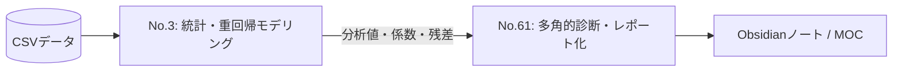

## 今回の連携は直列か、並列か

### 結論：直列（パイプライン型）

今回の「No.3」と「No.61」は、**No.3の分析結果をNo.61が受け取り、レポートへまとめる直列の流れ**として整理できます。

### 直列と並列の違い

**並列の場合**は、同じ元データに対して複数のアプローチを独立して実行します。それぞれが互いの結果を前提にしません。

例：
- No.3で統計サマリーを作成する
- 別機能で分布や外れ値を検知する
- 両方を同時に実行し、それぞれの結果を確認する

**今回の直列連携**では、次の順に処理します。
1. No.3が元データから偏回帰係数、決定係数、残差などを算出する。
2. No.61がその分析結果を受け取り、多角的な診断とレポートを組み立てる。
3. 完成した内容をObsidianノートやMOCへ保存する。

関連資料：[参考ドキュメント](https://docs.google.com/document/d/11V5wQ-Cw-eXKlaWmb0GiE_x317TXtN7OwqW68N4k_uE/edit?tab=t.0)

## 直列と並列、どちらを選ぶか

### 直列：意思決定・深い分析・自動化向け

**基本構造**：データ取得 → 高度計算・要約 → 図解・対策立案 → Obsidian登録

前工程の結果を次工程が引き継ぐため、分析から提案まで一貫したレポートにまとめやすい方式です。

向いている場面：
- 重回帰分析
- 原因分析から対策立案まで行う業務
- 月次レポートの作成

### 並列：探索的分析・多面的チェック向け

**基本構造**：1つのデータに対して、複数の視点を同時に適用

処理を同時に進められ、異なる切り口から全体像を素早く把握できます。

向いている場面：
- データ入手直後の現状把握（EDA）
- 初期スクリーニング
- 統計サマリーと異常値検知の同時実行

## おすすめ：並列から直列へつなぐハイブリッド型

実務では、**並列で情報を集め、その結果を直列で深掘りする**組み合わせが有効です。

1. **並列で探索**：基本統計、分布、異常値などを同時に確認する。
2. **重要点を選定**：調査すべき指標や傾向を絞り込む。
3. **直列で深掘り**：No.3の分析結果を、因果モデルや工程表、No.61の診断へ順番に引き継ぐ。
4. **成果を統合**：結論とアクションプランを1つのTaskレポートにまとめる。

## 今回の組み合わせの評価

今回の指示は、**「No.3の分析結果を受けてNo.61がレポートをまとめる」直列パイプライン**になっていました。分析値から診断・記録まで流れがつながるため、重回帰分析のように根拠を踏まえて次の判断を行う用途に適した組み合わせです。