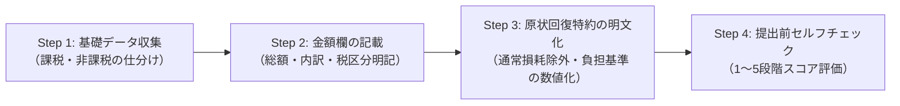

---
tags:
  - loop-engineering
  - category/real-estate
  - category/contract
  - framework/hybrid-diagnosis
date: 2026-11-01
---

# 🔄 LoopEngineering：入居者向けの契約書案の作成（税区分・原状回復特約の明確化）

## ① 現実の成果物作成・提出 (`01_RealOutput`)
- **日付**: 2026-11-01
- **成果物名・内容**: 入居者向けの契約書案の作成
- **提出先**: 上司
- **作成時の参照確認**:
  - [x] 関連するレシピ（`03_Recipe/`）を確認したか
  - [x] チェックリスト（`04_Action/`）を手元に開いているか

---

## ② 上司からのフィードバック・アドバイス (`02_Feedback`)
- **受けたアドバイス**:
  > 「契約書は『後から読んだ第三者や入居者が迷わないこと』が最優先。金額は総額だけでなく内訳・税区分を必ず明記し、特約条項はガイドラインに沿って負担基準を具体的に数値・事例で書くようにしてほしい。」
- **指摘事項（事実ベース）**:
  1. 管理費・共益費の消費税区分（非課税・課税の別）が明記されていない。
  2. 退去時の原状回復特約において、通常損耗と入居者負担の範囲が曖昧でトラブルリスクがある。
- **3階層分類タグ**:
  - `#What`（表層的事象）: 金額（税区分）・原状回復特約の具体記載漏れ
  - `#How`（行動・プロセス）: 提出前の法務・税務項目セルフチェック不足
  - `#Why`（根本原因・原則）: 入居者目線での誤解防止・紛争予防（「誰が読んでも一義的に解釈できるか」）という契約書の本質理解の不足

---

## ③ 原理・原則の抽象化・レシピ化 (`03_Recipe`)

### 1. 暗黙知の言語化（SECIモデル応用）
- **前提条件の特定**: 入居者は不動産や税制の専門知識を持たない前提で契約書を読む。
- **判断基準の分岐点**: 「一義的に解釈できるか（複数の解釈が生じる余地がないか）」で条文の良否を判断する。
- **思考プロセスのなぞり**: 金額記載時は「居住用（非課税）か事業用・付帯サービス（課税）か」を分解して表記し、特約記載時は「退去時にどのケースで誰がいくら負担するか」をシミュレーションして明文化する。

### 2. 全体構造の図形化（作成〜提出フロー）

### 3. 要素の表形式化（税区分・原状回復の明確化基準表）
| 項目 | NG記載（曖昧・トラブル原因） | OK記載（一義的・明確） | 根拠・原則 |
| :--- | :--- | :--- | :--- |
| **賃料・管理費・共益費** | 「月額〇〇円」のみ記載 | 「月額〇〇円（居住用につき**非課税**）」と明記 | 消費税法上の非課税・課税区分の明確化 |
| **駐車場・付帯サービス** | 「駐車場代〇〇円」のみ記載 | 「月額〇〇円（税抜〇〇円、**消費税10%：〇〇円**）」と内訳明記 | 課税対象項目の税額透明化 |
| **原状回復特約** | 「退去時の修繕費は借主負担とする」 | 「通常損耗・経年変化は貸主負担。故意・過失（タバコヤニ・ペット傷等）は借主負担（算出基準：〇〇）」 | 消費者契約法・国交省原状回復ガイドライン準拠 |

### 4. レシピ（手順・制約・品質規準）
- **目的**: 入居者との認識齟齬や退去時トラブルを防止し、誰が読んでも一義的に解釈できる入居者向け契約書案を作成する。
- **手順**:
  1. 物件条件・賃料・管理費・敷金等の基礎データを収集し、非課税・課税の区分を整理する。
  2. 標準契約書フォーマットに基礎データを反映し、金額欄に総額・内訳・税区分を明記する。
  3. 原状回復等の特約条項について、通常損耗と入居者負担の範囲（具体例・金額基準）を明文化する。
  4. 提出前にチェックリスト（1〜5段階評価）でセルフチェックを実施する。
- **制約**:
  - 曖昧な表現（「別途協議」「適宜負担」のみの記載など）を残さないこと。
  - 消費者契約法および原状回復ガイドラインに抵触する不当条項を含めないこと。
- **品質規準**:
  - [x] 賃料・管理費・付帯費用のすべてに内訳と消費税区分が明記されているか
  - [x] 特約条項において入居者の費用負担範囲が具体的（部位・事由・算出基準）に記載されているか

---

## ④ 即行動・次の試行 & 実践チェックリスト (`04_Action`)
- **フィードバックを受けた即時修正項目**:
  1. 契約書案の金額欄に管理費・共益費・付帯費用の消費税区分（非課税／課税）を追記
  2. 原状回復特約の条文に通常損耗の除外と入居者負担の具体例・金額基準を明記して再提出
- **次の試行スケジュール**: 2026-11-01（即日修正・上司へ再提出）
- **意識するポイント**: 「後から読んだ入居者が1ミリも迷わないか」を基準に、金額の税区分と特約の具体性を提出前にチェックリストで自己採点する。

### 実践チェックリスト（1〜5段階評価）
- [x] **項目1（金額・税区分の明確性）**: `[スコア: 4]` （ヒント: 賃料・管理費・駐車場代等の総額だけでなく内訳と課税/非課税区分がひと目で分かるか）
- [x] **項目2（特約条項の具体性）**: `[スコア: 4]` （ヒント: 退去時に争点にならないよう、通常損耗との境界や具体例・算出基準が書かれているか）

---

## 🚀 拡張思考（よっちゃん流ハイブリッド診断）

### 1. 現状分析：「核・質・特・欠」
| 視点 | 契約書案作成における診断 |
| :--- | :--- |
| **【核】核心** | **「将来の紛争予防（一義的解釈の担保）」**。誰がいつ読んでも1つの意味にしかならない状態を作ること。 |
| **【質】品質** | 法令（消費税法・消費者契約法・国交省ガイドライン）への準拠と、専門知識のない入居者への分かりやすさの両立。 |
| **【特】特性** | 金銭（入り口の課税区分）と原状回復（出口の負担基準）の2箇所がトラブルの9割を占める急所である。 |
| **【欠】欠損（罠）** | 作成者側が「当然わかるだろう」と内訳や基準を省略すると、退去時に最大のトラブルコストとして跳ね返る。 |

### 2. 未来ベクトル：「方・移・拡・新」
1. **【方】方向性**: 曖昧な自然言語条文を排除し、金額内訳や負担割合を「一覧表（テーブル）」として契約書内に組み込む。
2. **【移】移動性**: 本レシピのチェック基準を「重要事項説明書」「退去時精算書」「入居時マニュアル（FAQ）」へ横展開する。
3. **【拡】拡張性**: AIに契約書ドラフトを入力し、「税区分の漏れ」「ガイドライン違反リスクのある曖昧表現」を自動監査させる（アイアンマンスーツ化）。
4. **【新】新規性**: 原状回復の負担基準をテキストだけでなく「写真・図解付きチェックシート」として契約時に共有し、退去時トラブルゼロを実現する。
