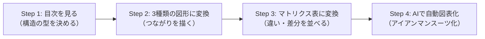

---
tags:
  - loop-engineering
  - knowledge/reading
  - framework/hybrid-diagnosis
date: 2026-11-02
---

# 🔄 LoopEngineering：技術書読解の視覚化（図形・表による高速理解）

## ① 現実の成果物作成・提出 (`01_RealOutput`)
- **日付**: 2026-11-02
- **成果物名・内容**: 技術書の読み込み・構造化インプット（[[2026-11-02_速読5ステップ_ビジネス書・技術書]]）
- **提出先**: 上司 / 自己レビュー

---

## ② 上司からのフィードバック・アドバイス (`02_Feedback`)
- **受けたアドバイス**:
  > 「全体を図形化することや表にして表示することで早く理解しやすくなる。」
- **指摘事項（事実ベース）**: 文章（テキスト）の箇条書きのみで技術書を読み進めており、全体像や概念間の関係性の把握に時間がかかっている。
- **3階層分類タグ**:
  - `#What`（表層的事象）: 全体図・比較表の未作成
  - `#How`（行動・プロセス）: 目次や概念間の関係を視覚化せず、文字のみで読み進める手順
  - `#Why`（根本原因・原則）: 一次元のテキストより、二次元の「図形（関係性）」や「表（差分・比較）」に変換した方が脳の情報処理速度が飛躍的に上がるという認知原則の未適用

---

## ③ 原理・原則の抽象化・レシピ化 (`03_Recipe`)

### 1. 具体的な行動手順（4ステップ）

### 2. パターン別：何を図にし、何を表にするか（変換ルール表）
| 本・資料に書かれている内容 | 変換する形式 | 具体的な書き方（手書き / Obsidian） |
| :--- | :--- | :--- |
| **手順・データの流れ・仕組み** | **矢印フロー図** (`A → B → C`) | 「入力 → 処理（核） → 出力」を四角と矢印でつなぐ |
| **全体構成・アーキテクチャ** | **包含・階層図**（ツリー / ブロック） | 親要素の中に子要素を配置し、全体と部分の関係を描く |
| **複数の手法・ツールの比較** | **比較マトリクス表**（縦×横の表） | 行に「手法A・B・C」、列に「特徴・メリット・欠点・用途」を並べる |
| **ポジショニング・トレードオフ** | **2軸マップ**（縦軸×横軸） | 例：「自動化レベル（高/低）× 導入コスト（高/低）」の4象限に配置 |

### 3. 従来の読み方 vs 図表読解の比較表
| 項目 | 従来の読み方（テキストのみ） | 改善後の読み方（図形化・表形式化） | 効果・メリット |
| :--- | :--- | :--- | :--- |
| **全体像の把握** | 1ページ目から順番に文字を追う | 目次・アーキテクチャを**1枚の図形**にする | 構造とつながりが一瞬で頭に入る |
| **技術要素の比較** | 各章の解説文を個別に読む | 手法・メリデメを**比較表（テーブル）**にする | 未知の差分（2割）だけを一目で抽出できる |
| **コードの読解** | 1行ずつ上から下まで目で追う | **入力 → 核（処理） → 出力**のブロック図で見る | 細部に迷わず本質ロジックを即理解できる |

### 4. レシピ（制約・品質規準）
- **制約**:
  - 技術書のまとめを長文テキストだけで終わらせず、必ず「図（全体構造）」と「表（要素比較）」をセットで出力すること。
  - 綺麗に描くことを目的化せず、手書きなら30秒の◯と矢印、デジタルならAI（Mermaid・テーブル自動生成）を活用すること。
- **品質規準**:
  - [x] 技術書の全体像（アーキテクチャ・処理フロー・章のつながり）が1枚の図形（5要素以内）で表現されているか
  - [x] 技術要素や概念の違い・特徴が「表（テーブル）」形式で比較・一覧化されているか

---

## ④ 即行動・次の試行 & 実践チェックリスト (`04_Action`)
- **即時修正・実践項目**: 今後の技術書インプットおよび要約ノート作成時は、必ず「全体図（Mermaid等）」と「比較表（テーブル）」をセットで作成する。
- **次の試行スケジュール**: 次回の技術書20分タイムアタック時に即実践。

### 実践チェックリスト（1〜5段階評価）
- [ ] **① 読む前の「枠」作り**: `[スコア: 4]` 本を開く前に、白紙やノートに「図を描くスペース」と「比較表の枠」を用意したか？
- [ ] **② 接続詞の記号化**: `[スコア: 4]` 文章中の「だから（`⇒`）」「しかし・対比（`⇄`）」「たとえば（`例:`）」を矢印や記号に置き換えながら読めているか？
- [ ] **③ 1枚図解テスト（抽象化）**: `[スコア: 4]` 本の「まえがき・目次」を見た段階で、本全体の構成を**四角と矢印だけのシンプルな図（5要素以内）**で描けるか？
- [ ] **④ 差分テーブル化（具体の整理）**: `[スコア: 4]` 「従来のやり方 vs この本の提案」または「手法A vs 手法B」を**3列以上の表**に整理したか？
- [ ] **⑤ 30秒説明テスト（定着確認）**: `[スコア: 4]` 作った「図」と「表」だけを見て、他人に30秒でその本の核心（核）を説明できるか？

---

## 🚀 拡張思考（よっちゃん流ハイブリッド診断）

### 1. 現状分析：「核・質・特・欠」で見る図表化のポイント
| 視点 | 図形化・表形式化における本質と注意点 |
| :--- | :--- |
| **【核】核心** | **「一次元（直列の文章）から二次元（並列の空間）へのコンパイル」**。人間の視覚野は、文字を読むより図・表の配置を見る方が数十倍速く関係性を処理できる。 |
| **【質】品質** | 良い図表の条件は「1図1メッセージ」。情報を詰め込みすぎず、**「要素は3〜5個まで」「比較軸が明確」**であるほど理解速度が上がる。 |
| **【特】特性** | **図は「全体のつながり（動的フロー・構造）」**の把握に強く、**表は「要素ごとの違い・抜け漏れ（静的比較）」**の発見に強い。 |
| **【欠】欠損（罠）** | **「綺麗に図を描くこと」自体が目的化すると逆に時間がかかる（本末転倒）**。手書きなら雑な◯と矢印で30秒、デジタルならAIにMermaid図や表を自動生成させるべき。 |

### 2. 未来ベクトル：「方・移・拡・新」による拡張アイデア
1. **【方】方向性（Compilation Analogy：自然言語のコード化）**
   - 頭の中で理解したことを、Obsidian上で **Mermaid記法（図のコード）やMarkdownテーブル** としてストックする。図を「テキストコード」として持っておくと、後から検索・再利用・AIへの再入力が自在になる。
2. **【移】移動性（インプットからアウトプットへの横展開）**
   - 「技術書を読むとき」だけでなく、**「上司への報告」「顧客への提案書」「契約書・マニュアルの整理」** にそのまま転用する。「自分が早く理解できる図表」は、「相手も一瞬で理解できる最強の成果物」になる。
3. **【拡】拡張性（アイアンマンスーツ化：AIによる自動図表化）**
   - 自分でゼロから図表を作らず、難解な章があれば目次や要点をAIに投げて **「この概念をMermaidのフロー図と、従来手法との比較表（核・質・特・欠）に変換して」** と指示し、AIに一瞬で視覚化させる。
4. **【新】新規性（表の「空白セル」から新しいアイデアを生む）**
   - 表（マトリクス）を作ると、**「まだ埋まっていない空白のマス（＝本に書かれていない弱点や、自社の未着手領域）」** が視覚的に浮かび上がる。これを使うと、単なる「理解」を超えて「新しい企画・改善案」が自動的に生まれる。
