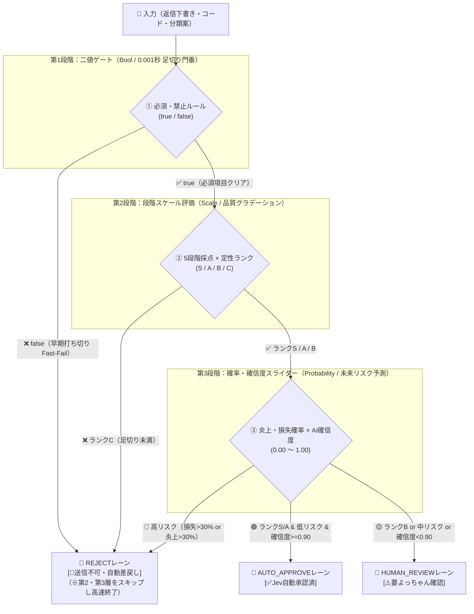

---
tags:
  - loop-engineering
  - jev-audit
  - framework/hybrid-diagnosis
date: 2026-11-07
---

# 🔄 LoopEngineering：Jev監査の段階的構成（カスケード）と複数組み合わせ設計

## ① 現実の成果物作成・提出 (`01_RealOutput`)
- **日付**: 2026-11-07
- **成果物名・内容**: Jev 3層統合ハイブリッド監査器（`antigravity-Jev-demo/jev_hybrid_auditor.py`）および個別評価デモ（二値 `jev_eval_bool_demo.py` / 段階 `jev_eval_scale_demo.py` / 確率 `jev_eval_prob_demo.py`）
- **提出先**: Antigravity 運用コックピット（`00_Dashboard/Jev_Audit_Dashboard.md`）

---

## ② 課題の発見・構造的気づき (`02_Feedback`)
- **気づき・テーマ**:
  > 「Jev監査を単発ではなく、段階的構成（縦の直列ゲート）や複数の組み合わせ（横の並列・マトリクス・自律スライダー）で設計するとどう進化するか？」
- **指摘事項（事実ベース）**: すべての評価項目を1つの巨大なプロンプトや毎回フルパイプラインで回すと、明らかなNG文面でも最後まで推論が走り計算時間・コストが無駄になるほか、「自動送信してよいか・人間が確認すべきか」の運用レーン分けが曖昧になる。
- **3階層分類タグ**:
  - `#What`（表層的事象）: 全層フル実行による推論コストと、PASS/FAIL二択のみによる運用仕分けの粗さ
  - `#How`（行動・プロセス）: 第1層（二値）での早期打ち切り（Fast-Fail）と、第2層（段階）×第3層（確率・確信度）のマトリクスによる3レーン仕分けの未定義
  - `#Why`（根本原因・原則）: Karpathy流「Software 1.0/2.0/3.0の適材適所」および「部分的自律性（Autonomy Slider）」をパイプライン構造としてコンパイルする必要があるため

---

## ③ 原理・原則の抽象化・レシピ化 (`03_Recipe`)

### 1. 段階的構成（縦のカスケード）× 3レーン仕分けフロー図

### 2. 4つの組み合わせパターン比較表（マトリクス）
| 構成パターン | 組み合わせ方 | 役割・動作メカニズム | 実務メリット |
| :--- | :--- | :--- | :--- |
| **① カスケード型** （早期打ち切り） | `第1層(Bool)` → `第2層(Scale)` → `第3層(Prob)` | 第1層で `false` なら後続の重いLLM評価をスキップ（`skipped=True`）して即差戻し | 無駄な推論待機時間をゼロにし、即座に必須項目漏れを修正させる |
| **② ドメイン合議型** （横の並列結合） | `冬期凍結Jev` × `騒音苦情Jev` × `一般修繕Jev` | 複合クレーム（例：凍結＋隣室トラブル）に対し複数の専門評価器を同時適用 | 単一プロンプトの視野狭窄を防ぎ、専門知識の抜け漏れを完封する |
| **③ 世代融合型** （SW 1.0 × 3.0） | `Python確定ルール(1.0)` ＋ `ローカルLLM(3.0)` | 禁止ワード（「全額負担」等）はPythonで100%検知し、文脈の共感度はLLMで採点 | ハルシネーションの完全防止と柔軟なニュアンス評価の両立 |
| **④ 3レーン分岐型** （自律スライダー） | `段階ランク(S〜C)` × `リスク確率・確信度` | 監査結果を `AUTO_APPROVE` / `HUMAN_REVIEW` / `AUTO_REJECT` の3レーンへ自動分類 | 安全な定型案件は全自動化し、グレーゾーンだけ人間が集中確認できる |

### 3. 3レーン自動仕分け基準表（Autonomy Slider 定義）
| 仕分けレーン (`action_lane`) | 件名プレフィックス (`draft_prefix`) | 判定条件（二値 × 段階 × 確率の組み合わせ） | 下流アクション |
| :--- | :--- | :--- | :--- |
| **`AUTO_APPROVE`** （完全自動承認） | `[✅Jev自動承認済]` | 二値 `PASS` かつ 段階ランク `S` または `A` かつ 確率 `PASS`（炎上<=20%, 損失<=15%, 合意>=70%）かつ 確信度 `>= 0.90` | そのままGmail下書き保存（即時送信可能） |
| **`HUMAN_REVIEW`** （人間レビュー待ち） | `[⚠️要よっちゃん確認]` | 二値 `PASS` かつ 致命的リスクなし（炎上<=30%, 損失<=30%）だが、ランク `B` または 確率・確信度が中間域 | Gmail下書きに要注意マークを付けてよっちゃんが最終確認 |
| **`AUTO_REJECT`** （自動差戻し・再生成） | `[🛑送信不可・自動差戻し]` | 二値 `FAIL`（早期打ち切り）、または ランク `C`、または 炎上・損失リスク `> 30%` | 送信ブロック＆自己修復ループ（Generator再推敲）へ差し戻し |

### 4. レシピ（制約・品質規準）
- **制約**:
  - 第1層（二値ゲート）で不合格となった場合は、原則として `fast_fail=True` で後続層をスキップし、理由を明示して即座に差し戻すこと。
  - 単なる `PASS / FAIL` の2値だけでなく、必ず `action_lane`（3レーン）と `draft_prefix` を出力に含めること。
- **品質規準**:
  - [x] 第1層（Bool）・第2層（Scale）・第3層（Prob）の役割と閾値が重複せず直교しているか
  - [x] 早期打ち切り（Fast-Fail）のON/OFFが制御可能か
  - [x] 3レーン（`AUTO_APPROVE` / `HUMAN_REVIEW` / `AUTO_REJECT`）のテストケースがすべて再現性100%で通過するか

---

## ④ 即行動・次の試行 & 実践チェックリスト (`04_Action`)
- **即時修正・実践項目**: `antigravity-Jev-demo/jev_hybrid_auditor.py` に早期打ち切り（Fast-Fail）と3レーン自動仕分けを組み込み、`--test-lanes` で3パターンの動作を実証する。
- **次の試行スケジュール**: 本番メールトリアージボット（`mail_triage_bot.py`）の下書き件名プレフィックスへの統合。

### 実践チェックリスト（1〜5段階評価）
- [x] **① 二値門番の確定性**: `[スコア: 5]` 禁止ワード（安易な全額負担確約）や必須要素漏れを第1層で100%捕捉できているか？
- [x] **② 早期打ち切り（Fast-Fail）**: `[スコア: 5]` 第1層NG時に第2・第3層をスキップして高速リターンできているか？
- [x] **③ 段階×確率のマトリクス連携**: `[スコア: 5]` 第2層のスコアと第3層のリスク確率が矛盾なく連動しているか？
- [x] **④ 3レーン自律スライダー**: `[スコア: 5]` `AUTO_APPROVE` / `HUMAN_REVIEW` / `AUTO_REJECT` の3段階に正しく振り分けられるか？
- [x] **⑤ ダッシュボード＆レポート可視化**: `[スコア: 5]` `06_Reports/` と `Jev_Audit_Dashboard.md` に結果が自動反映されるか？

---

## 🚀 拡張思考（よっちゃん流ハイブリッド診断）

### 1. 現状分析：「核・質・特・欠」
| 視点 | 診断内容 |
| :--- | :--- |
| **【核】核心** | **「直列の早期足切り（カスケード）」×「並列の評価軸統合（二値・段階・確率）」×「3レーン自律スライダー」**の三位一体アーキテクチャ。 |
| **【質】品質** | NG理由が「事実漏れ（Bool）」「表現不足（Scale）」「将来リスク（Prob）」のどこにあるか一目で特定でき、修正ループの精度が最大化される。 |
| **【特】特性** | 軽量・高速なルール判定（Software 1.0）を前段に置き、高コストな文脈・確率推論（Software 3.0）を後段に置くことで、速度と知能を両立。 |
| **【欠】欠損（今後の注意点）** | 閾値（例：損失確率15%以下など）を厳しくしすぎると `HUMAN_REVIEW` が増えるため、実運用データを見ながらスライダーを調整する運用が必要。 |

### 2. 未来ベクトル：「方・移・拡・新」
1. **【方】方向性（Compilation Analogy）**: 暗黙の「ベテラン管理者の勘（これはそのまま出していい／これは危ないから確認しよう）」を、明示的な確率閾値と3レーンコードへコンパイル。
2. **【移】移動性（横展開）**: 入居者メール対応だけでなく、契約書リーガルチェック、コードレビュー、Webリンク分類のすべてに同じ「3層×3レーン」構造を展開可能。
3. **【拡】拡張性（アイアンマンスーツ化）**: `mail_triage_bot.py` と直結し、Gmailを開いた瞬間に件名の `[✅Jev自動承認済]` / `[⚠️要よっちゃん確認]` だけで優先順位が分かるコックピット体験を実現。
4. **【新】新規性（フィードバックループの動的切り替え）**: 落ちた層に応じて、Generatorへ渡すプロンプトを「事実追加モード（第1層NG時）」と「丁寧さ向上モード（第2層NG時）」に自動切り替えする適応型自己修復。
