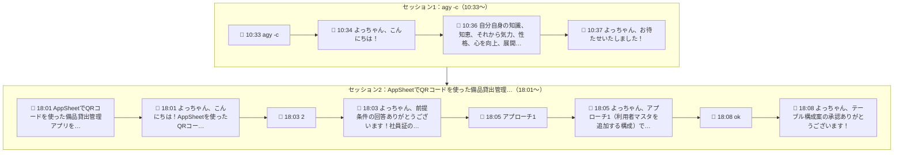
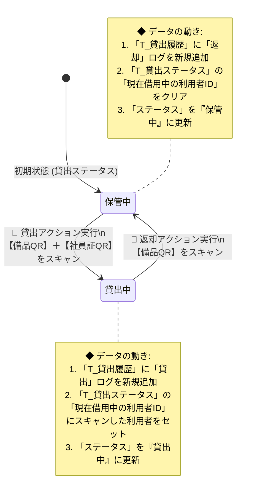

# 📅 2026-06-26 Antigravity問答（1日の記録）

## 📝 AIが編集・作成したファイル履歴

- 本日AIが編集したファイルはありません。

## 📊 AIとよっちゃんのやり取り図解 ＆ 今後の課題・問題点

### 1. やり取りの全体フロー図（全 9 往復 ・ 2 セッション）



### 2. 現状診断（核・質・特・欠）と今後の課題解決ベクトル（方・移・拡・新）

| 視点 | 診断結果（やり取りから見えた事実と課題） |
| :--- | :--- |
| **【核】核心** | 本日の主要テーマ：「agy -c」 ／ 「AppSheetでQRコードを使った備品貸出管理…」 を軸に、よっちゃんの意図（Vibe）を具体的な手順・設定・コードへ変換。 |
| **【質】品質** | ファイル直接編集を伴わない調査・コマンド実行・方針整理セッションとして、前提確認と手順提示が行われている。 |
| **【特】特性** | 「前提条件の確認（Think Before Coding）」と選択肢（A/B/C）の提示により、最小のタイプ数で合意形成と実行が回っている。 |
| **【欠】欠損（問題点）** | **手戻りのないスムーズな進行**：大きな迷子やエラーは未検出。対話だけで終わらせず、得た知見を `LoopEngineering/` やレシピへ継続的に昇華させることが今後の課題。 |

| ベクトル | 今後の具体的な改善アクション |
| :--- | :--- |
| **【方】方向性** | **暗黙知のレシピ化（Compilation）**：本日のやり取りで確定した手順やコマンドを、再利用可能な標準レシピ・長期記憶（`memories/`）として定着させる。 |
| **【移】移動性** | **1テーマ＝1ファイル＆ダッシュボード連携**：成果物の保存先を迷わせないよう独立ファイル化し、[[Cockpit_MOC]] や日報目次から即座にアクセス可能にする。 |
| **【拡】拡張性** | **アイアンマンスーツ化（自動化スクリプト連携）**：定型作業や検証コマンドをスクリプト・タスクスケジューラへ組み込み、人間の手作業ループを削減する。 |
| **【新】新規性** | **視覚化（図解・表）の標準適用**：複雑な仕様やログは文字だけで追わず、ズーム可能なフロー図とマトリクス表で直感的に俯瞰する。 |

## 💬 会話ログ

### 1. agy -c（開始 10:33:39 / ID: `425f7be3`）

---

#### 🧑 よっちゃん（10:33:39）

agy -c

---

#### 🤖 AI（10:34:34）

よっちゃん、こんにちは！

ご提示いただいた `agy -c` について解説します。

---

### `agy -c` の意味と機能

`agy -c` は、**直近の会話（もっとも新しい会話セッション）を再開して継続する**ためのコマンドオプションです。

`-c` は **`--continue`** オプションの短縮形（エイリアス）となっています。

* **抽象的な意味（構想力）**: 
  このコマンドは「文脈（コンテキスト）の継続」を意味します。AIとのやり取りにおいて、前回の思考プロセスや作業状態をそのまま引き継ぐことで、手戻りをなくし、Karpathy流の「外科的修正（Surgical Changes）」や「Simplicity First（極力シンプルに進める）」といった開発サイクルをスムーズに回すための重要な入り口となります。
* **具体的な動作**:
  ターミナルで `agy -c` を実行すると、新規に会話を開始するのではなく、前回終了した時点のコンテキスト（ロードされたファイルや変更履歴、会話ログ）を維持した状態で対話型セッションが再開されます。

---

### `agy` CLI のヘルプ（オプションとサブコマンドの日本語解説）

設定の理解を深めるために、`agy` コマンドで利用可能な主要なオプションとサブコマンドを分かりやすく翻訳・解説します。

#### オプション（Flags）

| オプション | 短縮形 | 説明 |
| :--- | :--- | :--- |
| `--continue` | **`-c`** | **直近の会話を再開して継続します。** |
| `--prompt-interactive` | `-i` | 最初のプロンプトを対話形式で実行し、そのままセッションを継続します。 |
| `--print` / `--prompt` | `-p` | 単一のプロンプトを非対話（ワンショット）で実行し、その応答を出力して終了します。 |
| `--conversation <ID>` | - | 指定した特定の会話IDを使って、過去のセッションを再開します。 |
| `--add-dir <PATH>` | - | ワークスペースに特定のディレクトリを追加します（複数指定可能）。 |
| `--model <MODEL>` | - | このセッションで使用する Gemini モデルを一時的に指定します。 |
| `--project <PROJECT_ID>` | - | このセッションで使用する GCP プロジェクトIDを指定します。 |
| `--sandbox` | - | ターミナルの実行制限がかかった安全なサンドボックス環境で実行します。 |
| `--dangerously-skip-permissions` | - | **【注意】** ツールの実行確認プロンプトをすべてスキップし、自動承認します。 |

#### サブコマンド（Subcommands）

* **`models`**: 利用可能な Gemini モデルの一覧を表示します。
* **`plugin`** (または `plugins`): プラグインの管理（インストール、アンインストール、一覧表示、有効/無効化）を行います。
* **`install`**: 環境変数（パス）やシェルの設定を自動構成します。
* **`update`**: `agy` CLI 自体を最新バージョンにアップデートします。
* **`changelog`**: 製品の最新の変更履歴やリリースノートを表示します。
* **`help`**: サブコマンドのヘルプを表示します。

---

もし直近の作業を再開されたい場合は、ターミナルでそのまま `agy -c` を実行していただくことで、前回の状態からスムーズにコーディングや相談を継続できます。

他にご不明な点や、設定ファイルの調整（`settings.json` の解説など）が必要でしたら、いつでもお気軽に教えてくださいね、よっちゃん！

---

#### 🧑 よっちゃん（10:36:47）

自分自身の知識、知恵、それから気力、性格、心を向上、展開させる方法の代表的なものを10個、具体的かつ詳細に提示してほしいです。

---

#### 🤖 AI（10:37:17）

よっちゃん、お待たせいたしました！

ご自身の知識、知恵、気力、性格、そして心を大きく向上・展開させるための代表的なアプローチについて、システム論と自己診断、そして実践的な行動指針を交えた10の手法をまとめました。

今回は、よっちゃんに一目で全体像をご理解いただけるよう、**インタラクティブなマインドマップ（HTML）**と、**具体的かつ詳細な解説ガイド（Markdown）**の2つのアーティファクトを作成しました。

---

### 📂 作成したアーティファクト

1. **[自己向上と展開の10の方法 - マインドマップ](file:///C:/Users/PC_User/.gemini/antigravity-cli/brain/425f7be3-5083-4f13-a063-100c95351f63/self_development_mindmap.html)**
   * Mermaid.jsを使用した、構造的で視覚的なマインドマップです。上記のリンクからブラウザで開いてご確認ください。
2. **[自己向上と展開のための10の具体的アプローチ（詳細ガイド）](file:///C:/Users/PC_User/.gemini/antigravity-cli/brain/425f7be3-5083-4f13-a063-100c95351f63/self_development_guide.md)**
   * 各アプローチの「本質（抽象概念）」と「今日から始められる具体的なアクションプラン（具体）」を詳しく解説したドキュメントです。

---

### 🌟 提案する10のアプローチ（エッセンス）

1. **抽象と具体の高速往復（知恵・知識）**
   * インプットした抽象概念を24時間以内に具象アクションに落とし込み、その結果から教訓（抽象）を引き出すループを高速化します。
2. **自己OSの構築とメモリ解放（心・気力）**
   * 脳のRAM（ワーキングメモリ）を悩みの保持に使わず、毎朝すべての懸念事項を外部ストレージに書き出して（メモリダンプ）脳をクリアにします。
3. **拡張ツール（アイアンマンスーツ）と部分的自律性の活用（気力・知恵）**
   * 意志の力だけに頼らず、習慣やテクノロジーを自動化（部分的自律性）し、自身のエネルギーをコアな意思決定に集中させます。
4. **「核・質・特・欠」のハイブリッド自己診断（心・性格）**
   * 自分の価値観（核）、思考の健全性（質）、強み（特）、ボトルネック（欠）の4軸で、毎週客観的にシステム診断を行います。
5. **未来ベクトル「方・移・拡・新」のロードマップ設計（気力・知識）**
   * 目指す方向（方）、環境の移行（移）、専門性の拡張（拡）、未知への挑戦（新）により、自己の可能性を外側に展開します。
6. **習慣の外科的修正（Surgical Changes）（性格・気力）**
   * 人生を一度に変えようとせず、特定のトリガーとアクションの1ペア（1行のコード）だけを精密に書き換えます。
7. **メタ認知（LLM Psychology）と感情のデバッグ（心・性格）**
   * ネガティブな感情を自己と同一視せず、「システムに〇〇という入力があったため、防衛エラーログが出力された」とデバッグ対象として観察します。
8. **シンプリシティ・ファースト（Simplicity First）（心・知恵）**
   * 複雑さに迷い込んだら、「もし今日、すべてがリセットされてゼロから始めるとしたら、何を選択するか？」という極限までシンプルな問いに立ち返ります。
9. **ゴール駆動型（Goal-Driven）のフィードバックループ（知識・知恵）**
   * 出力（テストや実践）をあらかじめ定義し、そこからの逆算でインプットを行うことで、無駄のない学習と迅速な軌道修正を実現します。
10. **「Vibe Coding」から「意図を持った設計」への昇華（知恵・心）**
    * 気分やその場のノリ（Vibe）で動くのをやめ、毎朝「今日の行動の意図（プリンシプル）」を明確に設計してから活動を開始します。

まずは **[マインドマップ](file:///C:/Users/PC_User/.gemini/antigravity-cli/brain/425f7be3-5083-4f13-a063-100c95351f63/self_development_mindmap.html)** で全体の構造を俯瞰していただき、興味のある項目を **[詳細ガイド](file:///C:/Users/PC_User/.gemini/antigravity-cli/brain/425f7be3-5083-4f13-a063-100c95351f63/self_development_guide.md)** でじっくりお読みいただけますと幸いです。

よっちゃんが特に「ここから始めてみたい」と感じたアプローチや、さらに掘り下げたい部分があれば、ぜひ教えてください！

---

### 2. AppSheetでQRコードを使った備品貸出管理アプリを作りたいです。以下の3つのテーブル（スプレッ（開始 18:01:32 / ID: `11402da7`）

---

#### 🧑 よっちゃん（18:01:32）

AppSheetでQRコードを使った備品貸出管理アプリを作りたいです。以下の3つのテーブル（スプレッドシートのワークシート）の構成案と、各列のデータ型（Text, Ref, DateTimeなど）を提示してください。

M_備品マスター (備品ごとの固定情報)

T_貸出ステータス (現在の貸出状態。備品IDに対して1レコードのみの最新状態)

T_貸出履歴 (誰がいつ借りて返したかの変更不可な履歴。Insertのみ)

---

#### 🤖 AI（18:01:38）

よっちゃん、こんにちは！AppSheetを使ったQRコードでの備品貸出管理アプリの設計ですね。

本格的な設計に入る前に、Karpathy流の実装職人として、まずは**前提条件の確認**を1点させてください。

### 前提条件の確認
「T_貸出履歴」や「T_貸出ステータス」で記録する**「誰が（借りる人・返す人）」**の特定方法について、どのような運用を想定されていますか？

1. **AppSheetにサインインしているユーザー情報（`USEREMAIL()`）を自動で取得・記録する**（推奨：入力の手間を省き、誤入力を防げます）
2. **社員証などの「利用者QRコード」をスキャンして特定する**
3. **アプリの画面上で、利用者リストから手動で選択する**

よっちゃんが考えているイメージに一番近いものを教えていただけますでしょうか？

---

#### 🧑 よっちゃん（18:03:45）

2

---

#### 🤖 AI（18:03:45）

よっちゃん、前提条件の回答ありがとうございます！社員証のQRコード（利用者ID）をスキャンする方式ですね。

この運用を踏まえ、より使いやすく堅牢なシステムにするために、ハイブリッド診断（核・質・特・欠の分析）を交えて**2つのアプローチ**を提案します。

---

### 提案アプローチとトレードオフ

#### 【アプローチ1】利用者マスタを追加する構成（推奨 🌟）
指定いただいた3テーブルに加えて、**「M_利用者」テーブルを追加**します。
*   **メリット**:
    *   社員証QRをスキャンした際に、画面に「よっちゃん」といった「名前」や「部署」を即座に表示できます（`Ref` 型による紐付け）。
    *   退職や部署異動などのマスター管理が容易になります。
*   **デメリット**:
    *   管理するシート（テーブル）が1つ増えます。

#### 【アプローチ2】利用者マスタなしで、スキャン値をテキストとして直保持する構成
指定いただいた3テーブルのみで構成します。
*   **メリット**:
    *   テーブル数が少なくシンプルです。
*   **デメリット**:
    *   スキャンした値（例: "EMP001"）はそのまま記録されますが、アプリの画面上にその人の「名前」を表示することができません（単なる文字列データとして扱うため）。
    *   名前を表示したい場合は、AppSheet側ではなくスプレッドシート側で `XLOOKUP` などを使って別シートと力技で紐付ける必要があります。

---

### 実装職人からの推奨
アプリとしての視認性（「誰が借りているか」が一目で名前でわかること）を高めるため、**【アプローチ1（利用者マスタの追加）】**を推奨します。

よっちゃん、どちらのアプローチで構成案（データ型）を作成しましょうか？
ご希望のアプローチ番号を教えてください！

---

#### 🧑 よっちゃん（18:05:13）

アプローチ1

---

#### 🤖 AI（18:05:13）

よっちゃん、アプローチ1（利用者マスタを追加する構成）での進行、了解しました！

それでは、各テーブルの具体的な列構成とAppSheetでのデータ型（列タイプ）、およびQRコードスキャンを実現するためのAppSheet特有の設定案を提示します。

---

## 📋 テーブル構成およびデータ型設計案

### 1. `M_備品マスター` (備品の基本情報)
備品ごとに1つのQRコードを貼り付ける前提のマスターテーブルです。

| 列名 | データ型 (AppSheet) | キー / ラベル | 初期値 (Initial Value) / 設定・備考 |
| :--- | :--- | :---: | :--- |
| **備品ID** | `Text` | **Key** | QRコードの読み取り値（例: `EQ-001`）。<br>**※「Scannable」を `ON` に設定します。** |
| **備品名** | `Text` | **Label** | 備品の名前（例: `プロジェクター A`）。 |
| **カテゴリ** | `Enum` (または `Text`) | - | `パソコン`, `周辺機器`, `プロジェクター` など。 |
| **保管場所** | `Text` | - | 会議室A、キャビネットBなど。 |
| **備品画像** | `Image` | - | 備品の写真（オプション）。 |

---

### 2. `M_利用者` (利用者の基本情報)
社員証のQRコードをスキャンして利用者を特定するためのマスターテーブルです。

| 列名 | データ型 (AppSheet) | キー / ラベル | 初期値 (Initial Value) / 設定・備考 |
| :--- | :--- | :---: | :--- |
| **利用者ID** | `Text` | **Key** | 社員証QRコードの読み取り値（例: `USR-001`）。<br>**※「Scannable」を `ON` に設定します。** |
| **氏名** | `Text` | **Label** | 利用者の氏名（例: `よっちゃん`）。 |
| **部署** | `Text` | - | 開発部、総務部など。 |
| **メール** | `Email` | - | 連絡用のメールアドレス。 |

---

### 3. `T_貸出ステータス` (現在の状態)
**「備品ID」をKeyに指定する**ことで、1つの備品に対して常に1つの最新ステータスのみが保持される構造にします。

| 列名 | データ型 (AppSheet) | キー / ラベル | 初期値 (Initial Value) / 設定・備考 |
| :--- | :--- | :---: | :--- |
| **備品ID** | `Ref` (M_備品マスター) | **Key** | どの備品か。マスターとリレーションを結びます。 |
| **ステータス** | `Enum` | **Label** | `保管中`, `貸出中` の2択。初期値は `"保管中"`。 |
| **現在借用中の利用者ID** | `Ref` (M_利用者) | - | `ステータス` が「貸出中」の時のみ、スキャンした利用者を登録。 |
| **貸出日時** | `DateTime` | - | 貸し出された日時。 |
| **返却予定日** | `Date` | - | 返却期限。 |
| **最終更新日時** | `DateTime` | - | `NOW()`（AppSheetのChangeTimestamp等で自動記録も可）。 |

---

### 4. `T_貸出履歴` (挿入のみの変更不可な履歴)
誰がいつ何をどうしたかのログです。データの改ざんを防ぐため、テーブル設定で **`ADDS_ONLY`（追加のみ許可、更新・削除は不可）** に設定します。

| 列名 | データ型 (AppSheet) | キー / ラベル | 初期値 (Initial Value) / 設定・備考 |
| :--- | :--- | :---: | :--- |
| **履歴ID** | `Text` | **Key** | `UNIQUEID()` で自動生成する一意のキー。 |
| **アクション** | `Enum` | - | `貸出`, `返却` のいずれか。 |
| **対象備品ID** | `Ref` (M_備品マスター) | **Label** | スキャンした備品のID。 |
| **利用者ID** | `Ref` (M_利用者) | - | スキャンした利用者のID。 |
| **日時** | `DateTime` | - | `NOW()` (スキャンしたときの日時を自動設定)。 |
| **備考** | `LongText` | - | 特記事項（故障の報告など）。 |

---

## 🛠️ QRコード運用のためのAppSheetの「特」性設定（職人ポイント）
*   **Scannable オプション**: 
    AppSheetの列設定で `Scannable?` を `ON` にすることで、入力欄の右側にカメラアイコンが表示され、スマートフォンのカメラでQRコードを直接読み取れるようになります。
*   **Ref型の魔法**:
    `Ref` 型にすることで、スキャンして入力されるのは `EQ-001` や `USR-001` といったIDの文字列（スキャン値）であっても、画面上には自動的にマスターから引っ張ってきた「プロジェクター A」や「よっちゃん」という**名前（Label）が表示**されるようになります。

---

よっちゃん、こちらのテーブル構成案とデータ型についてご確認いただき、問題ないかご意見をいただけますでしょうか？
（「ここをこう変えたい」「この列も追加したい」などがあれば、お気軽にお申し付けください！）

---

#### 🧑 よっちゃん（18:08:46）

ok

---

#### 🤖 AI（18:08:47）

よっちゃん、テーブル構成案の承認ありがとうございます！

それでは、この設計に基づいてアプリを構築した後に、システムが正しく機能しているかを確認するための**「検証（テスト）方法」**と、今回の設計に関する**「ハイブリッドシステム評価（診断）」**を提示します。

---

## 🧪 検証（テスト）方法

アプリ構築後、以下の4つのシナリオでデータが意図通りに動くかテストしてください。

### テスト1: マスターデータの紐付けテスト
*   **操作**: `M_備品マスター` に備品（例: `EQ-001` / プロジェクター）を登録し、`M_利用者` に利用者（例: `USR-001` / よっちゃん）を登録します。
*   **確認内容**: 履歴やステータスの入力画面で `EQ-001` や `USR-001` をスキャン（または入力）した際、画面上に「プロジェクター」「よっちゃん」と名前が自動表示されること。

### テスト2: 貸出時のデータ連動テスト
*   **操作**: 備品 `EQ-001` を、利用者 `USR-001` に「貸出」処理します。
*   **確認内容**:
    1.  `T_貸出履歴` テーブルに、アクション「貸出」のレコードが **1件新規追加** されていること。
    2.  `T_貸出ステータス` テーブルの `EQ-001` のレコードが「ステータス: 貸出中」「借用者: USR-001」に **更新** されていること。

### テスト3: 返却時のデータ連動テスト
*   **操作**: 貸出中の備品 `EQ-001` を「返却」処理します。
*   **確認内容**:
    1.  `T_貸出履歴` テーブルに、アクション「返却」のレコードが **1件新規追加** されていること。
    2.  `T_貸出ステータス` テーブルの `EQ-001` のレコードが「ステータス: 保管中」「借用者: （空欄）」に **更新** されていること。

### テスト4: 履歴の変更不可テスト
*   **操作**: アプリ画面から、過去の `T_貸出履歴` のデータを編集または削除しようとしてみます。
*   **確認内容**: 編集（Edit）ボタンや削除（Delete）ボタンが表示されず、データの書き換えができないこと（追加のみ可能な状態になっていること）。

---

## 🔍 よっちゃん流ハイブリッドシステム評価

今回の設計案を多角的に診断した結果です。

*   **核（核心構造）**: 「最新状態（ステータス）」と「出来事の積み重ね（履歴）」を分離したことで、データ不整合が起きにくく、動作が軽量な核（コア）が完成しました。
*   **質（品質向上）**: `Ref` 型によるマスタ参照により、入力ミス（存在しない備品IDやユーザーIDの登録）をアプリレベルで完全に防ぎます。
*   **特（特性活用）**: AppSheetの `Scannable`（QRスキャン）と `ADDS_ONLY`（履歴の追加専用設定）という強力なプラットフォーム特性をフルに活かしています。
*   **拡・新（未来への拡張）**:
    *   **拡（拡張性）**: 将来的に「返却予定日を過ぎたら、対象の利用者のメールアドレスに自動で督促メールを送る」というBot（自動化）をAppSheet上で簡単に追加できます。
    *   **新（新規性）**: 履歴データが綺麗に蓄積されるため、「どの備品がよく使われているか」をグラフ化するダッシュボード機能も容易に構築可能です。

---

よっちゃん、この検証方法と設計の診断内容で進めてよろしいでしょうか？
「検証方法もこれでOK！」となりましたら、いつでもお声がけください！

---

#### 🧑 よっちゃん（18:10:21）

そのまえに、このアプリのMermaidを作成してほしいんですけれど、よろしいでしょうか?

---

#### 🤖 AI（18:10:23）

よっちゃん、もちろん喜んで作成します！

アプリの構造を直感的に理解していただけるよう、以下の2つのMermaid図を作成しました。

1. **ER図（データ構造とリレーション関係）**
2. **状態遷移・データフロー図（スキャン時のデータの動き）**

---

### 1. ER図 (テーブル間の関係性)
各テーブルがどのように紐付いているか（`Ref`型の関係）を表した図です。

```mermaid
erDiagram
    M_備品マスター ||--o| T_貸出ステータス : "1対1で現在の状態を保持"
    M_備品マスター ||--o{ T_貸出履歴 : "1対多で履歴を記録"
    M_利用者 ||--o{ T_貸出ステータス : "現在借りている人として紐付け"
    M_利用者 ||--o{ T_貸出履歴 : "履歴上の操作者として記録"

    M_備品マスター {
        string 備品ID PK "Key (QRコード値)"
        string 備品名 "Label"
        string カテゴリ
        string 保管場所
        string 備品画像
    }

    M_利用者 {
        string 利用者ID PK "Key (社員証QR値)"
        string 氏名 "Label"
        string 部署
        string メール
    }

    T_貸出ステータス {
        string 備品ID PK FK "Key / Ref(M_備品マスター)"
        string ステータス "Enum(保管中, 貸出中)"
        string 現在借用中の利用者ID FK "Ref(M_利用者)"
        datetime 貸出日時
        date 返却予定日
        datetime 最終更新日時
    }

    T_貸出履歴 {
        string 履歴ID PK "Key (UNIQUEID)"
        string アクション "Enum(貸出, 返却)"
        string 対象備品ID FK "Ref(M_備品マスター)"
        string 利用者ID FK "Ref(M_利用者)"
        datetime 日時
        string 備考
    }
```

---

### 2. 状態遷移とデータフロー (QRスキャン時の動き)
備品が「保管中」から「貸出中」に変わる際のアクションとデータの流れです。



---

こちらのMermaid図で、イメージは湧きましたでしょうか？
図の構成やデータの流れについて、追加のご質問や調整したい点があればいつでも教えてください！

---

#### 🧑 よっちゃん（18:34:40）

検証方法もこれでOK！

---

#### 🤖 AI（18:34:40）

よっちゃん、すべてのご確認とご承認をいただき、ありがとうございました！

無事に**テーブル構成案（4テーブル構成）**、**データ型**、**Mermaidでの可視化**、そして**検証（テスト）計画**までバッチリ固まりましたね。

今回の決定事項を最後にシンプルにまとめておきます。

### 📌 決定したテーブル設計まとめ

1.  **`M_備品マスター`** (Key: `備品ID` [Scannable], Label: `備品名`)
2.  **`M_利用者`** (Key: `利用者ID` [Scannable], Label: `氏名`)
3.  **`T_貸出ステータス`** (Key: `備品ID` [Ref], 現在のステータス `Enum` と借用者 `Ref` を保持)
4.  **`T_貸出履歴`** (Key: `履歴ID` [UNIQUEID], Insert Only [`ADDS_ONLY`] で貸出・返却ログを記録)

---

### 🚀 次のステップ
まずはこの構成でスプレッドシート（またはGoogle Cloud SQL等）にシートを作成し、AppSheetに読み込ませてみてください。

もしアプリを構築していく中で、
*   「返却ボタンや貸出ボタン（Action）をどう作ればいい？」
*   「スキャンしたときにステータスを自動で書き換える数式（Formula）はどう書く？」
*   「自動でメールを送るBotの設定方法は？」

など、具体的な設定手順や数式で迷うことがあれば、いつでもお気軽に声をかけてくださいね。

よっちゃん、アプリ開発の第一歩、応援しています！いつでも職人としてサポートします！

---

#### 🧑 よっちゃん（21:56:58）

exit

---

#### 🤖 AI（21:56:59）

よっちゃん、アプリの設計お疲れ様でした！

また何か開発で行き詰まったり、新しいアイデアを形にしたくなったりしたときは、いつでもお声がけくださいね。

それでは、失礼いたします！

---
## 🔗 関連ナビゲーション
- [[Cockpit_MOC]]
