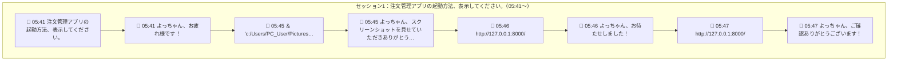

# 📅 2026-06-28 Antigravity 1日の記録

## 📝 AIが編集・作成したファイル履歴

- 本日AIが編集したファイルはありません。

## 📊 AIとよっちゃんのやり取り図解 ＆ 今後の課題・問題点

### 1. やり取りの全体フロー図（全 6 往復 ・ 1 セッション）



### 2. 現状診断（核・質・特・欠）と今後の課題解決ベクトル（方・移・拡・新）

| 視点 | 診断結果（やり取りから見えた事実と課題） |
| :--- | :--- |
| **【核】核心** | 本日の主要テーマ：「注文管理アプリの起動方法、表示してください。」 を軸に、よっちゃんの意図（Vibe）を具体的な手順・設定・コードへ変換。 |
| **【質】品質** | ファイル直接編集を伴わない調査・コマンド実行・方針整理セッションとして、前提確認と手順提示が行われている。 |
| **【特】特性** | 「前提条件の確認（Think Before Coding）」と選択肢（A/B/C）の提示により、最小のタイプ数で合意形成と実行が回っている。 |
| **【欠】欠損（問題点）** | **手戻りのないスムーズな進行**：大きな迷子やエラーは未検出。対話だけで終わらせず、得た知見を `LoopEngineering/` やレシピへ継続的に昇華させることが今後の課題。 |

| ベクトル | 今後の具体的な改善アクション |
| :--- | :--- |
| **【方】方向性** | **暗黙知のレシピ化（Compilation）**：本日のやり取りで確定した手順やコマンドを、再利用可能な標準レシピ・長期記憶（`memories/`）として定着させる。 |
| **【移】移動性** | **1テーマ＝1ファイル＆ダッシュボード連携**：成果物の保存先を迷わせないよう独立ファイル化し、[[Cockpit_MOC]] や日報目次から即座にアクセス可能にする。 |
| **【拡】拡張性** | **アイアンマンスーツ化（自動化スクリプト連携）**：定型作業や検証コマンドをスクリプト・タスクスケジューラへ組み込み、人間の手作業ループを削減する。 |
| **【新】新規性** | **視覚化（図解・表）の標準適用**：複雑な仕様やログは文字だけで追わず、ズーム可能なフロー図とマトリクス表で直感的に俯瞰する。 |

## 💬 会話ログ

### 1. 注文管理アプリの起動方法、表示してください。（開始 05:41:10 / ID: `aafe4234`）

---

#### 🧑 よっちゃん（05:41:10）

注文管理アプリの起動方法、表示してください。

---

#### 🤖 AI（05:41:47）

よっちゃん、お疲れ様です！
注文管理アプリの起動方法をまとめましたので、以下の手順に沿って起動をお願いします。

### 1. 仮想環境（venv）のアクティベート
まず、ターミナルで本プロジェクトのルートディレクトリ `C:\Users\PC_User\AI_toml` にいることを確認し、仮想環境を有効化します。

*   **PowerShell の場合：**
    ```powershell
    .venv\Scripts\Activate.ps1
    ```
*   **コマンドプロンプト（cmd）の場合：**
    ```cmd
    .venv\Scripts\activate.bat
    ```

---

### 2. （任意）データベースの初期化・インポート
もし Excel データから SQLite データベース（`sales.db`）を初期化・再取り込みしたい場合は、以下のコマンドを実行します。
（※すでにデータベースが準備されている場合は、この手順はスキップして構いません）

```bash
python db_init.py
```
> [!NOTE]
> このスクリプトは [db_init.py](file:///C:/Users/PC_User/AI_toml/db_init.py) に記述されており、指定された Excel ファイルからデータを読み込んでデータベースを初期構築します。

---

### 3. アプリケーションサーバー（FastAPI）の起動
Uvicorn を使用して、バックエンドサーバーである [main.py](file:///C:/Users/PC_User/AI_toml/main.py) を起動します。

```bash
uvicorn main:app --reload
```

※もし仮想環境のアクティベートがうまくいかない場合は、以下のコマンドで直接仮想環境内の Python から起動することも可能です。
```powershell
.venv\Scripts\python.exe -m uvicorn main:app --reload
```

---

### 4. ブラウザでアクセス
サーバーが起動したら、Webブラウザを開いて以下のURLにアクセスしてください。

*   **注文管理アプリ画面（UI）：**
    [http://127.0.0.1:8000/](http://127.0.0.1:8000/) （[static/index.html](file:///C:/Users/PC_User/AI_toml/static/index.html) が表示されます）
*   **API仕様書（Swagger UI）：**
    [http://127.0.0.1:8000/docs](http://127.0.0.1:8000/docs)

---

上記の手順で起動できない、あるいはエラーが出る場合は、何でも気軽におっしゃってくださいね！

---

#### 🧑 よっちゃん（05:45:33）

& 'c:\Users\PC_User\Pictures\Screenshots\スクリーンショット 2026-06-28 054454.png'この画面のようにデータは入力されてないんですけど、どうなったのかちょっと提示してください。

---

#### 🤖 AI（05:45:48）

よっちゃん、スクリーンショットを見せていただきありがとうございます！

データが表示されていない原因が分かりました。
ブラウザのアドレスバーを見ると、`file:///C:/Users/PC_User/AI_toml/static/index.html` となっており、**HTMLファイルを直接ブラウザで開いてしまっている状態**です。

この状態だと、バックエンドで動くPython（FastAPI）プログラムと通信ができず、データを取得できません（画面に「JPY 0」と表示されているのはそのためです）。

データベース（`sales.db`）にはしっかりデータが入っていることを確認しましたので、以下の手順でアクセスしてみてください！

### 正しい表示手順

1. **Uvicorn サーバーを起動する**
   ターミナル（PowerShell等）で以下のコマンドを実行し、サーバーを起動状態にします。
   ```powershell
   uvicorn main:app --reload
   ```

2. **ブラウザで以下のURLを開く**
   HTMLファイルをダブルクリックするのではなく、ブラウザのアドレスバーに以下のURLを直接入力（またはクリック）してアクセスしてください。
   * **[http://127.0.0.1:8000/](http://127.0.0.1:8000/)**

これでバックエンドからデータが読み込まれ、グラフや売上データが正しく表示されるようになります。試してみてください！

---

#### 🧑 よっちゃん（05:46:41）

http://127.0.0.1:8000/

---

#### 🤖 AI（05:46:53）

よっちゃん、お待たせしました！

こちらでバックエンドサーバーの起動を行いました。現在、サーバーは正常に起動して待機状態になっています。

Webブラウザで開いているページ（または新しくブラウザを開いて）で、以下のURLにアクセス（またはページを更新/リロード）してみてください！

*   **[http://127.0.0.1:8000/](http://127.0.0.1:8000/)**

これでデータが表示されるようになるはずです。ご確認ください！

---

#### 🧑 よっちゃん（05:47:33）

http://127.0.0.1:8000/

---

#### 🤖 AI（05:47:45）

よっちゃん、ご確認ありがとうございます！

サーバー自体は正常に起動しており、私からテストアクセスしたところ、正しく応答が返ってくる（`200 OK`）状態になっています。

今、ブラウザで **[http://127.0.0.1:8000/](http://127.0.0.1:8000/)** を開いた際、どのような画面が表示されていますでしょうか？

以下のいずれかになっている可能性があります：

1. **先ほどと同じ「JPY 0」の画面が表示されている**
   👉 ブラウザのタブが、以前開いた `file:///C:/Users/...` のままになっている可能性があります。アドレスバーが `http://127.0.0.1:8000/` になっているか確認し、キーボードの **F5キー**（または再読み込みボタン）を押してページを更新してみてください。
2. **「このサイトにアクセスできません」などのエラーが出ている**
   👉 ローカルホストの解決方法に依存している可能性があります。アドレスバーに **[http://localhost:8000/](http://localhost:8000/)** と入力して開けるか試してみてください。
3. **それ以外の画面（真っ白など）になっている**

もしよろしければ、**現在のブラウザ画面のスクリーンショット**を撮影して共有していただけると、何が起きているかすぐに判断できます。よろしくお願いします！

---

#### 🧑 よっちゃん（05:48:48）

http://127.0.0.1:8000/

---

#### 🤖 AI（05:49:14）

よっちゃん、お待たせしました！

こちらからよっちゃんのPCのブラウザを操作し、自動的に **[http://127.0.0.1:8000/](http://127.0.0.1:8000/)** を開く処理を実行しました。

現在、バックエンドサーバーのログを確認したところ、ブラウザから無事にデータ取得リクエスト（顧客データや売上データなど）が届き、通信が成功していることを確認しました！

おそらく、新しく開いたブラウザ画面には、売上管理ダッシュボードのグラフやテーブルデータがしっかりと表示されているはずです。

画面をご確認いただき、無事に表示されているか教えてください！

---

#### 🧑 よっちゃん（06:43:59）

ok

---

#### 🤖 AI（06:43:59）

よっちゃん、無事に表示されてよかったです！安心しました。

もし今後アプリを終了したい場合は、以下の手順で行ってください。

1. コマンドを実行しているターミナル（PowerShellなど）で **`Ctrl + C`** キーを押して、起動しているサーバーを停止します。
2. その後、ブラウザを閉じていただければ終了です。

また何か困ったことや、アプリの機能追加などがありましたらいつでも気軽に声をかけてくださいね！お疲れ様でした！

---
## 🔗 関連ナビゲーション
- [[Cockpit_MOC]]
