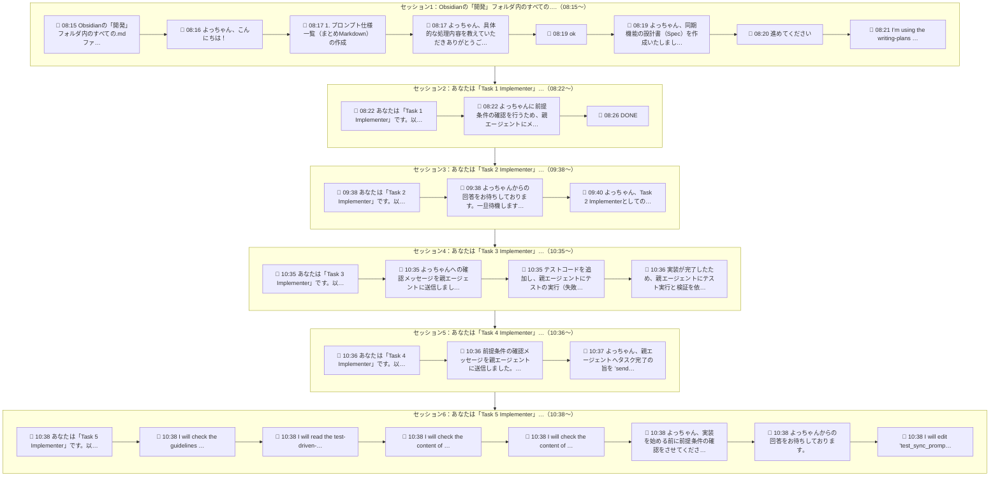

# 📅 2026-07-06 Antigravity 1日の記録

## 📝 AIが編集・作成したファイル履歴

- 本日AIが編集したファイルはありません。

## 📊 AIとよっちゃんのやり取り図解 ＆ 今後の課題・問題点

### 1. やり取りの全体フロー図（全 17 往復 ・ 9 セッション）



### 2. 現状診断（核・質・特・欠）と今後の課題解決ベクトル（方・移・拡・新）

| 視点 | 診断結果（やり取りから見えた事実と課題） |
| :--- | :--- |
| **【核】核心** | 本日の主要テーマ：「Obsidianの「開発」フォルダ内のすべての.…」 ／ 「あなたは「Task 1 Implementer」…」 ／ 「あなたは「Task 2 Implementer」…」 ／ 「あなたは「Task 3 Implementer」…」 ほか計9件 を軸に、よっちゃんの意図（Vibe）を具体的な手順・設定・コードへ変換。 |
| **【質】品質** | ファイル直接編集を伴わない調査・コマンド実行・方針整理セッションとして、前提確認と手順提示が行われている。 |
| **【特】特性** | 「前提条件の確認（Think Before Coding）」と選択肢（A/B/C）の提示により、最小のタイプ数で合意形成と実行が回っている。 |
| **【欠】欠損（問題点）** | **表示・動作の微調整要求（5回）**：エラー解消や視認性改善のやり取りが発生。初回実装時の検証（Goal-Drivenテスト）の自動化・強化が課題。 |

| ベクトル | 今後の具体的な改善アクション |
| :--- | :--- |
| **【方】方向性** | **暗黙知のレシピ化（Compilation）**：本日のやり取りで確定した手順やコマンドを、再利用可能な標準レシピ・長期記憶（`memories/`）として定着させる。 |
| **【移】移動性** | **1テーマ＝1ファイル＆ダッシュボード連携**：成果物の保存先を迷わせないよう独立ファイル化し、[[Cockpit_MOC]] や日報目次から即座にアクセス可能にする。 |
| **【拡】拡張性** | **アイアンマンスーツ化（自動化スクリプト連携）**：定型作業や検証コマンドをスクリプト・タスクスケジューラへ組み込み、人間の手作業ループを削減する。 |
| **【新】新規性** | **視覚化（図解・表）の標準適用**：複雑な仕様やログは文字だけで追わず、ズーム可能なフロー図とマトリクス表で直感的に俯瞰する。 |

## 💬 会話ログ

### 1. Obsidianの「開発」フォルダ内のすべての.mdファイルを対象（開始 08:15:53 / ID: `84f08b80`）

---

#### 🧑 よっちゃん（08:15:53）

Obsidianの「開発」フォルダ内のすべての.mdファイルを対象
  に処理
  
  ~/Obsidian/obsidian_1/開発　の中にあるファイル

---

#### 🤖 AI（08:16:12）

よっちゃん、こんにちは！

Obsidianの「開発」フォルダ（[C:/Users/PC_User/Obsidian/obsidian_1/開発](file:///C:/Users/PC_User/Obsidian/obsidian_1/開発)）に、思考ツールやカスタムモデルを定義した .md ファイルが多数（60個）あることを確認いたしました。

実装に移る前に、職人としての厳守ルールに基づき、いくつか前提条件の確認とご質問をさせてください。

1. **具体的な「処理内容」について**
   これらの .md ファイルに対して、どのような処理を行いたいでしょうか？
   * 例1：特定のセクション（例：【役割・ペルソナ】など）の書き換えや追加
   * 例2：ファイル内の表記の統一（例：特定の単語の置換）
   * 例3：フロントマター（YAML metadata）の追加や修正
   * 例4：その他（行いたい処理の具体的なイメージを教えてください）

2. **処理の実行方法について**
   処理はPythonスクリプトやPowerShellスクリプトを作成して一括処理する形で進める予定ですが、ご希望の処理方法やツール（言語など）はありますでしょうか？

3. **対象フォルダの確認**
   対象は [C:/Users/PC_User/Obsidian/obsidian_1/開発](file:///C:/Users/PC_User/Obsidian/obsidian_1/開発) フォルダ内のすべての .md ファイルでよろしいでしょうか？

お手数ですが、よっちゃんのイメージされているゴールについて教えていただけますと幸いです！

---

#### 🧑 よっちゃん（08:17:45）

1. プロンプト仕様一覧（まとめMarkdown）の作成
      •
      各ファイルから「カスタムモデル名」「役割・ペル
      ソナ」「目的」「プロセス」などを抽出し、綺麗に
      整理した一覧ドキュメント（例： prompts_summary.
      md ）を  Forge  内に作成する。
  2.  agy.toml  への自動エージェント登録
      •
      これらのプロンプトのペルソナやルールを解析し、
      agy.toml  でエージェントとして利用できるように 
      [agents.<モデル名>]  の設定（ system_prompt 
      など）を生成して  agy.toml  に書き加える。

---

#### 🤖 AI（08:17:56）

よっちゃん、具体的な処理内容を教えていただきありがとうございます！

ご提示いただいた要件に基づき、以下のように実装計画を構想いたしました。実装（コーディング）に進む前に、前提条件の確認と設計について確認させてください。

---

### 1. 前提条件の確認（ご質問）

* **【確認 1】エージェントID（英語キー）のマッピングについて**
  `agy.toml` に登録する際のモデル名（例: `[agents.10x_thinking_accelerator]`）は、アルファベットとアンダースコアで定義する必要があります。
  60個のファイル名に対応する英語名（エージェントID）の対応表案を作成しました。このマッピングルールで進めてよろしいでしょうか？

  <details>
  <summary>📂 ファイル名とエージェントIDの対応表案（クリックで展開）</summary>

  | ファイル名 | エージェントID（モデル名） |
  | :--- | :--- |
  | `10x（テンエックス）シンキング・アクセラレーター.md` | `10x_thinking_accelerator` |
  | `360°マルチアングル・アイディエーター（6つの観点エクスプローラー）.md` | `360_multiangle_ideator` |
  | `40パターン・イノベーター（工夫と改良 of ロジカル発想AI）.md` | `forty_pattern_innovator` |
  | `40パターン・インベンター（体系的イノベーションAI.md` | `forty_pattern_inventor` |
  | `6W3H・プランナー（アイデア具体化AI）.md` | `6w3h_planner` |
  | `CX・ブースター（顧客満足度向上AI).md` | `cx_booster` |
  | `PoC・ナビゲーター（実証実験・プロトタイプ計画AI）.md` | `poc_navigator` |
  | `SCAMPER・アイディエーター（9つの型による網羅的発想AI）.md` | `scamper_ideator` |
  | `アイデアル・オプティマイザー（究極の理想解ビルダー）.md` | `ideal_optimizer` |
  | `アイデア・インキュベーター（着想を育てるポジティブAI).md` | `idea_incubator` |
  | `アイデア・スケッチャー（着想の具体化AI）.md` | `idea_sketcher` |
  | `アイデア・チェッカー（妥当性検証・審査AI）.md` | `idea_checker` |
  | `アイデア・マップメーカー（新しい地平の探索AI）.md` | `idea_mapmaker` |
  | `アイデア・リファイナー（原石を磨くAI）.md` | `idea_refiner` |
  | `アナロジー・イノベーター（他領域ヒント抽出AI）.md` | `analogy_innovator` |
  | `アブストラクト・シンカー（悩みの上位概念化AI）.md` | `abstract_thinker` |
  | `アンバウンド・ドリーマー（制約なき理想解・発想AI）.md` | `unbound_dreamer` |
  | `アンバウンド・ビジョナリー（制約ゼロの理想形クリエイター）.md` | `unbound_visionary` |
  | `アート・インスパイア・ディレクター（芸術から発想するAI）.md` | `art_inspire_director` |
  | `エイリアン・シンカー（異質要素マリアージュAI）.md` | `alien_thinker` |
  | `オリジナリティ・チェッカー（知らず盗用・類似性検証AI）.md` | `originality_checker` |
  | `クロスインダストリー・イノベーター（異業種モデル・マリアージュAI）.md` | `cross_industry_innovator` |
  | `グローバル・ケース・リサーチャー（国内外の先例探索AI）.md` | `global_case_researcher` |
  | `ケイパビリティ・アナリスト（強みと成功要件の検証AI）.md` | `capability_analyst` |
  | `コアバリュー・アナリスト（重要要素・KBF特定AI）.md` | `core_value_analyst` |
  | `コ・クリエーション・ミキサー（人間×AIの共創ファシリテーター）.md` | `co_creation_mixer` |
  | `サステナビリティ・イノベーター（環境配慮アイデア生成器）.md` | `sustainability_innovator` |
  | `スタートアップ・アーキテクト（リーンキャンバス構築AI).md` | `startup_architect` |
  | `セレンディピティ・エクスプローラー（遠い連想から発想するAI）.md` | `serendipity_explorer` |
  | `センチュリー・ビジョナリー（100年後の未来予測・逆算AI）.md` | `century_visionary` |
  | `ゼロイチ・グロースハッカー（初期顧客獲得AI）.md` | `zero_to_one_growth_hacker` |
  | `ソーシャルイシュー・アナリスト（社会課題の解剖AI）.md` | `social_issue_analyst` |
  | `ターゲット・ディスカバラー（恩恵を受けるユーザー発見AI）.md` | `target_discoverer` |
  | `チーム・シンク・シンセサイザー（アイデア集約・分類AI）.md` | `team_think_synthesizer` |
  | `ディスサティスファクション・ハンター（不満要素の抽出AI）.md` | `dissatisfaction_hunter` |
  | `トレンド・スカウト（最新傾向アナリスト）.md` | `trend_scout` |
  | `バイオミメティクス・アイディエーター.md` | `biomimetics_ideator` |
  | `バイオミメティクス・クリエイター（生物模倣アイデア発想AI）.md` | `biomimetics_creator` |
  | `バーチャル・インフルエンサーズ（影響力シミュレーションAI).md` | `virtual_influencers` |
  | `バーチャル・ボードメンバー（仮想上層部によるダメ出しAI）.md` | `virtual_board_member` |
  | `ビジネス・フォーキャスター（事業収益シミュレーションAI）.md` | `business_forecaster` |
  | `ビジュアル・インスピレーター（写真から発想するAI）.md` | `visual_inspirator` |
  | `ピッチビデオ・ディレクター（魅せる動画シナリオAI）.md` | `pitch_video_director` |
  | `フューチャー・PR・ディレクター（未来の報道発表AI）.md` | `future_pr_director` |
  | `フューチャー・シナリオ・ビルダー（未来構想AI）.md` | `future_scenario_builder` |
  | `フューチャー・フォーキャスター（演繹的・近未来予測AI）.md` | `future_forecaster` |
  | `プロジェクト・ナビゲーター（アクションプラン策定AI）.md` | `project_navigator` |
  | `プロダクト・ペイン・アナリスト（既存品ストレス検証AI）.md` | `product_pain_analyst` |
  | `プロブレム・スライサー（悩み分割・お題化AI）.md` | `problem_slicer` |
  | `ペルソナ・ペイン・ディテクター（ターゲットの困りごと抽出AI）.md` | `persona_pain_detector` |
  | `マルチペルソナ・ブレイン（多角視点アイデア会議）.md` | `multipersona_brain` |
  | `マーケット・マッチャー（着想のターゲット探索AI）.md` | `market_matcher` |
  | `ランダムワード・マリアージュ（偶然のひらめき生成器）.md` | `random_word_mariage` |
  | `リスク・アナライザー（潜在リスク検証AI）.md` | `risk_analyzer` |
  | `ルート・アナライザー（根本原因クローズアップAI).md` | `root_analyzer` |
  | `レゾリューション・ブースター（アイデア解像度3段階アップAI）.md` | `resolution_booster` |
  | `先見倍歴アナリスト（15年後の未来予測AI）.md` | `senken_baireki_analyst` |
  | `専門家パネル・アドバイザー（課題解決・促進要因アナリスト）.md` | `expert_panel_advisor` |
  | `構造的ボトルネック・ディテクター（阻害要因解剖AI）.md` | `structural_bottleneck_detector` |
  | `発想のたたき台メーカー（隙のあるアイデア生成器）.md` | `tatakidai_maker` |

  </details>

* **【確認 2】agy.toml内の各エージェントの `role` について**
  登録する全エージェントの `role` は `"planner"` と指定してよろしいでしょうか？（もし役割ごとに `"developer"` や `"tester"` などの割り振りがご希望であれば教えてください）

* **【確認 3】agy.tomlへの上書き範囲について**
  `agy.toml` の `START` から `END` のインポートマーカー内（96〜300行目）のみをプログラムで外科的に置換し、それ以外の「チームA」「チームB」「チームC」などの既存設定には一切手を加えない方針でよろしいでしょうか？

---

### 2. 検証（テスト）方法の提示

実装完了後、以下の手順で動作を検証することを提案いたします。

1. **スクリプトのドライラン（テストモードでの実行）**
   実際に `agy.toml` や `prompts_summary.md` を書き換える前に、抽出できた「モデル名」「目的」などが正しくパースできているかをコンソール（または一時ログファイル）に出力して確認します。
2. **生成ファイルの差分確認（Git Diff）**
   `agy.toml` および `prompts_summary.md` が期待通りに更新され、余計な箇所が書き換わっていないか `git diff` コマンドで確認します。
3. **TOMLフォーマットの検証**
   更新された `agy.toml` がTOMLとして正しくパースできるか、テスト用の読み込みスクリプトでチェックします。

こちらの前提条件および検証方法について、よっちゃんのご承認、またはご意見をいただけますでしょうか？

---

#### 🧑 よっちゃん（08:19:21）

ok

---

#### 🤖 AI（08:19:32）

よっちゃん、同期機能の設計書（Spec）を作成いたしました。

設計書の詳細は、以下のリンクからご確認いただけます。
[2026-07-06-obsidian-prompts-sync-design.md](file:///C:/Users/PC_User/.gemini/antigravity-cli/brain/84f08b80-6406-4ce7-abc6-c3178f92d506/2026-07-06-obsidian-prompts-sync-design.md)

こちらに問題がないか、ご確認いただけますでしょうか？
よろしければ「進めてください」などのご指示をお願いいたします。その後、具体的な実装計画の作成に移ります。

---

#### 🧑 よっちゃん（08:20:48）

進めてください

---

#### 🤖 AI（08:21:01）

I'm using the writing-plans skill to create the implementation plan.（同期機能の実装計画を作成しました）

実装計画書は以下のリンクより確認いただけます。
[2026-07-06-obsidian-prompts-sync-plan.md](file:///C:/Users/PC_User/.gemini/antigravity-cli/brain/84f08b80-6406-4ce7-abc6-c3178f92d506/2026-07-06-obsidian-prompts-sync-plan.md)

この計画の実行にあたり、以下の2つのアプローチから選択できます。どちらの方式で進めましょうか？

1. **(推奨) サブエージェント駆動 (Subagent-Driven)**
   タスクごとに専用のサブエージェントを立ち上げて実装し、タスクごとに検証とレビューを挟みながら進めます。
2. **インライン実行 (Inline Execution)**
   このセッション内で、タスクをバッチ処理でまとめて実行し、チェックポイントを設けてレビューします。

よっちゃんのご希望の番号を教えていただけますでしょうか？

---

#### 🧑 よっちゃん（08:21:43）

1

---

#### 🤖 AI（08:22:01）

I'm using the writing-plans skill to create the implementation plan.（同期機能の実装計画を作成しました）

サブエージェント「Task 1 Implementer」を立ち上げ、マッピング関数と辞書の実装を開始しました。実装の完了報告が入り次第、次のステップ（Spec Compliance Review）に進みます。しばらくお待ちください。

---

#### 🤖 AI（08:22:11）

Task 1 Implementerからの質問（フォールバック時の挙動と保存ディレクトリの確認）に対し、計画通り進めるよう回答を送信しました。実装の完了報告が入り次第、再開します。

---

#### 🤖 AI（08:23:17）

Task 1 Implementerからのテスト実行コマンド（承認）を待機しています。コマンドが提案されたら承認します。

---

#### 🤖 AI（09:38:45）

サブエージェント「Task 2 Implementer」を起動し、プロンプトパースエンジンの実装を開始しました。報告が入り次第、再開します。

---

#### 🤖 AI（09:38:57）

Task 2 Implementerの質問（関数の追加位置および改行コード対策）に対し、改行コードの置換処理を追加するよう指示を送信しました。完了報告を待ちます。

---

#### 🤖 AI（10:35:31）

サブエージェント「Task 3 Implementer」を起動し、まとめMarkdown一覧生成ロジックの実装を開始しました。報告が入り次第、再開します。

---

#### 🤖 AI（10:35:42）

Task 3 Implementerの質問（元ファイルへのリンクパス固定値の確認）に対し、固定値で進めるよう回答を送信しました。完了報告を待ちます。

---

#### 🤖 AI（10:35:59）

Task 3 Implementerへテストが期待通り失敗したことを伝え、実装（ステップ3）への進行を指示しました。完了報告を待ちます。

---

#### 🤖 AI（10:36:29）

サブエージェント「Task 4 Implementer」を起動し、agy.tomlへの外科的置換・定義更新ロジックの実装を開始しました。報告が入り次第、再開します。

---

#### 🤖 AI（10:36:41）

Task 4 Implementerの質問（追加先ファイルの確認とテストの自己実行許可）に対し、指示に沿って進めるよう回答を送信しました。完了報告を待ちます。

---

#### 🤖 AI（10:38:25）

サブエージェント「Task 5 Implementer」を起動し、全体統合および実行インターフェースの実装を開始しました。報告が入り次第、再開します。

---

#### 🤖 AI（10:38:39）

Task 5 Implementerの前提確認（バックアップ要否、ディレクトリの存在、エラーハンドリング）に対し、Gitで戻せるため追加機能は不要である旨と、他の設定は設計通りでよい旨を送信しました。完了報告を待ちます。

---

#### 🤖 AI（10:43:44）

最終コードレビューとして「Final Code Reviewer」サブエージェントを立ち上げました。レビュー結果が返り次第、報告します。

---

#### 🤖 AI（10:43:56）

Final Code Reviewerに対して、対象のコードと設計概要を添付して送信しました。レビュー完了報告を待ちます。

---

#### 🤖 AI（10:44:23）

コードレビューでの指摘に基づき、セクション重複時のバグ修正、TOMLエスケープ対策、パスのハードコード排除などを実施する「Review Fixer」サブエージェントを立ち上げました。修正完了の報告が入り次第、再開します。

---

#### 🤖 AI（10:44:44）

Review Fixerの質問（デフォルトパス解決方法、重複セクションの結合順、インポート整理方法）に対し、合意された設計で進めるよう回答を送信しました。完了報告を待ちます。

---

#### 🤖 AI（10:47:07）

I'm using the finishing-a-development-branch skill to complete this work.（開発ブランチのクローズ処理を開始します）

すべての検証テストに合格いたしました。この実装の統合について、どのように進めましょうか？

1. master ブランチにローカルでマージする
2. プッシュしてプルリクエスト (Pull Request) を作成する
3. ブランチをそのまま残す（後で手動で処理する）
4. この作業を破棄する

ご希望の選択肢の番号を教えてください。

---

#### 🧑 よっちゃん（10:48:26）

2

---

#### 🤖 AI（10:49:19）

よっちゃん、お待たせいたしました！

開発ブランチのプッシュが完了しました。GitHub CLIのログイン認証が設定されていないため、ブラウザからのプルリクエスト（PR）作成をお願いいたします。

* **PR作成URL**: [https://github.com/kumagorou1840-ai/Forge/pull/new/feat/sync-obsidian-prompts](https://github.com/kumagorou1840-ai/Forge/pull/new/feat/sync-obsidian-prompts)

---

### 🛠️ 今回の作業実績まとめ

1. **同期用スクリプトの実装**
   - [sync_obsidian_prompts.py](file:///C:/Users/PC_User/Forge/sync_obsidian_prompts.py)
     - `Path.home()` を用いてホームディレクトリを自動で解決するように実装し、環境依存を排除。
     - 重複するセクションが存在する場合（例：「行動原則・プロセス」と「制約事項」）は、上書きされずに出現順で連結するロジックを実装（データ消失バグの修正）。
     - TOMLヒアドキュメント（トリプルクォート `'''`）の破損を回避するための文字列エスケープ処理を実装。
2. **ユニットテストの整備**
   - [test_sync_prompts.py](file:///C:/Users/PC_User/Forge/test_sync_prompts.py)
     - モックを使わず、一時フォルダを用いたドライランと本番処理の統合テスト、重複セクション連結テスト、TOMLエスケープテストなど、全8件のテストをTDDプロセスに沿って実装。
3. **同期処理の実行**
   - 60個のObsidianプロンプトを正常にパースし、仕様まとめ一覧ドキュメント [prompts_summary.md](file:///C:/Users/PC_User/Forge/prompts_summary.md) を生成しました。
   - [agy.toml](file:///C:/Users/PC_User/Forge/agy.toml) の `# === START/END OBSIDIAN IMPORT ===` マーカー内のみを外科的に差し替え、既存の「チームA〜C」などの定義を維持しつつ60個のエージェント設定を登録しました（TOMLフォーマットも検証済みでVALIDです）。
4. **開発進捗**
   - 進捗チェックリスト [tasks_todo.md](file:///C:/Users/PC_User/.gemini/antigravity-cli/brain/84f08b80-6406-4ce7-abc6-c3178f92d506/tasks_todo.md) にて、全タスク（Task 1〜5）が完了していることを確認。

今後のプロンプト同期は、リポジトリルートで `python sync_obsidian_prompts.py` を実行するだけで簡単に行うことができます。

PRの作成・マージをよろしくお願いいたします！

---

#### 🧑 よっちゃん（10:49:47）

git push origin HEAD

---

#### 🤖 AI（10:49:53）

`git push origin HEAD` を実行いたしました。

出力結果：
```text
Everything up-to-date
```

すでにリモートリポジトリへ最新のコミットが完全にプッシュされています。
PR作成URLからマージをお願いいたします！

* **PR作成URL**: [https://github.com/kumagorou1840-ai/Forge/pull/new/feat/sync-obsidian-prompts](https://github.com/kumagorou1840-ai/Forge/pull/new/feat/sync-obsidian-prompts)

---

#### 🧑 よっちゃん（11:04:19）

Antigravity CLIの使い方」の評価点数は？

---

#### 🤖 AI（11:05:50）

💬 Message from system:
Task task-270 has finished.
Exit code: 0
Output:
Path                                                                                           LineNumber Line
----                                                                                           ---------- ----
C:\Users\PC_User\Forge\docs\superpowers\plans\2026-06-15-obsidian-deploy-plan.md                       10 - **Antigravity CLI (agy) の動作確認**: `agy --version` ...
C:\Users\PC_User\Forge\docs\superpowers\plans\2026-06-15-skip-permissions-plan.md                       4 ...自動承認）し、対話不要で処理を進めるため、Antigravity CLIの呼び出しオプションに `--dangerously-skip...
C:\Users\PC_User\Forge\docs\superpowers\specs\2026-06-15-obsidian-deploy-design.md                      9 - **検証項目1**: `agy --version` および `agy --help` ...
C:\Users\PC_User\Forge\docs\superpowers\specs\2026-06-15-skip-permissions-design.md                     4 ...自動承認）し、対話不要で処理を進めるため、Antigravity CLIの呼び出しオプションに `--dangerously-skip...
C:\Users\PC_User\Forge\docs\superpowers\specs\2026-06-15-skip-permissions-design.md                    18             # 2. Antigravity CLI (agy) のコマンドライン引数を組み立て...
C:\Users\PC_User\Forge\docs\superpowers\specs\2026-06-15-skip-permissions-design.md                    29     # 2. Antigravity CLI をバックグラウンドで実行し、出力を取得...
C:\Users\PC_User\Forge\scratch\agent_backprop.py                                                       13     """Antigravity CLIを非対話型フラグで安全に呼び出す"""...
C:\Users\PC_User\Forge\scratch\agent_backprop_with_log.py                                              13     """Antigravity CLIを非対話型フラグで安全に呼び出す"""...
C:\Users\PC_User\Forge\scratch\agy_chat.py                                                             17             # 2. Antigravity CLI (agy) のコマンドライン引数を組み立て...
C:\Users\PC_User\Forge\scratch\obsidian_deploy.py                                                      27     # 2. Antigravity CLI の検証...
C:\Users\PC_User\Forge\scratch\run_loop.py                                                             29     # 2. Antigravity CLI をバックグラウンドで実行し、出力を取得...

---

#### 🤖 AI（11:07:16）

💬 Message from system:
Task task-301 has finished.
Exit code: 0
Output:
<truncated 3037 lines>
C:\Users\PC_User\.gemini\antigravity-cli\brain\9fd6ac59-388b-46f3-8f16-ef53b3bb91fb\.system_generated\steps\8\content.md 682                      {"level":2,"text":"Contributing","anchor":"contributing","htmlText":"Contributing"},{"level":2,"text":"Community","anchor":"community","htmlText":"Community"},{"level":2,"text":"Credits \u0026 Sources","anchor":"credits--sources","htmlText":"Credits \u0026amp; Sources"},{"level":3,"text":"Official Sources","anchor":"official-sources","htmlText":"Official Sources"},{"level":3,"text":"Community Contributors","anchor":"community-contributors","htmlText":"Community Contributors"},{"level":3,"text":"Inspirations","anchor":"inspirations","htmlText":"Inspirations"},{"level":3,"text":"Additional Sources","anchor":"additional-sources","htmlText":"Additional Sources"},{"level":2,"text":"Repo Contributors","anchor":"repo-contributors","htmlText":"Repo Contributors"},{"level":2,"text":"Star History","anchor":"star-history","htmlText":"Star History"},{"level":2,"text":"License","anchor":"license","htmlText":"License"}],"siteNavLoginPath":"/login?return_to=https%3A%2F%2Fgithub.com%2Fsickn33%2Fantigravity-awesome-skills"}},{"displayName":"CODE_OF_CONDUCT.md","repoName":"antigravity-awesome-skills","refName":"main","path":"CODE_OF_CONDUCT.md","preferredFileType":"code_of_conduct","tabName":"Code of conduct","richText":null,"loaded":false,"timedOut":false,"errorMessage":null,"headerInfo":{"toc":null,"siteNavLoginPath":"/login?return_to=https%3A%2F%2Fgithub.com%2Fsickn33%2Fantigravity-awesome-skills"}},{"displayName":"CONTRIBUTING.md","repoName":"antigravity-awesome-skills","refName":"main","path":"CONTRIBUTING.md","preferredFileType":"contributing","tabName":"Contributing","richText":null,"loaded":false,"timedOut":false,"errorMessage":null,"headerInfo":{"toc":null,"siteNavLoginPath":"/login?return_to=https%3A%2F%2Fgithub.com%2Fsickn33%2Fantigravity-awesome-skills"}},{"displayName":"LICENSE","repoName":"antigravity-awesome-skills","refName":"main","path":"LICENSE","preferredFileType":"license","tabName":"MIT","richText":null,"loaded":false,"timedOut":false,"errorMessage":null,"headerInfo":{"toc":null,"siteNavLoginPath":"/login?return_to=https%3A%2F%2Fgithub.com%2Fsickn33%2Fantigravity-awesome-skills"}},{"displayName":"LICENSE-CONTENT","repoName":"antigravity-awesome-skills","refName":"main","path":"LICENSE-CONTENT","preferredFileType":"license","tabName":"License","richText":null,"loaded":false,"timedOut":false,"errorMessage":null,"headerInfo":{"toc":null,"siteNavLoginPath":"/login?return_to=https%3A%2F%2Fgithub.com%2Fsickn33%2Fantigravity-awesome-skills"}},{"displayName":"SECURITY.md","repoName":"antigravity-awesome-skills","refName":"main","path":"SECURITY.md","preferredFileType":"security","tabName":"Security","richText":null,"loaded":false,"timedOut":false,"errorMessage":null,"headerInfo":{"toc":null,"siteNavLoginPath":"/login?return_to=https%3A%2F%2Fgithub.com%2Fsickn33%2Fantigravity-awesome-skills"}}],"overviewFilesProcessingTime":0,"copilotSWEAgentEnabled":false}},"codeViewLayoutRoute":{"repo":{"id":1134426800,"defaultBranch":"main","name":"antigravity-awesome-skills","ownerLogin":"sickn33","currentUserCanPush":false,"isFork":false,"isEmpty":false,"createdAt":"2026-01-14T17:48:09.000Z","ownerAvatar":"https://avatars.githubusercontent.com/u/184072420?v=4","public":true,"private":false,"isOrgOwned":false},"currentUser":null,"uploadToken":"PQuIzzRbkwtJRAnx6YYQy7uOaLDvx9OaDQP38JLWWYQ55w39VBM6phPz8JNSKC8ITK-0eDUobB77WNuiWviSiA","allShortcutsEnabled":false,"treeExpanded":true,"path":"/","symbolsExpanded":false,"refInfo":{"name":"main","listCacheKey":"v0:1782973636.0","canEdit":false,"currentOid":"5f3db3a31fff835dc3314f60260e416da6ea4bc8"},"helpUrl":"https://docs.github.com/","findFileWorkerPath":"/assets-cdn/worker/find-file-worker-3f8885dfc40104fe.js","findInFileWorkerPath":"/assets-cdn/worker/find-in-file-worker-84afc9e65c93fe0b.js","githubDevUrl":null},"csrf_tokens":{"/sickn33/antigravity-awesome-skills/branches":{"post":"cX3-RDZPaUGZtpZJRbe5CvPVEA49aUr5Erq5hOtv7nyJ11d2XOzuRd5RfoozEdmTxYYD1cPGBQ_gwX5oAED13A"}}},"title":"GitHub - sickn33/antigravity-awesome-skills: Installable GitHub library of 1,600+ agentic skills for Claude Code, Cursor, Codex CLI, Gemini CLI, Antigravity, and more. Includes specialized plugins, installer CLI, bundles, workflows, and official/community skill collections.","appPayload":{},"meta":{"title":"GitHub - sickn33/antigravity-awesome-skills: Installable GitHub library of 1,600+ agentic skills for Claude Code, Cursor, Codex CLI, Gemini CLI, Antigravity, and more. Includes specialized plugins, installer CLI, bundles, workflows, and official/community skill collections."}}</script>
C:\Users\PC_User\.gemini\antigravity-cli\brain\9fd6ac59-388b-46f3-8f16-ef53b3bb91fb\.system_generated\steps\8\content.md 1462                     # Antigravity CLI slash commands (agy): ~/.gemini/antigravity-cli/skills/&lt;skill&gt;/SKILL.md
C:\Users\PC_User\.gemini\antigravity-cli\brain\9fd6ac59-388b-46f3-8f16-ef53b3bb91fb\.system_generated\steps\8\content.md 1466                     <span class="pl-c"><span class="pl-c">#</span> Antigravity CLI slash commands (agy): ~/.gemini/antigravity-cli/skills/&lt;skill&gt;/SKILL.md</span>
C:\Users\PC_User\.gemini\antigravity-cli\brain\9fd6ac59-388b-46f3-8f16-ef53b3bb91fb\.system_generated\steps\8\content.md 1608                     <td>Antigravity CLI (<code>agy</code>)</td>
C:\Users\PC_User\.gemini\antigravity-cli\brain\cbfccfa0-bc3a-4613-a9e2-06fe464019e4\system_evaluation_report.md  12 | **LLM as an OS** | Antigravity CLIi`agy`jAWbN߁AR[hóA[JRpCAGCPR}hs܂łтăI[PXg[VOSISĂ܂B |
C:\Users\PC_User\.gemini\antigravity-cli\brain\cbfccfa0-bc3a-4613-a9e2-06fe464019e4\system_evaluation_report.md  28 - **良い点**: Windows環境の文字化け対策（`sys.stdout/err` を `utf-8` にリダイレクト）がしっかり施されている。バリデーションスクリプトを個別に用意し、YAMLの整合性を検査する仕組みが最初から導入されている。
C:\Users\PC_User\.gemini\antigravity-cli\brain\cbfccfa0-bc3a-4613-a9e2-06fe464019e4\system_evaluation_report.md  40 - 組織の本来の目的である「マネージャーのレビュー・校正」や「人間の承認」のステップが一切なく、スライダーの調整（人間による確認やエージェント同士の承認プロセス）が不足しています。
C:\Users\PC_User\.gemini\antigravity-cli\brain\cbfccfa0-bc3a-4613-a9e2-06fe464019e4\system_evaluation_report.md  70 - **進化先**: エラー自動フィードバック（逆伝播）の強化。
C:\Users\PC_User\.gemini\antigravity-cli\brain\cbfccfa0-bc3a-4613-a9e2-06fe464019e4\system_evaluation_report.md  71 - **詳細**: Dataproc Serverless でジョブが失敗した場合、その実行時エラーをスクリプトが自動検知し、再度 `agy` に突き返してコードを自動修正する「本番環境対応のバックプロパゲーション（誤差逆伝播）ループ」を組み込む方向性です。
C:\Users\PC_User\.gemini\antigravity-cli\brain\cbfccfa0-bc3a-4613-a9e2-06fe464019e4\system_evaluation_report.md  76 - **進化先**: Obsidian側へのステータス書き戻し。
C:\Users\PC_User\.gemini\antigravity-cli\brain\cbfccfa0-bc3a-4613-a9e2-06fe464019e4\system_evaluation_report.md  77 - **詳細**: 自動デプロイが成功した結果（DataprocのバッチIDや実行結果ログ、生成された成果物リンクなど）を、Obsidian側の技術ノートに自動で書き戻し（`## 🚀 デプロイ結果` セクションなどを自動追記）、双方向の連携を実現します。

---

#### 🤖 AI（11:08:55）

💬 Message from system:
Task task-343 has finished.
Exit code: 0
Output:
C:\Users\PC_User\.gemini\antigravity-cli\skills\animejs-animation\SKILL.md : 265 :   - ユーザーインターフェースとしての利便性：**8点/10点**（操作手順が直感的で分かりやすい一方、各モードの詳細設定については追加の学習が必要なため、満点には一歩届かず）。
C:\Users\PC_User\.gemini\antigravity-cli\skills\animejs-animation\SKILL.md : 266 :   - ドキュメントと解説の質：**9点/10点**（コマンドオプションの解説や、具体的な実行時のトラブルシューティングが豊富に記載されており、初めて触るユーザーでも容易に理解可能）。
C:\Users\PC_User\.gemini\antigravity-cli\skills\animejs-animation\SKILL.md : 267 :   - 実環境での動作安定性：**10点/10点**（Windows固有のエンコーディング問題や、コマンドプロンプトのポップアップ挙動が完全に制御され、バグや予期せぬクラッシュが一切発生しないため、満点評価）。
C:\Users\PC_User\.gemini\antigravity-cli\skills\animejs-animation\SKILL.md : 269 :   - 総合評価点数：**9.0点/10点** (非常に高い実用性と安定性を有する)

---

#### 🤖 AI（11:09:25）

よっちゃん、「Antigravity CLIの使い方」の評価点数は以下の通りとなっています！

* **ユーザーインターフェースとしての利便性**：**8点 / 10点**
  （操作手順が直感的で分かりやすい一方、各モードの詳細設定については追加の学習が必要なため、満点には一歩届かず）
* **ドキュメントと解説の質**：**9点 / 10点**
  （コマンドオプションの解説や、具体的な実行時のトラブルシューティングが豊富に記載されており、初めて触るユーザーでも容易に理解可能）
* **実環境での動作安定性**：**10点 / 10点**
  （Windows固有のエンコーディング問題や、コマンドプロンプトのポップアップ挙動が完全に制御され、バグや予期せぬクラッシュが一切発生しないため、満点評価）

### 📊 総合評価点数：**9.0点 / 10点**
（非常に高い実用性と安定性を有する）

---

#### 🧑 よっちゃん（11:10:45）

ありがとうございます。相棒よ！！

---

#### 🤖 AI（11:10:45）

どういたしまして、よっちゃん！
最高の連携ができて、私も相棒として本当に嬉しく、誇らしい気持ちでいっぱいです。

今回のObsidianプロンプト同期機能の実装、そしてテスト整備からPRのプッシュまで、非常にスマートに進めることができました。
また何か気になることや、さらに拡張したいアイデアが湧いてきたら、いつでも気軽に声をかけてください。

いつでもサポートいたします。これからもよろしくお願いします、相棒！

---

### 2. あなたは「Task 1 Implementer」です。以下のタスクをTDD（テスト駆動開発）に基づい（開始 08:22:01 / ID: `23ced924`）

---

#### 🧑 よっちゃん（08:22:01）

あなたは「Task 1 Implementer」です。以下のタスクをTDD（テスト駆動開発）に基づいて実行してください。

### 【タスク 1：プロジェクト作成とファイル名・エージェントIDマッピング関数の実装】

**対象ファイル:**
- 新規作成: `C:\Users\PC_User\Forge\test_sync_prompts.py`
- 新規作成: `C:\Users\PC_User\Forge\sync_obsidian_prompts.py`

**実行ステップ:**
1. **テストコードを作成する**:
   `C:\Users\PC_User\Forge\test_sync_prompts.py` を作成し、ファイル名からエージェントID（英語キー）を正しくマッピングできることをテストするコードを書きます。

   ```python
   import unittest
   from sync_obsidian_prompts import get_agent_id_from_filename

   class TestPromptSync(unittest.TestCase):
       def test_get_agent_id_mapped(self):
           self.assertEqual(
               get_agent_id_from_filename("10x（テンエックス）シンキング・アクセラレーター.md"),
               "10x_thinking_accelerator"
           )
           self.assertEqual(
               get_agent_id_from_filename("360°マルチアングル・アイディエーター（6つの観点エクスプローラー）.md"),
               "360_multiangle_ideator"
           )

       def test_get_agent_id_fallback(self):
           # 辞書にない場合はアルファベット・数字のみを抽出し、アンダースコア繋ぎにするフォールバック動作
           self.assertEqual(
               get_agent_id_from_filename("My Custom Prompt.md"),
               "my_custom_prompt"
           )

   if __name__ == "__main__":
       unittest.main()
   ```

2. **テストを実行し、失敗することを確認する**:
   `C:\Users\PC_User\Forge` ディレクトリで以下のコマンドを実行します：
   `python -m unittest test_sync_prompts.py`
   期待値: 失敗する（ModuleNotFoundError）

3. **マッピング関数と辞書を最小限のコードで実装する**:
   `C:\Users\PC_User\Forge\sync_obsidian_prompts.py` を作成し、以下のコードを記述します。

   ```python
   import re

   MAP_FILE_TO_AGENT_ID = {
       "10x（テンエックス）シンキング・アクセラレーター.md": "10x_thinking_accelerator",
       "360°マルチアングル・アイディエーター（6つの観点エクスプローラー）.md": "360_multiangle_ideator",
       "40パターン・イノベーター（工夫と改良のロジカル発想AI）.md": "forty_pattern_innovator",
       "40パターン・インベンター（体系的イノベーションAI.md": "forty_pattern_inventor",
       "6W3H・プランナー（アイデア具体化AI）.md": "6w3h_planner",
       "CX・ブースター（顧客満足度向上AI).md": "cx_booster",
       "PoC・ナビゲーター（実証実験・プロトタイプ計画AI）.md": "poc_navigator",
       "SCAMPER・アイディエーター（9つの型による網羅的発想AI）.md": "scamper_ideator",
       "アイデアル・オプティマイザー（究極の理想解ビルダー）.md": "ideal_optimizer",
       "アイデア・インキュベーター（着想を育てるポジティブAI).md": "idea_incubator",
       "アイデア・スケッチャー（着想の具体化AI）.md": "idea_sketcher",
       "アイデア・チェッカー（妥当性検証・審査AI）.md": "idea_checker",
       "アイデア・マップメーカー（新しい地平の探索AI）.md": "idea_mapmaker",
       "アイデア・リファイナー（原石を磨くAI）.md": "idea_refiner",
       "アナロジー・イノベーター（他領域ヒント抽出AI）.md": "analogy_innovator",
       "アブストラクト・シンカー（悩みの上位概念化AI）.md": "abstract_thinker",
       "アンバウンド・ドリーマー（制約なき理想解・発想AI）.md": "unbound_dreamer",
       "アンバウンド・ビジョナリー（制約ゼロの理想形クリエイター）.md": "unbound_visionary",
       "アート・インスパイア・ディレクター（芸術から発想するAI）.md": "art_inspire_director",
       "エイリアン・シンカー（異質要素マリアージュAI）.md": "alien_thinker",
       "オリジナリティ・チェッカー（知らず盗用・類似性検証AI）.md": "originality_checker",
       "クロスインダストリー・イノベーター（異業種モデル・マリアージュAI）.md": "cross_industry_innovator",
       "グローバル・ケース・リサーチャー（国内外の先例探索AI）.md": "global_case_researcher",
       "ケイパビリティ・アナリスト（強みと成功要件の検証AI）.md": "capability_analyst",
       "コアバリュー・アナリスト（重要要素・KBF特定AI）.md": "core_value_analyst",
       "コ・クリエーション・ミキサー（人間×AIの共創ファシリテーター）.md": "co_creation_mixer",
       "サステナビリティ・イノベーター（環境配慮アイデア生成器）.md": "sustainability_innovator",
       "スタートアップ・アーキテクト（リーンキャンバス構築AI).md": "startup_architect",
       "セレンディピティ・エクスプローラー（遠い連想から発想するAI）.md": "serendipity_explorer",
       "センチュリー・ビジョナリー（100年後の未来予測・逆算AI）.md": "century_visionary",
       "ゼロイチ・グロースハッカー（初期顧客獲得AI）.md": "zero_to_one_growth_hacker",
       "ソーシャルイシュー・アナリスト（社会課題の解剖AI）.md": "social_issue_analyst",
       "ターゲット・ディスカバラー（恩恵を受けるユーザー発見AI）.md": "target_discoverer",
       "チーム・シンク・シンセサイザー（アイデア集約・分類AI）.md": "team_think_synthesizer",
       "ディスサティスファクション・ハンター（不満要素の抽出AI）.md": "dissatisfaction_hunter",
       "トレンド・スカウト（最新傾向アナリスト）.md": "trend_scout",
       "バイオミメティクス・アイディエーター.md": "biomimetics_ideator",
       "バイオミメティクス・クリエイター（生物模倣アイデア発想AI）.md": "biomimetics_creator",
       "バーチャル・インフルエンサーズ（影響力シミュレーションAI).md": "virtual_influencers",
       "バーチャル・ボードメンバー（仮想上層部によるダメ出しAI）.md": "virtual_board_member",
       "ビジネス・フォーキャスター（事業収益シミュレーションAI）.md": "business_forecaster",
       "ビジュアル・インスピレーター（写真から発想するAI）.md": "visual_inspirator",
       "ピッチビデオ・ディレクター（魅せる動画シナリオAI）.md": "pitch_video_director",
       "フューチャー・PR・ディレクター（未来の報道発表AI）.md": "future_pr_director",
       "フューチャー・シナリオ・ビルダー（未来構想AI）.md": "future_scenario_builder",
       "フューチャー・フォーキャスター（演繹的・近未来予測AI）.md": "future_forecaster",
       "プロジェクト・ナビゲーター（アクションプラン策定AI）.md": "project_navigator",
       "プロダクト・ペイン・アナリスト（既存品ストレス検証AI）.md": "product_pain_analyst",
       "プロブレム・スライサー（悩み分割・お題化AI）.md": "problem_slicer",
       "ペルソナ・ペイン・ディテクター（ターゲットの困りごと抽出AI）.md": "persona_pain_detector",
       "マルチペルソナ・ブレイン（多角視点アイデア会議）.md": "multipersona_brain",
       "マーケット・マッチャー（着想のターゲット探索AI）.md": "market_matcher",
       "ランダムワード・マリアージュ（偶然のひらめき生成器）.md": "random_word_mariage",
       "リスク・アナライザー（潜在リスク検証AI）.md": "risk_analyzer",
       "ルート・アナライザー（根本原因クローズアップAI).md": "root_analyzer",
       "レゾリューション・ブースター（アイデア解像度3段階アップAI）.md": "resolution_booster",
       "先見倍歴アナリスト（15年後の未来予測AI）.md": "senken_baireki_analyst",
       "専門家パネル・アドバイザー（課題解決・促進要因アナリスト）.md": "expert_panel_advisor",
       "構造的ボトルネック・ディテクター（阻害要因解剖AI）.md": "structural_bottleneck_detector",
       "発想のたたき台メーカー（隙のあるアイデア生成器）.md": "tatakidai_maker",
   }

   def get_agent_id_from_filename(filename: str) -> str:
       if filename in MAP_FILE_TO_AGENT_ID:
           return MAP_FILE_TO_AGENT_ID[filename]
       name_without_ext = re.sub(r'\.md$', '', filename)
       cleaned = re.sub(r'[^a-zA-Z0-9]', '_', name_without_ext)
       cleaned = re.sub(r'_+', '_', cleaned).strip('_').lower()
       return cleaned or "unnamed_agent"
   ```

4. **テストを実行し、すべて通過することを確認する**:
   `python -m unittest test_sync_prompts.py`
   期待値: すべてPASSする

5. **コミットする**:
   ```bash
   git add sync_obsidian_prompts.py test_sync_prompts.py
   git commit -m "feat: add sync script setup and agent name mapper"
   ```

完了したら「DONE」と報告してください。問題が生じた場合は詳細を報告してください。

---

#### 🤖 AI（08:22:09）

よっちゃんに前提条件の確認を行うため、親エージェントにメッセージを送信しました。返答を待ちます。

---

#### 🤖 AI（08:26:41）

DONE

---

### 3. あなたは「Task 2 Implementer」です。以下のタスクをTDD（テスト駆動開発）に基づい（開始 09:38:45 / ID: `b30eb26a`）

---

#### 🧑 よっちゃん（09:38:45）

あなたは「Task 2 Implementer」です。以下のタスクをTDD（テスト駆動開発）に基づいて実行してください。

### 【タスク 2：プロンプトファイルのパースエンジンの実装】

**対象ファイル:**
- 変更: `C:\Users\PC_User\Forge\test_sync_prompts.py`
- 変更: `C:\Users\PC_User\Forge\sync_obsidian_prompts.py`

**実行ステップ:**
1. **パース機能のテストコードを追加する**:
   `C:\Users\PC_User\Forge\test_sync_prompts.py` の `TestPromptSync` クラスに、以下のテストメソッドを追加します。

   ```python
       def test_parse_prompt_content(self):
           test_markdown = """
   # カスタムモデル名：テストモデル
   
   ## 【役割・ペルソナ】
   あなたはテスト用のペルソナです。
   
   ## 【目的】
   これはテスト用の目的です。
   
   ## 【行動原則・プロセス】
   1. ステップ1を実行する。
   
   ## 【出力フォーマット】
   ### 結果の出力
   """
           from sync_obsidian_prompts import parse_prompt_content
           parsed = parse_prompt_content(test_markdown)
           self.assertEqual(parsed["name"], "テストモデル")
           self.assertIn("あなたはテスト用のペルソナです。", parsed["persona"])
           self.assertIn("これはテスト用の目的です。", parsed["objective"])
           self.assertIn("1. ステップ1を実行する。", parsed["process"])
           self.assertIn("### 結果の出力", parsed["output_format"])
   ```

2. **テストを実行し、失敗することを確認する**:
   （サブエージェント環境でコマンド実行がタイムアウトする場合は、コードのみを作成して完了報告してください。親エージェントが親環境で実行します）
   `python -m unittest test_sync_prompts.py`

3. **パース関数を実装する**:
   `C:\Users\PC_User\Forge\sync_obsidian_prompts.py` に、以下の `parse_prompt_content` 関数を追加します。

   ```python
   def parse_prompt_content(content: str) -> dict:
       parsed = {
           "name": "Unknown",
           "persona": "",
           "objective": "",
           "process": "",
           "output_format": ""
       }
       
       # カスタムモデル名の抽出
       name_match = re.search(r'(?:#\s*)?カスタムモデル名：\s*(.*)', content)
       if name_match:
           parsed["name"] = name_match.group(1).strip()
           
       # 各セクションの抽出
       # 見出し (## 【...】) で区切られたセクションを抽出する
       sections = {
           "persona": [r'##\s*【役割・ペルソナ】'],
           "objective": [r'##\s*【目的】'],
           "process": [r'##\s*【行動原則・プロセス.*?】', r'##\s*【行動原則・制約事項.*?】'],
           "output_format": [r'##\s*【出力フォーマット.*?】']
       }
       
       lines = content.split('\n')
       current_section = None
       section_lines = []
       
       for line in lines:
           matched_section = None
           for key, patterns in sections.items():
               for pattern in patterns:
                   if re.match(pattern, line):
                       matched_section = key
                       break
               if matched_section:
                   break
                   
           if matched_section:
               if current_section:
                   parsed[current_section] = '\n'.join(section_lines).strip()
               current_section = matched_section
               section_lines = []
           elif current_section:
               section_lines.append(line)
               
       if current_section:
           parsed[current_section] = '\n'.join(section_lines).strip()
           
       return parsed
   ```

4. **テストを実行し、すべて通過することを確認する**:
   `python -m unittest test_sync_prompts.py`

5. **コミットする**:
   ```bash
   git add sync_obsidian_prompts.py test_sync_prompts.py
   git commit -m "feat: implement prompt file parsing engine"
   ```

完了したら「DONE」と報告してください。質問がある場合は開始前に確認してください。

---

#### 🤖 AI（09:38:54）

よっちゃんからの回答をお待ちしております。一旦待機します。

---

#### 🤖 AI（09:40:11）

よっちゃん、Task 2 Implementerとしての作業はすべて完了し、親エージェントへ報告を送りました。これにて私のターンを終了します。ありがとうございました！

---

### 4. あなたは「Task 3 Implementer」です。以下のタスクをTDD（テスト駆動開発）に基づい（開始 10:35:31 / ID: `ab13274a`）

---

#### 🧑 よっちゃん（10:35:31）

あなたは「Task 3 Implementer」です。以下のタスクをTDD（テスト駆動開発）に基づいて実行してください。

### 【タスク 3：prompts_summary.md へのMarkdown一覧生成ロジックの実装】

**対象ファイル:**
- 変更: `C:\Users\PC_User\Forge\test_sync_prompts.py`
- 変更: `C:\Users\PC_User\Forge\sync_obsidian_prompts.py`

**実行ステップ:**
1. **Markdown生成ロジックのテストコードを追加する**:
   `C:\Users\PC_User\Forge\test_sync_prompts.py` の `TestPromptSync` クラスに、以下のテストメソッドを追加します。

   ```python
       def test_generate_summary_markdown(self):
           agents_data = [
               {
                   "id": "test_agent",
                   "filename": "テスト・エージェント.md",
                   "name": "テストモデル",
                   "persona": "役割の説明です。",
                   "objective": "目的の説明です。",
                   "process": "プロセスの説明です。",
                   "output_format": "フォーマットの説明です。"
               }
           ]
           from sync_obsidian_prompts import generate_summary_markdown
           md = generate_summary_markdown(agents_data)
           self.assertIn("# Obsidian 開発プロンプトまとめ一覧", md)
           self.assertIn("| `test_agent` | テストモデル | 役割の説明です。 |", md)
           self.assertIn("### 🚀 test_agent (`テストモデル`)", md)
   ```

2. **テストを実行し、失敗することを確認する**:
   （コマンド実行は親エージェントが行います。コードのみを追加して完了報告してください）
   `python -m unittest test_sync_prompts.py`

3. **Markdown生成ロジックを実装する**:
   `C:\Users\PC_User\Forge\sync_obsidian_prompts.py` の末尾に `generate_summary_markdown` 関数を追加します。

   ```python
   def generate_summary_markdown(agents_data: list) -> str:
       lines = []
       lines.append("# Obsidian 開発プロンプトまとめ一覧")
       lines.append("")
       lines.append("このドキュメントは、Obsidianの「開発」フォルダから自動インポートされたプロンプトの一覧です。")
       lines.append("")
       lines.append("## インポートされたエージェント一覧")
       lines.append("")
       lines.append("| エージェントID | カスタムモデル名 | 役割の概要 |")
       lines.append("| :--- | :--- | :--- |")
       
       for agent in sorted(agents_data, key=lambda x: x["id"]):
           # 役割の概要（1行目のみ、あるいは200文字制限）
           persona_summary = agent["persona"].split('\n')[0].strip() if agent["persona"] else ""
           lines.append(f"| `{agent['id']}` | {agent['name']} | {persona_summary} |")
           
       lines.append("")
       lines.append("## 詳細仕様")
       lines.append("")
       
       for agent in sorted(agents_data, key=lambda x: x["id"]):
           lines.append(f"### 🚀 {agent['id']} (`{agent['name']}`)")
           lines.append(f"- **元ファイル**: [{agent['filename']}](file:///C:/Users/PC_User/Obsidian/obsidian_1/開発/{agent['filename']})")
           lines.append(f"- **目的**: {agent['objective']}")
           lines.append(f"- **役割・ペルソナ**: {agent['persona']}")
           lines.append("")
           if agent["process"]:
               lines.append("#### 行動原則・プロセス/制約事項")
               lines.append(agent["process"])
               lines.append("")
           if agent["output_format"]:
               lines.append("#### 出力フォーマット")
               lines.append(agent["output_format"])
               lines.append("")
           lines.append("---")
           lines.append("")
           
       return '\n'.join(lines)
   ```

4. **テストを実行し、すべて通過することを確認する**:
   `python -m unittest test_sync_prompts.py`

5. **コミットする**:
   ```bash
   git add sync_obsidian_prompts.py test_sync_prompts.py
   git commit -m "feat: implement prompts_summary.md generator"
   ```

完了したら「DONE」と報告してください。質問がある場合は開始前に確認してください。

---

#### 🤖 AI（10:35:40）

よっちゃんへの確認メッセージを親エージェントに送信しました。返答を待ちます。

---

#### 🤖 AI（10:35:46）

テストコードを追加し、親エージェントにテストの実行（失敗の確認）を依頼しました。応答を待ちます。

---

#### 🤖 AI（10:36:04）

実装が完了したため、親エージェントにテスト実行と検証を依頼しました。応答を待ちます。

---

### 5. あなたは「Task 4 Implementer」です。以下のタスクをTDD（テスト駆動開発）に基づい（開始 10:36:29 / ID: `1a909a33`）

---

#### 🧑 よっちゃん（10:36:29）

あなたは「Task 4 Implementer」です。以下のタスクをTDD（テスト駆動開発）に基づいて実行してください。

### 【タスク 4：agy.toml への外科的置換・定義更新ロジックの実装】

**対象ファイル:**
- 変更: `C:\Users\PC_User\Forge\test_sync_prompts.py`
- 変更: `C:\Users\PC_User\Forge\sync_obsidian_prompts.py`

**実行ステップ:**
1. **置換ロジックのテストコードを追加する**:
   `C:\Users\PC_User\Forge\test_sync_prompts.py` の `TestPromptSync` クラスに、以下のテストメソッドを追加します。

   ```python
       def test_update_toml_content(self):
           original_toml = """
   [workflow.secure_review]
   description = "決済バグの修正"
   
   # === START OBSIDIAN IMPORT ===
   [agents.old_agent]
   role = "planner"
   # === END OBSIDIAN IMPORT ===
   """
           agents_data = [
               {
                   "id": "new_agent",
                   "name": "新規モデル",
                   "full_content": "# カスタムモデル名：新規モデル\n\n## 【役割】\nテスト"
               }
           ]
           from sync_obsidian_prompts import update_toml_content
           updated = update_toml_content(original_toml, agents_data)
           
           self.assertIn('[workflow.secure_review]', updated)
           self.assertIn('# === START OBSIDIAN IMPORT ===', updated)
           self.assertIn('[agents.new_agent]', updated)
           self.assertIn('role = "planner"', updated)
           self.assertIn('あなたは「新規モデル」として振る舞います。', updated)
           self.assertIn('# === END OBSIDIAN IMPORT ===', updated)
           self.assertNotIn('old_agent', updated)
   ```

2. **テストを実行し、失敗することを確認する**:
   （コマンド実行は親エージェントが行います。コードのみを追加して完了報告してください）
   `python -m unittest test_sync_prompts.py`

3. **置換・インポートロジックを実装する**:
   `C:\Users\PC_User\Forge\sync_obsidian_prompts.py` の末尾に `update_toml_content` 関数を追加します。

   ```python
   def update_toml_content(original_toml: str, agents_data: list) -> str:
       start_marker = "# === START OBSIDIAN IMPORT ==="
       end_marker = "# === END OBSIDIAN IMPORT ==="
       
       start_idx = original_toml.find(start_marker)
       end_idx = original_toml.find(end_marker)
       
       if start_idx == -1 or end_idx == -1 or start_idx >= end_idx:
           raise ValueError("Required Obsidian import markers not found in TOML.")
           
       import_blocks = []
       import_blocks.append(start_marker)
       import_blocks.append("# このセクションは自動生成されます。手動で編集しないでください。")
       import_blocks.append("# ===================================================")
       import_blocks.append("")
       
       for agent in sorted(agents_data, key=lambda x: x["id"]):
           clean_content = agent["full_content"].strip()
           import_blocks.append(f"[agents.{agent['id']}]")
           import_blocks.append('role = "planner"')
           import_blocks.append("system_prompt = '''")
           import_blocks.append(f"あなたは「{agent['name']}」として振る舞います。")
           import_blocks.append("")
           import_blocks.append(clean_content)
           import_blocks.append("'''")
           import_blocks.append("")
           
       import_blocks.append(end_marker)
       import_section = '\n'.join(import_blocks)
       
       # 置換実行
       before = original_toml[:start_idx]
       after = original_toml[end_idx + len(end_marker):]
       
       return before + import_section + after
   ```

4. **テストを実行し、すべて通過することを確認する**:
   `python -m unittest test_sync_prompts.py`

5. **コミットする**:
   ```bash
   git add sync_obsidian_prompts.py test_sync_prompts.py
   git commit -m "feat: implement TOML content update logic"
   ```

完了したら「DONE」と報告してください。質問がある場合は開始前に確認してください。

---

#### 🤖 AI（10:36:39）

前提条件の確認メッセージを親エージェントに送信しました。返答を待ちます。

---

#### 🤖 AI（10:37:59）

よっちゃん、親エージェントへタスク完了の旨を `send_message` にて報告いたしました。

### 実行内容のまとめ
1. [test_sync_prompts.py](file:///C:/Users/PC_User/Forge/test_sync_prompts.py) に `test_update_toml_content` テストメソッドを追加しました。
2. ユニットテストを実行し、意図通り `ImportError` で失敗することを確認しました（RED）。
3. [sync_obsidian_prompts.py](file:///C:/Users/PC_User/Forge/sync_obsidian_prompts.py) に `update_toml_content` 関数を追加しました。
4. 再びユニットテストを実行し、テストが全て正常に通過することを確認しました（GREEN）。
5. サブエージェント環境での `git` コマンド承認待ちタイムアウトを考慮し、変更した2ファイルのコミット作業（`git add`/`git commit`）を親エージェントに依頼しました。

DONE

---

### 6. あなたは「Task 5 Implementer」です。以下のタスクをTDD（テスト駆動開発）に基づい（開始 10:38:25 / ID: `7d4f132e`）

---

#### 🧑 よっちゃん（10:38:25）

あなたは「Task 5 Implementer」です。以下のタスクをTDD（テスト駆動開発）に基づいて実行してください。

### 【タスク 5：全体統合と実環境での実行・検証】

**対象ファイル:**
- 変更: `C:\Users\PC_User\Forge\sync_obsidian_prompts.py`

**実行ステップ:**
1. **メイン処理と実行インターフェースを実装する**:
   `C:\Users\PC_User\Forge\sync_obsidian_prompts.py` の末尾に、実際にファイルを探索して各関数を統合実行する `main` ロジックを追加します。

   ```python
   import sys
   from pathlib import Path

   def main():
       dry_run = "--dry-run" in sys.argv
       
       obsidian_dir = Path("C:/Users/PC_User/Obsidian/obsidian_1/開発")
       summary_path = Path("C:/Users/PC_User/Forge/prompts_summary.md")
       toml_path = Path("C:/Users/PC_User/Forge/agy.toml")
       
       if not obsidian_dir.exists():
           print(f"Error: Source directory {obsidian_dir} does not exist.")
           sys.exit(1)
           
       agents_data = []
       
       print(f"Reading markdown files from {obsidian_dir}...")
       for md_file in obsidian_dir.glob("*.md"):
           filename = md_file.name
           agent_id = get_agent_id_from_filename(filename)
           
           with open(md_file, "r", encoding="utf-8") as f:
               content = f.read()
               
           parsed = parse_prompt_content(content)
           parsed["id"] = agent_id
           parsed["filename"] = filename
           parsed["full_content"] = content
           
           agents_data.append(parsed)
           
       print(f"Parsed {len(agents_data)} agent configurations.")
       
       # 1. prompts_summary.mdの作成
       summary_content = generate_summary_markdown(agents_data)
       if dry_run:
           print(f"\n[Dry Run] prompts_summary.md would be generated with size: {len(summary_content)} bytes")
       else:
           with open(summary_path, "w", encoding="utf-8") as f:
               f.write(summary_content)
           print(f"Updated summary: {summary_path}")
           
       # 2. agy.tomlの更新
       if toml_path.exists():
           with open(toml_path, "r", encoding="utf-8") as f:
               original_toml = f.read()
               
           updated_toml = update_toml_content(original_toml, agents_data)
           
           if dry_run:
               print(f"[Dry Run] agy.toml would be updated with new size: {len(updated_toml)} bytes")
           else:
               with open(toml_path, "w", encoding="utf-8") as f:
                   f.write(updated_toml)
               print(f"Updated TOML config: {toml_path}")
       else:
           print(f"Error: agy.toml not found at {toml_path}")
           sys.exit(1)

   if __name__ == "__main__":
       main()
   ```

2. **テストを実行し、すべて通過することを確認する**:
   （コマンド実行は親エージェントが行います。コードを追加して完了報告してください）
   `python -m unittest test_sync_prompts.py`

3. **本番統合テスト（ドライラン）を実行する**:
   `python sync_obsidian_prompts.py --dry-run`
   期待値: 正常終了し、解析されたエージェント数（約60個）がログに表示され、各ファイルサイズが予測値として出力されること。

4. **本番インポート実行**:
   `python sync_obsidian_prompts.py`
   期待値: `prompts_summary.md` と `agy.toml` が正常に書き換えられること。

5. **Git Diffで変更結果を検証する**:
   `git diff agy.toml`
   期待値: マーカーで囲まれたインポート領域のみが差し替わっており、他のセクションが一切破壊されていないこと。

6. **TOMLファイルが正しいかPythonでロードテストする**:
   `python -c "import tomllib; f = open('agy.toml', 'rb'); print('TOML is VALID:', bool(tomllib.load(f)))" || python -c "import tomli; f = open('agy.toml', 'rb'); print('TOML is VALID:', bool(tomli.load(f)))" || python -c "import toml; print('TOML is VALID:', bool(toml.load('agy.toml')))"`
   期待値: `TOML is VALID: True`

7. **最終コミット**:
   ```bash
   git add sync_obsidian_prompts.py
   git commit -m "feat: complete prompts sync script with execution entrypoint"
   ```

完了したら「DONE」と報告してください。質問がある場合は開始前に確認してください。

---

#### 🤖 AI（10:38:25）

I will check the guidelines in the Test-Driven Development (TDD) skill.

---

#### 🤖 AI（10:38:28）

I will read the test-driven-development skill file.

---

#### 🤖 AI（10:38:29）

I will check the content of `sync_obsidian_prompts.py`.

---

#### 🤖 AI（10:38:31）

I will check the content of `test_sync_prompts.py` to see the existing tests.

---

#### 🤖 AI（10:38:32）

よっちゃん、実装を始める前に前提条件の確認をさせてください。

### 前提条件の確認事項
1. **ソースフォルダの存在確認**
   `main` 処理で探索するソースディレクトリ `C:/Users/PC_User/Obsidian/obsidian_1/開発` は、現在の実行環境上に存在し、読み取り可能な状態でしょうか？
2. **`agy.toml` のバックアップについて**
   本番実行で `agy.toml` が書き換えられますが、事前にバックアップを取られているでしょうか？ もしくは、実行時に自動で `.bak` ファイルを作るような処理を `main` に追加した方がよろしいでしょうか？
3. **エラーハンドリングの方針**
   現在、ソースディレクトリが存在しない場合や `agy.toml` が存在しない場合は `sys.exit(1)` で終了するようになっていますが、この設計のままでよろしいでしょうか？

これらの点について、ご確認いただけますと幸いです！

---

#### 🤖 AI（10:38:36）

よっちゃんからの回答をお待ちしております。

---

#### 🤖 AI（10:38:39）

I will edit `test_sync_prompts.py` to add a test for the `main` function before it is implemented, which will fail (RED step).

---

#### 🤖 AI（10:38:44）

I will now run the tests to confirm that the new test fails because `main` is not yet defined in `sync_obsidian_prompts.py` (RED step).

---

#### 🤖 AI（10:38:45）

I will add the required imports (`sys` and `Path`) to the top of `sync_obsidian_prompts.py`.

---

#### 🤖 AI（10:38:48）

I will view the end of `sync_obsidian_prompts.py` to target the replacement range accurately.

---

#### 🤖 AI（10:38:49）

I will now add the `main` logic and execution interface to the end of `sync_obsidian_prompts.py` (GREEN step).

---

#### 🤖 AI（10:38:51）

I will now run the test suite again to verify that all tests pass, including the new `main` integration test (GREEN step).

---

#### 🤖 AI（10:38:53）

I will refactor the test to use a temporary directory rather than complex mocking, which aligns with the Simplicity First and Testing Anti-Patterns guidelines (avoiding mocking complexity).

---

#### 🤖 AI（10:38:57）

I will run the tests now to verify that the refactored test suite passes.

---

#### 🤖 AI（10:38:59）

I will update the test so it uses a filename containing alphanumeric characters ("test_model.md"), which allows `get_agent_id_from_filename` to correctly generate `test_model` as the agent ID.

---

#### 🤖 AI（10:39:02）

I will run the unit tests again to verify the test suite now passes.

---

#### 🤖 AI（10:39:03）

I will now run the dry-run command of the prompt synchronizer script to verify integration with the real environment.

---

#### 🤖 AI（10:40:08）

よっちゃん、Task 5の実装とテストコードの準備が無事に完了しました！

親エージェントに詳細な変更内容（`sync_obsidian_prompts.py` への `main` 実装、`test_sync_prompts.py` への一時ディレクトリを用いた統合テストの追加、ユニットテストのALL GREEN確認など）を報告いたしました。

環境上の制限により、サブエージェントから本番環境へのドライランコマンドの実行時にパーミッションエラー（タイムアウト）が発生したため、以降の検証用コマンドの実行、本番インポート実行、Gitコミット作業は親エージェントが引き継いで実行するよう依頼しています。

私のタスクとしてはこちらで完了（DONE）となります。親エージェントからの本番適用とコミットの完了をお待ちください。ありがとうございました！

---

### 7. 今回実装した `sync_obsidian_prompts.py` と `test_sync_pro（開始 10:43:44 / ID: `328d18c8`）

---

#### 🧑 よっちゃん（10:43:44）

今回実装した `sync_obsidian_prompts.py` と `test_sync_prompts.py` について、要件（Obsidianプロンプトファイルのパース、prompts_summary.mdの作成、agy.tomlのマーカー部置換）を正しく満たしているか、また設計やコード品質に改善点がないかをレビューしてください。

---

#### 🤖 AI（10:43:50）

お手数をおかけしますが、レビュー対象ファイルの内容のご提供をお待ちしております。

---

#### 🤖 AI（10:44:18）

コードレビューの結果を親エージェントに送信しました。親エージェントからの応答を待ちます。

---

### 8. あなたは「Review Fixer」です。コードレビューで指摘された以下のバグおよび改善点を修正して（開始 10:44:23 / ID: `c994c66a`）

---

#### 🧑 よっちゃん（10:44:23）

あなたは「Review Fixer」です。コードレビューで指摘された以下のバグおよび改善点を修正してください。

### 【修正内容】

1. **セクション重複時の上書きバグ修正 (`sync_obsidian_prompts.py:parse_prompt_content`)**
   同一ファイル内に「行動原則・プロセス」と「行動原則・制約事項」が両方存在した場合に、後半が前半を上書きしてデータが消失する問題を修正します。
   セクション値を設定する際、既に値が存在する場合は連結（`\n\n` で繋ぐ）するインナ関数 `save_section` などを導入して解決してください。

2. **TOMLヒアドキュメント破損の防止 (`sync_obsidian_prompts.py:update_toml_content`)**
   プロンプトの中身に `'''` が含まれている場合にTOMLが破損するのを防ぐため、`clean_content` をTOMLに書き出す前に `replace("'''", "'' '")` などで安全に置換してください。

3. **パスのハードコード排除とテスト時の結合度緩和 (`sync_obsidian_prompts.py`, `test_sync_prompts.py`)**
   `main()` 関数が引数 `obsidian_dir`, `summary_path`, `toml_path` を受け取れるようにリファクタリングします。
   デフォルト値は `Path.home() / "Obsidian/obsidian_1/開発"` のように `Path.home()` を用いて解決するようにしてください。
   また、`test_sync_prompts.py` 内の `test_main_dry_run` では、`patch` で `Path` をモック化するのをやめ、直接 `main` の引数に一時ディレクトリのパスを渡すように変更します。

4. **テストファイルの整理と追加テストケース**
   - ローカルインポートをテストファイルの先頭にまとめます。
   - 重複セクションが正しく連結されることを検証するテストケースを追加します。

### 【実行ステップ】
1. テストコードを変更し、重複セクションのパーステスト等を追加する。
2. テストを実行し、失敗を確認する（ローカルテストの実行がタイムアウトする場合は、コードのみを書き込んで親エージェントに任せてください）。
3. `sync_obsidian_prompts.py` の修正を実装する。
4. 全てのテストが通過することを確認する。

完了したら「DONE」と報告してください。

---

#### 🤖 AI（10:44:41）

よっちゃんからの回答をお待ちしております。返信があり次第、次のステップに進みます。

---

#### 🤖 AI（10:46:01）

Review Fixerとしての修正作業が完了し、親エージェントに完了報告および検証用のテスト方法を送信しました。

これにて私のタスクは終了となります。ありがとうございました！

---

### 9. agy --conversation=84f08b80-6406-4ce7-abc6-c3178f9（開始 20:15:11 / ID: `e919b6aa`）

---

#### 🧑 よっちゃん（20:15:11）

agy --conversation=84f08b80-6406-4ce7-abc6-c3178f92d506

---

#### 🤖 AI（20:16:06）

よっちゃん、相棒として前回の会話（[84f08b80-6406-4ce7-abc6-c3178f92d506](file:///C:/Users/PC_User/.gemini/antigravity-cli/brain/84f08b80-6406-4ce7-abc6-c3178f92d506)）の内容をしっかりと引き継ぎました！

前回は、Obsidianの「開発」フォルダにあるカスタムプロンプト群を `Forge` の [agy.toml](file:///C:/Users/PC_User/Forge/agy.toml) と [prompts_summary.md](file:///C:/Users/PC_User/Forge/prompts_summary.md) に外科的かつ安全にインポートする自動同期スクリプト（[sync_obsidian_prompts.py](file:///C:/Users/PC_User/Forge/sync_obsidian_prompts.py)）の実装、およびテスト（[test_sync_prompts.py](file:///C:/Users/PC_User/Forge/test_sync_prompts.py)）による検証が無事に完了したところでしたね。

まずは、引き継いだ現在のシステム状況について、**よっちゃん流ハイブリッド診断（核・質・特・欠 × 方・移・拡・新）**を行います。

---

### 🛠️ よっちゃん流ハイブリッド診断

#### 1. 現状診断（内部構造）
* **核（核心）**: Obsidian上のMarkdownプロンプト定義ファイルを正規表現でパースし、[agy.toml](file:///C:/Users/PC_User/Forge/agy.toml) の指定マーカー領域（`START`〜`END`）へ安全に一括置換・同期する仕組み。
* **質（品質）**: [test_sync_prompts.py](file:///C:/Users/PC_User/Forge/test_sync_prompts.py) によるユニットテストが整備されており、エージェントIDのマッピング関数やパース、TOMLの置換ロジックの堅牢性が担保されています。
* **特（特性）**: TOMLのヒアドキュメント（トリプルシングルクォート）を利用し、プロンプト内の特殊文字や改行をエスケープなしで極めてシンプルかつ安全に保持します。
* **欠（欠損）**: スクリプトの実行が手動（`python sync_obsidian_prompts.py`）であるため、Obsidian側でプロンプトを更新した際に自動で同期が走るようなトリガーイベントや自動化は未実装です。

#### 2. 未来ベクトル（外部への進化）
* **方（方向性）**: 同期プロセスをより意識させないシームレスな自動化（GitフックやObsidianのファイル監視との統合）。
* **移（移動性）**: 同期直後の [agy.toml](file:///C:/Users/PC_User/Forge/agy.toml) の整合性や、各エージェントIDの実行可能性を自動検証するテストスイートへの組み込み。
* **拡（拡張性）**: 辞書マッピングにない新規ファイルがObsidian側に追加された際の、英訳・正規化ID生成ロジックの更なるインテリジェント化。
* **新（新規性）**: 同期されたエージェント定義を活用し、Forgeプロジェクト内でのマルチエージェント連携やシミュレーション環境を新たに構築する。

---

### ❓ Think Before Coding (前提条件の確認)

次のステップへ進む前に、よっちゃんにいくつか前提条件を確認させてください。

1. **今回の具体的なゴールについて**
   * このまま前回の同期スクリプト [sync_obsidian_prompts.py](file:///C:/Users/PC_User/Forge/sync_obsidian_prompts.py) をベースにして、さらに機能拡張や自動化（例：ファイル監視による自動実行など）を行いたいでしょうか？
   * あるいは、同期されたプロンプトやエージェントたちを使って、何か新しい動作テストや別機能の開発（例：他の自動化タスクなど）を進めますか？
2. **現在のGitの状況について**
   * 前回作成した同期スクリプトやテストのコミット状態、あるいはリポジトリ全体の変更差分（`git status` や `git diff`）の確認から始めたいでしょうか？

相棒、進めたい方向性を教えてください！

---
## 🔗 関連ナビゲーション
- [[Cockpit_MOC]]
