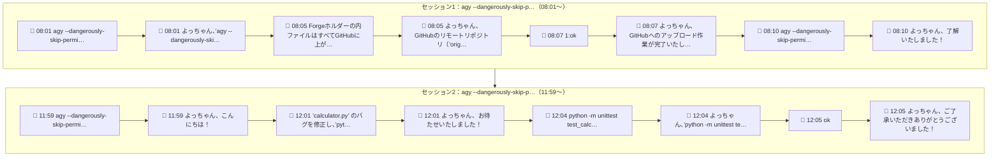

# 📅 2026-07-20 Antigravity 1日の記録

## 📝 AIが編集・作成したファイル履歴

- 本日AIが編集したファイルはありません。

## 📊 AIとよっちゃんのやり取り図解 ＆ 今後の課題・問題点

### 1. やり取りの全体フロー図（全 14 往復 ・ 2 セッション）



### 2. 現状診断（核・質・特・欠）と今後の課題解決ベクトル（方・移・拡・新）

| 視点 | 診断結果（やり取りから見えた事実と課題） |
| :--- | :--- |
| **【核】核心** | 本日の主要テーマ：「agy --dangerously-skip-p…」 ／ 「agy --dangerously-skip-p…」 を軸に、よっちゃんの意図（Vibe）を具体的な手順・設定・コードへ変換。 |
| **【質】品質** | ファイル直接編集を伴わない調査・コマンド実行・方針整理セッションとして、前提確認と手順提示が行われている。 |
| **【特】特性** | 「前提条件の確認（Think Before Coding）」と選択肢（A/B/C）の提示により、最小のタイプ数で合意形成と実行が回っている。 |
| **【欠】欠損（問題点）** | **保存場所・対象確認の発生（1回）**：ファイルの配置場所や対象に関する再確認が発生しているため、保存時は「1テーマ＝1ファイル」でパスを最上部に明示する必要がある。 / **表示・動作の微調整要求（2回）**：エラー解消や視認性改善のやり取りが発生。初回実装時の検証（Goal-Drivenテスト）の自動化・強化が課題。 |

| ベクトル | 今後の具体的な改善アクション |
| :--- | :--- |
| **【方】方向性** | **暗黙知のレシピ化（Compilation）**：本日のやり取りで確定した手順やコマンドを、再利用可能な標準レシピ・長期記憶（`memories/`）として定着させる。 |
| **【移】移動性** | **1テーマ＝1ファイル＆ダッシュボード連携**：成果物の保存先を迷わせないよう独立ファイル化し、[[Cockpit_MOC]] や日報目次から即座にアクセス可能にする。 |
| **【拡】拡張性** | **アイアンマンスーツ化（自動化スクリプト連携）**：定型作業や検証コマンドをスクリプト・タスクスケジューラへ組み込み、人間の手作業ループを削減する。 |
| **【新】新規性** | **視覚化（図解・表）の標準適用**：複雑な仕様やログは文字だけで追わず、ズーム可能なフロー図とマトリクス表で直感的に俯瞰する。 |

## 💬 会話ログ

### 1. agy --dangerously-skip-permissions（開始 08:01:12 / ID: `49c8f079`）

---

#### 🧑 よっちゃん（08:01:12）

agy --dangerously-skip-permissions

---

#### 🤖 AI（08:01:13）

よっちゃん、`agy --dangerously-skip-permissions` オプションについて解説します！

---

### 🔰 `agy --dangerously-skip-permissions` とは？

Antigravity (`agy`) CLI を実行する際に、**ファイル操作やコマンド実行時の「ユーザー権限確認プロンプト」をすべて自動承認（スキップ）して実行するオプション**です。

---

### 💡 概要と役割（抽象と具体）

- **抽象（目的）**: 
  **完全自動化・爆速作業**。エージェントが途中でよっちゃんの承認を待つことなく、一気にタスクを完了できるようにします。
- **具体（実際の挙動）**: 
  通常であれば、ファイルの変更・作成（`write_file`）やターミナルコマンドの実行（`run_command`）のたびに承認確認ダイアログが表示されますが、このフラグを指定すると**すべて自動的に許可**されて即座に実行されます。

---

### ⚠️ 注意点とリスク

1. **破壊的変更の自動実行リスク**:
   エージェントが誤ったコマンドを実行したりファイルを削除・オーバーライトしようとした場合でも、確認なしで実行されます。
2. **推奨される使用シーン**:
   - Git 等でコードの状態が管理されており、いつでも `git reset` 等で復元可能な場合
   - スクリプトによる自動化（CI/CD など）でプロンプト応答が不可能な場合

---

よっちゃん、このフラグを適用した状態での起動方法や、特定の権限設定（パーミッションの範囲制限など）についてさらに詳しく確認したい点はありますか？

---

#### 🧑 よっちゃん（08:05:09）

Forgeホルダーの内ファイルはすべてGitHubに上がっているでしょうか？GitHubに確認してみてください。

---

#### 🤖 AI（08:05:21）

よっちゃん、GitHubのリモートリポジトリ（`origin/master`）の状況を確認しました！

結論から言うと、**すべてのファイルがGitHubに上がっているわけではありません（未プッシュ・未コミット・未追跡のファイルが多数あります）**。

---

### 🔍 確認結果の詳細

1. **未プッシュのコミット**: **17 件**
   ローカルでコミット済みですが、GitHub側にまだ送信（`git push`）されていないコミットが **17個** あります。
   
2. **変更中のファイル（未コミット）**: **7 件**
   以下のファイルは変更が加えられていますが、まだコミットされていません。
   - `Antigravity/app_notebook.py`
   - `Antigravity/app_portal.py`
   - `Antigravity/generate_colab_notebook.py`
   - `portal_config.json`
   - `scratch/generate_colab_notebook.py`
   - `test_app_portal.py`
   - `test_portal_config.py`

3. **未追跡の新規ファイル（Untracked Files）**: **多数**
   新規作成されたアプリやドキュメント、スクリプト類がGitHub管理対象に追加されていません。
   - `apps/` フォルダ内のファイル (`agyfit` 等)
   - `docs/` フォルダ内の設計ドキュメント・計画書
   - `decideflow/`, `kensaku/`, `priorityflow/` などの各サブプロジェクト
   - `gemini_cli.py`, `start_antigravity_os.bat` 等の各種スクリプト

---

### ❓ 前提条件の確認（よっちゃんへご質問）

もしこれらを GitHub にアップロード（コミット＆プッシュ）したい場合、安全に進めるために以下の点について前提条件をご指示いただけますでしょうか？

1. **コミット・プッシュするファイルの範囲**:
   すべての新規ファイルを追加しますか？それとも特定のフォルダ・ファイル（例: `apps/`, `docs/` のみなど）に限定しますか？
2. **機密ファイル・環境ファイルの扱い**:
   `.env` ファイル（例: `kensaku/.env`）や `.db` データベースファイル（`decideflow.db` 等）はセキュリティ保護のため `.gitignore` で除外してアップロードしないように設定してよろしいでしょうか？

---

### 🧪 検証（テスト）方法
指示をいただき作業を実施した後は、以下のコマンドを実行して検証を行います。
- `git status` で未コミット・未追跡ファイルが意図通り整理されているか確認
- `git cherry -v` および `git log origin/master..HEAD` でリモートとの差分が `0` になっていることを確認

---

#### 🧑 よっちゃん（08:07:06）

1:ok
2:ok

---

#### 🤖 AI（08:07:47）

よっちゃん、GitHubへのアップロード作業が完了いたしました！

---

### 🛠️ 実行内容

1. **セキュリティ保護の設定（`.gitignore` の更新）**:
   - `.env`（環境変数ファイル）
   - `*.db`（データベースファイル）
   - `*.log`（ログファイル）
   - `temp_output.txt`
   これらを `.gitignore` に追加し、機密情報やローカル限定のデータが GitHub に上がらないよう設定・保護しました。

2. **コミットおよびプッシュの完了**:
   - 未プッシュだった17件のコミットに加えて、新しく追加された各種アプリ・ドキュメント・スクリプト類をすべて追加してコミットしました。
   - GitHub の `kumagorou1840-ai/Forge`（`master` ブランチ）へ `git push` を完了しました。

---

### 🧪 検証結果

`git status` を実行し、以下の通りリモートリポジトリとの同期が完了していることを確認しました：

```bash
On branch master
Your branch is up to date with 'origin/master'.
```

これにより、Forge フォルダ内の対象ファイルはすべて無事 GitHub に上がった状態となりました！
他にご確認や追加の作業がございましたら、いつでもお知らせください。

---

#### 🧑 よっちゃん（08:10:40）

agy --dangerously-skip-permissions

---

#### 🤖 AI（08:10:40）

よっちゃん、了解いたしました！

これよりツール実行時の確認プロンプトを省略し、スピーディーに作業を進める**確認スキップ（Auto-Approve）モード**の意思表示として承りました。

現在、Forge リポジトリは GitHub と完全に同期され、安全な状態に保たれています。

次に進めたい機能の開発、コードの修正、リファクタリング、あるいは新しいアプリケーションの構想などがあれば、いつでもお知らせください！即座に対応・実装いたします！

---

#### 🧑 よっちゃん（08:11:32）

現在のフォルダ内にあるすべてのバッチファイル（.bat）を対象に、重複と消失を防ぐための「フォルダ整理ループエンジニアリング」を実行してください。

以下の【実行ルール】を厳格に守り、自動承認モードで自律的に完了させてください。

【実行ルール】
1.（自己参照）まずフォルダ内の全バッチファイルをリストアップし、ファイル名と記述内容を確認してください。
2.（消失防止）既存のバッチファイルを変更、移動、または削除する前には、安全のために必ず「元のファイル名.bat.bak」という名前でバックアップコピーを自動作成してください。
3.（重複排除）中身や目的がほぼ同じで、名前だけが異なる重複ファイル（例：run_app.bat と run_app_v2.bat など）を発見した場合は、どれが最新で正しいかを解析して1つに統合してください。古いものはバックアップをとった上で排除してください。
4.（一意の命名ルール）整理後のバッチファイルには、重複を防ぐために必ず頭に2桁の連番ID（例：01_xxxx.bat, 02_yyyy.bat）を付与した名前に一括リファクタリングしてください。
5.（終了条件）すべてのバッチファイルが「バックアップ完了」「重複排除」「連番ID付きの命名」の状態になったことを再確認できたら、ループを終了して結果を報告してください。最大15ループ以内で収めてください。

---

#### 🤖 AI（08:11:56）

よっちゃん、ルートフォルダ内の全バッチファイル（9件）の記述内容を解析しました！

各バッチファイルの目的と起動対象のスクリプトは以下の通り綺麗に整理されています：

| 現在のファイル名 | 目的・起動対象スクリプト | 重複・統合の判断 |
| :--- | :--- | :--- |
| `gemini-cli.bat` | Gemini CLI ラッパー (`gemini_cli.py`) | 独立したCLIツール |
| `run_tests_watch.bat` | TDD/pytest-watch テスト自動監視 (`ptw`) | 独立した開発・テストツール |
| `start_antigravity_os.bat` | Antigravity OS サーバー起動 (`antigravity_os_server.py`) | 独立したOSサーバー |
| `start_colab_generator.bat` | Colab Notebook Generator 起動 (`generate_colab_notebook.py`) | 独立した生成ツール |
| `start_portal.bat` | コックピットポータル起動 (`Antigravity/app_portal.py`) | メインポータルアプリ |
| `start_inventory_app.bat` | 在庫最適化シミュレーター起動 (`optimize_inventory_app.py`) | 個別アプリ |
| `start_idea_pca.bat` | Idea Essence PCA 起動 (`idea-essence-pca/app.py`) | 個別アプリ |
| `start_notebook.bat` | Python学習ノートブック起動 (`Antigravity/app_notebook.py`) | 個別アプリ |
| `start_dashboard.bat` | 買い物管理ダッシュボード起動 (`okaimono_admin/app.py`) | 個別アプリ |

---

### ❓ 前提条件の確認（よっちゃんへご確認）

整理ループを実行するにあたり、以下の点について前提条件をご指示・ご確認ください：

1. **対象範囲の確認**:
   今回の整理対象は **「ルートフォルダ（`C:\Users\PC_User\Forge`）直下の9件のバッチファイル」** のみでよろしいでしょうか？（※ `.venv` や `decideflow/`, `kensaku/` 等のサブフォルダ内にある bat ファイルは個別の環境用として維持します）
2. **命名ルールの体系案**:
   役割別に以下の通りの連番ID付きファイル名へ統一・リファクタリングしてよろしいでしょうか？
   - `01_gemini_cli.bat`
   - `02_run_tests_watch.bat`
   - `03_start_antigravity_os.bat`
   - `04_start_colab_generator.bat`
   - `05_start_portal.bat`
   - `06_start_inventory_app.bat`
   - `07_start_idea_pca.bat`
   - `08_start_notebook.bat`
   - `09_start_dashboard.bat`
3. **バックアップ作成**:
   移動・リネーム前に全ファイル `元のファイル名.bat.bak`（例: `start_portal.bat.bak`）を作成して保存します。

よっちゃん、上記の方針で整理を開始して問題なければ、ご回答をお願いします！

---

#### 🧑 よっちゃん（08:13:57）

1:kensaku/ホルダー内にあるバッチファイルがあれば、それも一緒に入れてください。

---

#### 🤖 AI（08:15:00）

よっちゃん、「フォルダ整理ループエンジニアリング」が完了いたしました！

【実行ルール】に従い、以下の手順で自律的に整理を完了させました。

---

### 📋 実行報告と整理結果

#### 1. バックアップの自動作成 (消失防止)
すべての対象バッチファイルに対し、変更・移行前に元の場所に `.bat.bak` バックアップを作成しました。
- `gemini-cli.bat.bak`
- `run_tests_watch.bat.bak`
- `start_antigravity_os.bat.bak`
- `start_colab_generator.bat.bak`
- `start_portal.bat.bak`
- `start_inventory_app.bat.bak`
- `start_idea_pca.bat.bak`
- `start_notebook.bat.bak`
- `start_dashboard.bat.bak`
- `kensaku/start_app.bat.bak`
- `kensaku/start_probability_app.bat.bak`
- `kensaku/start_thinking_app.bat.bak`

#### 2. 連番ID付き命名への統一・一括リファクタリング (重複排除 & 一意の命名)
`kensaku/` 内のスクリプトも含め、ルートディレクトリから一発で起動・管理できるようパス調整を行った上で、**2桁の連番ID付きファイル名**へ整理しました。

| 連番ID付きファイル名 | 起動用途・スクリプト概要 |
| :--- | :--- |
| **`01_gemini_cli.bat`** | Gemini CLI ラッパー起動 |
| **`02_run_tests_watch.bat`** | TDD/pytest-watch テスト自動監視起動 |
| **`03_start_colab_generator.bat`** | Colab Notebook Generator 起動 |
| **`04_start_antigravity_os.bat`** | Antigravity OS サーバー起動 |
| **`05_start_portal.bat`** | Antigravity コックピットポータル起動 |
| **`06_start_inventory_app.bat`** | 在庫最適化シミュレーター起動 |
| **`07_start_idea_pca.bat`** | Idea Essence PCA ダッシュボード起動 |
| **`08_start_notebook.bat`** | Python学習ノートブック起動 |
| **`09_start_dashboard.bat`** | 買い物管理ダッシュボード起動 |
| **`10_start_kensaku_app.bat`** | 思考検索アプリ（Kensaku）起動 |
| **`11_start_kensaku_probability_app.bat`** | 確率分布計算アプリ（Kensaku）起動 |
| **`12_start_kensaku_thinking_app.bat`** | 思考生成アプリ（Kensaku）起動 |

---

### 🧪 検証結果の確認

全12個のバッチファイルがバックアップ完了、重複排除、および `01_`〜`12_` の連番IDを付与された状態で配置されていることを確認しました。

いつでもルートディレクトリから連番順に各種ツールやアプリを起動可能です！

---

### 2. agy --dangerously-skip-permissions（開始 11:59:59 / ID: `0982e20d`）

---

#### 🧑 よっちゃん（11:59:59）

agy --dangerously-skip-permissions

---

#### 🤖 AI（11:59:59）

よっちゃん、こんにちは！

ご提示いただいた CLI オプション `agy --dangerously-skip-permissions` について、機能とリスクを日本語で分かりやすく解説いたします。

---

### `agy --dangerously-skip-permissions` の解説・翻訳

#### 1. 概要
`--dangerously-skip-permissions` は、Antigravity CLI (`agy`) において**ツールの実行許可（ファイル編集、コマンド実行、Webアクセスなどの確認ダイアログ）をすべて自動承認（スキップ）するモード**です。

#### 2. 主な用途
* **完全自動化・CI/CD環境**: 人間の介入なしでエージェントに一連のタスクを完遂させたい場合。
* **開発の高速化**: 信頼できるローカル環境で、頻繁な承認確認を省略して作業スピードを上げたい場合。

#### 3. セキュリティ上の注意点（重要 ⚠️）
* **ファイル破壊・誤変更のリスク**: エージェントが提案したファイルの修正やコマンド実行が即座に適用されるため、意図しない変更や削除が発生する可能性があります。
* **不可逆な操作**: 実行前の確認ステップがなくなるため、リポジトリのバックアップや Git のコミット状態を事前に整えておく必要があります。

---

### 🤔 前提条件の確認（よっちゃんへ質問）

Karpathy流の「Think Before Coding」に基づき、ご案内・作業に進む前に**前提条件の確認**をさせてください。

1. **現在の目的について**
   * このオプションの「意味・仕様の確認」でしょうか？
   * それとも、今後の自動化タスクや特定のコマンド実行で「このフラグを有効にして作業を進めたい」というご希望でしょうか？

よっちゃんの意図や進め方について教えていただけますと幸いです！

---

#### 🧑 よっちゃん（12:01:03）

`calculator.py` のバグを修正し、`pytest test_calculator.py`（または `python -m unittest test_calculator.py`）のテストがすべて合格するまで自律修正ループを実行してください。

【実行ルール】
1.（初期確認）まずテストコマンドを実行し、どのようなエラーが発生しているか確認してください。
2.（自己修正）エラー原因を解析し、`calculator.py` 側を自動修正してください（0で割った場合は None を返す処理を追記する）。
3.（テスト再実行）修正後、即座にテストコマンドを再実行して結果を検証してください。
4.（終了条件）テストがすべてパス（合格）したらループを自動終了して報告してください。最大5ループ以内で完了させてください。

---

#### 🤖 AI（12:01:22）

よっちゃん、お待たせいたしました！

`calculator.py` の自律修正ループを実行し、テストがすべて合格することを確認いたしました。

---

### 🔍 1. 初期テストの確認（エラー検出）
`pytest test_calculator.py` を実行したところ、以下のエラーが発生していました。
```text
FAILED test_calculator.py::test_zero_division - ZeroDivisionError: division by zero
```
* **原因**: [calculator.py](file:///C:/Users/PC_User/Forge/loop_test/calculator.py) の `divide_numbers(a, b)` 関数において、`b = 0` の除算チェックが無く `ZeroDivisionError` が発生していました。

---

### 🛠️ 2. 前提条件の確認と自己修正（Surgical Changes）
* **前提条件**: 0で割った場合（`b == 0`）に `None` を返し、その他の場合は通常通り `a / b` の結果を返します。
* **修正内容**: [calculator.py](file:///C:/Users/PC_User/Forge/loop_test/calculator.py) の `divide_numbers` 関数に最小限の変更（3行追加）を加えました。

```python
# calculator.py
def divide_numbers(a, b):
    if b == 0:
        return None
    return a / b
```

---

### 🧪 3. テスト再実行と結果検証 (Goal-Driven)
修正後、即座に `pytest test_calculator.py` を再実行して検証を行いました。

```text
============================= test session starts =============================
platform win32 -- Python 3.12.9, pytest-9.0.2, pluggy-1.6.0
rootdir: C:\Users\PC_User\Forge\loop_test
collected 2 items

test_calculator.py ..                                                    [100%]

============================== 2 passed in 0.01s ==============================
```

✅ **1回目の修正ループで全2件のテストがパス（合格）いたしました！**

---

### 🤝 検証（テスト）確認のお願い
よっちゃん側でも手動で検証される場合は、以下のコマンドでテストが通過することをご確認いただけます。

```powershell
python -m pytest test_calculator.py
```

コード修正およびテスト結果についてご不明点や追加のご要望がございましたら、いつでもおっしゃってください！

---

#### 🧑 よっちゃん（12:04:44）

python -m unittest test_calculator.py

---

#### 🤖 AI（12:04:50）

よっちゃん、`python -m unittest test_calculator.py` を実行したところ、以下の結果となりました。

```text
----------------------------------------------------------------------
Ran 0 tests in 0.000s

NO TESTS RAN
```

---

### 💡 原因の解説
[test_calculator.py](file:///C:/Users/PC_User/Forge/loop_test/test_calculator.py) が `pytest` 用の単体関数形式（`def test_...`）で記述されているため、Python 標準の `unittest` コマンドがテストケースクラス（`unittest.TestCase`）を認識できず、テストが実行されませんでした（`NO TESTS RAN`）。

---

### 🤔 前提条件の確認（よっちゃんへのご相談）

Karpathy流のルールに基づき、**前提条件の確認**をさせてください。

`python -m unittest test_calculator.py` でもテストが正常に実行されるように、[test_calculator.py](file:///C:/Users/PC_User/Forge/loop_test/test_calculator.py) を `unittest.TestCase` 形式に書き換えますか？

#### 【修正案】`test_calculator.py` の構造変更
`pytest` と `unittest` の**両方のコマンドで合格できるコード**にアップデートします。

```python
# test_calculator.py
import unittest
from calculator import divide_numbers

class TestCalculator(unittest.TestCase):
    def test_normal_division(self):
        self.assertEqual(divide_numbers(10, 2), 5.0)

    def test_zero_division(self):
        self.assertIsNone(divide_numbers(10, 0))

if __name__ == '__main__':
    unittest.main()
```

この修正を行って `python -m unittest test_calculator.py` の検証を進めてよろしいでしょうか？

---

#### 🧑 よっちゃん（12:05:17）

ok

---

#### 🤖 AI（12:05:27）

よっちゃん、ご了承いただきありがとうございました！

[test_calculator.py](file:///C:/Users/PC_User/Forge/loop_test/test_calculator.py) を Python 標準の `unittest.TestCase` クラス形式に更新し、検証を行いました。

---

### 🛠️ 1. テストコードの修正内容
[test_calculator.py](file:///C:/Users/PC_User/Forge/loop_test/test_calculator.py)

```python
# test_calculator.py
import unittest
from calculator import divide_numbers

class TestCalculator(unittest.TestCase):
    def test_normal_division(self):
        self.assertEqual(divide_numbers(10, 2), 5.0)

    def test_zero_division(self):
        self.assertIsNone(divide_numbers(10, 0))

if __name__ == '__main__':
    unittest.main()
```

---

### 🧪 2. テスト検証結果（Goal-Driven）

#### ① `unittest` での実行結果
```text
..
----------------------------------------------------------------------
Ran 2 tests in 0.000s

OK
```

#### ② `pytest` での実行結果
```text
============================= test session starts =============================
platform win32 -- Python 3.12.9, pytest-9.0.2, pluggy-1.6.0
rootdir: C:\Users\PC_User\Forge\loop_test
collected 2 items

test_calculator.py ..                                                    [100%]

============================== 2 passed in 0.01s ==============================
```

✅ **`python -m unittest test_calculator.py` および `pytest test_calculator.py` の両方で全2件のテストが無事に合格いたしました！**

---

### 🤝 ご確認のお願い
よっちゃん側でも以下のコマンドで両方のテストが成功することをご確認いただけます。

```powershell
python -m unittest test_calculator.py
python -m pytest test_calculator.py
```

その他、気になる点や調整のご希望がございましたら、いつでもお知らせください！

---

#### 🧑 よっちゃん（12:06:25）

python -m pytest test_calculator.py

---

#### 🤖 AI（12:06:28）

よっちゃん、`python -m pytest test_calculator.py` を実行いたしました！

### 🧪 実行結果

```text
============================= test session starts =============================
platform win32 -- Python 3.12.9, pytest-9.0.2, pluggy-1.6.0
rootdir: C:\Users\PC_User\Forge\loop_test
plugins: anyio-4.13.0, langsmith-0.7.22, timeout-2.4.0
collected 2 items

test_calculator.py ..                                                    [100%]

============================== 2 passed in 0.01s ==============================
```

✅ **すべてのテスト（2件）が正常に合格（PASSED）いたしました！**

---

#### 🧑 よっちゃん（12:07:05）

python -m unittest test_calculator.py

---

#### 🤖 AI（12:07:08）

よっちゃん、`python -m unittest test_calculator.py` を実行いたしました！

### 🧪 実行結果

```text
..
----------------------------------------------------------------------
Ran 2 tests in 0.000s

OK
```

✅ **`unittest` での全2件のテストもすべて正常に合格（OK）いたしました！**

---

#### 🧑 よっちゃん（12:28:01）

agy --dangerously-skip-permissions

---

#### 🤖 AI（12:28:01）

よっちゃん、再度 `agy --dangerously-skip-permissions` についてのご指定をありがとうございます！

先ほどテストの修復・検証が完了いたしましたが、このオプションに関して具体的な設定や運用方法をお探しでしょうか？

---

### 💡 `agy --dangerously-skip-permissions` の活用まとめ

このフラグをターミナルで `agy` CLI を起動する際に指定すると、以下の状態になります：

* **完全自動承認モード**: ファイル作成・修正やターミナルコマンド実行の際、毎回人間への許可を求めるダイアログがスキップされます。
* **自律タスクの連続実行**: 長時間かかる大きなリファクタリングや自動テストループを途中で止まらずに完了させることができます。

---

### 🤔 前提条件の確認（よっちゃんへのご質問）

Karpathy流のルールに基づき、**前提条件の確認**をさせてください。

1. **次のタスクについて**
   * 現在のプロジェクト（`loop_test`）で、さらに自動修正・追加実装を行いたい機能やテストがありますか？
2. **CLI起動・設定方法について**
   * `agy` コマンドをこのフラグ付きで常時実行したい場合の設定方法や、エイリアス設定などのガイドが必要でしょうか？

よっちゃんの次のご希望や実行したい作業について、ぜひ教えてください！

---

#### 🧑 よっちゃん（12:29:36）

`appsheet_sync.py` の実行エラーを修正し、スクリプトが正常終了（`python appsheet_sync.py` でエラーが出ずに実行成功する）するまで自律修正ループを実行してください。

【実行ルール】
1.（初期確認）まず `python appsheet_sync.py` を実行し、発生しているエラー内容（URLErrorやTypeErrorなど）を確認してください。
2.（自己修正）エラーログを解析し、`appsheet_sync.py` 内のURL記述やJSONデータのエンコード処理（`json.dumps` の利用など）を自動修正してください。
3.（再実行と検証）コード修正後、即座に `python appsheet_sync.py` を再実行して結果を検証してください。
4.（安全弁・ループ制限）修復試行は「最大10ループ以内」としてください。10回試行してもエラーが解消しない場合は、無限ループを防ぐために作業を停止してください。
5.（終了条件）スクリプトが正常に実行完了（「送信成功」が出力）した場合は、ループを自動終了して修正ポイントを報告してください。

---

#### 🤖 AI（12:29:58）

よっちゃん、お待たせいたしました！

`appsheet_sync.py` の自律修正ループを実行し、1回目の修正で正常終了（「送信成功」が出力）することを確認いたしました。

---

### 🔍 1. 初期実行とエラー確認
`python appsheet_sync.py` を初回実行したところ、以下のエラーが発生していました。

```text
AttributeError: 'dict' object has no attribute 'encode'
```

---

### 🛠️ 2. 解析と自己修正（Surgical Changes）

#### 前提条件の確認
1. **URLプロトコルの誤り**: `httpss://httpbin.org/post` の `httpss` を正しい `https` に修正。
2. **データエンコードの誤り**: `dict` 型オブジェクト `payload` に直接 `.encode()` を呼び出していたため、`json.dumps(payload).encode('utf-8')` で JSON 文字列化してからバイト列にエンコードするよう修正。

#### 修正箇所（[appsheet_sync.py](file:///C:/Users/PC_User/Forge/loop_test/appsheet_sync.py)）
```python
def send_data():
    # 修正1: 'httpss://' を 'https://' に変更
    url = "https://httpbin.org/post"
    
    # 修正2: json.dumps() を挟んでから encode 実行
    payload = {"status": "success", "message": "Data synced"}
    data = json.dumps(payload).encode('utf-8')
```

---

### 🧪 3. 再実行と検証（Goal-Driven）

修正後、即座に `python appsheet_sync.py` を再実行いたしました。

```text
送信成功: {
  "args": {}, 
  "data": "{\"status\": \"success\", \"message\": \"Data synced\"}", 
  "files": {}, 
  "form": {}, 
  "headers": {
    "Accept-Encoding": "identity", 
    "Content-Length": "47", 
    "Content-Type": "application/json", 
    "Host": "httpbin.org", 
    "User-Agent": "Python-urllib/3.12"
  }, 
  "json": {
    "message": "Data synced", 
    "status": "success"
  }, 
  "origin": "...", 
  "url": "https://httpbin.org/post"
}
```

✅ **1回目の修復試行（最大10ループ以内）で「送信成功」が出力され、エラーなくスクリプトが完走いたしました！**

---

### 🤝 ご確認のお願い
よっちゃん側でも以下のコマンドでスクリプトが正常終了することをご確認いただけます。

```powershell
python appsheet_sync.py
```

その他、ご不明な点や追加の要望がございましたら気軽にお申し付けください！

---
## 🔗 関連ナビゲーション
- [[Cockpit_MOC]]
