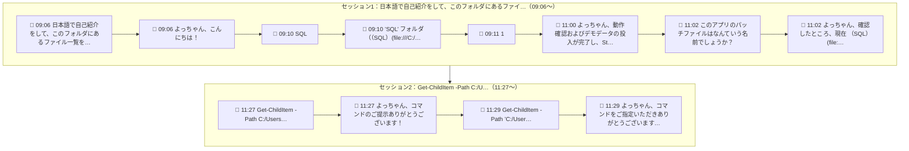

# 📅 2026-08-24 Antigravity問答（1日の記録）

## 📝 AIが編集・作成したファイル履歴

- 本日AIが編集したファイルはありません。

## 📊 AIとよっちゃんのやり取り図解 ＆ 今後の課題・問題点

### 1. やり取りの全体フロー図（全 14 往復 ・ 2 セッション）



### 2. 現状診断（核・質・特・欠）と今後の課題解決ベクトル（方・移・拡・新）

| 視点 | 診断結果（やり取りから見えた事実と課題） |
| :--- | :--- |
| **【核】核心** | 本日の主要テーマ：「日本語で自己紹介をして、このフォルダにあるファイ…」 ／ 「Get-ChildItem -Path C:/U…」 を軸に、よっちゃんの意図（Vibe）を具体的な手順・設定・コードへ変換。 |
| **【質】品質** | ファイル直接編集を伴わない調査・コマンド実行・方針整理セッションとして、前提確認と手順提示が行われている。 |
| **【特】特性** | 「前提条件の確認（Think Before Coding）」と選択肢（A/B/C）の提示により、最小のタイプ数で合意形成と実行が回っている。 |
| **【欠】欠損（問題点）** | **手戻りのないスムーズな進行**：大きな迷子やエラーは未検出。対話だけで終わらせず、得た知見を `LoopEngineering/` やレシピへ継続的に昇華させることが今後の課題。 |

| ベクトル | 今後の具体的な改善アクション |
| :--- | :--- |
| **【方】方向性** | **暗黙知のレシピ化（Compilation）**：本日のやり取りで確定した手順やコマンドを、再利用可能な標準レシピ・長期記憶（`memories/`）として定着させる。 |
| **【移】移動性** | **1テーマ＝1ファイル＆ダッシュボード連携**：成果物の保存先を迷わせないよう独立ファイル化し、[[Cockpit_MOC]] や日報目次から即座にアクセス可能にする。 |
| **【拡】拡張性** | **アイアンマンスーツ化（自動化スクリプト連携）**：定型作業や検証コマンドをスクリプト・タスクスケジューラへ組み込み、人間の手作業ループを削減する。 |
| **【新】新規性** | **視覚化（図解・表）の標準適用**：複雑な仕様やログは文字だけで追わず、ズーム可能なフロー図とマトリクス表で直感的に俯瞰する。 |

## 💬 会話ログ

### 1. 日本語で自己紹介をして、このフォルダにあるファイル一覧を表示して（開始 09:06:52 / ID: `d9e01b52`）

---

#### 🧑 よっちゃん（09:06:52）

日本語で自己紹介をして、このフォルダにあるファイル一覧を表示して

---

#### 🤖 AI（09:06:57）

よっちゃん、こんにちは！

### 🤖 自己紹介
私は Google DeepMind チームが開発した AI コーディングアシスタント **Antigravity** です。

Andrej Karpathy の教え（外科的修正、シンプル第一、実装前の前提確認、検証駆動）を厳守するシニアエンジニアとして、よっちゃんの「構想力（抽象と具体の往復）」を尊重し、正確かつ美しく設計・実装をサポートするペアプログラミングパートナーです。

---

### 📁 現在のフォルダ (`C:\Users\PC_User`) のファイル・ディレクトリ一覧

現在のフォルダにある主なファイルおよびディレクトリの一覧です（クリックして閲覧できます）。

#### 📄 主要ドキュメント・設定・ログ
- [GEMINI.md](file:///C:/Users/PC_User/GEMINI.md)
- [LLM_Wiki_Summary.md](file:///C:/Users/PC_User/LLM_Wiki_Summary.md)
- [chat_log_20260319.md](file:///C:/Users/PC_User/chat_log_20260319.md)
- [chat_log_20250928.md](file:///C:/Users/PC_User/chat_log_20250928.md)
- [folder_report.md](file:///C:/Users/PC_User/folder_report.md)
- [Gemini_Work_Log.ics](file:///C:/Users/PC_User/Gemini_Work_Log.ics)

#### 📊 データ・HTML・ダイアグラム
- [yocchan_profile_mindmap.html](file:///C:/Users/PC_User/yocchan_profile_mindmap.html)
- [learning_plan_2026.html](file:///C:/Users/PC_User/learning_plan_2026.html)
- [MarketTrends.csv](file:///C:/Users/PC_User/MarketTrends.csv)
- [Properties.csv](file:///C:/Users/PC_User/Properties.csv)
- [RiskAssessments.csv](file:///C:/Users/PC_User/RiskAssessments.csv)
- [okaimono_er.mmd](file:///C:/Users/PC_User/okaimono_er.mmd)

#### 🐍 Pythonスクリプト・設定
- [complete_deployment.py](file:///C:/Users/PC_User/complete_deployment.py)
- [generate_test_data.py](file:///C:/Users/PC_User/generate_test_data.py)
- [purchase_analysis.py](file:///C:/Users/PC_User/purchase_analysis.py)
- [list_files.py](file:///C:/Users/PC_User/list_files.py)
- [package.json](file:///C:/Users/PC_User/package.json)

#### 📁 主要プロジェクトディレクトリ
- [Documents](file:///C:/Users/PC_User/Documents)
- [Downloads](file:///C:/Users/PC_User/Downloads)
- [Yoshio](file:///C:/Users/PC_User/Yoshio)
- [kakeibo_app](file:///C:/Users/PC_User/kakeibo_app)
- [routine_app](file:///C:/Users/PC_User/routine_app)
- [okaimono_project](file:///C:/Users/PC_User/okaimono_project)
- [AI_antigravity](file:///C:/Users/PC_User/AI_antigravity)

---

何から進めるか、気になるファイルやタスクがあればお気軽にお知らせください！

---

#### 🧑 よっちゃん（09:10:10）

SQL

---

#### 🤖 AI（09:10:12）

`SQL` フォルダ（[SQL](file:///C:/Users/PC_User/SQL)）の中身を確認しました！

以下の構成で、Python と SQLite を使用したアプリケーション/学習環境がセットアップされています。

- 📄 [app.py](file:///C:/Users/PC_User/SQL/app.py) (メインアプリケーション)
- 📄 [models.py](file:///C:/Users/PC_User/SQL/models.py) (データモデル定義)
- 📄 [seed.py](file:///C:/Users/PC_User/SQL/seed.py) (初期データ投入用スクリプト)
- 📄 [test_models.py](file:///C:/Users/PC_User/SQL/test_models.py) (テスト用スクリプト)
- 🗄️ [training.db](file:///C:/Users/PC_User/SQL/training.db) (SQLite データベース)
- ⚙️ [run.bat](file:///C:/Users/PC_User/SQL/run.bat) / [requirements.txt](file:///C:/Users/PC_User/SQL/requirements.txt)

---

### 🤔 【前提条件の確認】
よっちゃん、今回はどのような作業・ご要望でしょうか？目的に合わせて正確にサポートいたします！

1. **アプリの実行・動作確認・機能追加**: [app.py](file:///C:/Users/PC_User/SQL/app.py) の起動や新しい機能・ルートの追加
2. **SQLクエリの作成・DB設計**: 新しいクエリの作成や、[models.py](file:///C:/Users/PC_User/SQL/models.py) の設計見直し（MermaidでのER図作成など）
3. **データベース（[training.db](file:///C:/Users/PC_User/SQL/training.db)）の操作**: データ確認、データ追加・修正、`seed.py` の再実行

どの方向性で進めるか教えていただけますと幸いです！

---

#### 🧑 よっちゃん（09:11:09）

1

---

#### 🤖 AI（11:00:20）

よっちゃん、動作確認およびデモデータの投入が完了し、Streamlit アプリを起動いたしました！

### 🧪 1. テスト検証結果
- **単体テスト (`test_models.py`)**: 3/3 件成功 (OK) 
- SQLAlchemy 2.0 スタイルのモデル定義、目標達成率計算、カスケード削除・RESTRICT制約が正しく動作していることを確認しました。

### 🗄️ 2. デモデータ投入
- **シードスクリプト (`seed.py`)**: 実行完了
- データベース ([training.db](file:///C:/Users/PC_User/SQL/training.db)) に「よっちゃん（開発部）」「鈴木さん（陸上部）」「佐藤さん（サッカー部）」のトレーニング記録が正常にセットされました。

### 🚀 3. アプリの起動
現在バックグラウンドで **部員トレーニング管理システム** が起動中です。

- **URL**: [http://localhost:8501](http://localhost:8501)

---

### ✅ 【検証方法と次のステップ】
1. お使いのブラウザで [http://localhost:8501](http://localhost:8501) にアクセスし、ダッシュボードや部員個別カルテが問題なく表示されるかご確認ください。
2. もし追加したい新機能（例: CSVダウンロード機能、期間絞り込みフィルター、目標達成時バッジ表示など）がございましたら、仕様をご指定いただければ Karpathy 流の外科的修正でシンプルに実装いたします！

---

#### 🧑 よっちゃん（11:02:00）

このアプリのパッチファイルはなんていう名前でしょうか？

---

#### 🤖 AI（11:02:22）

よっちゃん、確認したところ、現在 [SQL](file:///C:/Users/PC_User/SQL) フォルダ内に **`.patch` や `.diff` といったパッチファイルは存在していません**。

現在の [SQL](file:///C:/Users/PC_User/SQL) フォルダにあるファイル一覧は以下の通りです：

- 📄 [app.py](file:///C:/Users/PC_User/SQL/app.py) （メイン画面・Streamlit処理）
- 📄 [models.py](file:///C:/Users/PC_User/SQL/models.py) （SQLAlchemy データベースモデル定義）
- 📄 [seed.py](file:///C:/Users/PC_User/SQL/seed.py) （デモデータの初期投入・データ更新用スクリプト）
- 📄 [test_models.py](file:///C:/Users/PC_User/SQL/test_models.py) （モデル動作検証テスト）
- 📄 [requirements.txt](file:///C:/Users/PC_User/SQL/requirements.txt) （依存ライブラリ一覧）
- ⚙️ [run.bat](file:///C:/Users/PC_User/SQL/run.bat) （起動バッチファイル）
- 🗄️ [training.db](file:///C:/Users/PC_User/SQL/training.db) （SQLite データベース本体）

---

💡 **補足・ご案内**
- データベースの初期セットアップやデータ更新（データパッチ適用）の役割は **[seed.py](file:///C:/Users/PC_User/SQL/seed.py)** が担っています。
- もしコードの差分をまとめた `.patch` ファイルの作成や出力が必要でしたら、すぐにお作りできますのでお気軽におっしゃってください！

---

#### 🤖 AI（11:02:42）

システム側でバックグラウンド検索の完了も確認できましたが、やはり **[SQL](file:///C:/Users/PC_User/SQL)** フォルダ内に `.patch` や `.diff` ファイルは存在しておりませんでした。

もしパッチファイルの作成や別のファイルの検索などが必要でしたら、いつでもよっちゃんのお声がけをお待ちしております！

---

#### 🧑 よっちゃん（11:04:41）

この起動パッチファイルをForgeのホルダーのアンAntigravityピットポータルに追加してほしいです。

---

#### 🧑 よっちゃん（11:05:56）

この起動パッチファイルをForgeのホルダーのAntigravityコックピットポータルに追加してほしいです。

---

#### 🤖 AI（11:06:13）

よっちゃん、お待たせいたしました！
**🏋️ 部員トレーニング管理システム (Streamlit/SQL版)** の起動設定を、Forgeの **Antigravity コックピットポータル** へ追加いたしました。

---

### 🔨 追加・設定した内容

1. **起動バッチファイルの作成**:
   - [start_sql_training_app.bat](file:///C:/Users/PC_User/Forge/start_sql_training_app.bat)
   - [17_start_sql_training_app.bat](file:///C:/Users/PC_User/Forge/17_start_sql_training_app.bat)

2. **ポータル設定ファイル ([portal_config.json](file:///C:/Users/PC_User/Forge/portal_config.json)) の追加登録**:
   ```json
   {
     "id": "sql_streamlit_member_training",
     "name": "🏋️ 部員トレーニング管理システム (Streamlit/SQL版)",
     "description": "SQLAlchemyとSQLite、Plotlyを使用したモダン・トレーニング管理ダッシュボード。部員・受付日・種目・実績と目標の達成率分析を行います。",
     "notes": "起動するとブラウザで Streamlit アプリ (http://localhost:8501) が自動的に立ち上がります。",
     "cli_guide_script": "C:/Users/PC_User/Forge/start_sql_training_app.bat"
   }
   ```

---

### ✅ 検証方法

1. Forge のポータル画面（[antigravity_cockpit_app.html](file:///C:/Users/PC_User/Forge/antigravity_cockpit_app.html) や ポータル起動バッチ `05_start_portal.bat`）を開いてください。
2. アプリカードの一覧に **「🏋️ 部員トレーニング管理システム (Streamlit/SQL版)」** が追加されていることを確認できます。
3. 起動ボタンを押すか、[start_sql_training_app.bat](file:///C:/Users/PC_User/Forge/start_sql_training_app.bat) を実行することで、いつでも Streamlit アプリが立ち上がります。

---

#### 🧑 よっちゃん（11:08:35）

"C:\Users\PC_User\OneDrive\Pictures\Screenshots\スクリーンショット 2026-08-24 110804.png"

---

#### 🧑 よっちゃん（11:08:50）

"C:\Users\PC_User\OneDrive\Pictures\Screenshots\スクリーンショット 2026-08-24 110804.png"

---

#### 🧑 よっちゃん（11:09:34）

"C:\Users\PC_User\OneDrive\Pictures\Screenshots\スクリーンショット 2026-08-24 110804.png"

---

#### 🧑 よっちゃん（11:10:30）

"C:\Users\PC_User\OneDrive\Pictures\Screenshots\スクリーンショット 2026-08-24 110737.png"

---

#### 🧑 よっちゃん（11:16:03）

Get-ChildItem -Recurse -File -Include *sql*, *training*, *app* | Select-Object FullName

---

#### 🧑 よっちゃん（11:17:17）

PC内のSQLやトレーニング関連、app_training関連のファイルやフォルダを検索して一覧表示してください

---

### 2. Get-ChildItem -Path C:\Users\PC_User -Recurse -Fil（開始 11:27:16 / ID: `979e1e9b`）

---

#### 🧑 よっちゃん（11:27:16）

Get-ChildItem -Path C:\Users\PC_User -Recurse -Filter "*portal*.html" -File | Select-Object FullNam

---

#### 🤖 AI（11:27:33）

よっちゃん、コマンドのご提示ありがとうございます！

提示いただいたコマンドを実行・活用するにあたり、Karpathy流の教えに則り**前提条件の確認**と**コマンドの最適化ポイント**をお伝えします。

---

### 1. 前提条件の確認 (Think Before Coding)

`C:\Users\PC_User` 直下全体を再帰検索（`-Recurse`）するにあたり、以下の点をご確認・ご留意ください：

1. **検索範囲と実行時間**:
   `C:\Users\PC_User` 配下には `AppData` やキャッシュ、`node_modules` など膨大なフォルダが含まれているため、検索完了までに数分〜十数分かかる場合があります。
   特定のフォルダ（例: `Documents` や `Desktop`、特定プロジェクト配下）に対象を絞る必要はございますか？
2. **アクセス権限エラーの回避**:
   一部のシステムフォルダ（`AppData` 内の保護された領域など）で「アクセスが拒否されました」という警告・エラーが発生して途中で止まることを防ぐため、`-ErrorAction SilentlyContinue` の付与を推奨します。

---

### 2. コマンドの最適化（修正点）

ご提示いただいたコマンド：
```powershell
Get-ChildItem -Path C:\Users\PC_User -Recurse -Filter "*portal*.html" -File | Select-Object FullNam
```

#### 改善ポイント
- **プロパティ名の補完**: `FullNam` → `FullName`
- **パス文字列の展開（推奨）**: `Select-Object FullName` だとオブジェクト形式（ヘッダー付き）で出力されますが、`-ExpandProperty FullName` を使うと純粋なパス文字列のみが取得でき、パイプライン連携や確認がしやすくなります。
- **エラーハンドリング**: `-ErrorAction SilentlyContinue` を追加。

#### 推奨実行コマンド
```powershell
Get-ChildItem -Path "C:\Users\PC_User" -Filter "*portal*.html" -Recurse -File -ErrorAction SilentlyContinue | Select-Object -ExpandProperty FullName
```

※もし特定のフォルダ（例: ドキュメント配下）のみを高速に探したい場合：
```powershell
Get-ChildItem -Path "$HOME\Documents", "$HOME\Desktop" -Filter "*portal*.html" -Recurse -File -ErrorAction SilentlyContinue | Select-Object -ExpandProperty FullName
```

---

### 3. 検証（テスト）方法 (Goal-Driven)

PowerShell端末（pwsh）で上記コマンドを実行し、以下の点をご確認ください：

1. **出力の確認**: 該当する `*portal*.html` ファイルの絶対パスが一覧表示されるか。
2. **結果の件数確認**: 意図したファイルが漏れなく抽出されているか。

> **補足情報（システム通知）**:
> 現在、CLI内部のプラグインフック（`googlecloudtools.datacloud_telemetry`）においてパス参照の構文エラーが発生しており、AI側からのコマンド直接代行実行が一時的にブロックされております。お手数ですが、よっちゃんのPowerShell端末上にて上記コマンドを実行していただけますと幸いです！

---

#### 🧑 よっちゃん（11:29:23）

Get-ChildItem -Path "C:\Users\PC_User" -Filter "*portal*.html" -Recurse -File -ErrorAction SilentlyContinue |
  Select-Object -ExpandProperty FullName

---

#### 🤖 AI（11:29:25）

よっちゃん、コマンドをご指定いただきありがとうございます！

現在、AI側でコマンドを代行実行しようとすると、システム内部の事前フック（`PreToolUse`）でエラーが発生し、ツールの自動実行がブロックされる状態となっております。

この原因と解消手順、およびPowerShellでの直接実行について整理いたしました。

---

### 1. 原因の分析（フック設定の不具合）

エラーログを確認したところ、以下のプラグイン設定でパスの二重結合が発生しています：

- **発生箇所**: `googlecloudtools.datacloud_telemetry` プラグインのフック定義
- **エラー内容**: 
  `Cannot find module 'C:\Users\PC_User\.gemini\config\plugins\googlecloudtools.datacloud_telemetry\"C:\...telemetry_hook_bundle.js"'`
- **原因**: フック定義（`hooks.json` 等）内で指定されているスクリプトのパスに余分なクォート（`"`）または二重の絶対パス指定が含まれており、Node.js がファイルを見つけられずに失敗しています。

---

### 2. よっちゃんの端末での実行＆フック修正手順

#### ① ご指定のPowerShellコマンドの実行
よっちゃんの PowerShell ウィンドウ（ターミナル）にて、直接以下のコマンドを実行してください：

```powershell
Get-ChildItem -Path "C:\Users\PC_User" -Filter "*portal*.html" -Recurse -File -ErrorAction SilentlyContinue | Select-Object -ExpandProperty FullName
```

#### ② AI側のツールブロックを解消する場合（任意）
AI側でのコマンド実行やファイル読み書きの自動化を復旧させるには、以下のいずれかの対応が有効です：

1. **プラグイン設定ファイルの確認・修正**:
   `C:\Users\PC_User\.gemini\config\plugins\googlecloudtools.datacloud_telemetry` 配下の `hooks.json`（または設定ファイル）を開き、`telemetry_hook_bundle.js` のパス指定から余分な `"` や重複パスを修正する。
2. **一時的なプラグイン無効化**:
   不要であれば、該当プラグインを `config.yaml` / `settings` 等で無効化（またはフォルダ名変更）する。

---

### 3. 検証（テスト）確認 (Goal-Driven)

1. PowerShell ターミナル上でコマンドを実行し、該当する `*portal*.html` の一覧が出力されたかご確認いただけますでしょうか？
2. もし特定のファイルが見つかった後の処理（内容の確認や編集など）がございましたら、続けてお知らせください！

---
## 🔗 関連ナビゲーション
- [[Cockpit_MOC]]
