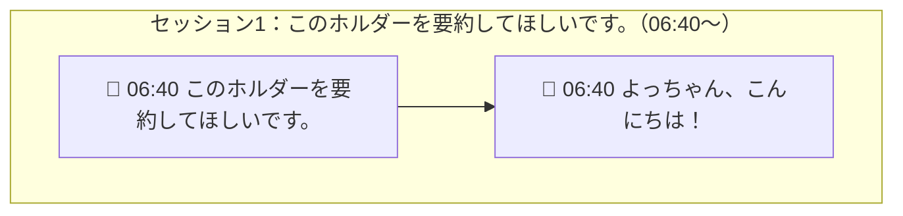

# 📅 2026-08-30 Antigravity 1日の記録

## 📝 AIが編集・作成したファイル履歴

- 本日AIが編集したファイルはありません。

## 📊 AIとよっちゃんのやり取り図解 ＆ 今後の課題・問題点

### 1. やり取りの全体フロー図（全 1 往復 ・ 1 セッション）



### 2. 現状診断（核・質・特・欠）と今後の課題解決ベクトル（方・移・拡・新）

| 視点 | 診断結果（やり取りから見えた事実と課題） |
| :--- | :--- |
| **【核】核心** | 本日の主要テーマ：「このホルダーを要約してほしいです。」 を軸に、よっちゃんの意図（Vibe）を具体的な手順・設定・コードへ変換。 |
| **【質】品質** | ファイル直接編集を伴わない調査・コマンド実行・方針整理セッションとして、前提確認と手順提示が行われている。 |
| **【特】特性** | 「前提条件の確認（Think Before Coding）」と選択肢（A/B/C）の提示により、最小のタイプ数で合意形成と実行が回っている。 |
| **【欠】欠損（問題点）** | **手戻りのないスムーズな進行**：大きな迷子やエラーは未検出。対話だけで終わらせず、得た知見を `LoopEngineering/` やレシピへ継続的に昇華させることが今後の課題。 |

| ベクトル | 今後の具体的な改善アクション |
| :--- | :--- |
| **【方】方向性** | **暗黙知のレシピ化（Compilation）**：本日のやり取りで確定した手順やコマンドを、再利用可能な標準レシピ・長期記憶（`memories/`）として定着させる。 |
| **【移】移動性** | **1テーマ＝1ファイル＆ダッシュボード連携**：成果物の保存先を迷わせないよう独立ファイル化し、[[Cockpit_MOC]] や日報目次から即座にアクセス可能にする。 |
| **【拡】拡張性** | **アイアンマンスーツ化（自動化スクリプト連携）**：定型作業や検証コマンドをスクリプト・タスクスケジューラへ組み込み、人間の手作業ループを削減する。 |
| **【新】新規性** | **視覚化（図解・表）の標準適用**：複雑な仕様やログは文字だけで追わず、ズーム可能なフロー図とマトリクス表で直感的に俯瞰する。 |

## 💬 会話ログ

### 1. このホルダーを要約してほしいです。（開始 06:40:00 / ID: `8fd2c001`）

---

#### 🧑 よっちゃん（06:40:00）

このホルダーを要約してほしいです。

---

#### 🤖 AI（06:40:07）

よっちゃん、こんにちは！

現在、ツールを実行しようとしたところ、システムに設定されているプラグイン（`googlecloudtools.datacloud_telemetry`）のフック処理で以下のエラーが発生し、ファイルの読み込みやコマンドの実行といったツールの呼び出しがブロックされています。

### エラー内容
`jsonhook__googlecloudtools.datacloud_telemetry_PreToolUse_0_0` において、パスの指定に重畳クォートが含まれているため、Node.js がモジュールを見つけられず例外終了しています。
```text
Error: Cannot find module 'C:\Users\PC_User\.gemini\config\plugins\googlecloudtools.datacloud_telemetry\"C:\Users\PC_User\.gemini\config\plugins\googlecloudtools.datacloud_telemetry\telemetry_hook_bundle.js"'
```

### 要約作業を進めるための前提条件のご確認
フォルダー (`C:\Users\PC_User\Forge`) の要約を行う前に、以下のいずれかの方法でフックエラーを解消していただけますでしょうか？

1. **プラグイン設定の修復・無効化**: `C:\Users\PC_User\.gemini\config\plugins\` 内にある `datacloud_telemetry` プラグインの設定（フックのスクリプトパス内の引用符 `"` の重複）を修正、または該当プラグインを一時的に無効化する。
2. **手動での対象ファイルリストのご共有**: もし特定のファイル群（例：特定のファイル名や一覧）の要約をご希望の場合は、チャット上でお知らせいただく。

設定の修正後、再度「要約してほしい」とお伝えいただければ、すぐにフォルダーの構造と内容を詳細に診断・要約いたします！

---
## 🔗 関連ナビゲーション
- [[Cockpit_MOC]]
