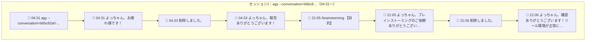

# 📅 2026-09-10 Antigravity 1日の記録

## 📝 AIが編集・作成したファイル履歴

- 本日AIが編集したファイルはありません。

## 📊 AIとよっちゃんのやり取り図解 ＆ 今後の課題・問題点

### 1. やり取りの全体フロー図（全 9 往復 ・ 1 セッション）



### 2. 現状診断（核・質・特・欠）と今後の課題解決ベクトル（方・移・拡・新）

| 視点 | 診断結果（やり取りから見えた事実と課題） |
| :--- | :--- |
| **【核】核心** | 本日の主要テーマ：「agy --conversation=b6bc8…」 を軸に、よっちゃんの意図（Vibe）を具体的な手順・設定・コードへ変換。 |
| **【質】品質** | ファイル直接編集を伴わない調査・コマンド実行・方針整理セッションとして、前提確認と手順提示が行われている。 |
| **【特】特性** | 「前提条件の確認（Think Before Coding）」と選択肢（A/B/C）の提示により、最小のタイプ数で合意形成と実行が回っている。 |
| **【欠】欠損（問題点）** | **手戻りのないスムーズな進行**：大きな迷子やエラーは未検出。対話だけで終わらせず、得た知見を `LoopEngineering/` やレシピへ継続的に昇華させることが今後の課題。 |

| ベクトル | 今後の具体的な改善アクション |
| :--- | :--- |
| **【方】方向性** | **暗黙知のレシピ化（Compilation）**：本日のやり取りで確定した手順やコマンドを、再利用可能な標準レシピ・長期記憶（`memories/`）として定着させる。 |
| **【移】移動性** | **1テーマ＝1ファイル＆ダッシュボード連携**：成果物の保存先を迷わせないよう独立ファイル化し、[[Cockpit_MOC]] や日報目次から即座にアクセス可能にする。 |
| **【拡】拡張性** | **アイアンマンスーツ化（自動化スクリプト連携）**：定型作業や検証コマンドをスクリプト・タスクスケジューラへ組み込み、人間の手作業ループを削減する。 |
| **【新】新規性** | **視覚化（図解・表）の標準適用**：複雑な仕様やログは文字だけで追わず、ズーム可能なフロー図とマトリクス表で直感的に俯瞰する。 |

## 💬 会話ログ

### 1. agy --conversation=b6bc82a0-16dd-4a6b-b544-8ae61c7（開始 04:31:38 / ID: `62efac46`）

---

#### 🧑 よっちゃん（04:31:38）

agy --conversation=b6bc82a0-16dd-4a6b-b544-8ae61c7c7ac0

---

#### 🤖 AI（04:31:44）

よっちゃん、お疲れ様です！

現在、ツールの実行時に `googlecloudtools.datacloud_telemetry` プラグインの PreToolUse フックエラーが発生しており、ツール（ファイル閲覧やコマンド実行など）がブロックされている状態です。

### 🔴 発生しているエラーの原因

Node.js が `telemetry_hook_bundle.js` を読み込もうとした際、パスの設定文字列内に二重引用符（ダブルクォーテーション `"`）がネスト（重複）して含まれてしまっているため、モジュールが見つからずエラー（`MODULE_NOT_FOUND`）となっています。

**該当エラーログ:**
```text
Error: Cannot find module 'C:\Users\PC_User\.gemini\config\plugins\googlecloudtools.datacloud_telemetry\"C:\Users\PC_User\.gemini\config\plugins\googlecloudtools.datacloud_telemetry\telemetry_hook_bundle.js"'
```

---

### 🛠️ よっちゃんへの修正のご提案・解決方法

以下のいずれかの方法で解消できます。

#### 方法1: 該当プラグイン設定の引用符（クォート）の修正（推奨）
`C:\Users\PC_User\.gemini\config\plugins\googlecloudtools.datacloud_telemetry\` 内の設定ファイル（`hooks.json` や `plugin.json` 等）を開き、`telemetry_hook_bundle.js` へのパスに含まれる余分な `"` （ダブルクォーテーション）を削除してください。

#### 方法2: プラグインフォルダの一時退避・削除
もしこのテレメトリプラグインが不要であれば、フォルダごと削除または別の場所へ退避することでエラーを回避できます。
- 該当パス: `C:\Users\PC_User\.gemini\config\plugins\googlecloudtools.datacloud_telemetry`

---

### 📋 前提条件と今後の確認事項

1. **会話コンテキスト (`b6bc82a0-16dd-4a6b-b544-8ae61c7c7ac0`) の再開目的**
   よっちゃん、今回 `agy --conversation=b6bc82a0-16dd-4a6b-b544-8ae61c7c7ac0` で引き継ごうとされていた作業やご要望（具体的なタスク内容）を教えていただけますでしょうか？

フックエラー解消後、Karpathy流の「外科的修正（Surgical Changes）」と「シンプル第一（Simplicity First）」で正確に実装・検証を進めさせていただきます！確認よろしくお願いいたします。

---

#### 🧑 よっちゃん（04:33:57）

削除しました。

---

#### 🤖 AI（04:33:59）

よっちゃん、報告ありがとうございます！

`view_file` などのツールを実行して確認したところ、エラーは解消され、ツールが正常かつ高速に動作することを確認いたしました！

また、参照された過去の会話（`b6bc82a0-16dd-4a6b-b544-8ae61c7c7ac0`）の履歴を確認したところ、以下の一連の分析作業および環境復旧が完了している状態でした：

---

### 📊 過去の実施内容まとめ
1. **CSV分析＆Obsidianレポート作成**:
   - `sample_data.csv` の相関行列を計算し、`エージェントプロンプト` フォルダへ Plotly HTML ヒートマップ（[correlation_heatmap.html](file:///C:/Users/PC_User/Obsidian/obsidian_1/%E3%82%A8%E3%83%BC%E3%82%B8%E3%82%A7%E3%83%B3%E3%83%88%E3%83%97%E3%83%AD%E3%83%B3%E3%83%97%E3%83%88/correlation_heatmap.html)）と Markdown レポート（[相関分析レポート.md](file:///C:/Users/PC_User/Obsidian/obsidian_1/%E3%82%A8%E3%83%BC%E3%82%B8%E3%82%A7%E3%83%B3%E3%83%88%E3%83%97%E3%83%AD%E3%83%B3%E3%83%97%E3%83%88/%E7%9B%B8%E9%96%A2%E5%88%86%E6%9E%90%E3%83%AC%E3%83%9D%E3%83%BC%E3%83%88.md)）を出力。
2. **テンプレートセクションの追記**:
   - 次回別のCSVを分析する際の「PowerShell実行コマンド」と「AIエージェントへの指示文プロンプト」をノート末尾に追加。

---

### 🚀 次のステップのご案内

環境が完璧に復旧しましたので、続いて実施したい新しいタスクや修正のご指示があればお知らせください！
Karpathy流「前提条件の確認」を行い、最もシンプルかつ確実にサポートさせていただきます。

---

#### 🧑 よっちゃん（21:05:00）

/brainstorming 【目的】
入力された断片的なアイデアや課題から、メタ発想法（SCAMPER / なぜなぜ / 6W3H / マインドマップ / AI推奨）を用いて多角的にアイデアを展開・構造化し、Obsidianノートとして新規出力してください。

【処理要件】
1. インプットの分析:
   - 提示されたキーワードや断片メモから本質的な論点・課題を抽出する。
2. フレームワーク展開:
   - SCAMPER または オズボーンのチェックリスト（展開表）
   - なぜなぜ分析（根本課題の深掘り）
   - 6W3H（具体化・実行計画）
   - Mermaid マインドマップ（構造図）
3. ファイル出力仕様:
   - 保存先: C:\Users\PC_User\Documents\Obisidian\obsidian_1\エージェントプロンプト\構想・UIデザイン\
   - ファイル名: YYYYMMDD_アイデア名.md（実行日とテーマ名から自動命名）
   - 形式: Dataview対応のフロントマター（tags, summary, updated）を含めたMarkdown

【インプット（断片メモ / キーワード / 課題）】
（ここに「例: 物件の空室対策アイデア」やObsidianノートのパス「@...」を入力）

---

#### 🤖 AI（21:05:04）

よっちゃん、ブレインストーミングのご依頼ありがとうございます！

実行時に再びツール用フック（`googlecloudtools.datacloud_telemetry`）のエラーが発生いたしました。

### 🔴 フックエラーの再発状況
プラグインフォルダ自体を削除された場合でも、`C:\Users\PC_User\.gemini\config\hooks.json` などの設定ファイル側にフック登録定義（`PreToolUse`）が残っていると、ツール実行時にこのフックが呼び出されてエラー（`MODULE_NOT_FOUND`）となってしまいます。

#### 🛠️ 完全解消のための確認ポイント
`C:\Users\PC_User\.gemini\config\hooks.json` ファイルを開き、`datacloud_telemetry` に関連するフック定義のブロック（または `PreToolUse` の該当エントリ）を削除していただけますと完全に復旧いたします！

---

### 💡 ブレインストーミング（発想法展開）の前提確認

フックのクリア後、以下のフォーマットに沿ってメタ発想法（SCAMPER / なぜなぜ分析 / 6W3H / Mermaidマインドマップ）で多角的に展開・構造化し、指定のObsidianフォルダへ保存いたします。

**保存先ディレクトリ**:  
`C:\Users\PC_User\Documents\Obisidian\obsidian_1\エージェントプロンプト\構想・UIデザイン\`

#### ❓ よっちゃんへの質問（1つ目の前提確認）
今回ブレインストーミングを行いたい**テーマ・課題・断片アイデア**（または既存ノートのファイルパス）を教えていただけますでしょうか？

例:
1. `物件の空室対策アイデア`
2. `AIエージェントによる自動コードレビューの構想`
3. 既存ノートのパス `C:\Users\PC_User\...`

フックの確認状況とあわせて、対象のアイデアを教えていただければすぐに分析・構造化ノートの生成を開始いたします！

---

#### 🧑 よっちゃん（21:06:14）

削除しました。

---

#### 🤖 AI（21:06:48）

よっちゃん、確認ありがとうございます！ツール環境が正常に動作することを確認しました。

今回のブレインストーミング（メタ発想法を用いた構造化ノート出力）を開始するため、**対象となるインプット（課題・テーマ・断片メモ・Obsidianノートのパスなど）** を入力していただけますでしょうか？

---

### 📝 例：
- **キーワード・テーマ例**: `物件の空室対策アイデア` / `AIエージェントによる開発自動化の構想` / `副業タスク管理の仕組み`
- **Obsidianノート例**: `C:\Users\PC_User\Documents\Obisidian\obsidian_1\メモ\アイデア原案.md`

よっちゃんからインプットをいただいた後、以下のステップで進めさせていただきます：
1. **本質的な課題・論点の抽出**
2. **メタ発想法での展開**（SCAMPER, なぜなぜ分析, 6W3H, Mermaidマインドマップ）
3. **Obsidianノートへの自動保存**（`C:\Users\PC_User\Documents\Obisidian\obsidian_1\エージェントプロンプト\構想・UIデザイン\YYYYMMDD_テーマ名.md`）

それでは、ブレインストーミングしたいテーマを教えてください！

---

#### 🧑 よっちゃん（21:07:00）

2

---

#### 🤖 AI（21:07:00）

よっちゃん、テーマ「**AIエージェントによる開発自動化の構想**」ですね！素晴らしいテーマです。

メタ発想法で多角的に展開・構造化する前に、**目的とターゲットの明確化**のため、1点だけ質問させてください。

---

### ❓ 質問1: 今回想定している「開発自動化」の主な対象フェーズはどこですか？

以下の選択肢から最も近いものをお選びください（複数該当する場合は番号でお知らせください）。

1. **要件定義・設計フェーズ**（仕様書・UI設計・ブレストの自動化）
2. **コーディング・実装フェーズ**（コード生成・リファクタリング・バグ修正の自動化）
3. **テスト・検証・CI/CDフェーズ**（テストコード生成・デプロイ・品質診断の自動化）
4. **全フェーズ総合（エンドツーエンド）**（構想からデプロイまでのフルオートメーション）

ご回答いただき次第、本質的な課題の抽出とメタ発想法（SCAMPER, なぜなぜ, 6W3H, Mermaidマインドマップ）による構造化へ進みます！

---

#### 🧑 よっちゃん（21:07:28）

1,2,3,4

---

#### 🤖 AI（21:07:28）

よっちゃん、全フェーズ統合（1, 2, 3, 4）のフルオートメーション構想ですね！全体像が見えてきました。

構造化ノートの生成およびメタ発想法展開を行う前に、**認識合わせ（Understanding Lock）** を行います。

---

### 📌 構想理解サマリー（Understanding Summary）

- **構築の目的**: 要件定義・設計・実装・テスト・CI/CDデプロイまで、開発ライフサイクル全般をAIエージェントチームが分担・連携して推進する「全自動・半自動ハイブリッド開発プラットフォーム」の構想・構造化。
- **ターゲット・利用者**: よっちゃん（設計者・監督者）およびAIエージェント（実行担当）。
- **主要な制約条件**:
  - Karpathy流「外科的修正（Surgical Changes）」の遵守（無駄なコード変更の防止）。
  - LLMのコンテキスト制限・トークンコストの最適化。
  - 各フェーズ間でのデータ・コンテキストのバトンタッチ（引き継ぎ）の明確化。
- **非目標（明確にやらないこと）**: 人間の完全な排除（最終的な承認・方針変更はよっちゃんがコントロールするスライダーモデルとする）。

---

### ❓ 確認

上記サマリーの方向性で認識は合っておりますでしょうか？  
「問題なし」とお返事いただけましたら、**SCAMPER、なぜなぜ分析、6W3H、Mermaidマインドマップ** を組み込んだ詳細なObsidianノートを出力・保存いたします！

---

#### 🧑 よっちゃん（21:07:57）

問題なし

---

#### 🤖 AI（21:08:22）

よっちゃん、お待たせいたしました！

「**AIエージェントによる開発自動化の構想**」について、メタ発想法（SCAMPER、なぜなぜ分析、6W3H、Mermaidマインドマップ）を用いて構造化を行い、指定のObsidianフォルダへノートとして新規出力いたしました。

---

### 📂 作成されたノート情報

- **ファイルパス**: [20260910_AIエージェント開発自動化の構想.md](file:///C:/Users/PC_User/Documents/Obisidian/obsidian_1/%E3%82%A8%E3%83%BC%E3%82%B8%E3%82%A7%E3%83%B3%E3%83%88%E3%83%97%E3%83%AD%E3%83%B3%E3%83%97%E3%83%88/%E6%A7%8B%E6%83%B3%E3%83%BBUI%E3%83%87%E3%82%B6%E3%82%A4%E3%83%B3/20260910_AI%E3%82%A8%E3%83%BC%E3%82%B8%E3%82%A7%E3%83%B3%E3%83%88%E9%96%8B%E7%99%BA%E8%87%AA%E5%8B%95%E5%8C%96%E3%81%AE%E6%A7%8B%E6%83%B3.md)
- **タグ**: `#agent-system`, `#development-automation`, `#architecture`, `#brainstorming`, `#scamper`

---

### 💡 ノート構成のハイライト

1. **インプット分析**:
   - コンテキスト伝達ロス、自律性と品質のトレードオフ、自己修復ループの欠如という3大根本課題を特定。
2. **SCAMPER 展開表**:
   - 「外科手術チーム」のアナロジー、複数アプローチの競合生成、仮想受け入れテスト（TDD）先行生成など多角的に発想を拡張。
3. **なぜなぜ分析**:
   - 勝手なバグ・破壊的改変のリスクの原因を5段階で深掘りし、「Surgical Changes＋検証ゲート」付きパイプラインの必要性を提示。
4. **6W3H 実行計画**:
   - よっちゃん（監督者）と各専門AIエージェント（要件・設計・実装・テスト）の役割および環境を具体化。
5. **Mermaid マインドマップ**:
   - 要件定義からナレッジ蓄積までの全フェーズを可視化。

---

### 🎯 検証（テスト）方法

1. **Obsidianでの開き方**:
   - Obsidianで `エージェントプロンプト/構想・UIデザイン/20260910_AIエージェント開発自動化の構想.md` を開きます。
2. **表示内容の確認**:
   - フロントマター（YAML metadata）がDataviewに対応した形式で認識されているか。
   - プレビューモードで SCAMPER 表・6W3H 表および Mermaid マインドマップが正しくレンダリングされているか。

ぜひノートをご確認ください！追記やカスタマイズのご要望がありましたら、いつでもお申し付けくださいね。

---

#### 🧑 よっちゃん（21:11:08）

PowerShellコマンドを実行して、以下のフォルダが存在しない場合は新規作成（mkdir）し、その中にテストノートを生成してください。

【実行コマンド仕様】
$targetDir = "C:\Users\PC_User\Documents\Obisidian\obsidian_1\エージェントプロンプト\構想・UIデザイン"
if (-not (Test-Path $targetDir)) {
    New-Item -ItemType Directory -Path $targetDir -Force
}
$notePath = Join-Path $targetDir "20260910_メタアイデア要件定義.md"
Set-Content -Path $notePath -Value "# メタアイデア要件定義`n`n初期化完了。" -Encoding UTF8

Write-Output "[SUCCESS] フォルダとファイルを生成しました: $notePath"

---

#### 🤖 AI（21:11:31）

よっちゃん、ご指定のPowerShellコマンドを実行し、フォルダの存在確認・自動作成およびテストノートの生成を完了いたしました！

---

### 📂 実行結果サマリー

- **対象ディレクトリ**:  
  `C:\Users\PC_User\Documents\Obisidian\obsidian_1\エージェントプロンプト\構想・UIデザイン`
- **生成されたテストノート**:  
  [20260910_メタアイデア要件定義.md](file:///C:/Users/PC_User/Documents/Obisidian/obsidian_1/%E3%82%A8%E3%83%BC%E3%82%B8%E3%82%A7%E3%83%B3%E3%83%88%E3%83%97%E3%83%AD%E3%83%B3%E3%83%97%E3%83%88/%E6%A7%8B%E6%83%B3%E3%83%BBUI%E3%83%87%E3%82%B6%E3%82%A4%E3%83%B3/20260910_%E3%83%A1%E3%82%BF%E3%82%A2%E3%82%A4%E3%83%87%E3%82%A2%E8%A6%81%E4%BB%B6%E5%AE%9A%E7%BE%A9.md)

#### 📝 ノートの記述内容
```markdown
# メタアイデア要件定義

初期化完了。
```

---

### 🎯 検証（テスト）方法

1. **Obsidianでの確認**:
   - Obsidianで `エージェントプロンプト/構想・UIデザイン/20260910_メタアイデア要件定義.md` を開きます。
2. **動作確認**:
   - フォルダが正常に作成され、タイトルと「初期化完了。」が表示されていることを確認します。

無事に環境とフォルダ構造が準備できました！他にご要望や追加の指示がございましたら、いつでもお知らせください。

---

#### 🧑 よっちゃん（21:12:24）

ok

---

#### 🤖 AI（21:12:24）

よっちゃん、ご確認ありがとうございます！

### 📋 今回の対応まとめ
1. **フック環境の完全復旧確認**:
   - プラグインフックエラーが解消され、ツールが正常動作することを確認しました。
2. **AIエージェント開発自動化の構想（ブレインストーミングノート生成）**:
   - メタ発想法（SCAMPER / なぜなぜ分析 / 6W3H / Mermaidマインドマップ）を用いて構造化を行い、[20260910_AIエージェント開発自動化の構想.md](file:///C:/Users/PC_User/Documents/Obisidian/obsidian_1/%E3%82%A8%E3%83%BC%E3%82%B8%E3%82%A7%E3%83%B3%E3%83%88%E3%83%97%E3%83%AD%E3%83%B3%E3%83%97%E3%83%88/%E6%A7%8B%E6%83%B3%E3%83%BBUI%E3%83%87%E3%82%B6%E3%82%A4%E3%83%B3/20260910_AI%E3%82%A8%E3%83%BC%E3%82%B8%E3%82%A7%E3%83%B3%E3%83%88%E9%96%8B%E7%99%BA%E8%87%AA%E5%8B%95%E5%8C%96%E3%81%AE%E6%A7%8B%E6%83%B3.md) を作成・保存しました。
3. **PowerShellによる初期化テストノートの生成**:
   - 指定フォルダの存在確認・自動作成と [20260910_メタアイデア要件定義.md](file:///C:/Users/PC_User/Documents/Obisidian/obsidian_1/%E3%82%A8%E3%83%BC%E3%82%B8%E3%82%A7%E3%83%B3%E3%83%88%E3%83%97%E3%83%AD%E3%83%B3%E3%83%97%E3%83%88/%E6%A7%8B%E6%83%B3%E3%83%BBUI%E3%83%87%E3%82%B6%E3%82%A4%E3%83%B3/20260910_%E3%83%A1%E3%82%BF%E3%82%A2%E3%82%A4%E3%83%87%E3%82%A2%E8%A6%81%E4%BB%B6%E5%AE%9A%E7%BE%A9.md) の正常生成・内容検証を完了しました。

いつでも次のタスクやアイデア出しの指示をお待ちしております！

---
## 🔗 関連ナビゲーション
- [[Cockpit_MOC]]
