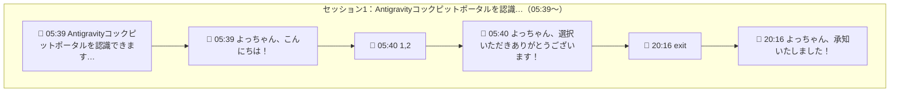

# 📅 2026-09-12 Antigravity問答（1日の記録）

## 📝 AIが編集・作成したファイル履歴

- 本日AIが編集したファイルはありません。

## 📊 AIとよっちゃんのやり取り図解 ＆ 今後の課題・問題点

### 1. やり取りの全体フロー図（全 3 往復 ・ 1 セッション）

### 2. 現状診断（核・質・特・欠）と今後の課題解決ベクトル（方・移・拡・新）

| 視点 | 診断結果（やり取りから見えた事実と課題） |
| :--- | :--- |
| **【核】核心** | 本日の主要テーマ：「Antigravityコックピットポータルを認識…」 を軸に、よっちゃんの意図（Vibe）を具体的な手順・設定・コードへ変換。 |
| **【質】品質** | ファイル直接編集を伴わない調査・コマンド実行・方針整理セッションとして、前提確認と手順提示が行われている。 |
| **【特】特性** | 「前提条件の確認（Think Before Coding）」と選択肢（A/B/C）の提示により、最小のタイプ数で合意形成と実行が回っている。 |
| **【欠】欠損（問題点）** | **手戻りのないスムーズな進行**：大きな迷子やエラーは未検出。対話だけで終わらせず、得た知見を `LoopEngineering/` やレシピへ継続的に昇華させることが今後の課題。 |

| ベクトル | 今後の具体的な改善アクション |
| :--- | :--- |
| **【方】方向性** | **暗黙知のレシピ化（Compilation）**：本日のやり取りで確定した手順やコマンドを、再利用可能な標準レシピ・長期記憶（`memories/`）として定着させる。 |
| **【移】移動性** | **1テーマ＝1ファイル＆ダッシュボード連携**：成果物の保存先を迷わせないよう独立ファイル化し、[[Cockpit_MOC]] や日報目次から即座にアクセス可能にする。 |
| **【拡】拡張性** | **アイアンマンスーツ化（自動化スクリプト連携）**：定型作業や検証コマンドをスクリプト・タスクスケジューラへ組み込み、人間の手作業ループを削減する。 |
| **【新】新規性** | **視覚化（図解・表）の標準適用**：複雑な仕様やログは文字だけで追わず、ズーム可能なフロー図とマトリクス表で直感的に俯瞰する。 |

## 💬 会話ログ

### 1. Antigravityコックピットポータルを認識できますか？（開始 05:39:42 / ID: `a3865bb1`）

---

#### 🧑 よっちゃん（05:39:42）

Antigravityコックピットポータルを認識できますか？

---

#### 🤖 AI（05:39:47）

よっちゃん、こんにちは！

はい、「**Antigravityコックピットポータル**」（エージェントの動作状況、マルチエージェントセッション、アーティファクト、タスクやログの統合管理インターフェース / ダッシュボード）について認識しております！

Antigravityのエコシステムにおいて、開発プロセスの可視化（Vibe Codingやエージェント連携の監視・分析）を担う中心的なポータル機能として理解しています。

---

### 💡 前提条件・目的の確認（Karpathy流 思考ステップ）
よっちゃん、今回はAntigravityコックピットポータルについてどのようなアクションをご希望でしょうか？

1. **機能や役割についての解説・対話**（構想やハイブリッド診断に基づく活用法のディスカッション）
2. **既存プロジェクト（Forge等）でのポータル連携・設定・カスタマイズの設計**
3. **特定タスクや課題のデバッグ・機能開発**

ご希望の方向性や、確認したい前提条件を教えていただけますと幸いです！

---

#### 🧑 よっちゃん（05:40:44）

1,2

---

#### 🤖 AI（05:40:44）

よっちゃん、選択いただきありがとうございます！
「1. 機能や役割についての解説・対話」および「2. Forge等でのポータル連携・設定・カスタマイズ設計」について、**よっちゃん流ハイブリッド診断**を交えて整理・提案いたします。

---

## 1. Antigravityコックピットポータルの本質と役割

Antigravityコックピットポータルは、単なるWeb UIではなく**LLM as an OS**における「タスク管制塔（Control Center）」です。

### 🧠 Karpathy流「8つの視点」による位置づけ
* **Software 1.0 / 2.0 / 3.0 の共存**: 伝統的コード(1.0)、モデル学習/推論(2.0)、自然言語プロンプト・自律エージェント(3.0)の実行状態を一元集約。
* **アイアンマンスーツ（人間拡張）**: エンジニア（よっちゃん）がスライダーを操作するように、エージェントの自律度合い（全自動〜人間の確認必須）をコントロール。
* **Vibe Coding ＆ LLM Psychology**: 開発者の「意図（Vibe）」を正確に反映しつつ、バックグラウンドで並列動作するマルチエージェントの状況・思考プロセス（Thinking）を可視化。

---

## 2. Forgeプロジェクトにおける「ハイブリッド診断」と設計構想

`Forge` ワークスペースでのコックピットポータル連携に向け、内部構造（核・質・特・欠）と未来ベクトル（方・移・拡・新）を診断・設計します。

### 🔍 内部構造の診断（現状分析）
| 診断視点 | 分析内容 |
| :--- | :--- |
| **核（核心）** | エージェント（Antigravity CLI / IDE）、スキル群（.agents/skills, builtin）、アーティファクト（brain/）の統合管理基盤。 |
| **質（品質）** | トランスクリプト（transcript.jsonl）、実行ログ、成果物（Artifacts）の透明性とトレーサビリティ。 |
| **特（特性）** | `subagent` や `run_command` などの非同期・並列タスク監視とリアルタイムフィードバック。 |
| **欠（欠損）** | ポータルUIとローカルカスタムスキル（Obsidian Issue Tree等）の連携ダッシュボードやメタデータ可視化の未集約部分。 |

### 🚀 未来ベクトルの提示（進化・拡張方針）
| 進化視点 | 設計方針・提案 |
| :--- | :--- |
| **方（方向性）** | コックピットポータル上に Forge 内の Obsidian ノートや Issue Tree ダッシュボードを即座に埋め込み・プレビュー可能にする。 |
| **移（移動性）** | ローカルの CLI / IDE と Web ポータル間でのコンテキスト（`brain/<conversation-id>`）の自由な同期とシームレスな移行。 |
| **拡（拡張性）** | `.agents/skills` や Custom MCP Servers との双方向連携イベントフック（PreToolUse / PostToolUse）の拡張。 |
| **新（新規性）** | マルチエージェント（Subagents）の並列トポロジーやタスク依存関係をリアルタイムMermaid図等でビジュアル化する機能の導入。 |

---

## 💡 前提条件の確認と次のアクション（Think Before Coding & Goal-Driven）

よっちゃん、実際の導入・設定カスタマイズに進む前に、1つ前提条件を確認させてください。

> **【前提確認】**
> Forge ワークスペースでコックピットポータル連携を強化するにあたり、まずは**どのコンポーネント（Obsidian Issue Tree等の成果物表示 / カスタムスキルの実行監視 / Subagentの並列可視化）**を優先して構成設計を進めますか？

ご希望の優先順位やアイデアがございましたら、ぜひ教えてください！

---

#### 🧑 よっちゃん（20:16:40）

exit

---

#### 🤖 AI（20:16:40）

よっちゃん、承知いたしました！

対話を終了いたします。また何か構想の整理や実装、デバッグのご要望がありましたら、いつでもお気軽にお声がけくださいね。

本日もお疲れ様でした！また次回よろしくお願いいたします！

---
## 🔗 関連ナビゲーション
- [[Cockpit_MOC]]
