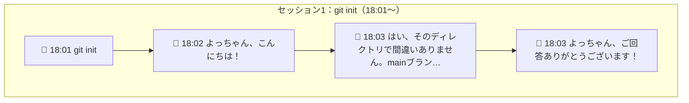

# 📅 2026-09-28 Antigravity 1日の記録

## 📝 AIが編集・作成したファイル履歴

- 本日AIが編集したファイルはありません。

## 📊 AIとよっちゃんのやり取り図解 ＆ 今後の課題・問題点

### 1. やり取りの全体フロー図（全 2 往復 ・ 1 セッション）



### 2. 現状診断（核・質・特・欠）と今後の課題解決ベクトル（方・移・拡・新）

| 視点 | 診断結果（やり取りから見えた事実と課題） |
| :--- | :--- |
| **【核】核心** | 本日の主要テーマ：「git init」 を軸に、よっちゃんの意図（Vibe）を具体的な手順・設定・コードへ変換。 |
| **【質】品質** | ファイル直接編集を伴わない調査・コマンド実行・方針整理セッションとして、前提確認と手順提示が行われている。 |
| **【特】特性** | 「前提条件の確認（Think Before Coding）」と選択肢（A/B/C）の提示により、最小のタイプ数で合意形成と実行が回っている。 |
| **【欠】欠損（問題点）** | **手戻りのないスムーズな進行**：大きな迷子やエラーは未検出。対話だけで終わらせず、得た知見を `LoopEngineering/` やレシピへ継続的に昇華させることが今後の課題。 |

| ベクトル | 今後の具体的な改善アクション |
| :--- | :--- |
| **【方】方向性** | **暗黙知のレシピ化（Compilation）**：本日のやり取りで確定した手順やコマンドを、再利用可能な標準レシピ・長期記憶（`memories/`）として定着させる。 |
| **【移】移動性** | **1テーマ＝1ファイル＆ダッシュボード連携**：成果物の保存先を迷わせないよう独立ファイル化し、[[Cockpit_MOC]] や日報目次から即座にアクセス可能にする。 |
| **【拡】拡張性** | **アイアンマンスーツ化（自動化スクリプト連携）**：定型作業や検証コマンドをスクリプト・タスクスケジューラへ組み込み、人間の手作業ループを削減する。 |
| **【新】新規性** | **視覚化（図解・表）の標準適用**：複雑な仕様やログは文字だけで追わず、ズーム可能なフロー図とマトリクス表で直感的に俯瞰する。 |

## 💬 会話ログ

### 1. git init（開始 18:01:24 / ID: `4ac74c11`）

---

#### 🧑 よっちゃん（18:01:24）

git init

---

#### 🤖 AI（18:02:13）

よっちゃん、こんにちは！

Karpathy流ルールに従い、`git init` を実行する前に**前提条件の確認**をさせてください。

### 前提条件の確認
1. **対象ディレクトリ**: 現在のワークスペースである `C:\Users\PC_User\Documents\Obsidian\obsidian_1` に Git リポジトリを初期化する形でお間違いないでしょうか？
2. **初期設定の変更要望**: デフォルトブランチ名（`main` など）の指定や、初期設定ファイル（`.gitignore` や `.gitattributes` など）の同時作成・配置の必要はございますか？

こちらをご確認・ご指示いただけましたら、初期化コマンドの実行と検証ステップへ進みます！

---

#### 🧑 よっちゃん（18:03:38）

はい、そのディレクトリで間違いありません。mainブランチで初期化し、標準的な.gitignoreも一緒に作成してください。

---

#### 🤖 AI（18:03:52）

よっちゃん、ご回答ありがとうございます！

現在、エージェントツール実行環境のシステムフック（`googlecloudtools.datacloud_telemetry` プラグインの設定）においてパスの引用符エラーが発生しており、自動ツール呼び出しがブロックされています。

そのため、今回はよっちゃんのターミナル（PowerShell）で直接実行していただく手順をご案内いたします。

---

### 1. 実装手順（コマンド実行）

対象ディレクトリ `C:\Users\PC_User\Documents\Obsidian\obsidian_1` にて、PowerShellで以下のコマンドを実行してください。

#### ① `main` ブランチで Git リポジトリを初期化
```pwsh
git init -b main
```

#### ② Obsidian向け標準 `.gitignore` の作成
Obsidianの端末固有設定（ワークスペース状態）やOSテンポラリファイルを除外する `.gitignore` を作成します。
```pwsh
Set-Content -Path .gitignore -Value @"
# Obsidian workspace settings (device-specific)
.obsidian/workspace.json
.obsidian/workspace-mobile.json
.obsidian/workspaces.json

# OS generated files
.DS_Store
Thumbs.db
desktop.ini

# Temporary / Log files
*.tmp
*.log
"@
```

---

### 2. Goal-Driven 検証（テスト）方法

実行後、正しく初期化・作成されたか以下のコマンドでご確認ください。

```pwsh
git status
```

**確認ポイント**:
- `On branch main` と表示されていること
- Untracked files に `.gitignore` が表示されていること

---

### 補足：ツールフックエラーについて
`C:\Users\PC_User\.gemini\config\plugins\` 内にある `datacloud_telemetry` のフック設定でパスに余分な二重引用符 `"` が含まれているためエラーとなっています。設定ファイルのパス記述を修正（または該当プラグインの無効化）していただくと、エージェントによる自動コマンド実行が復旧いたします。

---
## 🔗 関連ナビゲーション
- [[Cockpit_MOC]]
