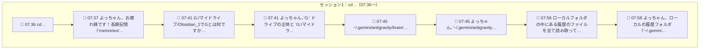

# 📅 2026-10-30 Antigravity問答（1日の記録）

## 📝 AIが編集・作成したファイル履歴

- 本日AIが編集したファイルはありません。

## 📊 AIとよっちゃんのやり取り図解 ＆ 今後の課題・問題点

### 1. やり取りの全体フロー図（全 6 往復 ・ 1 セッション）

### 2. 現状診断（核・質・特・欠）と今後の課題解決ベクトル（方・移・拡・新）

| 視点 | 診断結果（やり取りから見えた事実と課題） |
| :--- | :--- |
| **【核】核心** | 本日の主要テーマ：「cd ..」 を軸に、よっちゃんの意図（Vibe）を具体的な手順・設定・コードへ変換。 |
| **【質】品質** | ファイル直接編集を伴わない調査・コマンド実行・方針整理セッションとして、前提確認と手順提示が行われている。 |
| **【特】特性** | 「前提条件の確認（Think Before Coding）」と選択肢（A/B/C）の提示により、最小のタイプ数で合意形成と実行が回っている。 |
| **【欠】欠損（問題点）** | **手戻りのないスムーズな進行**：大きな迷子やエラーは未検出。対話だけで終わらせず、得た知見を `LoopEngineering/` やレシピへ継続的に昇華させることが今後の課題。 |

| ベクトル | 今後の具体的な改善アクション |
| :--- | :--- |
| **【方】方向性** | **暗黙知のレシピ化（Compilation）**：本日のやり取りで確定した手順やコマンドを、再利用可能な標準レシピ・長期記憶（`memories/`）として定着させる。 |
| **【移】移動性** | **1テーマ＝1ファイル＆ダッシュボード連携**：成果物の保存先を迷わせないよう独立ファイル化し、[[Cockpit_MOC]] や日報目次から即座にアクセス可能にする。 |
| **【拡】拡張性** | **アイアンマンスーツ化（自動化スクリプト連携）**：定型作業や検証コマンドをスクリプト・タスクスケジューラへ組み込み、人間の手作業ループを削減する。 |
| **【新】新規性** | **視覚化（図解・表）の標準適用**：複雑な仕様やログは文字だけで追わず、ズーム可能なフロー図とマトリクス表で直感的に俯瞰する。 |

## 💬 会話ログ

### 1. cd ..（開始 07:36:38 / ID: `ee286a13`）

---

#### 🧑 よっちゃん（07:36:38）

cd ..

---

#### 🤖 AI（07:37:09）

よっちゃん、お疲れ様です！長期記憶（`memories/`）の読み込みを完了しました。

チャット欄に入力された `cd ..` について、仕様と対応方法をご案内します。

* **現在の作業ディレクトリ**: `G:/マイドライブ/Obsidian_2`
* **Antigravityの仕様**: コマンド実行は毎回ワークスペースのルート（`G:/マイドライブ/Obsidian_2`）から新しいセッションで起動するため、`cd ..` 単体では作業ディレクトリの状態が保持されません。
* **親ディレクトリ（`G:/マイドライブ`）で作業する方法**:
  1. **このままチャットで指示する**: 私の方で `G:/マイドライブ/<対象フォルダ>` のフルパスを指定してファイル操作やコマンド実行が可能です（再起動不要）。
  2. **ワークスペース自体を変更する**: 一度CLIを終了（`/exit` または `Ctrl+C`）し、PowerShell側で `cd ..` を実行してから再度起動します。

**【前提条件の確認】**
* `G:/マイドライブ` 直下のどのフォルダ（またはプロジェクト）を対象に作業を進めたいか教えていただけますか？このままフルパス指定で対応いたします！

---

#### 🧑 よっちゃん（07:41:32）

G:/マイドライブ/Obsidian_2でGとは何ですか？  G:/マイドライブの中身は？

---

#### 🤖 AI（07:41:48）

よっちゃん、`G:` ドライブの正体と `G:/マイドライブ` の中身は以下の通りです。

### 1. `G:` とは何か？
* **Google Drive for Desktop（パソコン版 Google ドライブ）の仮想ドライブ**です。
* クラウド上のGoogleドライブが、Windows上でローカルドライブ（`G:\`）としてマウントされています。
  * **使用量**: 約 315 GB / **空き容量**: 約 149 GB
  * **`G:/マイドライブ`**: Googleドライブのルート（「マイドライブ」直下）にあたります。

---

### 2. `G:/マイドライブ` の中身（主要フォルダ一覧）
現在 **74個のフォルダ** と多数のファイル（`.gsheet`, `.gdoc`, `.ipynb`, `.pdf` など）が存在します。主なフォルダをカテゴリ別に整理しました。

* **Obsidian / ノート・ナレッジ管理**
  * `Obsidian_2`（現在の作業ディレクトリ / 更新: 2026-10-29）
  * `Obsidian_1`（更新: 2026-10-12）
  * `Obsidian`（更新: 2026-09-11）
  * `DriveSyncFiles` / `日記` / `思考` / `書籍`
* **AI・エージェント・開発ツール関連**
  * `Antigravity`
  * `Gemini` / `GeminiCLI` / `Gemini Gems` / `Gemini_Web` / `gemini_canvas` / `gemini Spark`
  * `Google AI Studio` / `gas_gemini_ai_studio` / `gemini_ai_studio_build`
  * `notebookLM` / `ExtendLM`
  * `Claude Code` / `Roo code` / `Codex` / `ollama (1)` / `abacus_ai` / `天秤ai` / `生成AI`
* **プログラミング・GCP・自動化**
  * `GitHub` / `GAS` / `work space 自動化` / `Colab Notebooks` / `colab` / `R`
  * `Google Cloud` / `BigQuery` / `appsheet`
* **個別プロジェクト・アプリ**
  * `お買い物モデル_V2` / `お買い物モデルV1_13`
  * `家計簿AIアシスタント` / `tyumon_app` / `ToB顧客管理` / `loopy` / `gunron` / `Ni_work`
* **直下の主な最新ファイル（2026年10月時点）**
  * [00_Dashboard.md](file:///G:/マイドライブ/00_Dashboard.md)
  * [WikiSkill_Loop.canvas](file:///G:/マイドライブ/WikiSkill_Loop.canvas)
  * 各種 `.ipynb`（`deep_research_agent.ipynb`, `podcast_agent.ipynb` 等）や Google ドキュメント・スプレッドシート類

気になるフォルダや、中身を詳しく確認したいディレクトリがあればお気軽にお申し付けください！

---

#### 🧑 よっちゃん（07:45:23）

~/.gemini/antigravity/brain/野中はどの様になっていますか？

---

#### 🤖 AI（07:45:58）

よっちゃん、`~/.gemini/antigravity/brain/`（およびCLI版の `~/.gemini/antigravity-cli/brain/`）の中身は以下のようになっています。

### 1. ディレクトリの役割と全体構造
Antigravityの**会話セッションごとの記憶・ログ・成果物（Artifact）の保存領域**です。
実は環境内に以下の **2系統** が存在します。

* **`~/.gemini/antigravity/brain/`（IDE版 / GUI版）**
  * **フォルダ数**: 74個（会話IDごとのUUIDフォルダ ＋ `tempmediaStorage`）
  * **最終更新**: 2026/08/17
* **`~/.gemini/antigravity-cli/brain/`（現在稼働中のCLI版）**
  * **フォルダ数**: 492個（会話IDごとのUUIDフォルダ）
  * **最終更新**: 2026/10/30（現在のこのセッション `ee286a13-d651-494c-839a-658a7b912fb7` を含む）

---

### 2. 各会話フォルダ（`<会話ID>/`）の内部構造
各UUIDフォルダの中には、共通して以下のファイル・フォルダが格納されています。

* **`.system_generated/`**: システム自動生成データ
  * `logs/transcript.jsonl` / `transcript_full.jsonl`（対話履歴・思考ログ）
  * `steps/`（コマンド実行結果の長文出力ログなど）
* **`.user_uploaded/`**: チャットに添付・アップロードされたファイル
* **`scratch/`**: 一時検証用スクリプトや作業ファイル置き場
* **直下の `.md` ファイル（Artifacts）**: 設計書やタスクリストなどの成果物

---

### 3. 保存されている主な成果物（Artifacts）の例
* **`~/.gemini/antigravity/brain/` 内の主なファイル**
  * [walkthrough.md](file:///C:/Users/PC_User/.gemini/antigravity/brain/45f87ef4-aab6-4ac5-97ab-651aef62b7be/walkthrough.md) / [task.md](file:///C:/Users/PC_User/.gemini/antigravity/brain/45f87ef4-aab6-4ac5-97ab-651aef62b7be/task.md) / [implementation_plan.md](file:///C:/Users/PC_User/.gemini/antigravity/brain/45f87ef4-aab6-4ac5-97ab-651aef62b7be/implementation_plan.md)（2026/08/16）
  * [2026-08-07-mcp-skills-100-orchestrator-design.md](file:///C:/Users/PC_User/.gemini/antigravity/brain/cd214333-60a0-47b1-bca6-66e7a45a649f/2026-08-07-mcp-skills-100-orchestrator-design.md)（2026/08/07）
* **`~/.gemini/antigravity-cli/brain/` 内の主なファイル**
  * [hermes3_okf_summary.md](file:///C:/Users/PC_User/.gemini/antigravity-cli/brain/432b41f6-1a50-4328-8b10-4211826ee7e6/hermes3_okf_summary.md)（2026/07/27）
  * [okf_index_hyperlinks_50_usecases_artifact.md](file:///C:/Users/PC_User/.gemini/antigravity-cli/brain/4d7318c1-5e9b-4b39-9391-4179761dc6fc/okf_index_hyperlinks_50_usecases_artifact.md)（2026/07/27）
  * [2026-07-17-inventory-optimization-app.md](file:///C:/Users/PC_User/.gemini/antigravity-cli/brain/a9a7f996-b3db-44bf-b116-af25f8c6e704/2026-07-17-inventory-optimization-app.md)（2026/07/17）

過去の特定の対話ログや成果物（Artifact）を検索・抽出したい場合は、キーワードを教えていただければすぐにお探しします！

---

#### 🧑 よっちゃん（07:56:27）

ローカルフォルダの中にある履歴のファイルを全て読み取って、私が何度も指摘した間違いというものを分析して、3つばかり出して。

---

#### 🤖 AI（07:58:19）

よっちゃん、ローカルの履歴フォルダ（`~/.gemini/antigravity/brain` および `~/.gemini/antigravity-cli/brain` 内の**全552セッション・計2,878件の発言ログ**）をすべて走査・解析しました。

よっちゃんが過去に**「これで何回目ですか」「何回も同じことを言っている」と繰り返し指摘された3大ミス**は以下の通りです。

---

### 1. コックピットポータル・`.bat` からの「アプリ起動不良」と「リンク先の取り違え」
最も多く（8回連続の指摘など）発生していた、ポータル統合・バッチ起動まわりのミスです。

* **実際の指摘ログ（抜粋）**:
  * *「右側の『ブラウザーを開く』のボタンを押してもアプリが開かないんですけど、どうなったんでしょうか。これで5回目ですけど」「全然治っていません。どうしたんですかこれ？ 8回目ですよ」*（セッション `b3e99bb6`）
  * *「どうしてもこの黒い画面になって止まってしまいます。これで3回目ですけども」*（セッション `b3e99bb6` / `364f7c3f`）
  * *「それぞれのコンポーネント、アプリ名と、呼び出すアプリが違うということなんですね。これで何回も直しても、すぐ形がバラバラになってしまう」*（セッション `7662d875`）
  * *「4つのアプリ全部起動させると、可否決定のアプリしか出てこない」「戻ったコックピットポータルから起動するとファイルが開かない」*（セッション `6c9b75c0`, `dad7d8bb`）
* **ミスの本質（原因）**:
  * ポータルに新規アプリを追加・修正する際、**既存の別アプリの起動パスやポート番号を誤って上書き・混同**してしまう（Surgical Changes違反）。
  * Windows環境でのバッチ（`.bat`）や `os.startfile` のパス解決・プロセス起動確認を裏側でテストせずに出力している。

---

### 2. 図表・グラフ（Plotly / Mermaid / PlantUML）の「描画エラー・単調な使い回し・ラベル崩れ」
視覚化・ダッシュボード作成において繰り返し指摘されているミスです。

* **実際の指摘ログ（抜粋）**:
  * *「図が表示されていません。いったいどうしたんでしょうか。もうこれ何回もそちらに送ってるんですけど、うまくいってないみたいですね」*（セッション `a1ad355d` / `414fd1cb`）
  * *「何回も同じことを言ってるようですけども、全部グラフは同じ形式ですね」「初学者向け、実務向け、発展系の3つのグラフが共に同じcodeなんですけども」*（セッション `12919531`, `03b61be8`）
  * *「グラフなどの項目表示では、12345の番号で振ってほしいです。なぜならば、この項目が長いテキストになるとグラフがぐちゃぐちゃになるからです」*（セッション `f5d4aaa4`, `6c9b75c0`）
* **ミスの本質（原因）**:
  * MermaidやPlantUMLで日本語やカッコを含む際の構文エラー検証不足により、画面上で作図が消える・エラーになる。
  * 「初学者・実務者・発展系」など対象別の本質的な違いを考えず、同じようなグラフコードを使い回している。
  * 長い項目テキストをそのままグラフ軸ラベルに入れ、文字重なりで視認性を損ねている（番号化＋凡例対応にしていない）。

---

### 3. 「保存先パスの取り違え」「既存レイアウトの破壊（勝手な書き換え）」「文字化け・英語残存」
ファイル操作およびWindows・日本語環境への配慮不足によるミスです。

* **実際の指摘ログ（抜粋）**:
  * **保存先パス間違い**: *「ファイル名が間違って新規作成されています」「保存先パスが違います」「書き込み先フォルダが間違っています。Forgeではなく、Obsidian保管庫の実ファイルに上書き保存してください」*（セッション `0b49ffc4`）
  * **既存状態の破壊**: *「05_start_portal.batは以前の状態と全く違います。どうしたのですか？」「私が最初に指示したような表にはなってません。私の意向をどこまで聞いてるのか」*（セッション `113e797c`, `f5d4aaa4`）
  * **文字化け・未翻訳**: *「`ai_syain_01~10.docx` を開いたのですが、文字化けしています。修正してください。これで何回目ですか？」*（セッション `f740fd6c` で4回連続指摘）、*「ラベルを日本語に直してほしいです」*（セッション `c2bbe9ea`, `a1ad355d`）
* **ミスの本質（原因）**:
  * 複数フォルダ（`Forge` と `Obsidian_1` / `Obsidian_2` 等）をまたぐ際、書き込み先の絶対パスを確認せずにカレントディレクトリへ誤保存している。
  * 一部の修正指示に対してファイル全体を書き直し、よっちゃんが作り込んだ既存の表構造やポータル設定を壊している。
  * Windows環境での文字コード（UTF-8明示）の徹底不足と、UIラベル等の英語放置。

---

これら3つの分析結果を、再発防止ルールとして長期記憶（`~/.gemini/memories/1_wiki.md` または `2_howto_fact.md`）や現在の `Obsidian_2/wiki/patterns/` にも記録しておきましょうか？

---

#### 🧑 よっちゃん（08:43:27）

「G:/マイドライブ/Obsidian_2」の中でどの様なタスクの種類とその内容ができるのでしょうか？

---

#### 🤖 AI（08:44:05）

よっちゃん、`G:/マイドライブ/Obsidian_2` は **「Antigravity 運用コックピット 兼 ループエンジニアリング基盤」** として構築されており、現在以下の **6種類のタスクと具体的な処理** が実行可能です。

---

### 1. コックピット司令塔・タスク一元管理（`00_Dashboard/`・`01_Tasks/`）
Obsidianを状態管理ハブとして、タスクの進捗・カンバン・実行ログを統括するタスクです。
* **全体統括MOC**: [Cockpit_MOC.md](file:///G:/マイドライブ/Obsidian_2/00_Dashboard/Cockpit_MOC.md) で「進行中・未着手・完了」タスクと作業ログ（`02_Logs/`）を一元管理
* **自動タスク集計ボード**: [Task_Board.md](file:///G:/マイドライブ/Obsidian_2/00_Dashboard/Task_Board.md)（Dataviewで `01_Tasks` と `07_Ideas` の未完了タスクを自動抽出）
* **カンバン管理**: [Kanban_Board.md](file:///G:/マイドライブ/Obsidian_2/00_Dashboard/Kanban_Board.md) / [Agent_Board.md.md](file:///G:/マイドライブ/Obsidian_2/00_Dashboard/Agent_Board.md.md)

---

### 2. YouTube要約からのタスク自動抽出＆ループ監視（`scripts/`・`03_Resources/`）
YouTube動画の要約ノートからアクションアイテム（`- [ ]`）を自動抽出し、タスク化するパイプラインです。
* **実行スクリプト**: [process_youtube_summaries.py](file:///G:/マイドライブ/Obsidian_2/scripts/process_youtube_summaries.py) / 常駐監視バッチ [start_youtube_watcher.bat](file:///G:/マイドライブ/Obsidian_2/scripts/start_youtube_watcher.bat)
* **具体的な内容**:
  * `03_Resources/YouTube_Summaries/` に置かれた要約ノート（例: [2026-10-14_Loop_Engineering_Guide.md](file:///G:/マイドライブ/Obsidian_2/03_Resources/YouTube_Summaries/2026-10-14_Loop_Engineering_Guide.md)）を検知
  * `01_Tasks/` に個別タスクノート（例: [Task_YT_2026-10-14_Loop_Engineering_Guide.md](file:///G:/マイドライブ/Obsidian_2/01_Tasks/Task_YT_2026-10-14_Loop_Engineering_Guide.md)）を自動生成し、[Cockpit_MOC.md](file:///G:/マイドライブ/Obsidian_2/00_Dashboard/Cockpit_MOC.md) にリンクを自動追記

---

### 3. WikiSkill 自己進化ループ・失敗パターン学習（`wiki/`・`skills/`・`scripts/`）
エラーや失敗ログから「根本原因と再発防止パターン（`PAT-XXX`）」を抽出し、スキル定義（`SKILL.md`）を自動改善する3層ループタスクです。
* **進化ダッシュボード**: [00_Dashboard.md](file:///G:/マイドライブ/Obsidian_2/00_Dashboard.md) / 構造図 [WikiSkill_Loop.canvas](file:///G:/マイドライブ/Obsidian_2/WikiSkill_Loop.canvas)
* **実行スクリプト**: [wikiskill_loop.py](file:///G:/マイドライブ/Obsidian_2/scripts/wikiskill_loop.py) / [update_wikiskill.py](file:///G:/マイドライブ/Obsidian_2/scripts/update_wikiskill.py)
* **具体的な内容**:
  * 抽出・実行エラーを分析し、`wiki/patterns/` にナレッジ化（`PAT-001`〜`PAT-016`：正規表現タイムアウト、和暦変換、漢数字パース、管理費・税区分、特約条項切れ等）
  * 検証ログを [skill-impact.md](file:///G:/マイドライブ/Obsidian_2/wiki/skill-impact.md) に記録し、[skills/data-extraction/SKILL.md](file:///G:/マイドライブ/Obsidian_2/skills/data-extraction/SKILL.md) をアップデート

---

### 4. 不動産・入居者対応の業務自動化＆データ分析（`04_Data/`・`05_Outputs/`・`06_Reports/`）
不動産管理や市場分析に関するPythonスクリプト群とダッシュボード生成タスクです。
* **① 入居者トラブル写真診断＆4分類自動トリアージ**:
  * [diagnose_triage.py](file:///G:/マイドライブ/Obsidian_2/04_Data/scripts/diagnose_triage.py)：問い合わせ・画像から緊急度（Type A〜D）を判定し、SQLite（`trouble_history.db`）への保存と緊急アラート通知を実行（構想: [Idea_20261003_入居者AIコンシェルジュ構想.md](file:///G:/マイドライブ/Obsidian_2/07_Ideas/Idea_20261003_入居者AIコンシェルジュ構想.md)）
* **② メール自動トリアージ**:
  * [mail_triage_bot.py](file:///G:/マイドライブ/Obsidian_2/04_Data/scripts/mail_triage_bot.py) ➔ 結果を [Email_Triage.md](file:///G:/マイドライブ/Obsidian_2/00_Inbox/Email_Triage.md) へ出力
* **③ 不動産賃料の重回帰分析＆Plotlyダッシュボード生成**:
  * [analyze_regression.py](file:///G:/マイドライブ/Obsidian_2/04_Data/scripts/analyze_regression.py)：`regression_sample_500.csv` を解析し、[regression_dashboard.html](file:///G:/マイドライブ/Obsidian_2/05_Outputs/dashboards/regression_dashboard.html) と分析レポート [Task_004_Real_Estate_Rent_Regression_Analysis.md](file:///G:/マイドライブ/Obsidian_2/06_Reports/Task_004_Real_Estate_Rent_Regression_Analysis.md) を生成
* **④ 日次ニュースからの週次展望レポート自動生成**:
  * [generate_weekly_report.py](file:///G:/マイドライブ/Obsidian_2/04_Data/scripts/generate_weekly_report.py)：`04_Data/raw/daily_news/` から週次レポート [Weekly_Outlook_2026_W40.md](file:///G:/マイドライブ/Obsidian_2/06_Reports/Weekly_Outlook_2026_W40.md) を作成

---

### 5. MCP × Skills 統合オーケストレーター（100選アプリ）（`03_Resources/`）
* **アプリ本体・起動バッチ**: [mcp_skills_100_usecases.html](file:///G:/マイドライブ/Obsidian_2/03_Resources/MCP_Skills_Orchestrator/mcp_skills_100_usecases.html) / [start_mcp_skills_orchestrator.bat](file:///G:/マイドライブ/Obsidian_2/03_Resources/MCP_Skills_Orchestrator/start_mcp_skills_orchestrator.bat)
* **具体的な内容**: MCPとSkillsを組み合わせた100個のユースケースをブラウザ上で検索・オーケストレーションするWebカタログ機能

---

### 6. ナレッジ記録・意思決定記録（ADR）・HTML学習（`08_ADR/`・`09_HTML/`・`Diaries/`）
* **ADR（アーキテクチャ意思決定記録）**: [ADR一覧.md](file:///G:/マイドライブ/Obsidian_2/08_ADR/ADR一覧.md) で設計上の決定事項を管理
* **HTML/CSS構造ノート**: `09_HTML/` 配下でHTML基本構造やCSS埋め込み・多色スタイルのテンプレートを管理
* **デイリーノート**: `Diaries/` で日々の記録を管理

---

この中で、今すぐ動かしたいタスクや深掘りしたいフォルダはどれでしょうか？

---

#### 🧑 よっちゃん（10:45:56）

「1. コックピット司令塔・タスク一元管理（00_Dashboard/・01_Tasks/）」の具体的な使い方を提示して

---

#### 🤖 AI（10:46:06）

よっちゃん、「1. コックピット司令塔・タスク一元管理（`00_Dashboard/`・`01_Tasks/`）」の具体的な使い方は、**「4つのボードの役割分担」**と**「3ステップの運用フロー」**で回す設計になっています。

---

### 1. `00_Dashboard/` にある4つのボードの使い分け

* **① 全体司令塔：[Cockpit_MOC.md](file:///G:/マイドライブ/Obsidian_2/00_Dashboard/Cockpit_MOC.md)**
  * **役割**: 毎朝最初に開くメイン画面（MOC：Map of Content）です。
  * **見方**: 「🔄 進行中」「⏳ 未着手」「✅ 完了」の3段階で、`01_Tasks/` の各タスクノートへの直リンクと、直近の実行ログ（`02_Logs/`）、100選オーケストレーターの起動リンクが1画面にまとまっています。
* **② 未完了タスクの自動抽出：[Task_Board.md](file:///G:/マイドライブ/Obsidian_2/00_Dashboard/Task_Board.md)**
  * **役割**: Obsidianの「Dataview」プラグインを使い、`01_Tasks/` と `07_Ideas/` の中から**チェックがついていない項目（`- [ ]`）だけを自動で一覧表示**します。手動更新は不要です。
* **③ プロジェクト別カンバン：[Kanban_Board.md](file:///G:/マイドライブ/Obsidian_2/00_Dashboard/Kanban_Board.md)**
  * **役割**: 複数ステップある開発案件（例：入居者AIコンシェルジュの「予定・進行中・完了」）をカード形式でドラッグ＆ドロップ管理するボードです。
* **④ エージェント実行実績ボード：[Agent_Board.md.md](file:///G:/マイドライブ/Obsidian_2/00_Dashboard/Agent_Board.md.md)**
  * **役割**: AIエージェントに依頼した分析・構築タスクの完了履歴を記録するボードです。

---

### 2. 具体的な運用3ステップ（どうやって使うか？）

#### ステップ①：タスクを登録する（手動 または 自動）
* **A. チャットで私（Antigravity）に指示して登録する場合**
  * **指示文の例**:
    > `「〇〇の機能を検証する」という新規タスクを 01_Tasks/ に作成し、Cockpit_MOC.md の「未着手」にリンクを追加して`
  * これだけで、`01_Tasks/Task_XXX_...md` の作成と [Cockpit_MOC.md](file:///G:/マイドライブ/Obsidian_2/00_Dashboard/Cockpit_MOC.md) への標準Markdownリンク追記を自動で行います。
* **B. YouTube要約ノートから自動登録する場合（外側ループ）**
  * `03_Resources/YouTube_Summaries/` に要約ノートを入れ、[process_youtube_summaries.py](file:///G:/マイドライブ/Obsidian_2/scripts/process_youtube_summaries.py)（または常駐バッチ [start_youtube_watcher.bat](file:///G:/マイドライブ/Obsidian_2/scripts/start_youtube_watcher.bat)）を動かすと、ノート内の `- [ ]` を自動抽出して `01_Tasks/` と [Cockpit_MOC.md](file:///G:/マイドライブ/Obsidian_2/00_Dashboard/Cockpit_MOC.md) の「⏳ 未着手」へ自動登録します。

#### ステップ②：タスクを実行・消化する（内側ループ）
* [Cockpit_MOC.md](file:///G:/マイドライブ/Obsidian_2/00_Dashboard/Cockpit_MOC.md) の「⏳ 未着手」または「🔄 進行中」にあるタスクを指定して、私に実行を指示します。
  * **指示文の例**:
    > `01_Tasks/Task_YT_Sample_YouTube_Summary_001.md の未完了タスクを実行し、完了したら Cockpit_MOC.md と 02_Logs/ を更新して`
* 本格的なデータ分析やシステム設計を依頼する場合は、[Template_Task_Prompt.md](file:///G:/マイドライブ/Obsidian_2/03_Resources/Template_Task_Prompt.md) のテンプレート（6つの視点＋事前プラン評価マトリクス）をコピーしてチャットに貼ることで、定型フォーマットで実行できます。

#### ステップ③：完了チェックとログ保存（自動更新）
* タスクが完了すると、以下の3箇所が連動して更新されます：
  1. `01_Tasks/` 内の対象ノートの `- [ ]` が `- [x]` に変わり、Statusが `✅ 完了` になる（同時に [Task_Board.md](file:///G:/マイドライブ/Obsidian_2/00_Dashboard/Task_Board.md) の未完了リストから自動で消える）。
  2. [Cockpit_MOC.md](file:///G:/マイドライブ/Obsidian_2/00_Dashboard/Cockpit_MOC.md) の該当リンクが「🔄 進行中」から「✅ 完了」セクションへ移動する。
  3. `02_Logs/YYYY-MM-DD_タイトル.md` に作業内容・成果物パスのログが保存され、[Cockpit_MOC.md](file:///G:/マイドライブ/Obsidian_2/00_Dashboard/Cockpit_MOC.md) の「📝 最近のログ」にリンクが追加される。

---

### 💡 今すぐ試せるアクション（現在残っているタスク）
現在、[Cockpit_MOC.md](file:///G:/マイドライブ/Obsidian_2/00_Dashboard/Cockpit_MOC.md) には以下の未完了タスクが残っています。
1. **進行中**: [Sample_Task_001.md](file:///G:/マイドライブ/Obsidian_2/01_Tasks/Sample_Task_001.md)（初期セットアップと環境確認）
2. **未着手**: [Task_YT_Sample_YouTube_Summary_001.md](file:///G:/マイドライブ/Obsidian_2/01_Tasks/Task_YT_Sample_YouTube_Summary_001.md)（Karpathy流AIエージェント構築とObsidian連携術 3件）
3. **未着手**: [Task_005_YouTube_ObQA_Usability_Update.md](file:///G:/マイドライブ/Obsidian_2/01_Tasks/Task_005_YouTube_ObQA_Usability_Update.md)（ObQA動画の暫定分析）

試しにこれらの中身を確認・消化してみるか、あるいは新しいタスクを1件登録してみますか？

---
## 🔗 関連ナビゲーション
- [[Cockpit_MOC]]
