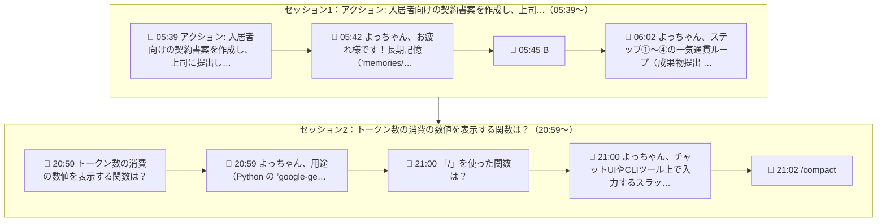

# 📅 2026-11-01 Antigravity 1日の記録

## 📝 AIが編集・作成したファイル履歴

- `05:45:38` **部分編集** `G:\マイドライブ\Obsidian_2\LoopEngineering\01_RealOutput\01_現実の成果物作成・提出.md` → [[01_現実の成果物作成・提出]]
- `05:45:38` **部分編集** `G:\マイドライブ\Obsidian_2\LoopEngineering\02_Feedback\02_上司からのフィードバック・アドバイス.md` → [[02_上司からのフィードバック・アドバイス]]
- `05:45:38` **部分編集** `G:\マイドライブ\Obsidian_2\LoopEngineering\03_Recipe\暗黙知言語化フレームワーク_SECI.md` → [[暗黙知言語化フレームワーク_SECI]]
- `05:45:38` **部分編集** `G:\マイドライブ\Obsidian_2\LoopEngineering\03_Recipe\変更ログテンプレート.md` → [[変更ログテンプレート]]
- `05:45:38` **部分編集** `G:\マイドライブ\Obsidian_2\LoopEngineering\03_Recipe\03_原理・原則の抽象化_レシピ更新.md` → [[03_原理・原則の抽象化_レシピ更新]]
- `05:45:38` **部分編集** `G:\マイドライブ\Obsidian_2\LoopEngineering\04_Action\04_即行動_次の試行.md` → [[04_即行動_次の試行]]
- `05:45:38` **部分編集** `G:\マイドライブ\Obsidian_2\LoopEngineering\04_Action\チェックリストと評価スコア_1-5.md` → [[チェックリストと評価スコア_1-5]]
- `05:55:39` **新規作成/上書き** `G:\マイドライブ\Obsidian_2\LoopEngineering\01_RealOutput\01_現実の成果物作成・提出.md` → [[01_現実の成果物作成・提出]]
- `05:55:39` **新規作成/上書き** `G:\マイドライブ\Obsidian_2\LoopEngineering\02_Feedback\02_上司からのフィードバック・アドバイス.md` → [[02_上司からのフィードバック・アドバイス]]
- `05:55:39` **新規作成/上書き** `G:\マイドライブ\Obsidian_2\LoopEngineering\03_Recipe\暗黙知言語化フレームワーク_SECI.md` → [[暗黙知言語化フレームワーク_SECI]]
- `05:55:39` **新規作成/上書き** `G:\マイドライブ\Obsidian_2\LoopEngineering\03_Recipe\変更ログテンプレート.md` → [[変更ログテンプレート]]
- `05:55:39` **新規作成/上書き** `G:\マイドライブ\Obsidian_2\LoopEngineering\03_Recipe\03_原理・原則の抽象化_レシピ更新.md` → [[03_原理・原則の抽象化_レシピ更新]]
- `05:55:39` **新規作成/上書き** `G:\マイドライブ\Obsidian_2\LoopEngineering\04_Action\04_即行動_次の試行.md` → [[04_即行動_次の試行]]
- `05:55:39` **新規作成/上書き** `G:\マイドライブ\Obsidian_2\LoopEngineering\04_Action\チェックリストと評価スコア_1-5.md` → [[チェックリストと評価スコア_1-5]]
- `06:01:23` **部分編集** `C:\Users\PC_User\.gemini\memories\1_wiki.md`

## 📊 AIとよっちゃんのやり取り図解 ＆ 今後の課題・問題点

### 1. やり取りの全体フロー図（全 5 往復 ・ 2 セッション）



### 2. 現状診断（核・質・特・欠）と今後の課題解決ベクトル（方・移・拡・新）

| 視点 | 診断結果（やり取りから見えた事実と課題） |
| :--- | :--- |
| **【核】核心** | 本日の主要テーマ：「アクション: 入居者向けの契約書案を作成し、上司…」 ／ 「トークン数の消費の数値を表示する関数は？」 を軸に、よっちゃんの意図（Vibe）を具体的な手順・設定・コードへ変換。 |
| **【質】品質** | 計 15 回のファイル操作により、[[01_現実の成果物作成・提出]], [[02_上司からのフィードバック・アドバイス]], [[暗黙知言語化フレームワーク_SECI]], [[変更ログテンプレート]] ほか計8ファイル への具体的な成果物反映・記録が完了している。 |
| **【特】特性** | 「前提条件の確認（Think Before Coding）」と選択肢（A/B/C）の提示により、最小のタイプ数で合意形成と実行が回っている。 |
| **【欠】欠損（問題点）** | **複数ファイルへの分散編集（計15回）**：更新箇所が多岐にわたるため、後からの追跡コストを下げる集約ノートの活用が有効。 |

| ベクトル | 今後の具体的な改善アクション |
| :--- | :--- |
| **【方】方向性** | **暗黙知のレシピ化（Compilation）**：本日のやり取りで確定した手順やコマンドを、再利用可能な標準レシピ・長期記憶（`memories/`）として定着させる。 |
| **【移】移動性** | **1テーマ＝1ファイル＆ダッシュボード連携**：成果物の保存先を迷わせないよう独立ファイル化し、[[Cockpit_MOC]] や日報目次から即座にアクセス可能にする。 |
| **【拡】拡張性** | **アイアンマンスーツ化（自動化スクリプト連携）**：定型作業や検証コマンドをスクリプト・タスクスケジューラへ組み込み、人間の手作業ループを削減する。 |
| **【新】新規性** | **視覚化（図解・表）の標準適用**：複雑な仕様やログは文字だけで追わず、ズーム可能なフロー図とマトリクス表で直感的に俯瞰する。 |

## 💬 会話ログ

### 1. アクション: 入居者向けの契約書案を作成し、上司に提出した。（開始 05:39:29 / ID: `6357fb4c`）

---

#### 🧑 よっちゃん（05:39:29）

アクション: 入居者向けの契約書案を作成し、上司に提出した。

---

#### 🤖 AI（05:42:33）

よっちゃん、お疲れ様です！長期記憶（`memories/`）および新設された `LoopEngineering/` フォルダの4ステップ構造を確認しました。

ご提示いただいたアクション（ステップ①）について、[01_現実の成果物作成・提出.md](file:///G:/マイドライブ/Obsidian_2/LoopEngineering/01_RealOutput/01_現実の成果物作成・提出.md) への反映案は以下の通りです。

```markdown
# ① 現実の成果物作成・提出

## 概要
日々の実務における成果物の作成および提出に関する記録・ワークフロー。

## 作成時の参照リスト
- [x] 関連するレシピ（`03_Recipe/`）を確認したか
- [x] チェックリスト（`04_Action/`）を手元に開いているか

## 提出物リンク / 記録
- 日付: 2026-11-01
- 成果物名・内容: 入居者向けの契約書案の作成
- 提出先: 上司
```

---

### 🔍 前提条件の確認（Think Before Coding）

ファイルへの書き込みを実行する前に、以下の2点を確認させてください。

* **1. 今回の作業範囲**:
  * **A.** まずはステップ①（[01_現実の成果物作成・提出.md](file:///G:/マイドライブ/Obsidian_2/LoopEngineering/01_RealOutput/01_現実の成果物作成・提出.md)）への記録のみを行い、よっちゃんからの次なる入力（実際のフィードバック等）を待つ
  * **B.** ステップ①〜④（[02_上司からのフィードバック・アドバイス.md](file:///G:/マイドライブ/Obsidian_2/LoopEngineering/02_Feedback/02_上司からのフィードバック・アドバイス.md) → [03_原理・原則の抽象化_レシピ更新.md](file:///G:/マイドライブ/Obsidian_2/LoopEngineering/03_Recipe/03_原理・原則の抽象化_レシピ更新.md) → [04_即行動_次の試行.md](file:///G:/マイドライブ/Obsidian_2/LoopEngineering/04_Action/04_即行動_次の試行.md)）まで、一連のループを一気通貫で回す
* **2. ステップ②（上司からのフィードバック）の扱い**:
  * 実際のフィードバック内容をよっちゃんからご提示いただくか、それともテスト用にAI側で「上司からの指摘事項サンプル（特約条項・金額表記など）」を仮設定してループを回すか、どちらをご希望でしょうか？

---

#### 🧑 よっちゃん（05:45:37）

B
AI側で「上司からの指摘事項サンプル（特約条項・金額表記など）」を
      仮設定してループを回す

---

#### 🤖 AI（06:02:31）

よっちゃん、ステップ①〜④の一気通貫ループ（成果物提出 → 上司フィードバック仮設定 → SECI・レシピ抽象化 → 即行動・チェックリスト更新）の反映が完了しました！
あわせて長期記憶の [1_wiki.md](file:///C:/Users/PC_User/.gemini/memories/1_wiki.md) にも `LoopEngineering/` の4ステップ構造を記録しました。

---

### 📄 更新した完成ファイル一覧と内容

#### ① [01_現実の成果物作成・提出.md](file:///G:/マイドライブ/Obsidian_2/LoopEngineering/01_RealOutput/01_現実の成果物作成・提出.md)
```markdown
# ① 現実の成果物作成・提出

## 概要
日々の実務における成果物の作成および提出に関する記録・ワークフロー。

## 作成時の参照リスト
- [x] 関連するレシピ（`03_Recipe/`）を確認したか
- [x] チェックリスト（`04_Action/`）を手元に開いているか

## 提出物リンク / 記録
- 日付: 2026-11-01
- 成果物名・内容: 入居者向けの契約書案の作成
- 提出先: 上司
```

#### ② [02_上司からのフィードバック・アドバイス.md](file:///G:/マイドライブ/Obsidian_2/LoopEngineering/02_Feedback/02_上司からのフィードバック・アドバイス.md)
```markdown
# ② 上司からのフィードバック・アドバイス

## 記録テンプレート
- **日時**: 2026-11-01
- **対象の成果物**: 入居者向けの契約書案
- **指摘事項（事実ベース）**: 1. 管理費・共益費の消費税区分（非課税・課税の別）が明記されていない / 2. 退去時の原状回復特約において、通常損耗と入居者負担の範囲が曖昧でトラブルリスクがある
- **分類タグ**: #What （金額・特約の記載漏れ） / #How （提出前の法務・税務項目セルフチェック不足） / #Why （入居者目線での誤解防止・紛争予防という契約書の本質理解の不足） （`3階層分類タグ定義.md` を参照）
- **上司のコメント・アドバイス**: 「契約書は『後から読んだ第三者や入居者が迷わないこと』が最優先。金額は総額だけでなく内訳・税区分を必ず明記し、特約条項はガイドラインに沿って負担基準を具体的に数値・事例で書くようにしてほしい。」
```

#### ③ [暗黙知言語化フレームワーク_SECI.md](file:///G:/マイドライブ/Obsidian_2/LoopEngineering/03_Recipe/暗黙知言語化フレームワーク_SECI.md) / [変更ログテンプレート.md](file:///G:/マイドライブ/Obsidian_2/LoopEngineering/03_Recipe/変更ログテンプレート.md) / [03_原理・原則の抽象化_レシピ更新.md](file:///G:/マイドライブ/Obsidian_2/LoopEngineering/03_Recipe/03_原理・原則の抽象化_レシピ更新.md)
```markdown
# レシピ・原則管理

## 目的
フィードバックから抽出した暗黙知を構造化し、次回以降の再現性を担保する。

## 変更ログ
| 日付 | 変更理由 / 背景 | 主な更新内容 | 更新者 |
| :--- | :--- | :--- | :--- |
| 2026-11-01 | 指摘に基づく改善（税区分・原状回復特約の明確化） | 金額表記ルールおよび特約条項の品質規準・チェックリストを追加 | よっちゃん |

## レシピ本文
### 目的
- 入居者との認識齟齬や退去時トラブルを防止し、誰が読んでも一義的に解釈できる入居者向け契約書案を作成する。

### 手順
1. 物件条件・賃料・管理費・敷金等の基礎データを収集し、非課税・課税の区分を整理する。
2. 標準契約書フォーマットに基礎データを反映し、金額欄に総額・内訳・税区分を明記する。
3. 原状回復等の特約条項について、通常損耗と入居者負担の範囲（具体例・金額基準）を明文化する。
4. 提出前にチェックリスト（1〜5段階評価）でセルフチェックを実施する。

### 制約
- 曖昧な表現（「別途協議」「適宜負担」のみの記載など）を残さないこと。
- 消費者契約法および原状回復ガイドラインに抵触する不当条項を含めないこと。

### 品質規準
- [x] 賃料・管理費・付帯費用のすべてに内訳と消費税区分が明記されているか
- [x] 特約条項において入居者の費用負担範囲が具体的（部位・事由・算出基準）に記載されているか

### チェックリスト (1〜5段階評価)
- [x] 項目1: 金額・税区分の明確性 [スコア: 4] (ヒント: 賃料・管理費・駐車場代等の課税/非課税がひと目で分かるか)
- [x] 項目2: 特約条項（原状回復等）の具体性 [スコア: 4] (ヒント: 退去時に争点にならないよう具体例と基準が書かれているか)
```

#### ④ [04_即行動_次の試行.md](file:///G:/マイドライブ/Obsidian_2/LoopEngineering/04_Action/04_即行動_次の試行.md) / [チェックリストと評価スコア_1-5.md](file:///G:/マイドライブ/Obsidian_2/LoopEngineering/04_Action/チェックリストと評価スコア_1-5.md)
```markdown
# ④ 即行動・次の試行

## アクションプラン
- **フィードバックを受けた即時修正項目**: 1. 契約書案の金額欄に管理費・共益費・付帯費用の消費税区分（非課税／課税）を追記 / 2. 原状回復特約の条文に通常損耗の除外と入居者負担の具体例・金額基準を明記して再提出
- **次の試行スケジュール**: 2026-11-01（即日修正・上司へ再提出）
- **意識するポイント**: 「後から読んだ入居者が1ミリも迷わないか」を基準に、金額の税区分と特約の具体性を提出前にチェックリストで自己採点する。
```

---

### ✅ 検証（テスト）方法（Goal-Driven）

以下の方法で、Obsidian上での表示とループ構造の整合性をご確認ください。

1. **Obsidianでの表示確認**:
   * Obsidianのファイルエクスプローラーから `LoopEngineering/` 配下の `01_RealOutput` 〜 `04_Action` の各ノートを開き、チェックボックス（`- [x]`）やテーブル（変更ログ）が崩れずレンダリングされているか確認します。
2. **コマンドによる一括差分確認（PowerShell）**:
   ```powershell
   git status LoopEngineering/
   Get-Content G:\マイドライブ\Obsidian_2\LoopEngineering\*\*.md -Encoding UTF8
   ```

内容に修正したい箇所や、さらに追加したいチェック項目があればお申し付けください！

---

### 2. トークン数の消費の数値を表示する関数は？（開始 20:59:18 / ID: `a840a87b`）

---

#### 🧑 よっちゃん（20:59:18）

トークン数の消費の数値を表示する関数は？

---

#### 🤖 AI（20:59:44）

よっちゃん、用途（Python の `google-genai` SDK または GAS）に合わせた完成コードと要点をご案内します。

### 1. Python (`google-genai` SDK) の完成コード

```python
from google import genai

client = genai.Client()


def show_token_usage(prompt: str, model: str = "gemini-2.5-flash") -> None:
    # 1. 送信前のトークン数カウント関数 (count_tokens)
    count_res = client.models.count_tokens(model=model, contents=prompt)
    print(f"【送信前見積もり】合計トークン数: {count_res.total_tokens}")

    # 2. 生成実行と実際の消費トークン数表示 (usage_metadata)
    response = client.models.generate_content(model=model, contents=prompt)
    usage = response.usage_metadata

    print(f"【入力トークン】  : {usage.prompt_token_count}")
    print(f"【出力トークン】  : {usage.candidates_token_count}")
    print(f"【合計消費トークン】: {usage.total_token_count}")


if __name__ == "__main__":
    show_token_usage("こんにちは！トークン消費テストです。")
```

---

### 2. GAS (Google Apps Script) の完成コード

```javascript
function showTokenUsageGAS(promptText) {
  const apiKey = PropertiesService.getScriptProperties().getProperty('GEMINI_API_KEY');
  const model = 'gemini-2.5-flash';
  const url = `https://generativelanguage.googleapis.com/v1beta/models/${model}:generateContent?key=${apiKey}`;

  const payload = {
    contents: [{ parts: [{ text: promptText }] }]
  };

  const res = UrlFetchApp.fetch(url, {
    method: 'post',
    contentType: 'application/json',
    payload: JSON.stringify(payload)
  });

  const data = JSON.parse(res.getContentText());
  const usage = data.usageMetadata;

  Logger.log(`入力トークン: ${usage.promptTokenCount}`);
  Logger.log(`出力トークン: ${usage.candidatesTokenCount}`);
  Logger.log(`合計消費トークン: ${usage.totalTokenCount}`);
  return usage;
}
```

---

### 💡 要点まとめ（関数・プロパティ一覧）

* **生成後の消費量を取得するプロパティ（API共通）**
  * Python: `response.usage_metadata`
    * `prompt_token_count`（入力トークン数）
    * `candidates_token_count`（出力トークン数）
    * `total_token_count`（合計消費トークン数）
  * GAS (REST API): `data.usageMetadata`（キャメルケース：`promptTokenCount` / `candidatesTokenCount` / `totalTokenCount`）
* **生成前にトークン数を事前計算する関数**
  * Python: `client.models.count_tokens(model=..., contents=...)` → `.total_tokens` で数値取得
  * GAS (REST API): エンドポイントを `:countTokens` に変更してPOST → `data.totalTokens` で数値取得

もし現在作業中の特定スクリプトへの組み込みをご希望の場合は、対象ファイルを教えていただければ前提条件を確認の上で実装します！

---

#### 🧑 よっちゃん（21:00:41）

「/」を使った関数は？

---

#### 🤖 AI（21:00:41）

よっちゃん、チャットUIやCLIツール上で入力するスラッシュコマンド（`/`）ですね！環境ごとに一覧でまとめます。

### 📌 トークン消費量・コンテキスト確認のスラッシュコマンド

* **Gemini CLI**
  * `/stats` : 現在のセッションの**入力・出力・キャッシュトークン消費数**やリクエスト統計を数値で表示します。
  * `/memory show` : 読み込まれているメモリ（コンテキスト）の内容とサイズ感を確認します。
* **Claude Code**
  * `/cost` : 現在のセッションの**総トークン消費数**と**概算コスト（ドル）**を表示します。
  * `/context` : コンテキストウィンドウの**トークン使用量・内訳（空き容量・割合）**を視覚的に表示します。
  * `/usage` : プランの利用枠（レートリミット・残り枠）の使用状況を表示します。
* **Antigravity（このチャット画面）および共通の整理コマンド**
  * `/compact` : 会話が長くなりトークン消費が増えた際、文脈を要約・圧縮してトークン枠を空けます。

（※現在お使いの画面が **Gemini CLI** であれば `/stats`、**Claude Code** であれば `/cost` または `/context` を入力するとすぐ数値が表示されます）

---

#### 🧑 よっちゃん（21:02:57）

/compact

---
## 🔗 関連ナビゲーション
- [[Cockpit_MOC]]
- [[01_現実の成果物作成・提出]]
- [[02_上司からのフィードバック・アドバイス]]
- [[暗黙知言語化フレームワーク_SECI]]
- [[変更ログテンプレート]]
- [[03_原理・原則の抽象化_レシピ更新]]
- [[04_即行動_次の試行]]
- [[チェックリストと評価スコア_1-5]]
