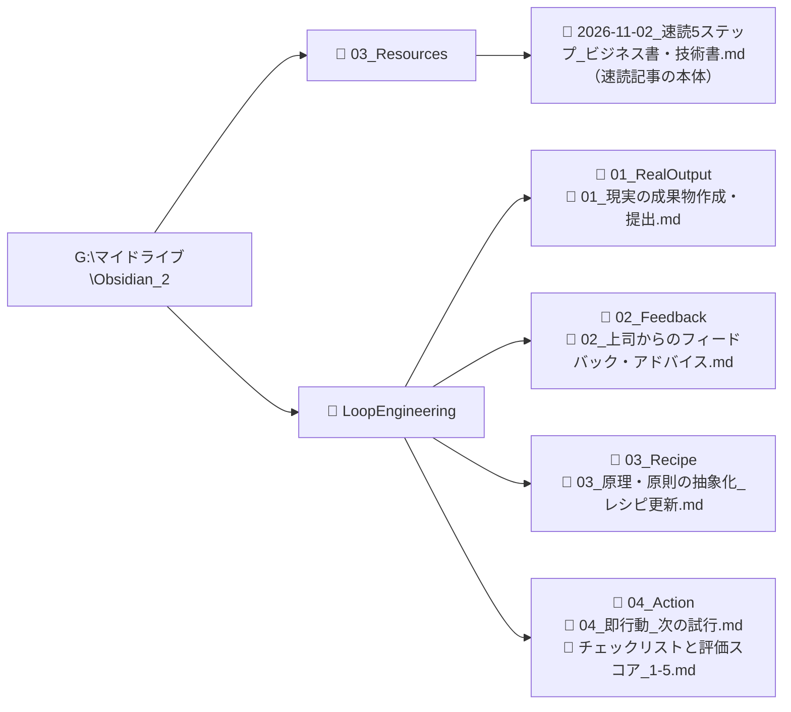

# 📅 2026-11-02 Antigravity問答（1日の記録）

## 📝 AIが編集・作成したファイル履歴

- `15:14:24` **新規作成/上書き** `G:\マイドライブ\Obsidian_2\03_Resources\2026-11-02_速読5ステップ_ビジネス書・技術書.md` → [[2026-11-02_速読5ステップ_ビジネス書・技術書]]
- `15:14:24` **部分編集** `C:\Users\PC_User\.gemini\memories\2_howto_fact.md`
- `15:38:46` **部分編集** `G:\マイドライブ\Obsidian_2\LoopEngineering\01_RealOutput\01_現実の成果物作成・提出.md` → [[01_現実の成果物作成・提出]]
- `15:38:46` **部分編集** `G:\マイドライブ\Obsidian_2\LoopEngineering\02_Feedback\02_上司からのフィードバック・アドバイス.md` → [[02_上司からのフィードバック・アドバイス]]
- `15:38:46` **部分編集** `G:\マイドライブ\Obsidian_2\LoopEngineering\03_Recipe\03_原理・原則の抽象化_レシピ更新.md` → [[03_原理・原則の抽象化_レシピ更新]]
- `15:38:46` **部分編集** `G:\マイドライブ\Obsidian_2\LoopEngineering\04_Action\04_即行動_次の試行.md` → [[04_即行動_次の試行]]
- `15:38:46` **部分編集** `G:\マイドライブ\Obsidian_2\LoopEngineering\04_Action\チェックリストと評価スコア_1-5.md` → [[チェックリストと評価スコア_1-5]]
- `15:41:08` **部分編集** `G:\マイドライブ\Obsidian_2\03_Resources\2026-11-02_速読5ステップ_ビジネス書・技術書.md` → [[2026-11-02_速読5ステップ_ビジネス書・技術書]]
- `15:41:08` **部分編集** `C:\Users\PC_User\.gemini\memories\2_howto_fact.md`
- `16:17:26` **部分編集** `G:\マイドライブ\Obsidian_2\LoopEngineering\01_RealOutput\01_現実の成果物作成・提出.md` → [[01_現実の成果物作成・提出]]
- `16:17:26` **部分編集** `G:\マイドライブ\Obsidian_2\LoopEngineering\02_Feedback\02_上司からのフィードバック・アドバイス.md` → [[02_上司からのフィードバック・アドバイス]]
- `16:17:26` **部分編集** `G:\マイドライブ\Obsidian_2\LoopEngineering\03_Recipe\03_原理・原則の抽象化_レシピ更新.md` → [[03_原理・原則の抽象化_レシピ更新]]
- `16:17:26` **部分編集** `G:\マイドライブ\Obsidian_2\LoopEngineering\04_Action\04_即行動_次の試行.md` → [[04_即行動_次の試行]]
- `16:17:26` **部分編集** `G:\マイドライブ\Obsidian_2\LoopEngineering\04_Action\チェックリストと評価スコア_1-5.md` → [[チェックリストと評価スコア_1-5]]
- `16:18:40` **新規作成/上書き** `G:\マイドライブ\Obsidian_2\LoopEngineering\2026-11-02_技術書読解の視覚化（図形・表）.md` → [[2026-11-02_技術書読解の視覚化（図形・表）]]
- `16:18:40` **部分編集** `C:\Users\PC_User\.gemini\memories\2_howto_fact.md`
- `16:34:42` **新規作成/上書き** `G:\マイドライブ\Obsidian_2\LoopEngineering\2026-11-02_技術書読解の視覚化（図形・表）.md` → [[2026-11-02_技術書読解の視覚化（図形・表）]]
- `16:34:42` **部分編集** `C:\Users\PC_User\.gemini\memories\2_howto_fact.md`
- `17:44:03` **新規作成/上書き** `G:\マイドライブ\Obsidian_2\LoopEngineering\2026-11-01_入居者向けの契約書案の作成.md` → [[2026-11-01_入居者向けの契約書案の作成]]
- `17:44:03` **部分編集** `C:\Users\PC_User\.gemini\memories\2_howto_fact.md`

## 📊 AIとよっちゃんのやり取り図解 ＆ 今後の課題・問題点

### 1. やり取りの全体フロー図（全 13 往復 ・ 1 セッション）

### 2. 現状診断（核・質・特・欠）と今後の課題解決ベクトル（方・移・拡・新）

| 視点 | 診断結果（やり取りから見えた事実と課題） |
| :--- | :--- |
| **【核】核心** | 本日の主要テーマ：「本を速く読みたい。」 を軸に、よっちゃんの意図（Vibe）を具体的な手順・設定・コードへ変換。 |
| **【質】品質** | 計 20 回のファイル操作により、[[2026-11-02_速読5ステップ_ビジネス書・技術書]], `2_howto_fact.md`, [[01_現実の成果物作成・提出]], [[02_上司からのフィードバック・アドバイス]] ほか計9ファイル への具体的な成果物反映・記録が完了している。 |
| **【特】特性** | 「前提条件の確認（Think Before Coding）」と選択肢（A/B/C）の提示により、最小のタイプ数で合意形成と実行が回っている。 |
| **【欠】欠損（問題点）** | **保存場所・対象確認の発生（4回）**：ファイルの配置場所や対象に関する再確認が発生しているため、保存時は「1テーマ＝1ファイル」でパスを最上部に明示する必要がある。 / **複数ファイルへの分散編集（計20回）**：更新箇所が多岐にわたるため、後からの追跡コストを下げる集約ノートの活用が有効。 |

| ベクトル | 今後の具体的な改善アクション |
| :--- | :--- |
| **【方】方向性** | **暗黙知のレシピ化（Compilation）**：本日のやり取りで確定した手順やコマンドを、再利用可能な標準レシピ・長期記憶（`memories/`）として定着させる。 |
| **【移】移動性** | **1テーマ＝1ファイル＆ダッシュボード連携**：成果物の保存先を迷わせないよう独立ファイル化し、[[Cockpit_MOC]] や日報目次から即座にアクセス可能にする。 |
| **【拡】拡張性** | **アイアンマンスーツ化（自動化スクリプト連携）**：定型作業や検証コマンドをスクリプト・タスクスケジューラへ組み込み、人間の手作業ループを削減する。 |
| **【新】新規性** | **視覚化（図解・表）の標準適用**：複雑な仕様やログは文字だけで追わず、ズーム可能なフロー図とマトリクス表で直感的に俯瞰する。 |

## 💬 会話ログ

### 1. 本を速く読みたい。（開始 15:05:57 / ID: `9c635b1e`）

---

#### 🧑 よっちゃん（15:05:57）

本を速く読みたい。

---

#### 🤖 AI（15:06:17）

よっちゃん、お疲れ様です！「本を速く読みたい」という目的に対して、**「抽象（全体の構造・意図の把握）」と「具体（必要な細部の精読）」の往復**を軸に、いくつかアプローチが考えられます。

どの方向性で進めたいか、まずは前提を確認させてください。

### 1. アプローチの方向性（どれに近いですか？）
- **A. 人間の読書術・思考フレームワーク**
  - 「全部を均等に読まない」ための技術（目的設定 → 目次から「核」を掴む → 必要な箇所だけ具体を読むスキミング術）
- **B. AI × Obsidian による高速インプット自動化（アイアンマンスーツ型）**
  - 電子書籍・PDF・テキストをAIに読み込ませ、「核・質・特・欠」などのフレームワークで構造化要約し、Obsidianへ自動蓄積する仕組みの構築
- **C. RSVP（高速逐次視覚提示）ツールの活用**
  - テキストを1単語・1フレーズずつ高速点滅表示して眼球移動をゼロにするスピードリーダー機能の活用・実装

### 2. 前提条件の確認
- **対象の本**: 紙の本ですか？ それとも電子書籍（Kindle / PDF / EPUBなど）ですか？
- **主なジャンル**: ビジネス書・技術書（情報取得が目的）か、小説・教養書（体験や深い思考が目的）か、どちらでしょうか？

ご希望の方向性を教えていただければ、すぐに具体的な方法や仕組みをご提案します！

---

#### 🧑 よっちゃん（15:07:46）

A
紙の本、ビジネス書・技術書

---

#### 🤖 AI（15:07:46）

よっちゃん、ありがとうございます！
**「紙のビジネス書・技術書」** であれば、1ページ目から順番に読むのをやめるだけで、理解度を落とさずに読書スピードを3〜5倍に引き上げられます。

本質は **「抽象（全体の設計図・主張）を先に掴み、必要な具体（事例・詳細・コード）だけに降りる」** という往復運動です。

---

### 紙のビジネス書・技術書を最速で読む「5ステップ」

#### 1. 【準備】読む前に「持ち帰るゴール」を1行で決める（1分）
- 「この本から何を得られたら勝ちか？」を1つだけ決めてから開きます。
- 脳に検索キーワードがセットされ、無関係な8割の文章を無意識にスキップできるようになります。

#### 2. 【抽象】「まえがき・目次・あとがき」で全体構造（核）を掴む（5分）
- **まえがき・あとがき**: 著者が最も伝えたい「核（コアメッセージ）」が凝縮されています。
- **目次**: 本全体の設計図です。目次を見ながら**「今の自分に重要な章（★）」を2〜3個選び**、それ以外の章は「読まない」と決めます（紙の本なら気になるページにドッグイヤーや付箋をつけます）。

#### 3. 【抽象→具体】「見出し・太字・図解」の高速スキミング（10〜15分）
- 選んだ章の **「見出し」「段落の最初の1文」「太字」「図表・まとめ」** だけを目で追いながらページをめくります。
- ビジネス書の8割は「具体例（エピソード）」です。抽象（主張）が納得できれば、具体例はすべて読み飛ばします。
- **「なぜそうなる？」「具体的にどうやる？」と引っかかった箇所だけ**、スピードを落として本文（具体）を精読します。

#### 4. 【技術書特化】「既知」を飛ばし、「差分」と「入出力」だけ読む
- **未知の2割に集中**: すでに知っている概念や基礎文法の章は丸ごと飛ばします。
- **コードは「入出力」と「核」だけ見る**: サンプルコードを1行ずつ目で追うと遅くなります。「何を入力して、どう変換し、何を出力しているか」のブロック構造だけを把握します。

#### 5. 【具体アクション】「明日から試すこと」を1つだけメモする（3分）
- 読書の目的は「読了」ではなく「行動の変化」です。
- 本を閉じる前に、**「この本の核は何か（抽象）」「明日どの業務・コードで試すか（具体）」** を1〜3行だけ（Obsidianなどに）メモして完了とします。

---

### 検証（テスト）方法のご提案

この読書術がよっちゃんにフィットするか検証するため、**手元にある未読（または積読）のビジネス書・技術書を1冊だけ用意して「20分タイムアタック」** を試してみませんか？

1. **0〜1分**: 「この本から知りたいこと」を1つ決める
2. **1〜6分**: 「まえがき・目次・あとがき」だけを読み、読むべき章を3つに絞る
3. **6〜20分**: その3つの章の「見出し・図解・太字」だけを追い、気になった箇所だけ本文を読む

もし今お手元に読みたい本があれば、**「本のタイトル」と「その本から得たいこと」** を教えていただければ、一緒に目次からの絞り込み（どこを読み飛ばすべきかの設計）をシミュレーションすることも可能です。いかがでしょうか？

---

#### 🧑 よっちゃん（15:10:51）

この記事の要約は何処に配置保存されていますか？

---

#### 🤖 AI（15:12:30）

よっちゃん、確認しました！状況は以下の通りです。

### 1. 今回の「速読5ステップ」の要約について
- 先ほどチャット上でご提案した内容は、**まだファイルには保存されていません**（チャット上のみの表示です）。

### 2. `Obsidian_2` 内の要約・ナレッジの配置場所（既存ルール）
現在、ワークスペース（`G:\マイドライブ\Obsidian_2`）では用途ごとに以下の場所へ保存される構成になっています。

- **動画・外部記事の要約ノート**
  - 📂 [WL_PROTECT_2](file:///G:/マイドライブ/Obsidian_2/03_Resources/YouTube_Summaries/)
    - 例: [WL_PROTECT_3](file:///G:/マイドライブ/Obsidian_2/03_Resources/YouTube_Summaries/2026-10-14_Loop_Engineering_Guide.md)
    - ※ここに配置すると [WL_PROTECT_4](file:///G:/マイドライブ/Obsidian_2/scripts/process_youtube_summaries.py) が検知し、[WL_PROTECT_5](file:///G:/マイドライブ/Obsidian_2/01_Tasks/) へのタスク生成と [WL_PROTECT_6](file:///G:/マイドライブ/Obsidian_2/00_Dashboard/Cockpit_MOC.md) へのリンク追加を自動で行います。
- **原理・原則の抽象化（ノウハウ・レシピ）**
  - 📂 [WL_PROTECT_7](file:///G:/マイドライブ/Obsidian_2/LoopEngineering/03_Recipe/)
    - 例: [WL_PROTECT_8](file:///G:/マイドライブ/Obsidian_2/LoopEngineering/03_Recipe/03_原理・原則の抽象化_レシピ更新.md)
- **調査レポート・まとめ記事**
  - 📂 [WL_PROTECT_9](file:///G:/マイドライブ/Obsidian_2/06_Reports/)
- **Googleドキュメント連携ファイル（ルート直下）**
  - 📄 [WL_PROTECT_10](file:///G:/マイドライブ/Obsidian_2/ループエンジニアリング.gdoc)、[WL_PROTECT_11](file:///G:/マイドライブ/Obsidian_2/Antigravity_進化と革新.gdoc) など
- **AIの長期記憶（Memories）**
  - 📄 [WL_PROTECT_12](file:///C:/Users/PC_User/.gemini/memories/1_wiki.md) / [WL_PROTECT_13](file:///C:/Users/PC_User/.gemini/memories/2_howto_fact.md)

---

### 💡 前提条件の確認
もし「今回の速読5ステップ」や「別の特定記事の要約」をファイルとして保存（または検索）したい場合、以下のどちらをご希望でしょうか？

1. **今回の「速読5ステップ」をObsidianに新規保存したい**（保存先：`03_Resources/` または `LoopEngineering/03_Recipe/` など）
2. **過去に保存した別の記事要約を探している**（記事のタイトルやキーワードを教えていただければ、すぐに場所を特定します！）

---

#### 🧑 よっちゃん（15:14:09）

１

---

#### 🤖 AI（15:15:06）

よっちゃん、直ちに保存を完了しました。

### 保存したファイル名
1. **Obsidianノート**: [WL_PROTECT_0](file:///G:/マイドライブ/Obsidian_2/03_Resources/2026-11-02_速読5ステップ_ビジネス書・技術書.md)
2. **長期記憶（手続記憶）**: [WL_PROTECT_1](file:///C:/Users/PC_User/.gemini/memories/2_howto_fact.md)

### 保存・追記内容
- **コアエッセンス**: 「抽象（全体の設計図・主張）」を先に掴み、必要な「具体（詳細・コード）」だけに降りる往復運動で読書速度を3〜5倍にする。
- **実践5ステップ**:
  1. 読む前に「持ち帰るゴール」を1行で決める（1分）
  2. 「まえがき・目次・あとがき」から重要な2〜3章だけに絞る（5分）
  3. 「見出し・太字・図解」を高速スキミングし、疑問箇所のみ精読する（10〜15分）
  4. 技術書は既知を飛ばし、未知の差分とコードの「入出力・核」だけ見る
  5. 「本の核（抽象）」と「明日から試すこと1つ（具体）」をObsidianにメモして完了する（3分）

---

#### 🧑 よっちゃん（15:32:16）

LoopEngineeringをどの様に使うか？

---

#### 🤖 AI（15:32:34）

よっちゃん、[WL_PROTECT_0](file:///G:/マイドライブ/Obsidian_2/LoopEngineering/) は、日々の業務や読書で得た「気づき・指摘（具体）」を、二度と同じミスをしない「標準レシピ・チェックリスト（抽象→具体）」へ変換し続ける**4ステップの自己進化システム**です。

使い方は以下の通りです。

---

### 🔄 1. 基本の4ステップ運用フロー（具体 ⇄ 抽象の往復）

#### Step 1：【具体】成果物を作る・試す
- 📂 [WL_PROTECT_1](file:///G:/マイドライブ/Obsidian_2/LoopEngineering/01_RealOutput/01_現実の成果物作成・提出.md)
- **やること**: 作業前に既存の「レシピ（Step 3）」と「チェックリスト（Step 4）」を開き、それを見ながら業務（契約書作成やコード実装など）を行って提出します。

#### Step 2：【具体→抽象】フィードバックを3階層で分解する
- 📂 [WL_PROTECT_2](file:///G:/マイドライブ/Obsidian_2/LoopEngineering/02_Feedback/02_上司からのフィードバック・アドバイス.md)
- 📄 [WL_PROTECT_3](file:///G:/マイドライブ/Obsidian_2/LoopEngineering/02_Feedback/3階層分類タグ定義.md)
- **やること**: 指摘や手戻り（または自分のつまずき）を以下の3つに分解します。
  - `#What`（表層）：何が間違っていたか
  - `#How`（手順）：どの確認プロセスが抜けていたか
  - `#Why`（本質）：どの前提・原理原則の理解が不足していたか

#### Step 3：【抽象】暗黙知を「レシピ（原則・手順）」に書き換える
- 📂 [WL_PROTECT_7](file:///G:/マイドライブ/Obsidian_2/LoopEngineering/03_Recipe/03_原理・原則の抽象化_レシピ更新.md)
- 📄 [WL_PROTECT_8](file:///G:/マイドライブ/Obsidian_2/LoopEngineering/03_Recipe/暗黙知言語化フレームワーク_SECI.md)
- **やること**: Step 2の `#Why` と `#How` をもとに、「次回から誰がやっても100点になる手順・制約・品質規準」としてレシピ本文をアップデートします。

#### Step 4：【抽象→具体】チェックリストで自己採点し、即行動する
- 📂 [WL_PROTECT_11](file:///G:/マイドライブ/Obsidian_2/LoopEngineering/04_Action/04_即行動_次の試行.md)
- 📄 [WL_PROTECT_12](file:///G:/マイドライブ/Obsidian_2/LoopEngineering/04_Action/チェックリストと評価スコア_1-5.md)
- **やること**: 提出前にチェックできる項目を追加し、1〜5段階で自己採点（スコア3以上で合格）してから再提出・次の業務（Step 1）へ戻ります。

---

### 🤖 2. Antigravity（AI）を使った「手間ゼロ」の回し方

よっちゃんが4つのファイルを毎回手作業で書く必要はありません。以下のように**チャットで1行投げるだけ**で回せます。

- **実務で指摘・気づきがあった時**:
  > 「〇〇の作業で『××に気をつけるように』と指摘されたから、`LoopEngineering` の4ファイルに反映して」
  → AIが自動で `#What/#How/#Why` 分析、SECI言語化、レシピ更新、チェックリスト追加まで一括実行します。
- **先ほどの「速読5ステップ」で本を読んだ時**:
  > 「今日読んだ本に『〇〇という原則』が書いてあったから、`LoopEngineering` のレシピとチェックリストに組み込んで」
  → 読んだ本の内容が、翌日の実務チェックリストに即座に変換されます。

---

### 💡 前提条件の確認・次のステップ
もし今、**「直近の実務で改善したいテーマ」** または **「先ほどの『速読5ステップ』自体を `LoopEngineering` のレシピ＆チェックリストに組み込む」** のどちらか試しに回してみたいものがあれば、すぐに実演・反映できますがいかがでしょうか？

---

#### 🧑 よっちゃん（15:38:46）

技術書を読み込むとき『全体を図形化することや表にして表示することで早く理解しやすくなるとアドバイスを受けた。』と指摘されたから、LoopEngineering 
  │ の4ファイルに反映して

---

#### 🤖 AI（15:42:04）

よっちゃん、直ちに `LoopEngineering` の全ステップおよび長期記憶への反映・保存を完了しました。

### 保存・更新したファイル名
1. [WL_PROTECT_1](file:///G:/マイドライブ/Obsidian_2/LoopEngineering/01_RealOutput/01_現実の成果物作成・提出.md)
2. [WL_PROTECT_2](file:///G:/マイドライブ/Obsidian_2/LoopEngineering/02_Feedback/02_上司からのフィードバック・アドバイス.md)
3. [WL_PROTECT_3](file:///G:/マイドライブ/Obsidian_2/LoopEngineering/03_Recipe/03_原理・原則の抽象化_レシピ更新.md)
4. [WL_PROTECT_4](file:///G:/マイドライブ/Obsidian_2/LoopEngineering/04_Action/04_即行動_次の試行.md)（および [WL_PROTECT_5](file:///G:/マイドライブ/Obsidian_2/LoopEngineering/04_Action/チェックリストと評価スコア_1-5.md)）
5. [WL_PROTECT_6](file:///G:/マイドライブ/Obsidian_2/03_Resources/2026-11-02_速読5ステップ_ビジネス書・技術書.md) ＆ [WL_PROTECT_7](file:///C:/Users/PC_User/.gemini/memories/2_howto_fact.md)

### 追記内容
- **① 成果物記録 (`01_RealOutput`)**: 2026-11-02「技術書の読み込み・構造化インプット」の試行記録を追記。
- **② フィードバック3階層分類 (`02_Feedback`)**:
  - `#What`: 全体図・比較表の未作成（文章のみで処理）
  - `#How`: 目次や概念間の関係を視覚化せず文字のみで読み進める手順
  - `#Why`: 一次元の文章より二次元の「図形（関係性）」や「表（差分・比較）」に変換した方が脳の情報処理速度が飛躍的に上がるという認知原則の未適用
- **③ レシピ・品質規準 (`03_Recipe`)**: 変更ログに履歴を追加し、手順・制約・品質規準に「全体像の1枚図形化（ブロック図・フロー図）」と「複数要素の比較表（テーブル）化」を追加。
- **④ 即行動・チェックリスト (`04_Action`)**: 速読ノートへの反映と、次回技術書読解時に「図（全体構造）」と「表（要素比較）」に変換できているかを自己採点するチェック項目（項目3）を追加。

---

#### 🧑 よっちゃん（15:43:49）

この記事は何処に配置保存していますか？

---

#### 🤖 AI（15:43:49）

よっちゃん、保存先のフォルダとファイルパスは以下の通りです（ObsidianのVault `G:\マイドライブ\Obsidian_2` 内に配置しています）。

### 📁 フォルダ構造（配置図）

---

### 📊 保存ファイル一覧表

| 種類 | Obsidian内の場所（フォルダ） | ファイル名（クリックで開けます） | フルパス（エクスプローラー用） |
| :--- | :--- | :--- | :--- |
| **記事本体（速読5ステップ）** | `03_Resources` | [WL_PROTECT_2](file:///G:/マイドライブ/Obsidian_2/03_Resources/2026-11-02_速読5ステップ_ビジネス書・技術書.md) | `G:\マイドライブ\Obsidian_2\03_Resources\2026-11-02_速読5ステップ_ビジネス書・技術書.md` |
| **① 成果物記録** | `LoopEngineering/01_RealOutput` | [WL_PROTECT_5](file:///G:/マイドライブ/Obsidian_2/LoopEngineering/01_RealOutput/01_現実の成果物作成・提出.md) | `G:\マイドライブ\Obsidian_2\LoopEngineering\01_RealOutput\01_現実の成果物作成・提出.md` |
| **② 指摘・アドバイス** | `LoopEngineering/02_Feedback` | [WL_PROTECT_8](file:///G:/マイドライブ/Obsidian_2/LoopEngineering/02_Feedback/02_上司からのフィードバック・アドバイス.md) | `G:\マイドライブ\Obsidian_2\LoopEngineering\02_Feedback\02_上司からのフィードバック・アドバイス.md` |
| **③ レシピ・原則** | `LoopEngineering/03_Recipe` | [WL_PROTECT_11](file:///G:/マイドライブ/Obsidian_2/LoopEngineering/03_Recipe/03_原理・原則の抽象化_レシピ更新.md) | `G:\マイドライブ\Obsidian_2\LoopEngineering\03_Recipe\03_原理・原則の抽象化_レシピ更新.md` |
| **④ 次の試行・行動** | `LoopEngineering/04_Action` | [WL_PROTECT_14](file:///G:/マイドライブ/Obsidian_2/LoopEngineering/04_Action/04_即行動_次の試行.md) | `G:\マイドライブ\Obsidian_2\LoopEngineering\04_Action\04_即行動_次の試行.md` |
| **④ 自己採点リスト** | `LoopEngineering/04_Action` | [WL_PROTECT_17](file:///G:/マイドライブ/Obsidian_2/LoopEngineering/04_Action/チェックリストと評価スコア_1-5.md) | `G:\マイドライブ\Obsidian_2\LoopEngineering\04_Action\チェックリストと評価スコア_1-5.md` |
| **AI長期記憶** | `.gemini/memories` | [WL_PROTECT_20](file:///C:/Users/PC_User/.gemini/memories/2_howto_fact.md) | `C:\Users\PC_User\.gemini\memories\2_howto_fact.md` |

※ 別のフォルダ（例：`00_Dashboard/Cockpit_MOC.md` からのリンク追加や、ルート直下など）へ移動・リンク追加したい場合はすぐに対応しますのでおっしゃってください！

---

#### 🧑 よっちゃん（16:08:23）

結局何処に保存されていますか？

---

#### 🤖 AI（16:09:03）

よっちゃん、複雑に書いてしまい失礼しました！結論は**以下の1ファイル**です。

- **フォルダ**: `G:\マイドライブ\Obsidian_2` の中の **`03_Resources`** フォルダ
- **ファイル名**: [WL_PROTECT_2](file:///G:/マイドライブ/Obsidian_2/03_Resources/2026-11-02_速読5ステップ_ビジネス書・技術書.md)

---

### 💡 もしObsidianの画面で見当たらない場合
- 現在Obsidianアプリで **`C:\Users\PC_User\Obsidian_1`**（またはCドライブ側の `Obsidian_2`）を開いていると表示されません。
- Obsidianの保管庫（Vault）を **`G:\マイドライブ\Obsidian_2`** に切り替えるか、もし今開いている保管庫の方へコピーしたい場合はすぐ移しますので教えてください！

---

#### 🧑 よっちゃん（16:12:17）

LoopEngineeringで分析された記事は何処に保存されましたか？

---

#### 🤖 AI（16:12:17）

よっちゃん、新しく別ファイルを作ったのではなく、**`G:\マイドライブ\Obsidian_2\LoopEngineering` の中にある既存4ファイルの「一番下（末尾）」に追記**して保存されています。

### 保存されている場所（各ファイルの下部に追記済み）
1. **成果物記録**: [WL_PROTECT_1](file:///G:/マイドライブ/Obsidian_2/LoopEngineering/01_RealOutput/01_現実の成果物作成・提出.md#L15-L17) の末尾（15〜17行目）
2. **原因分析（#What/#How/#Why）**: [WL_PROTECT_2](file:///G:/マイドライブ/Obsidian_2/LoopEngineering/02_Feedback/02_上司からのフィードバック・アドバイス.md#L12-L16) の末尾（12〜16行目）
3. **レシピ化（手順・品質規準）**: [WL_PROTECT_3](file:///G:/マイドライブ/Obsidian_2/LoopEngineering/03_Recipe/03_原理・原則の抽象化_レシピ更新.md#L10-L39) の各項目末尾
4. **即行動プラン**: [WL_PROTECT_4](file:///G:/マイドライブ/Obsidian_2/LoopEngineering/04_Action/04_即行動_次の試行.md#L10-L12) の末尾（10〜12行目）

---

### 💡 確認させてください
元の4ファイルには前回の「入居者向けの契約書案」が上に書かれているため、パッと見で分かりにくかったかと思います。

- **今回の「技術書読解（図形化・表形式化）」の分析だけを1つにまとめた専用ノート**を、`LoopEngineering` フォルダ直下（または各フォルダ内）に**新規ファイルとして独立作成**しましょうか？

---

#### 🧑 よっちゃん（16:17:26）

その方がそれぞれの.mdを汚すことが少ないと思います。
おねがいします。

---

#### 🤖 AI（16:19:23）

よっちゃん、既存の `.md` ファイルを元の綺麗な状態に戻した上で、独立した新規ファイルとして保存を完了しました。

### 保存したファイル名
1. **LoopEngineering 専用ノート**: [WL_PROTECT_1](file:///G:/マイドライブ/Obsidian_2/LoopEngineering/2026-11-02_技術書読解の視覚化（図形・表）.md)
2. **長期記憶（運用ルール追記）**: [WL_PROTECT_2](file:///C:/Users/PC_User/.gemini/memories/2_howto_fact.md)

### 保存・追記内容
- **既存ファイルの復元**: `01`〜`04` の既存 `.md` ファイル（契約書案の記録）から今回の追記分を除去し、元の状態にクリーンアップ。
- **新規ノートの作成**: `LoopEngineering` フォルダ直下に、①成果物記録、②3階層分類（`#What/#How/#Why`）、③フロー図（Mermaid）＆比較表（テーブル）付きのレシピ、④1〜5段階チェックリストを1つにまとめた専用ノートを新規作成。
- **長期記憶へのルール登録**: 「今後 `LoopEngineering` に記録する際は、既存ファイルを汚さず案件ごとに独立した新規 `.md` ファイルを作成する」ルールを [WL_PROTECT_10](file:///C:/Users/PC_User/.gemini/memories/2_howto_fact.md) に保存。

---

#### 🧑 よっちゃん（16:24:13）

「全体を図形化することや表にして表示することで早く理解しやすくなる。」というアドバイスでどの様に行動、手順を踏んでゆくかのチェックリストや更に良くなる拡張思考を調べて活用したいです。

---

#### 🤖 AI（16:24:14）

よっちゃん、「全体を図形化・表形式化して早く理解する」というアドバイスを実務・読書で120%活かすための**「具体的な行動手順」「実践チェックリスト」**、そして**よっちゃん流ハイブリッド診断（核・質・特・欠 ／ 方・移・拡・新）に基づく「拡張思考」**を整理しました。

---

### 1. 具体的な行動手順（どう手を動かすか：4ステップ）

本や資料を開いたら、文字をそのまま追うのではなく**「どんな図・表に変換するか」の型（パターン）を先に決めてから読む**のが最速のコツです。

#### パターン別：何を図にし、何を表にするか（変換ルール表）

| 本・資料に書かれている内容 | 変換する形式 | 具体的な書き方（手書き / Obsidian） |
| :--- | :--- | :--- |
| **手順・データの流れ・仕組み** | **矢印フロー図** (`A → B → C`) | 「入力 → 処理（核） → 出力」を四角と矢印でつなぐ |
| **全体構成・アーキテクチャ** | **包含・階層図**（ツリー / ブロック） | 親要素の中に子要素を配置し、全体と部分の関係を描く |
| **複数の手法・ツールの比較** | **比較マトリクス表**（縦×横の表） | 行に「手法A・B・C」、列に「特徴・メリット・欠点・用途」を並べる |
| **ポジショニング・トレードオフ** | **2軸マップ**（縦軸×横軸） | 例：「自動化レベル（高/低）× 導入コスト（高/低）」の4象限に配置 |

---

### 2. 実践チェックリスト（1〜5段階評価）

本を読むとき・資料をまとめるときに、手元で確認する5つの行動チェックリストです。

- [ ] **① 読む前の「枠」作り**: 本を開く前に、白紙（またはノート）に「図を描くスペース」と「比較表の枠」を用意したか？
- [ ] **② 接続詞の記号化**: 文章中の「だから（`⇒`）」「しかし・対比（`⇄`）」「たとえば（`例:`）」を矢印や記号に置き換えながら読めているか？
- [ ] **③ 1枚図解テスト（抽象化）**: 本の「まえがき・目次」を見た段階で、本全体の構成を**四角と矢印だけのシンプルな図（5要素以内）**で描けるか？
- [ ] **④ 差分テーブル化（具体の整理）**: 「従来のやり方 vs この本の提案」または「手法A vs 手法B」を**3列以上の表**に整理したか？
- [ ] **⑤ 30秒説明テスト（定着確認）**: 作った「図」と「表」だけを見て、他人に30秒でその本の核心（核）を説明できるか？

---

### 3. 更に良くなる「拡張思考」（よっちゃん流ハイブリッド診断）

単なる「図解メモ」にとどめず、思考力とAI自動化へ拡張するための視点です。

#### 🔍 現状分析：「核・質・特・欠」で見る図表化のポイント
| 視点 | 図形化・表形式化における本質と注意点 |
| :--- | :--- |
| **【核】核心** | **「一次元（直列の文章）から二次元（並列の空間）へのコンパイル」**。人間の視覚野は、文字を読むより図・表の配置を見る方が数十倍速く関係性を処理できる。 |
| **【質】品質** | 良い図表の条件は「1図1メッセージ」。情報を詰め込みすぎず、**「要素は3〜5個まで」「比較軸が明確」**であるほど理解速度が上がる。 |
| **【特】特性** | **図は「全体のつながり（動的フロー・構造）」**の把握に強く、**表は「要素ごとの違い・抜け漏れ（静的比較）」**の発見に強い。 |
| **【欠】欠損（罠）** | **「綺麗に図を描くこと」自体が目的化すると逆に時間がかかる（本末転倒）**。手書きなら雑な◯と矢印で30秒、デジタルならAIにMermaid図や表を自動生成させるべき。 |

#### 🚀 未来ベクトル：「方・移・拡・新」による拡張アイデア
1. **【方】方向性（Compilation Analogy：自然言語のコード化）**
   - 頭の中で理解したことを、Obsidian上で **Mermaid記法（図のコード）やMarkdownテーブル** としてストックする。図を「テキストコード」として持っておくと、後から検索・再利用・AIへの再入力が自在になります。
2. **【移】移動性（インプットからアウトプットへの横展開）**
   - 「技術書を読むとき」だけでなく、**「上司への報告」「顧客への提案書」「契約書・マニュアルの整理」** にそのまま転用する。「自分が早く理解できる図表」は、「相手も一瞬で理解できる最強の成果物」になります。
3. **【拡】拡張性（アイアンマンスーツ化：AIによる自動図表化）**
   - 自分でゼロから図表を作らず、本の中で難解な章があれば、目次や要点をAIに投げて **「この概念をMermaidのフロー図と、従来手法との比較表（核・質・特・欠）に変換して」** と指示し、AIに一瞬で視覚化させる。
4. **【新】新規性（表の「空白セル」から新しいアイデアを生む）**
   - 表（マトリクス）を作ると、**「まだ埋まっていない空白のマス（＝本に書かれていない弱点や、自社の未着手領域）」** が視覚的に浮かび上がります。これを使うと、単なる「理解」を超えて「新しい企画・改善案」が自動的に生まれます。

---

### 💡 確認・次のステップ
この「4ステップ行動手順」「5項目チェックリスト」「拡張思考（核・質・特・欠／方・移・拡・新）」を、先ほど作成した専用ノート [WL_PROTECT_4](file:///G:/マイドライブ/Obsidian_2/LoopEngineering/2026-11-02_技術書読解の視覚化（図形・表）.md) に追記してアップデートしておきましょうか？

---

#### 🧑 よっちゃん（16:34:42）

お願いします。

---

#### 🤖 AI（17:16:42）

よっちゃん、直ちに保存・追記を完了しました。

### 保存・更新したファイル名
1. [WL_PROTECT_0](file:///G:/マイドライブ/Obsidian_2/LoopEngineering/2026-11-02_技術書読解の視覚化（図形・表）.md)
2. [WL_PROTECT_1](file:///C:/Users/PC_User/.gemini/memories/2_howto_fact.md)

### 追記内容
- **具体的な行動手順（4ステップ＆変換ルール表）**: 「手順＝矢印フロー図」「構成＝階層図」「複数手法＝比較マトリクス表」「トレードオフ＝2軸マップ」の変換基準を追加。
- **実践チェックリスト（5項目・1〜5段階評価）**: ①読む前の枠作り、②接続詞の記号化、③1枚図解テスト（5要素以内）、④差分テーブル化、⑤30秒説明テストを追加。
- **拡張思考（よっちゃん流ハイブリッド診断）**:
  - **「核・質・特・欠」**: 一次元から二次元へのコンパイル（核）、1図1メッセージ（質）、動的フロー図と静的比較表の使い分け（特）、綺麗に描く目的化の回避（欠）。
  - **「方・移・拡・新」**: Mermaid/Markdownコード化（方）、上司報告・提案書への横展開（移）、AIによる自動図表化（拡）、表の空白セルからの新企画発想（新）。

---

#### 🧑 よっちゃん（17:44:03）

入居者向けの契約書案の作成もLoopEngineeringの直下に作成して下さい。

---

#### 🤖 AI（17:44:56）

よっちゃん、直ちに `LoopEngineering` 直下へ独立した新規ファイルとして作成・保存を完了しました。

### 保存・更新したファイル名
1. [WL_PROTECT_1](file:///G:/マイドライブ/Obsidian_2/LoopEngineering/2026-11-01_入居者向けの契約書案の作成.md)
2. [WL_PROTECT_2](file:///C:/Users/PC_User/.gemini/memories/2_howto_fact.md)

### 保存・追記内容
- **①〜④の4ステップ統合**: 成果物提出記録、上司からのフィードバックと `#What/#How/#Why` 分析、SECI暗黙知言語化・レシピ、即行動プランと1〜5段階チェックリストを1ファイルに集約。
- **図形化・表形式化の適用**: 作成〜提出の4ステップフロー図（Mermaid）と、「賃料・駐車場・原状回復特約のNG記載 vs OK記載」の比較表（テーブル）を追加。
- **拡張思考（よっちゃん流ハイブリッド診断）**: 契約書作成における「核・質・特・欠」診断と、「方・移・拡・新」によるAI自動監査・図解チェックシート化などの展開案を追加。

---
## 🔗 関連ナビゲーション
- [[Cockpit_MOC]]
- [[2026-11-02_速読5ステップ_ビジネス書・技術書]]
- [[01_現実の成果物作成・提出]]
- [[02_上司からのフィードバック・アドバイス]]
- [[03_原理・原則の抽象化_レシピ更新]]
- [[04_即行動_次の試行]]
- [[チェックリストと評価スコア_1-5]]
- [[2026-11-02_技術書読解の視覚化（図形・表）]]
- [[2026-11-01_入居者向けの契約書案の作成]]
