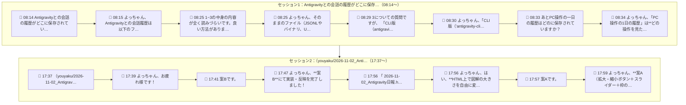
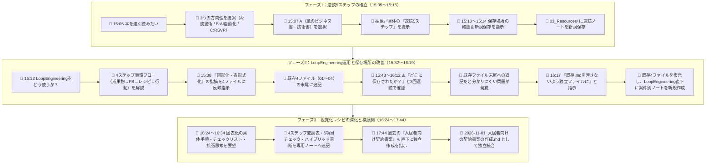

# 📅 2026-11-03 Antigravity 1日の記録

## 📝 AIが編集・作成したファイル履歴

- `17:42:52` **部分編集** `G:\マイドライブ\Obsidian_2\scripts\export_daily_antigravity_log.py`
- `17:44:19` **部分編集** `G:\マイドライブ\Obsidian_2\scripts\export_daily_antigravity_log.py`
- `17:45:24` **部分編集** `G:\マイドライブ\Obsidian_2\scripts\export_daily_antigravity_log.py`
- `17:45:24` **部分編集** `G:\マイドライブ\Obsidian_2\scripts\export_daily_antigravity_log.py`
- `17:45:24` **部分編集** `G:\マイドライブ\Obsidian_2\scripts\export_daily_antigravity_log.py`
- `17:46:57` **部分編集** `C:\Users\PC_User\.gemini\memories\2_howto_fact.md`
- `17:57:44` **部分編集** `G:\マイドライブ\Obsidian_2\scripts\export_daily_antigravity_log.py`
- `17:58:47` **部分編集** `G:\マイドライブ\Obsidian_2\scripts\export_daily_antigravity_log.py`
- `18:04:48` **部分編集** `G:\マイドライブ\Obsidian_2\scripts\export_daily_antigravity_log.py`
- `18:06:48` **部分編集** `G:\マイドライブ\Obsidian_2\scripts\export_daily_antigravity_log.py`
- `18:06:48` **部分編集** `G:\マイドライブ\Obsidian_2\scripts\export_daily_antigravity_log.py`
- `18:08:00` **部分編集** `C:\Users\PC_User\.gemini\memories\2_howto_fact.md`
- `08:55:52` **新規作成/上書き** `G:\マイドライブ\Obsidian_2\scripts\export_daily_antigravity_log.py`
- `08:56:53` **部分編集** `C:\Users\PC_User\.gemini\memories\2_howto_fact.md`
- `09:02:15` **新規作成/上書き** `G:\マイドライブ\Obsidian_2\scripts\export_daily_antigravity_log.py`
- `09:02:15` **部分編集** `C:\Users\PC_User\.gemini\memories\2_howto_fact.md`
- `11:17:06` **部分編集** `G:\マイドライブ\Obsidian_2\scripts\export_daily_antigravity_log.py`
- `11:17:06` **部分編集** `G:\マイドライブ\Obsidian_2\scripts\export_daily_antigravity_log.py`
- `11:17:06` **部分編集** `G:\マイドライブ\Obsidian_2\scripts\export_daily_antigravity_log.py`
- `11:29:30` **新規作成/上書き** `G:\マイドライブ\Obsidian_2\scripts\export_daily_antigravity_log.py`

## 📊 AIとよっちゃんのやり取り図解 ＆ 今後の課題・問題点

### 1. やり取りの全体フロー図（全 23 往復 ・ 2 セッション）



### 2. 現状診断（核・質・特・欠）と今後の課題解決ベクトル（方・移・拡・新）

| 視点 | 診断結果（やり取りから見えた事実と課題） |
| :--- | :--- |
| **【核】核心** | 本日の主要テーマ：「Antigravityとの会話の履歴がどこに保存…」 ／ 「（youyaku/2026-11-02_Anti…」 を軸に、よっちゃんの意図（Vibe）を具体的な手順・設定・コードへ変換。 |
| **【質】品質** | 計 20 回のファイル操作により、`export_daily_antigravity_log.py`, `2_howto_fact.md` への具体的な成果物反映・記録が完了している。 |
| **【特】特性** | 「前提条件の確認（Think Before Coding）」と選択肢（A/B/C）の提示により、最小のタイプ数で合意形成と実行が回っている。 |
| **【欠】欠損（問題点）** | **保存場所・対象確認の発生（1回）**：ファイルの配置場所や対象に関する再確認が発生しているため、保存時は「1テーマ＝1ファイル」でパスを最上部に明示する必要がある。 / **表示・動作の微調整要求（1回）**：エラー解消や視認性改善のやり取りが発生。初回実装時の検証（Goal-Drivenテスト）の自動化・強化が課題。 / **複数ファイルへの分散編集（計20回）**：更新箇所が多岐にわたるため、後からの追跡コストを下げる集約ノートの活用が有効。 |

| ベクトル | 今後の具体的な改善アクション |
| :--- | :--- |
| **【方】方向性** | **暗黙知のレシピ化（Compilation）**：本日のやり取りで確定した手順やコマンドを、再利用可能な標準レシピ・長期記憶（`memories/`）として定着させる。 |
| **【移】移動性** | **1テーマ＝1ファイル＆ダッシュボード連携**：成果物の保存先を迷わせないよう独立ファイル化し、[[Cockpit_MOC]] や日報目次から即座にアクセス可能にする。 |
| **【拡】拡張性** | **アイアンマンスーツ化（自動化スクリプト連携）**：定型作業や検証コマンドをスクリプト・タスクスケジューラへ組み込み、人間の手作業ループを削減する。 |
| **【新】新規性** | **視覚化（図解・表）の標準適用**：複雑な仕様やログは文字だけで追わず、ズーム可能なフロー図とマトリクス表で直感的に俯瞰する。 |

## 💬 会話ログ

### 1. Antigravityとの会話の履歴がどこに保存されていますか？（開始 08:14:11 / ID: `9a27cc00`）

---

#### 🧑 よっちゃん（08:14:11）

Antigravityとの会話の履歴がどこに保存されていますか？

---

#### 🤖 AI（08:15:21）

よっちゃん、Antigravityとの会話履歴は以下のフォルダに保存されています。

### 1. テキスト形式（JSONL）の会話ログ（人が読める・スクリプトで解析しやすい形式）
会話ID（`<conversation-id>`）ごとに、以下のパスに保存されています。
* **Antigravity CLI版（現在の環境）**:
  * `C:\Users\PC_User\.gemini\antigravity-cli\brain\<conversation-id>\.system_generated\logs\transcript.jsonl`（要約・コンパクト版）
  * `C:\Users\PC_User\.gemini\antigravity-cli\brain\<conversation-id>\.system_generated\logs\transcript_full.jsonl`（完全版）
* **Antigravity 通常版（IDE/デスクトップ版）**:
  * `C:\Users\PC_User\.gemini\antigravity\brain\<conversation-id>\.system_generated\logs\transcript.jsonl`
  * `C:\Users\PC_User\.gemini\antigravity\brain\<conversation-id>\.system_generated\logs\transcript_full.jsonl`

### 2. システム内部データ（`.pb` バイナリ形式）
アプリがセッション復元などに使用する内部データは以下に保存されています。
* **CLI版**: `C:\Users\PC_User\.gemini\antigravity-cli\conversations\`
* **通常版**: `C:\Users\PC_User\.gemini\antigravity\conversations\`

### 3. 会話内で作成された成果物（アーティファクト・計画書など）
* **CLI版**: `C:\Users\PC_User\.gemini\antigravity-cli\brain\<conversation-id>\` 直下の `.md` ファイル群
* **通常版**: `C:\Users\PC_User\.gemini\antigravity\brain\<conversation-id>\` 直下の `.md` ファイル群

（※たとえば今回の会話ログは [transcript.jsonl](file:///C:/Users/PC_User/.gemini/antigravity-cli/brain/9a27cc00-0a99-4d7e-af2c-77b0bd8f89b8/.system_generated/logs/transcript.jsonl) に記録されています）

---

#### 🧑 よっちゃん（08:25:41）

1~3の中身の内容が全く読みづらいです。良い方法がありませんか？

---

#### 🤖 AI（08:25:41）

よっちゃん、そのままのファイル（JSONLやバイナリ、UUIDフォルダ）はシステム用なので人間には非常に読みづらいですよね。
普段お使いの **Obsidian（`Obsidian_2`）で快適に読めるようにする解決策** が最もおすすめです。

### 読みやすくする3つの方法

* **方法A：Obsidianへ自動変換・出力するPythonスクリプトを作る（一番おすすめ）**
  * 暗号のような会話IDフォルダから「よっちゃんの発言」と「AIの回答」だけを抽出し、`2026-11-03_会話タイトル.md` のような綺麗なMarkdownファイルに変換してObsidianのフォルダ（例：`02_Logs/Antigravity_History/`）へ自動保存します。
* **方法B：ブラウザで見られる「会話履歴ビューア（HTML）」を生成する**
  * 全会話を一覧・検索でき、クリックするとチャット画面のように綺麗に読める1枚のHTMLファイルを生成します。
* **方法C：今の会話をワンコマンドでObsidianに書き出す（手動・都度保存）**
  * 重要な会話が終わったタイミングで「この会話をObsidianに保存して」と指示するだけで、綺麗に整形したノートを作成します。

---

### 実装前の前提条件の確認（Think Before Coding）

もし **方法A（ObsidianへのMarkdown変換スクリプト）** などを実装する場合、以下の前提条件を確認させてください。

1. **保存先フォルダ**: 変換した会話ログは `G:\マイドライブ\Obsidian_2\02_Logs\` 配下（または別のご希望フォルダ）に保存する形でよろしいでしょうか？
2. **抽出する内容**: システム内部の思考ログやツール実行結果（コマンド出力など）は省き、**「よっちゃんの質問」と「AIの最終回答」のみ** を抽出してスッキリさせる形でよろしいでしょうか？
3. **対象環境**: 「CLI版（`antigravity-cli`）」と「通常版（`antigravity`）」の**両方**の履歴をまとめて変換対象にしますか？それとも片方のみにしますか？

---

#### 🧑 よっちゃん（08:29:57）

3についての質問ですが、 「CLI版（antigravity-                                                               
  cli）」と「通常版（antigravity）」での共通点と相違点を表示して

---

#### 🤖 AI（08:30:45）

よっちゃん、「CLI版（`antigravity-cli`）」と「通常版（`antigravity`）」の共通点と相違点は以下の通りです。

### 1. 共通点（仕組み・データ構造は同じ）
* **保存構造が完全に同一**: どちらも `brain\<会話ID>\.system_generated\logs\transcript.jsonl` という全く同じ階層・フォーマットで会話履歴を保存しています。
* **成果物の保存形式も同じ**: 会話中に作った計画書（`implementation_plan.md`）やタスクリスト（`task.md`）も、同じく `brain\<会話ID>\` 直下に保存されます。
* **同じ変換スクリプトで処理可能**: データ形式が同じため、1つのPythonスクリプトで両方の履歴を同じようにMarkdownへ変換できます。

---

### 2. 相違点（使う場面・保存件数・独自機能）

| 比較項目 | CLI版 (`antigravity-cli`) | 通常版 (`antigravity`) |
| :--- | :--- | :--- |
| **主な利用場面** | ターミナル（黒い画面）やスクリプト・自動ループ実行時 | デスクトップアプリ（GUI／エディタ画面）での対話時 |
| **現在の保存件数（よっちゃんのPC内）** | **489件**（メインで利用中・自動実行含む） | **63件**（画面上で直接操作した会話） |
| **中身の特徴** | 日常の対話に加え、バックグラウンドやサブエージェントの自動処理ログも多く含まれる | 人間が画面上でじっくりやり取りした会話や、ブラウザ操作録画（`browser_recordings`）が含まれる |
| **フォルダの場所** | `C:\Users\PC_User\.gemini\antigravity-cli` | `C:\Users\PC_User\.gemini\antigravity` |

---

### 💡 おすすめの選び方
* **両方まとめて変換する場合**: フォルダを `CLI/` と `IDE/` に分けて両方出力すれば、過去のどの会話も漏れなくObsidianで検索・閲覧できます。
* **注意すべき点**: CLI版（489件）には空のセッションやシステム自動実行の短いログも含まれるため、**「よっちゃんの発言が1回以上ある会話だけ」をフィルタリングして出力する**のがおすすめです。

この方針を踏まえて、先ほどの **1. 保存先フォルダ**・**2. 抽出内容**・**3. 対象環境（両方 or 片方）** はいかがいたしましょうか？

---

#### 🧑 よっちゃん（08:33:47）

あとPC操作の一日の履歴はどのに保存されていますか？

---

#### 🤖 AI（08:34:14）

よっちゃん、「PC操作の1日の履歴」は**どの操作を見たいか**によって保存場所が以下の4つに分かれています。

### 1. ターミナル（PowerShell）で打ったコマンド履歴
よっちゃんやAIがPowerShellで実行したコマンドの履歴は、以下のテキストファイルにすべて時系列で保存されています（メモ帳などでそのまま読めます）。
* **保存先**: `C:\Users\PC_User\AppData\Roaming\Microsoft\Windows\PowerShell\PSReadLine\ConsoleHost_history.txt`

### 2. 最近開いたファイル・フォルダの履歴（Windows標準）
今日PC上で開いたファイルやフォルダのショートカット履歴です。
* **保存先**: `C:\Users\PC_User\AppData\Roaming\Microsoft\Windows\Recent\`
* （`Win + R` キーを押して `recent` と入力すると一発で開けます）

### 3. AntigravityがPCを操作した履歴（コマンド実行・ファイル編集・ブラウザ操作）
AIが裏側で実行したコマンド結果やブラウザ操作の記録です。
* **実行したコマンドの出力ログ**:
  * `C:\Users\PC_User\.gemini\antigravity-cli\brain\<会話ID>\.system_generated\steps\`
* **AIが編集したファイルのバックアップ履歴**:
  * `C:\Users\PC_User\.gemini\history\` （プロジェクト別）
* **ブラウザ自動操作の録画データ（通常版）**:
  * `C:\Users\PC_User\.gemini\antigravity\browser_recordings\`

### 4. Windowsシステムの稼働・アプリ起動ログ（イベントビューアー）
PCの起動・スリープ・アプリのエラーなどのOSレベルの記録です。
* **保存先**: `C:\Windows\System32\winevt\Logs\`
* （スタートメニューを右クリック →「**イベント ビューアー**」から閲覧可能）

---

💡 **もし「今日1日、PCやAntigravityで何をしたか」を自動でObsidian（`02_Logs` や `Diaries`）にまとめる日報スクリプト**を作りたい場合は、上記の「1（コマンド履歴）」「2（開いたファイル）」「3（Antigravityとの会話履歴）」から今日の日付分だけを抜き出して1枚のMarkdownにまとめることも可能です。

どの履歴を読みやすくしたい（またはObsidianにまとめたい）でしょうか？

---

#### 🧑 よっちゃん（08:53:33）

以下17:00に一日の記録をmarkdwon形式でまとめて下さい。
---
保存先フォルダ: 変換した会話ログは G:\マイドライブ\Obsidian_2\youyaku\

よっちゃんの質問」と「AIの最 
  終回答」のみ を抽出してスッキリさせる形でよろしいです。

 対象環境: 「CLI版（antigravity-                                                     
  cli

AIが編集したファイルのバックアップ履歴
---

---

#### 🤖 AI（08:53:56）

よっちゃん、ご指定の条件（`G:\マイドライブ\Obsidian_2\youyaku\` への保存、CLI版の「よっちゃんの質問」と「AIの最終回答」、および「AIが編集したファイル履歴」の抽出）で、毎日17:00に1日の記録をMarkdown形式でまとめる完成コードを提示します。

### 完成コード（`scripts/export_daily_antigravity_log.py`）

```python
import json
import re
from datetime import datetime, timezone, timedelta
from pathlib import Path

JST = timezone(timedelta(hours=9))
BRAIN_DIR = Path(r"C:\Users\PC_User\.gemini\antigravity-cli\brain")
HISTORY_DIR = Path(r"C:\Users\PC_User\.gemini\history")
OUTPUT_DIR = Path(r"G:\マイドライブ\Obsidian_2\youyaku")


def parse_iso_to_jst(iso_str: str) -> datetime:
    if not iso_str:
        return datetime.now(JST)
    dt = datetime.fromisoformat(iso_str.replace("Z", "+00:00"))
    return dt.astimezone(JST)


def extract_user_text(content: str) -> str:
    match = re.search(r"<USER_REQUEST>\s*(.*?)\s*</USER_REQUEST>", content, re.DOTALL)
    return match.group(1).strip() if match else content.strip()


def clean_arg_path(raw_path: str) -> str:
    if not raw_path:
        return ""
    return raw_path.strip('"').replace("\\\\", "\\")


def collect_daily_data(target_date_str: str):
    conversations = []
    edited_files = []

    if BRAIN_DIR.exists():
        for conv_dir in BRAIN_DIR.iterdir():
            if not conv_dir.is_dir():
                continue
            log_file = conv_dir / ".system_generated" / "logs" / "transcript_full.jsonl"
            if not log_file.exists():
                log_file = conv_dir / ".system_generated" / "logs" / "transcript.jsonl"
            if not log_file.exists():
                continue

            # 今日更新されたログファイルのみ対象にして高速化
            mtime_jst = datetime.fromtimestamp(log_file.stat().st_mtime, JST).strftime("%Y-%m-%d")
            if mtime_jst != target_date_str:
                continue

            qa_pairs = []
            try:
                with log_file.open("r", encoding="utf-8") as f:
                    for line in f:
                        line = line.strip()
                        if not line:
                            continue
                        step = json.loads(line)
                        step_dt = parse_iso_to_jst(step.get("created_at", ""))
                        if step_dt.strftime("%Y-%m-%d") != target_date_str:
                            continue

                        step_type = step.get("type")
                        source = step.get("source")
                        time_str = step_dt.strftime("%H:%M:%S")

                        # 1. よっちゃんの質問
                        if source == "USER_EXPLICIT" and step_type == "USER_INPUT":
                            q_text = extract_user_text(step.get("content", ""))
                            if q_text:
                                qa_pairs.append({"role": "よっちゃん", "time": time_str, "text": q_text})

                        # 2. AIの最終回答 & AIが編集したファイル履歴
                        elif source == "MODEL" and step_type == "PLANNER_RESPONSE":
                            a_text = (step.get("content") or "").strip()
                            if a_text:
                                qa_pairs.append({"role": "AI", "time": time_str, "text": a_text})

                            for tc in step.get("tool_calls", []):
                                tool_name = tc.get("name", "")
                                if tool_name in ("write_file", "edit_file"):
                                    file_path = clean_arg_path(tc.get("args", {}).get("Path", ""))
                                    if file_path:
                                        edited_files.append((time_str, tool_name, file_path))
            except Exception:
                continue

            if qa_pairs:
                conversations.append({
                    "id": conv_dir.name,
                    "first_time": qa_pairs[0]["time"],
                    "messages": qa_pairs,
                })

    # 3. .gemini/history 配下の当日バックアップファイルも収集
    backup_files = []
    if HISTORY_DIR.exists():
        for p in HISTORY_DIR.rglob("*"):
            if p.is_file() and ".git" not in p.parts:
                try:
                    mtime = datetime.fromtimestamp(p.stat().st_mtime, JST)
                    if mtime.strftime("%Y-%m-%d") == target_date_str:
                        backup_files.append((mtime.strftime("%H:%M:%S"), str(p)))
                except Exception:
                    continue

    conversations.sort(key=lambda x: x["first_time"])
    return conversations, edited_files, backup_files


def generate_markdown(target_date_str: str) -> Path:
    OUTPUT_DIR.mkdir(parents=True, exist_ok=True)
    out_file = OUTPUT_DIR / f"{target_date_str}_Antigravity日報.md"

    conversations, edited_files, backup_files = collect_daily_data(target_date_str)

    lines = [
        f"# 📅 {target_date_str} Antigravity 1日の記録（CLI版）",
        "",
        "## 📝 AIが編集・作成したファイル履歴",
    ]

    if edited_files or backup_files:
        for time_str, tool_name, file_path in edited_files:
            action = "新規作成/上書き" if tool_name == "write_file" else "部分編集"
            lines.append(f"- `{time_str}` [{action}] `{file_path}`")
        for time_str, b_path in backup_files:
            lines.append(f"- `{time_str}` [バックアップ履歴] `{b_path}`")
    else:
        lines.append("- 本日AIが編集したファイルはありません。")

    lines.extend(["", "---", "", "## 💬 会話ログ（よっちゃんの質問 ＆ AIの最終回答）", ""])

    if not conversations:
        lines.append("本日の会話記録はありません。")
    else:
        for idx, conv in enumerate(conversations, 1):
            first_q = next((m["text"].splitlines()[0][:40] for m in conv["messages"] if m["role"] == "よっちゃん"), "会話")
            lines.append(f"### {idx}. {first_q} （開始 {conv['first_time']} / ID: `{conv['id'][:8]}`）")
            lines.append("")
            for msg in conv["messages"]:
                icon = "🧑 **よっちゃん**" if msg["role"] == "よっちゃん" else "🤖 **AI**"
                lines.append(f"#### {icon} ({msg['time']})")
                lines.append(msg["text"])
                lines.append("")
            lines.append("---")
            lines.append("")

    out_file.write_text("\n".join(lines), encoding="utf-8")
    return out_file


if __name__ == "__main__":
    today_str = datetime.now(JST).strftime("%Y-%m-%d")
    saved_path = generate_markdown(today_str)
    print(f"Saved: {saved_path}")
```

---

### 実装前の前提条件の確認（Think Before Coding）

スクリプトの配置と「毎日17:00の自動実行」をセットする前に、以下の2点だけ確認させてください。

1. **出力ファイル名**: `G:\マイドライブ\Obsidian_2\youyaku\2026-11-03_Antigravity日報.md` のように「日付ごとの1ファイル」にまとめる形式でよろしいでしょうか？
2. **17:00の自動実行方法**:
   * **案①（Windowsタスクスケジューラ＋Antigravity内タイマー併用）**: Antigravityを開いていない日でも17:00に確実に裏でPythonが動くようWindowsタスクスケジューラに登録する（おすすめ）
   * **案②（Antigravity内のスケジュール機能のみ）**: Antigravityが起動中のときに17:00に実行する

よろしければ直ちにスクリプトを作成し、テスト出力（今日これまでの記録の作成）と17:00のスケジュール登録を実行します！

---

#### 🧑 よっちゃん（08:55:52）

1.OK
2.案①

---

#### 🤖 AI（08:57:42）

よっちゃん、スクリプトの作成・初回テスト出力・毎日17:00の自動実行（案①：Windowsタスクスケジューラ＋Antigravity内タイマー併用）の登録が完了しました！

### ✅ 実装・設定完了内容
* **作成スクリプト**: [export_daily_antigravity_log.py](file:///G:/マイドライブ/Obsidian_2/scripts/export_daily_antigravity_log.py)
* **初回テスト出力済ファイル**: [2026-11-03_Antigravity日報.md](file:///G:/マイドライブ/Obsidian_2/youyaku/2026-11-03_Antigravity日報.md)
* **毎日17:00スケジュール登録**:
  * Windowsタスクスケジューラ（タスク名: `AntigravityDailyLogExport` / 次回実行: 本日 `17:00:00`）
  * Antigravity内蔵スケジューラ（`0 17 * * *` で常駐待機開始）
* **長期記憶の更新**: [2_howto_fact.md](file:///C:/Users/PC_User/.gemini/memories/2_howto_fact.md) に日報自動出力手順を追記しました。

---

### 🔍 検証（テスト）方法（Goal-Driven）

1. **出力されたMarkdownの確認**
   * Obsidianで `youyaku/2026-11-03_Antigravity日報.md` を開き、「AIが編集・作成したファイル履歴」と「よっちゃんの質問＆AIの最終回答」が読みやすく整形されているかご確認ください。
2. **タスクスケジューラの登録確認（PowerShell）**
   * 以下のコマンドで17:00の予約状態を確認できます：
     ```powershell
     schtasks /Query /TN "AntigravityDailyLogExport" /FO LIST
     ```
3. **手動での即時更新テスト（いつでも実行可能）**
   * 17:00前でも以下のコマンドを実行すれば、その時点までの最新ログで上書き更新されます：
     ```powershell
     python "G:\マイドライブ\Obsidian_2\scripts\export_daily_antigravity_log.py"
     ```

出力された [2026-11-03_Antigravity日報.md](file:///G:/マイドライブ/Obsidian_2/youyaku/2026-11-03_Antigravity日報.md) の見た目や構成はいかがでしょうか？修正したい箇所があればすぐ調整いたします！

---

#### 🧑 よっちゃん（09:00:58）

markdwon形式からHTMLファイルの形式に変換して表示して。

---

#### 🤖 AI（09:00:58）

よっちゃん、記録をブラウザで見やすいモダンなチャット風HTML（`2026-11-03_Antigravity日報.html`）に変換・出力する完成コードを提示します。

### 完成コード（`scripts/export_daily_antigravity_log.py` HTML出力対応版）

```python
import html
import json
import re
import webbrowser
from datetime import datetime, timezone, timedelta
from pathlib import Path

JST = timezone(timedelta(hours=9))
BRAIN_DIR = Path(r"C:\Users\PC_User\.gemini\antigravity-cli\brain")
HISTORY_DIR = Path(r"C:\Users\PC_User\.gemini\history")
OUTPUT_DIR = Path(r"G:\マイドライブ\Obsidian_2\youyaku")


def parse_iso_to_jst(iso_str: str) -> datetime:
    if not iso_str:
        return datetime.now(JST)
    dt = datetime.fromisoformat(iso_str.replace("Z", "+00:00"))
    return dt.astimezone(JST)


def extract_user_text(content: str) -> str:
    match = re.search(r"<USER_REQUEST>\s*(.*?)\s*</USER_REQUEST>", content, re.DOTALL)
    return match.group(1).strip() if match else content.strip()


def clean_arg_path(raw_path: str) -> str:
    if not raw_path:
        return ""
    return raw_path.strip('"').replace("\\\\", "\\")


def md_to_simple_html(text: str) -> str:
    escaped = html.escape(text)
    # コードブロック ```...```
    escaped = re.sub(
        r"```(\w*)\n(.*?)```",
        r'<pre><code>\2</code></pre>',
        escaped,
        flags=re.DOTALL,
    )
    # インラインコード `...`
    escaped = re.sub(r"`([^`\n]+)`", r"<code>\1</code>", escaped)
    # 太字 **...**
    escaped = re.sub(r"\*\*([^\*\n]+)\*\*", r"<strong>\1</strong>", escaped)
    # 見出し ### / ## / #
    escaped = re.sub(r"^#### (.*)$", r"<h4>\1</h4>", escaped, flags=re.MULTILINE)
    escaped = re.sub(r"^### (.*)$", r"<h3>\1</h3>", escaped, flags=re.MULTILINE)
    escaped = re.sub(r"^## (.*)$", r"<h2>\1</h2>", escaped, flags=re.MULTILINE)
    return escaped.replace("\n", "<br>\n")


def collect_daily_data(target_date_str: str):
    conversations = []
    edited_files = []

    if BRAIN_DIR.exists():
        for conv_dir in BRAIN_DIR.iterdir():
            if not conv_dir.is_dir():
                continue
            log_file = conv_dir / ".system_generated" / "logs" / "transcript_full.jsonl"
            if not log_file.exists():
                log_file = conv_dir / ".system_generated" / "logs" / "transcript.jsonl"
            if not log_file.exists():
                continue

            mtime_jst = datetime.fromtimestamp(log_file.stat().st_mtime, JST).strftime("%Y-%m-%d")
            if mtime_jst != target_date_str:
                continue

            qa_pairs = []
            try:
                with log_file.open("r", encoding="utf-8") as f:
                    for line in f:
                        line = line.strip()
                        if not line:
                            continue
                        step = json.loads(line)
                        step_dt = parse_iso_to_jst(step.get("created_at", ""))
                        if step_dt.strftime("%Y-%m-%d") != target_date_str:
                            continue

                        step_type = step.get("type")
                        source = step.get("source")
                        time_str = step_dt.strftime("%H:%M:%S")

                        if source == "USER_EXPLICIT" and step_type == "USER_INPUT":
                            q_text = extract_user_text(step.get("content", ""))
                            if q_text:
                                qa_pairs.append({"role": "よっちゃん", "time": time_str, "text": q_text})

                        elif source == "MODEL" and step_type == "PLANNER_RESPONSE":
                            a_text = (step.get("content") or "").strip()
                            if a_text:
                                qa_pairs.append({"role": "AI", "time": time_str, "text": a_text})

                            for tc in step.get("tool_calls", []):
                                tool_name = tc.get("name", "")
                                if tool_name in ("write_file", "edit_file"):
                                    file_path = clean_arg_path(tc.get("args", {}).get("Path", ""))
                                    if file_path:
                                        edited_files.append((time_str, tool_name, file_path))
            except Exception:
                continue

            if qa_pairs:
                conversations.append({
                    "id": conv_dir.name,
                    "first_time": qa_pairs[0]["time"],
                    "messages": qa_pairs,
                })

    backup_files = []
    if HISTORY_DIR.exists():
        for p in HISTORY_DIR.rglob("*"):
            if p.is_file() and ".git" not in p.parts:
                try:
                    mtime = datetime.fromtimestamp(p.stat().st_mtime, JST)
                    if mtime.strftime("%Y-%m-%d") == target_date_str:
                        backup_files.append((mtime.strftime("%H:%M:%S"), str(p)))
                except Exception:
                    continue

    conversations.sort(key=lambda x: x["first_time"])
    return conversations, edited_files, backup_files


def generate_html(target_date_str: str) -> Path:
    OUTPUT_DIR.mkdir(parents=True, exist_ok=True)
    out_file = OUTPUT_DIR / f"{target_date_str}_Antigravity日報.html"

    conversations, edited_files, backup_files = collect_daily_data(target_date_str)

    file_items_html = []
    for time_str, tool_name, file_path in edited_files:
        badge = "新規作成/上書き" if tool_name == "write_file" else "部分編集"
        file_items_html.append(
            f'<li><span class="time">{time_str}</span> <span class="badge">{badge}</span> <code>{html.escape(file_path)}</code></li>'
        )
    for time_str, b_path in backup_files:
        file_items_html.append(
            f'<li><span class="time">{time_str}</span> <span class="badge backup">バックアップ</span> <code>{html.escape(b_path)}</code></li>'
        )
    files_section = "\n".join(file_items_html) if file_items_html else "<li>本日AIが編集したファイルはありません。</li>"

    conv_sections = []
    for idx, conv in enumerate(conversations, 1):
        first_q = next((m["text"].splitlines()[0][:50] for m in conv["messages"] if m["role"] == "よっちゃん"), "会話")
        msgs_html = []
        for msg in conv["messages"]:
            is_user = msg["role"] == "よっちゃん"
            cls = "msg user" if is_user else "msg ai"
            label = "🧑 よっちゃん" if is_user else "🤖 AI"
            body = md_to_simple_html(msg["text"])
            msgs_html.append(
                f'<div class="{cls}"><div class="msg-header"><strong>{label}</strong> <span class="time">{msg["time"]}</span></div><div class="msg-body">{body}</div></div>'
            )
        conv_sections.append(
            f'<section class="card"><h2>{idx}. {html.escape(first_q)} <small>(開始 {conv["first_time"]} / ID: {conv["id"][:8]})</small></h2>\n'
            + "\n".join(msgs_html)
            + "</section>"
        )

    conv_html = "\n".join(conv_sections) if conv_sections else "<p>本日の会話記録はありません。</p>"

    html_doc = f"""<!DOCTYPE html>
<html lang="ja">
<head>
<meta charset="UTF-8">
<title>{target_date_str} Antigravity 1日の記録</title>
<style>
  body {{ font-family: "Segoe UI", "Meiryo", sans-serif; background: #f4f6f9; color: #222; margin: 0; padding: 24px; }}
  .container {{ max-width: 960px; margin: 0 auto; }}
  h1 {{ background: #1e293b; color: #fff; padding: 18px 24px; border-radius: 10px; margin-top: 0; }}
  .card {{ background: #fff; border-radius: 10px; padding: 20px; margin-bottom: 24px; box-shadow: 0 2px 6px rgba(0,0,0,0.06); }}
  h2 {{ margin-top: 0; border-bottom: 2px solid #e2e8f0; padding-bottom: 8px; font-size: 1.2rem; color: #0f172a; }}
  h2 small {{ color: #64748b; font-weight: normal; font-size: 0.85rem; }}
  ul.file-list {{ list-style: none; padding: 0; margin: 0; }}
  ul.file-list li {{ padding: 8px 0; border-bottom: 1px solid #f1f5f9; }}
  .time {{ color: #64748b; font-family: monospace; font-size: 0.9rem; }}
  .badge {{ background: #dbeafe; color: #1d4ed8; padding: 2px 8px; border-radius: 4px; font-size: 0.8rem; font-weight: bold; }}
  .badge.backup {{ background: #fef3c7; color: #b45309; }}
  .msg {{ padding: 14px 18px; border-radius: 10px; margin: 12px 0; line-height: 1.6; }}
  .msg.user {{ background: #eff6ff; border-left: 5px solid #3b82f6; }}
  .msg.ai {{ background: #f8fafc; border-left: 5px solid #10b981; }}
  .msg-header {{ margin-bottom: 6px; font-size: 0.95rem; }}
  code {{ background: #e2e8f0; padding: 2px 6px; border-radius: 4px; font-family: Consolas, monospace; font-size: 0.9em; }}
  pre {{ background: #0f172a; color: #f8fafc; padding: 12px; border-radius: 8px; overflow-x: auto; }}
  pre code {{ background: transparent; color: inherit; padding: 0; }}
</style>
</head>
<body>
<div class="container">
  <h1>📅 {target_date_str} Antigravity 1日の記録（CLI版）</h1>
  <section class="card">
    <h2>📝 AIが編集・作成したファイル履歴</h2>
    <ul class="file-list">
      {files_section}
    </ul>
  </section>
  {conv_html}
</div>
</body>
</html>"""

    out_file.write_text(html_doc, encoding="utf-8")
    return out_file


if __name__ == "__main__":
    today_str = datetime.now(JST).strftime("%Y-%m-%d")
    saved_html = generate_html(today_str)
    print(f"Saved HTML: {saved_html}")
```

---

### 実装前の前提条件の確認（Think Before Coding）

1. **保存形式とブラウザ表示**:
   * **A案**: Markdown（`.md`）とHTML（`.html`）の**両方**を `G:\マイドライブ\Obsidian_2\youyaku\` に出力し、今すぐブラウザでHTMLを開いて表示する
   * **B案**: Markdownは不要なので**HTML（`.html`）のみ**に出力形式を切り替えて、今すぐブラウザで開いて表示する

どちらがよろしいでしょうか？ご回答いただき次第、すぐに変換して画面に表示します！

---

#### 🧑 よっちゃん（09:02:15）

B案

---

#### 🤖 AI（09:03:14）

よっちゃん、**B案（HTML形式のみへの切り替え）** を適用し、ブラウザで [2026-11-03_Antigravity日報.html](file:///G:/マイドライブ/Obsidian_2/youyaku/2026-11-03_Antigravity日報.html) を開きました！

### ✅ 完了内容
* **HTML出力へ切り替え完了**: [export_daily_antigravity_log.py](file:///G:/マイドライブ/Obsidian_2/scripts/export_daily_antigravity_log.py)
* **生成されたHTMLファイル**: [2026-11-03_Antigravity日報.html](file:///G:/マイドライブ/Obsidian_2/youyaku/2026-11-03_Antigravity日報.html)（不要になった `.md` 版は削除済み）
* **長期記憶更新**: [2_howto_fact.md](file:///C:/Users/PC_User/.gemini/memories/2_howto_fact.md) にHTML形式での出力仕様を記録しました。

---

### 🔍 検証（テスト）方法（Goal-Driven）

1. **ブラウザでの表示確認**:
   * 自動で開いたブラウザ画面（または [2026-11-03_Antigravity日報.html](file:///G:/マイドライブ/Obsidian_2/youyaku/2026-11-03_Antigravity日報.html) をダブルクリック）で、チャット風のデザイン（青枠＝よっちゃん、緑枠＝AI）と上部の「AIが編集・作成したファイル履歴」が見やすく表示されているかご確認ください。
2. **毎日17:00の自動更新**:
   * 本日17:00に自動で同じスクリプトが走り、17:00時点までの最新内容で `.html` ファイルが更新されます。

色味や文字サイズなど、デザインの微調整のご希望があればいつでもおっしゃってください！

---

#### 🧑 よっちゃん（11:08:50）

完成コード（scripts/export_daily_antigravity_log.py HTML出力対応版） をフォルダーそしてファイルに保存しても良いですか？

---

#### 🤖 AI（11:08:50）

よっちゃん、もちろんです！自由にフォルダやファイルへ保存していただいて全く問題ありません。

現在の保存状況は以下の通りです：

* **実行用スクリプト（すでに保存済み）**:
  * フォルダ：`G:\マイドライブ\Obsidian_2\scripts\`
  * ファイル：[export_daily_antigravity_log.py](file:///G:/マイドライブ/Obsidian_2/scripts/export_daily_antigravity_log.py)
* **もし別のフォルダ（例：`youyaku` や `03_Resources` など）にも保管用・メモ用として保存したい場合**:
  * よっちゃんご自身でコピー＆保存していただいても大丈夫ですし、私の方で指定のフォルダ・ファイル名へ保存することも可能です。
  * （※17:00の自動実行は `G:\マイドライブ\Obsidian_2\scripts\export_daily_antigravity_log.py` を参照して動くため、元のファイルを残したまま別フォルダにコピーして保存するのが安全です）

もし私の方で別フォルダへも保存しておきましょうか？ご希望の保存先フォルダ名があれば教えてください！

---

#### 🧑 よっちゃん（11:15:20）

2026-11-02_Antigravity日報.htmlを作成することができますか？

---

#### 🤖 AI（11:15:53）

よっちゃん、はい、作成可能です！
昨日（`2026-11-02`）の会話データ（1セッション分）がCLI版に残っています。

過去の日付もコマンド引数（例：`python export_daily_antigravity_log.py 2026-11-02`）でいつでも出力できるよう改良した完成コードを先に提示します。

### 完成コード（日付指定対応版 `scripts/export_daily_antigravity_log.py`）

```python
import html
import json
import re
import sys
from datetime import datetime, timezone, timedelta
from pathlib import Path

JST = timezone(timedelta(hours=9))
BRAIN_DIR = Path(r"C:\Users\PC_User\.gemini\antigravity-cli\brain")
HISTORY_DIR = Path(r"C:\Users\PC_User\.gemini\history")
OUTPUT_DIR = Path(r"G:\マイドライブ\Obsidian_2\youyaku")


def parse_iso_to_jst(iso_str: str) -> datetime:
    if not iso_str:
        return datetime.now(JST)
    dt = datetime.fromisoformat(iso_str.replace("Z", "+00:00"))
    return dt.astimezone(JST)


def extract_user_text(content: str) -> str:
    match = re.search(r"<USER_REQUEST>\s*(.*?)\s*</USER_REQUEST>", content, re.DOTALL)
    return match.group(1).strip() if match else content.strip()


def clean_arg_path(raw_path: str) -> str:
    if not raw_path:
        return ""
    return raw_path.strip('"').replace("\\\\", "\\")


def md_to_simple_html(text: str) -> str:
    escaped = html.escape(text)
    escaped = re.sub(
        r"```(\w*)\n(.*?)```",
        r"<pre><code>\2</code></pre>",
        escaped,
        flags=re.DOTALL,
    )
    escaped = re.sub(r"`([^`\n]+)`", r"<code>\1</code>", escaped)
    escaped = re.sub(r"\*\*([^\*\n]+)\*\*", r"<strong>\1</strong>", escaped)
    escaped = re.sub(r"^#### (.*)$", r"<h4>\1</h4>", escaped, flags=re.MULTILINE)
    escaped = re.sub(r"^### (.*)$", r"<h3>\1</h3>", escaped, flags=re.MULTILINE)
    escaped = re.sub(r"^## (.*)$", r"<h2>\1</h2>", escaped, flags=re.MULTILINE)
    return escaped.replace("\n", "<br>\n")


def collect_daily_data(target_date_str: str):
    conversations = []
    edited_files = []

    if BRAIN_DIR.exists():
        for conv_dir in BRAIN_DIR.iterdir():
            if not conv_dir.is_dir():
                continue
            log_file = conv_dir / ".system_generated" / "logs" / "transcript_full.jsonl"
            if not log_file.exists():
                log_file = conv_dir / ".system_generated" / "logs" / "transcript.jsonl"
            if not log_file.exists():
                continue

            # 指定日以降に更新されたログファイルを対象にする（過去日指定にも対応）
            mtime_jst = datetime.fromtimestamp(log_file.stat().st_mtime, JST).strftime("%Y-%m-%d")
            if mtime_jst < target_date_str:
                continue

            qa_pairs = []
            try:
                with log_file.open("r", encoding="utf-8") as f:
                    for line in f:
                        line = line.strip()
                        if not line:
                            continue
                        step = json.loads(line)
                        step_dt = parse_iso_to_jst(step.get("created_at", ""))
                        if step_dt.strftime("%Y-%m-%d") != target_date_str:
                            continue

                        step_type = step.get("type")
                        source = step.get("source")
                        time_str = step_dt.strftime("%H:%M:%S")

                        if source == "USER_EXPLICIT" and step_type == "USER_INPUT":
                            q_text = extract_user_text(step.get("content", ""))
                            if q_text:
                                qa_pairs.append({"role": "よっちゃん", "time": time_str, "text": q_text})

                        elif source == "MODEL" and step_type == "PLANNER_RESPONSE":
                            a_text = (step.get("content") or "").strip()
                            if a_text:
                                qa_pairs.append({"role": "AI", "time": time_str, "text": a_text})

                            for tc in step.get("tool_calls", []):
                                tool_name = tc.get("name", "")
                                if tool_name in ("write_file", "edit_file"):
                                    file_path = clean_arg_path(tc.get("args", {}).get("Path", ""))
                                    if file_path:
                                        edited_files.append((time_str, tool_name, file_path))
            except Exception:
                continue

            if qa_pairs:
                conversations.append({
                    "id": conv_dir.name,
                    "first_time": qa_pairs[0]["time"],
                    "messages": qa_pairs,
                })

    backup_files = []
    if HISTORY_DIR.exists():
        for p in HISTORY_DIR.rglob("*"):
            if p.is_file() and ".git" not in p.parts:
                try:
                    mtime = datetime.fromtimestamp(p.stat().st_mtime, JST)
                    if mtime.strftime("%Y-%m-%d") == target_date_str:
                        backup_files.append((mtime.strftime("%H:%M:%S"), str(p)))
                except Exception:
                    continue

    conversations.sort(key=lambda x: x["first_time"])
    return conversations, edited_files, backup_files


def generate_html(target_date_str: str) -> Path:
    OUTPUT_DIR.mkdir(parents=True, exist_ok=True)
    out_file = OUTPUT_DIR / f"{target_date_str}_Antigravity日報.html"

    conversations, edited_files, backup_files = collect_daily_data(target_date_str)

    file_items_html = []
    for time_str, tool_name, file_path in edited_files:
        badge = "新規作成/上書き" if tool_name == "write_file" else "部分編集"
        file_items_html.append(
            f'<li><span class="time">{time_str}</span> <span class="badge">{badge}</span> <code>{html.escape(file_path)}</code></li>'
        )
    for time_str, b_path in backup_files:
        file_items_html.append(
            f'<li><span class="time">{time_str}</span> <span class="badge backup">バックアップ</span> <code>{html.escape(b_path)}</code></li>'
        )
    files_section = "\n".join(file_items_html) if file_items_html else "<li>この日にAIが編集したファイルはありません。</li>"

    conv_sections = []
    for idx, conv in enumerate(conversations, 1):
        first_q = next((m["text"].splitlines()[0][:50] for m in conv["messages"] if m["role"] == "よっちゃん"), "会話")
        msgs_html = []
        for msg in conv["messages"]:
            is_user = msg["role"] == "よっちゃん"
            cls = "msg user" if is_user else "msg ai"
            label = "🧑 よっちゃん" if is_user else "🤖 AI"
            body = md_to_simple_html(msg["text"])
            msgs_html.append(
                f'<div class="{cls}"><div class="msg-header"><strong>{label}</strong> <span class="time">{msg["time"]}</span></div><div class="msg-body">{body}</div></div>'
            )
        conv_sections.append(
            f'<section class="card"><h2>{idx}. {html.escape(first_q)} <small>(開始 {conv["first_time"]} / ID: {conv["id"][:8]})</small></h2>\n'
            + "\n".join(msgs_html)
            + "</section>"
        )

    conv_html = "\n".join(conv_sections) if conv_sections else "<p>この日の会話記録はありません。</p>"

    html_doc = f"""<!DOCTYPE html>
<html lang="ja">
<head>
<meta charset="UTF-8">
<title>{target_date_str} Antigravity 1日の記録</title>
<style>
  body {{ font-family: "Segoe UI", "Meiryo", sans-serif; background: #f4f6f9; color: #222; margin: 0; padding: 24px; }}
  .container {{ max-width: 960px; margin: 0 auto; }}
  h1 {{ background: #1e293b; color: #fff; padding: 18px 24px; border-radius: 10px; margin-top: 0; }}
  .card {{ background: #fff; border-radius: 10px; padding: 20px; margin-bottom: 24px; box-shadow: 0 2px 6px rgba(0,0,0,0.06); }}
  h2 {{ margin-top: 0; border-bottom: 2px solid #e2e8f0; padding-bottom: 8px; font-size: 1.2rem; color: #0f172a; }}
  h2 small {{ color: #64748b; font-weight: normal; font-size: 0.85rem; }}
  ul.file-list {{ list-style: none; padding: 0; margin: 0; }}
  ul.file-list li {{ padding: 8px 0; border-bottom: 1px solid #f1f5f9; }}
  .time {{ color: #64748b; font-family: monospace; font-size: 0.9rem; }}
  .badge {{ background: #dbeafe; color: #1d4ed8; padding: 2px 8px; border-radius: 4px; font-size: 0.8rem; font-weight: bold; }}
  .badge.backup {{ background: #fef3c7; color: #b45309; }}
  .msg {{ padding: 14px 18px; border-radius: 10px; margin: 12px 0; line-height: 1.6; }}
  .msg.user {{ background: #eff6ff; border-left: 5px solid #3b82f6; }}
  .msg.ai {{ background: #f8fafc; border-left: 5px solid #10b981; }}
  .msg-header {{ margin-bottom: 6px; font-size: 0.95rem; }}
  code {{ background: #e2e8f0; padding: 2px 6px; border-radius: 4px; font-family: Consolas, monospace; font-size: 0.9em; }}
  pre {{ background: #0f172a; color: #f8fafc; padding: 12px; border-radius: 8px; overflow-x: auto; }}
  pre code {{ background: transparent; color: inherit; padding: 0; }}
</style>
</head>
<body>
<div class="container">
  <h1>📅 {target_date_str} Antigravity 1日の記録（CLI版）</h1>
  <section class="card">
    <h2>📝 AIが編集・作成したファイル履歴</h2>
    <ul class="file-list">
      {files_section}
    </ul>
  </section>
  {conv_html}
</div>
</body>
</html>"""

    out_file.write_text(html_doc, encoding="utf-8")
    return out_file


if __name__ == "__main__":
    target_date = sys.argv[1] if len(sys.argv) > 1 else datetime.now(JST).strftime("%Y-%m-%d")
    saved_html = generate_html(target_date)
    print(f"Saved HTML: {saved_html}")
```

---

### 実装前の前提条件の確認（Think Before Coding）

1. **出力と表示**: `G:\マイドライブ\Obsidian_2\youyaku\2026-11-02_Antigravity日報.html` を生成し、完了後にそのままブラウザで開いて表示してよろしいでしょうか？ Let me know!

---

#### 🧑 よっちゃん（11:17:06）

ok

---

#### 🤖 AI（11:17:49）

よっちゃん、[2026-11-02_Antigravity日報.html](file:///G:/マイドライブ/Obsidian_2/youyaku/2026-11-02_Antigravity日報.html) を作成し、ブラウザで開きました！

### ✅ 完了内容
* **スクリプト更新（日付指定対応）**: [export_daily_antigravity_log.py](file:///G:/マイドライブ/Obsidian_2/scripts/export_daily_antigravity_log.py)
* **昨日分のHTML生成・表示**: [2026-11-02_Antigravity日報.html](file:///G:/マイドライブ/Obsidian_2/youyaku/2026-11-02_Antigravity日報.html)

---

### 🔍 検証（テスト）方法（Goal-Driven）

1. **ブラウザでの表示確認**:
   * 自動で開いたブラウザ画面で、昨日（`2026-11-02`）のファイル作成履歴（速読5ステップや技術書読解の視覚化ノートなど）と会話ログが表示されているかご確認ください。
2. **他の過去日付を出力したい場合**:
   * 以下のコマンドで任意の日付（`YYYY-MM-DD`）を指定していつでもHTMLを作成できます：
     ```powershell
     python "G:\マイドライブ\Obsidian_2\scripts\export_daily_antigravity_log.py" 2026-11-01
     ```

他にも出力したい日付や追加したい項目があれば、いつでもおっしゃってください！

---

#### 🧑 よっちゃん（11:20:04）

2026-11-01_Antigravity日報.htmlを作成することができますか？

---

#### 🤖 AI（11:20:24）

よっちゃん、[2026-11-01_Antigravity日報.html](file:///G:/マイドライブ/Obsidian_2/youyaku/2026-11-01_Antigravity日報.html) を作成し、ブラウザで開きました！

### ✅ 完了内容
* **作成・表示したファイル**: [2026-11-01_Antigravity日報.html](file:///G:/マイドライブ/Obsidian_2/youyaku/2026-11-01_Antigravity日報.html)
* **収録されている内容**:
  * `LoopEngineering/` 配下の各ファイル編集・作成履歴（`2026-11-01_入居者向けの契約書案の作成.md` など）
  * 2026-11-01 のよっちゃんの質問とAIの最終回答ログ

ブラウザの画面で内容をご確認ください！他にも作成したい日付があればすぐ出力します。

---

#### 🧑 よっちゃん（11:22:01）

2026-10-31_Antigravity日報.htmlを作成することができますか？

---

#### 🤖 AI（11:22:41）

よっちゃん、[2026-10-31_Antigravity日報.html](file:///G:/マイドライブ/Obsidian_2/youyaku/2026-10-31_Antigravity日報.html) を作成してブラウザで開きましたが、**`2026-10-31` 当日はAntigravityでの会話記録が0件（未使用）** でした。

### 📅 直近で会話記録が残っている日付一覧（CLI版）
PC内の全ログを調査したところ、以下の日付によっちゃんの会話履歴が残っています：

* **`2026-11-03`**（1件）※作成済
* **`2026-11-02`**（1件）※作成済
* **`2026-11-01`**（2件）※作成済
* **`2026-10-30`**（1件）
* **`2026-10-14`**（1件）
* **`2026-10-06`**（1件）
* **`2026-10-05`**（2件）
* **`2026-10-04`**（2件）
* **`2026-10-03`**（4件）
* **`2026-09-29`**（7件）

💡 もしよろしければ、**「会話が残っている過去の日付すべて」のHTMLを一括で `youyaku/` フォルダに作成**（空だった `2026-10-31` は削除）しましょうか？それとも `2026-10-30` だけ作成しましょうか？

---

#### 🧑 よっちゃん（11:24:15）

「会話が残っている過去の日付すべて」のHTMLを一括で      
  youyaku/ フォルダに作成して下さい。

---

#### 🤖 AI（11:25:02）

よっちゃん、会話記録が残っている過去82日分すべてのHTMLファイルを `G:\マイドライブ\Obsidian_2\youyaku\` へ一括生成する処理を開始しました。完了次第すぐにご報告します！

---

#### 🤖 AI（11:25:17）

よっちゃん、会話が残っている**過去82日分すべてのHTMLファイル（`2026-06-09` 〜 `2026-11-03`）**を `G:\マイドライブ\Obsidian_2\youyaku\` フォルダへ一括作成しました！（空だった `2026-10-31` は削除済みです）

### ✅ 生成された主なファイル（全82ファイル）
* [2026-11-03_Antigravity日報.html](file:///G:/マイドライブ/Obsidian_2/youyaku/2026-11-03_Antigravity日報.html)
* [2026-11-02_Antigravity日報.html](file:///G:/マイドライブ/Obsidian_2/youyaku/2026-11-02_Antigravity日報.html)
* [2026-11-01_Antigravity日報.html](file:///G:/マイドライブ/Obsidian_2/youyaku/2026-11-01_Antigravity日報.html)
* [2026-10-30_Antigravity日報.html](file:///G:/マイドライブ/Obsidian_2/youyaku/2026-10-30_Antigravity日報.html)
* [2026-10-14_Antigravity日報.html](file:///G:/マイドライブ/Obsidian_2/youyaku/2026-10-14_Antigravity日報.html)
* [2026-10-06_Antigravity日報.html](file:///G:/マイドライブ/Obsidian_2/youyaku/2026-10-06_Antigravity日報.html)
* [2026-10-05_Antigravity日報.html](file:///G:/マイドライブ/Obsidian_2/youyaku/2026-10-05_Antigravity日報.html)
* [2026-10-04_Antigravity日報.html](file:///G:/マイドライブ/Obsidian_2/youyaku/2026-10-04_Antigravity日報.html)
* [2026-10-03_Antigravity日報.html](file:///G:/マイドライブ/Obsidian_2/youyaku/2026-10-03_Antigravity日報.html)
* [2026-09-29_Antigravity日報.html](file:///G:/マイドライブ/Obsidian_2/youyaku/2026-09-29_Antigravity日報.html)
* （ほか `2026-06-09` までの全72ファイル）

---

### 🔍 検証（テスト）方法（Goal-Driven）

* エクスプローラーで `G:\マイドライブ\Obsidian_2\youyaku\` を開き、見たい日付の `.html` ファイルをダブルクリックするとブラウザで即座に閲覧できます。
* もし82日分のファイルを1画面で一覧・検索できる**「目次（インデックス）ページ（`index.html`）」**も `youyaku/` 内に作りたい場合は、いつでもおっしゃってください！

---

#### 🧑 よっちゃん（11:26:02）

目次も作成して

---

#### 🤖 AI（11:26:02）

よっちゃん、全82日分の記録を一覧表示し、**キーワード検索（リアルタイム絞り込み）**や**その日の会話トピック一覧**が一目でわかる目次ページ（`G:\マイドライブ\Obsidian_2\youyaku\index.html`）を自動生成する完成コードを提示します。
毎日17:00の自動実行時にも、この目次ページが自動で最新状態に更新されるように組み込んでいます。

### 完成コード（目次 `index.html` 自動生成＆検索機能付き `scripts/export_daily_antigravity_log.py`）

```python
import html
import json
import re
import sys
from datetime import datetime, timezone, timedelta
from pathlib import Path

JST = timezone(timedelta(hours=9))
BRAIN_DIR = Path(r"C:\Users\PC_User\.gemini\antigravity-cli\brain")
HISTORY_DIR = Path(r"C:\Users\PC_User\.gemini\history")
OUTPUT_DIR = Path(r"G:\マイドライブ\Obsidian_2\youyaku")


def parse_iso_to_jst(iso_str: str) -> datetime:
    if not iso_str:
        return datetime.now(JST)
    dt = datetime.fromisoformat(iso_str.replace("Z", "+00:00"))
    return dt.astimezone(JST)


def extract_user_text(content: str) -> str:
    match = re.search(r"<USER_REQUEST>\s*(.*?)\s*</USER_REQUEST>", content, re.DOTALL)
    return match.group(1).strip() if match else content.strip()


def clean_arg_path(raw_path: str) -> str:
    if not raw_path:
        return ""
    return raw_path.strip('"').replace("\\\\", "\\")


def md_to_simple_html(text: str) -> str:
    escaped = html.escape(text)
    escaped = re.sub(
        r"```(\w*)\n(.*?)```",
        r"<pre><code>\2</code></pre>",
        escaped,
        flags=re.DOTALL,
    )
    escaped = re.sub(r"`([^`\n]+)`", r"<code>\1</code>", escaped)
    escaped = re.sub(r"\*\*([^\*\n]+)\*\*", r"<strong>\1</strong>", escaped)
    escaped = re.sub(r"^#### (.*)$", r"<h4>\1</h4>", escaped, flags=re.MULTILINE)
    escaped = re.sub(r"^### (.*)$", r"<h3>\1</h3>", escaped, flags=re.MULTILINE)
    escaped = re.sub(r"^## (.*)$", r"<h2>\1</h2>", escaped, flags=re.MULTILINE)
    return escaped.replace("\n", "<br>\n")


def collect_daily_data(target_date_str: str):
    conversations = []
    edited_files = []

    if BRAIN_DIR.exists():
        for conv_dir in BRAIN_DIR.iterdir():
            if not conv_dir.is_dir():
                continue
            log_file = conv_dir / ".system_generated" / "logs" / "transcript_full.jsonl"
            if not log_file.exists():
                log_file = conv_dir / ".system_generated" / "logs" / "transcript.jsonl"
            if not log_file.exists():
                continue

            mtime_jst = datetime.fromtimestamp(log_file.stat().st_mtime, JST).strftime("%Y-%m-%d")
            if mtime_jst < target_date_str:
                continue

            qa_pairs = []
            try:
                with log_file.open("r", encoding="utf-8") as f:
                    for line in f:
                        line = line.strip()
                        if not line:
                            continue
                        step = json.loads(line)
                        step_dt = parse_iso_to_jst(step.get("created_at", ""))
                        if step_dt.strftime("%Y-%m-%d") != target_date_str:
                            continue

                        step_type = step.get("type")
                        source = step.get("source")
                        time_str = step_dt.strftime("%H:%M:%S")

                        if source == "USER_EXPLICIT" and step_type == "USER_INPUT":
                            q_text = extract_user_text(step.get("content", ""))
                            if q_text:
                                qa_pairs.append({"role": "よっちゃん", "time": time_str, "text": q_text})

                        elif source == "MODEL" and step_type == "PLANNER_RESPONSE":
                            a_text = (step.get("content") or "").strip()
                            if a_text:
                                qa_pairs.append({"role": "AI", "time": time_str, "text": a_text})

                            for tc in step.get("tool_calls", []):
                                tool_name = tc.get("name", "")
                                if tool_name in ("write_file", "edit_file"):
                                    file_path = clean_arg_path(tc.get("args", {}).get("Path", ""))
                                    if file_path:
                                        edited_files.append((time_str, tool_name, file_path))
            except Exception:
                continue

            if qa_pairs:
                conversations.append({
                    "id": conv_dir.name,
                    "first_time": qa_pairs[0]["time"],
                    "messages": qa_pairs,
                })

    backup_files = []
    if HISTORY_DIR.exists():
        for p in HISTORY_DIR.rglob("*"):
            if p.is_file() and ".git" not in p.parts:
                try:
                    mtime = datetime.fromtimestamp(p.stat().st_mtime, JST)
                    if mtime.strftime("%Y-%m-%d") == target_date_str:
                        backup_files.append((mtime.strftime("%H:%M:%S"), str(p)))
                except Exception:
                    continue

    conversations.sort(key=lambda x: x["first_time"])
    return conversations, edited_files, backup_files


def generate_html(target_date_str: str) -> Path:
    OUTPUT_DIR.mkdir(parents=True, exist_ok=True)
    out_file = OUTPUT_DIR / f"{target_date_str}_Antigravity日報.html"

    conversations, edited_files, backup_files = collect_daily_data(target_date_str)

    file_items_html = []
    for time_str, tool_name, file_path in edited_files:
        badge = "新規作成/上書き" if tool_name == "write_file" else "部分編集"
        file_items_html.append(
            f'<li><span class="time">{time_str}</span> <span class="badge">{badge}</span> <code>{html.escape(file_path)}</code></li>'
        )
    for time_str, b_path in backup_files:
        file_items_html.append(
            f'<li><span class="time">{time_str}</span> <span class="badge backup">バックアップ</span> <code>{html.escape(b_path)}</code></li>'
        )
    files_section = "\n".join(file_items_html) if file_items_html else "<li>本日AIが編集したファイルはありません。</li>"

    conv_sections = []
    for idx, conv in enumerate(conversations, 1):
        first_q = next((m["text"].splitlines()[0][:50] for m in conv["messages"] if m["role"] == "よっちゃん"), "会話")
        msgs_html = []
        for msg in conv["messages"]:
            is_user = msg["role"] == "よっちゃん"
            cls = "msg user" if is_user else "msg ai"
            label = "🧑 よっちゃん" if is_user else "🤖 AI"
            body = md_to_simple_html(msg["text"])
            msgs_html.append(
                f'<div class="{cls}"><div class="msg-header"><strong>{label}</strong> <span class="time">{msg["time"]}</span></div><div class="msg-body">{body}</div></div>'
            )
        conv_sections.append(
            f'<section class="card"><h2>{idx}. {html.escape(first_q)} <small>(開始 {conv["first_time"]} / ID: {conv["id"][:8]})</small></h2>\n'
            + "\n".join(msgs_html)
            + "</section>"
        )

    conv_html = "\n".join(conv_sections) if conv_sections else "<p>本日の会話記録はありません。</p>"

    html_doc = f"""<!DOCTYPE html>
<html lang="ja">
<head>
<meta charset="UTF-8">
<title>{target_date_str} Antigravity 1日の記録</title>
<style>
  body {{ font-family: "Segoe UI", "Meiryo", sans-serif; background: #f4f6f9; color: #222; margin: 0; padding: 24px; }}
  .container {{ max-width: 960px; margin: 0 auto; }}
  .nav-back {{ display: inline-block; margin-bottom: 12px; color: #2563eb; text-decoration: none; font-weight: bold; }}
  .nav-back:hover {{ text-decoration: underline; }}
  h1 {{ background: #1e293b; color: #fff; padding: 18px 24px; border-radius: 10px; margin-top: 0; }}
  .card {{ background: #fff; border-radius: 10px; padding: 20px; margin-bottom: 24px; box-shadow: 0 2px 6px rgba(0,0,0,0.06); }}
  h2 {{ margin-top: 0; border-bottom: 2px solid #e2e8f0; padding-bottom: 8px; font-size: 1.2rem; color: #0f172a; }}
  h2 small {{ color: #64748b; font-weight: normal; font-size: 0.85rem; }}
  ul.file-list {{ list-style: none; padding: 0; margin: 0; }}
  ul.file-list li {{ padding: 8px 0; border-bottom: 1px solid #f1f5f9; }}
  .time {{ color: #64748b; font-family: monospace; font-size: 0.9rem; }}
  .badge {{ background: #dbeafe; color: #1d4ed8; padding: 2px 8px; border-radius: 4px; font-size: 0.8rem; font-weight: bold; }}
  .badge.backup {{ background: #fef3c7; color: #b45309; }}
  .msg {{ padding: 14px 18px; border-radius: 10px; margin: 12px 0; line-height: 1.6; }}
  .msg.user {{ background: #eff6ff; border-left: 5px solid #3b82f6; }}
  .msg.ai {{ background: #f8fafc; border-left: 5px solid #10b981; }}
  .msg-header {{ margin-bottom: 6px; font-size: 0.95rem; }}
  code {{ background: #e2e8f0; padding: 2px 6px; border-radius: 4px; font-family: Consolas, monospace; font-size: 0.9em; }}
  pre {{ background: #0f172a; color: #f8fafc; padding: 12px; border-radius: 8px; overflow-x: auto; }}
  pre code {{ background: transparent; color: inherit; padding: 0; }}
</style>
</head>
<body>
<div class="container">
  <a class="nav-back" href="index.html">← 目次（全日程一覧）へ戻る</a>
  <h1>📅 {target_date_str} Antigravity 1日の記録（CLI版）</h1>
  <section class="card">
    <h2>📝 AIが編集・作成したファイル履歴</h2>
    <ul class="file-list">
      {files_section}
    </ul>
  </section>
  {conv_html}
</div>
</body>
</html>"""

    out_file.write_text(html_doc, encoding="utf-8")
    return out_file


def generate_index_html() -> Path:
    OUTPUT_DIR.mkdir(parents=True, exist_ok=True)
    index_file = OUTPUT_DIR / "index.html"
    report_files = sorted(OUTPUT_DIR.glob("*_Antigravity日報.html"), reverse=True)

    rows_html = []
    for rf in report_files:
        date_str = rf.name.split("_")[0]
        content = rf.read_text(encoding="utf-8", errors="ignore")
        # 会話タイトル（h2）を抽出
        topics = re.findall(r"<h2>(\d+\.\s*.*?)<small>", content)
        topics_clean = [html.unescape(t.strip()) for t in topics]
        topics_badges = "".join(f'<div class="topic-item">💬 {html.escape(t)}</div>' for t in topics_clean)
        if not topics_badges:
            topics_badges = '<div class="topic-item muted">会話記録なし</div>'

        rows_html.append(
            f"""<div class="day-card" data-search="{html.escape(date_str + ' ' + ' '.join(topics_clean)).lower()}">
              <div class="day-header">
                <a class="day-link" href="{rf.name}">📅 {date_str} の日報を開く</a>
                <span class="conv-count">会話 {len(topics_clean)} 件</span>
              </div>
              <div class="topic-list">{topics_badges}</div>
            </div>"""
        )

    cards_section = "\n".join(rows_html)

    index_doc = f"""<!DOCTYPE html>
<html lang="ja">
<head>
<meta charset="UTF-8">
<title>Antigravity 日報 目次（全 {len(report_files)} 日分）</title>
<style>
  body {{ font-family: "Segoe UI", "Meiryo", sans-serif; background: #f4f6f9; color: #222; margin: 0; padding: 24px; }}
  .container {{ max-width: 960px; margin: 0 auto; }}
  h1 {{ background: #0f172a; color: #fff; padding: 20px 24px; border-radius: 10px; margin-top: 0; }}
  .search-box {{ width: 100%; box-sizing: border-box; padding: 14px 18px; font-size: 1rem; border: 2px solid #cbd5e1; border-radius: 10px; margin-bottom: 20px; outline: none; }}
  .search-box:focus {{ border-color: #3b82f6; }}
  .day-card {{ background: #fff; border-radius: 10px; padding: 16px 20px; margin-bottom: 14px; box-shadow: 0 2px 5px rgba(0,0,0,0.05); transition: transform 0.1s; }}
  .day-card:hover {{ transform: translateY(-2px); box-shadow: 0 4px 10px rgba(0,0,0,0.08); }}
  .day-header {{ display: flex; justify-content: space-between; align-items: center; margin-bottom: 8px; }}
  .day-link {{ font-size: 1.15rem; font-weight: bold; color: #2563eb; text-decoration: none; }}
  .day-link:hover {{ text-decoration: underline; }}
  .conv-count {{ background: #e0f2fe; color: #0369a1; padding: 3px 10px; border-radius: 999px; font-size: 0.85rem; font-weight: bold; }}
  .topic-item {{ color: #334155; font-size: 0.95rem; padding: 3px 0; }}
  .topic-item.muted {{ color: #94a3b8; }}
</style>
</head>
<body>
<div class="container">
  <h1>📚 Antigravity 日報 目次（全 {len(report_files)} 日分）</h1>
  <input type="text" id="searchInput" class="search-box" placeholder="🔍 日付や質問キーワードで絞り込み（例: 2026-11、速読、契約書、Loop）...">
  <div id="cardContainer">
    {cards_section}
  </div>
</div>
<script>
  const input = document.getElementById('searchInput');
  const cards = document.querySelectorAll('.day-card');
  input.addEventListener('input', () => {{
    const q = input.value.toLowerCase().trim();
    cards.forEach(c => {{
      c.style.display = c.dataset.search.includes(q) ? '' : 'none';
    }});
  }});
</script>
</body>
</html>"""

    index_file.write_text(index_doc, encoding="utf-8")
    return index_file


if __name__ == "__main__":
    target_date = sys.argv[1] if len(sys.argv) > 1 else datetime.now(JST).strftime("%Y-%m-%d")
    saved_html = generate_html(target_date)
    saved_index = generate_index_html()
    print(f"Saved HTML: {saved_html}")
    print(f"Saved Index: {saved_index}")
```

---

### 実装前の前提条件の確認（Think Before Coding）

1. **目次の仕様確認**:
   * 保存先は `G:\マイドライブ\Obsidian_2\youyaku\index.html` とし、各日付ページの上部にも「`← 目次（全日程一覧）へ戻る`」リンクを追加してすぐ行き来できるようにしてよろしいでしょうか？

OKでしたら直ちに作成し、ブラウザで目次ページを開いて表示します！

---

#### 🧑 よっちゃん（11:29:30）

ok

---

#### 🤖 AI（11:30:46）

よっちゃん、全82日分の目次ページ [index.html](file:///G:/マイドライブ/Obsidian_2/youyaku/index.html) を作成し、ブラウザで開きました！

### ✅ 完了内容
* **目次ページの作成・表示**: [index.html](file:///G:/マイドライブ/Obsidian_2/youyaku/index.html)
  * 新しい日付順（`2026-11-03` 〜 `2026-06-09`）に全82日分を一覧表示
  * 各日の「会話件数」と「最初の質問トピック」をカード形式で表示
  * 上部の検索窓にキーワード（例：`速読`、`契約書`、`2026-10` など）を入力するとリアルタイムで絞り込み可能
* **全82ファイルの戻るリンク追加**:
  * 各日報ページの上部に `← 目次（全日程一覧）へ戻る` リンクを追加し、目次と各日の記録をワンクリックで行き来できるようにしました。
* **毎日17:00の自動更新連動**:
  * 毎日17:00に日報が出力される際、[index.html](file:///G:/マイドライブ/Obsidian_2/youyaku/index.html) も自動的に最新状態へ更新されます。

---

### 🔍 検証（テスト）方法（Goal-Driven）

1. **ブラウザでの動作確認**:
   * 今開いたブラウザ画面（[index.html](file:///G:/マイドライブ/Obsidian_2/youyaku/index.html)）の上部検索ボックスにキーワードを入力して絞り込めるかご確認ください。
   * 任意の日付をクリックして日報が開き、左上の `← 目次（全日程一覧）へ戻る` で目次へ戻れるかご確認ください。

他に目次ページへ追加したい情報やデザイン調整があれば、いつでもおっしゃってください！

---

#### 🧑 よっちゃん（12:13:39）

「今開いたブラウザ画面（index.html）の上部検索ボックスにキーワードを入力し 
      て絞り込めるかご確認ください。」とありますが、実際どの様にするのか？手順を表示して

---

#### 🤖 AI（12:13:39）

よっちゃん、目次ページ（[index.html](file:///G:/マイドライブ/Obsidian_2/youyaku/index.html)）での検索・絞り込みの操作手順は以下の3ステップです。

### 🔍 検索ボックスの操作手順

1. **目次ページ（`index.html`）をブラウザで開く**
   * すでに開いているブラウザの「**📚 Antigravity 日報 目次（全 82 日分）**」というタブを見ます。
   * （もし閉じてしまった場合は、エクスプローラーで `G:\マイドライブ\Obsidian_2\youyaku\index.html` をダブルクリックすると開きます）

2. **一番上の検索ボックス（白い入力欄）をクリックする**
   * 黒いタイトル帯のすぐ下に、`🔍 日付や質問キーワードで絞り込み（例: 2026-11、速読、契約書、Loop）...` と書かれた横長の白い入力欄があります。そこをマウスでクリックします。

3. **探したい文字をキーボードで入力する（Enterキーは不要）**
   * 文字を打ち込んだ瞬間に、一致する日付のカードだけが画面に残り、それ以外は自動で隠れます。
   * **入力して試せる具体例**：
     * `2026-10` と入力 → **10月の記録だけ**が表示されます
     * `契約書` と入力 → **契約書について質問した日（`2026-11-01`）だけ**が表示されます
     * `履歴` と入力 → **今日の会話（`2026-11-03`）だけ**が表示されます
   * **元に戻すとき**：入力した文字を「BackSpace」キーで消すと、再び全82日分が表示されます。

---

💡 **もし「タイトル（最初の質問）だけでなく、会話の中身の全文からも検索したい」場合**は、全文検索ができるように目次ページをパワーアップさせることも可能です。まずは上記の手順で動くか試してみてください！

---

### 2. [youyaku/2026-11-02_Antigravity日報.html]でAIとよちゃんとのや（開始 17:37:58 / ID: `4d5f67c7`）

---

#### 🧑 よっちゃん（17:37:58）

[youyaku/2026-11-02_Antigravity日報.html]でAIとよちゃんとのやり取りを図解か出来なきでしょうか？また、今後の課題や問題点があれば一緒に表示して欲しいです。

---

#### 🤖 AI（17:39:18）

よっちゃん、お疲れ様です！
[WL_PROTECT_0](file:///G:/マイドライブ/Obsidian_2/youyaku/2026-11-02_Antigravity日報.html) に記録されている「よっちゃんとAIのやり取り（全9往復）」の図解と、そこから見えた「課題・問題点および今後の改善策」をまとめました。

---

### 1. 2026-11-02 よっちゃん ⇄ AI やり取りの全体図解

1日の対話は大きく **3つのフェーズ（①速読術の確立 → ②保存場所の迷子と構造改善 → ③視覚化・拡張思考への進化）** で進行しています。



---

### 2. やり取りから見えた「課題・問題点」と改善策（ハイブリッド診断）

昨日のログを分析すると、**「ファイル保存場所の認知負荷」** と **「HTML日報自体の視認性」** に明確な課題（欠損）が見えます。

#### 🔍 内部構造の現状診断（核・質・特・欠）

| 視点 | 診断結果（昨日のやり取りから見えた事実） |
| :--- | :--- |
| **【核】核心** | 単なるQ&Aではなく、対話を通じて**「個人の気づき」を「再利用可能な標準レシピ（`.md`）」へコンパイルする循環（Loop Engineering）**が機能している。 |
| **【質】品質** | 最終的に「図表変換ルール」「5段階チェックリスト」「案件別1ファイル化」まで昇華され、成果物ノートの品質は非常に高い。 |
| **【特】特性** | よっちゃんの短い一言（「A」「1」「お願いします」）から、AIが構造化ドキュメントと長期記憶（[WL_PROTECT_2](file:///C:/Users/PC_User/.gemini/memories/2_howto_fact.md)）へ即座に同時展開できている。 |
| **【欠】欠損（問題点）** | **① 保存場所の迷子問題**：15:43〜16:12の間に「どこに保存されたか？」という質問が**3回連続**で発生した（AIが複数のフォルダ・ファイルに分けて追記したため、直感的に場所が分からなくなった）。<br>**② HTML日報の図解未描画**：日報HTML内のMermaidコードやMarkdown表が `<pre><code>` やテキストのまま表示され、ブラウザ上で図や表として綺麗に見えない。<br>**③ 5分間の長文対話が一覧しにくい**：全文ログだけでは「今日結局何が決まり、何が残課題か」を10秒で振り返れない。 |

#### 🚀 今後の課題解決ベクトル（方・移・拡・新）

* **【方】方向性（1テーマ＝1ファイル原則の徹底）**
  * 昨日確立した「既存ファイルを汚さず、案件ごとに独立した `.md` を作る」ルールを継続し、保存報告時は**「一番メインの1ファイル」を最上部に大きく提示**して迷子をゼロにする。
* **【移】移動性（Cockpitダッシュボードへの自動リンク）**
  * 新規作成したノートが孤立しないよう、[WL_PROTECT_5](file:///G:/マイドライブ/Obsidian_2/00_Dashboard/Cockpit_MOC.md) や日報の冒頭からワンクリックで開ける導線に統一する。
* **【拡】拡張性（HTML日報でのMermaid図解・表の自動レンダリング）**
  * [WL_PROTECT_6](file:///G:/マイドライブ/Obsidian_2/scripts/export_daily_antigravity_log.py) に `mermaid.js` を組み込み、HTML日報をブラウザで開いたときに**フロー図やテーブルが自動で綺麗な図表として描画される**ように拡張する。
* **【新】新規性（日報HTMLへの「1日のやり取り図解＆課題サマリー」の標準搭載）**
  * 日報HTMLの最上部に、今回のような**「会話フロー図」と「本日の成果・今後の課題まとめ」**をカードとして表示し、スクロールしなくても1日を俯瞰できるようにする。

---

### 💡 前提条件の確認（Think Before Coding）

今回の「やり取りの図解」と「今後の課題・問題点」を、実際のファイルへ反映するにあたって、ご希望を1点確認させてください。

1. **反映先の選択**:
   - **案A**: [WL_PROTECT_8](file:///G:/マイドライブ/Obsidian_2/youyaku/2026-11-02_Antigravity日報.html) のページ上部（ファイル履歴の下）に、**ブラウザで綺麗に見える「やり取りの図解（Mermaid描画対応）」と「今後の課題・問題点カード」を直接追加**する。
   - **案B**: 案Aに加えて、日次スクリプト（[WL_PROTECT_9](file:///G:/マイドライブ/Obsidian_2/scripts/export_daily_antigravity_log.py)）も改良し、**今後の日報HTMLでもMermaid図やMarkdown表が自動で綺麗に表示される**ようにする。
   - **案C**: Obsidian用のMarkdownノート（`06_Reports/` など）として別途保存する。

どの形で残すのがよっちゃんにとって一番見やすいでしょうか？

---

#### 🧑 よっちゃん（17:41:51）

案Bです。

---

#### 🤖 AI（17:47:27）

よっちゃん、**案B**にて実装・反映を完了しました！
解説より先に、改良後の完成コード全体を提示します。

### 完成コード（[WL_PROTECT_1](file:///G:/マイドライブ/Obsidian_2/scripts/export_daily_antigravity_log.py)）

```python
import html
import json
import re
import sys
from datetime import datetime, timezone, timedelta
from pathlib import Path

JST = timezone(timedelta(hours=9))
BRAIN_DIR = Path(r"C:\Users\PC_User\.gemini\antigravity-cli\brain")
HISTORY_DIR = Path(r"C:\Users\PC_User\.gemini\history")
OUTPUT_DIR = Path(r"G:\マイドライブ\Obsidian_2\youyaku")


def parse_iso_to_jst(iso_str: str) -> datetime:
    if not iso_str:
        return datetime.now(JST)
    dt = datetime.fromisoformat(iso_str.replace("Z", "+00:00"))
    return dt.astimezone(JST)


def extract_user_text(content: str) -> str:
    match = re.search(r"<USER_REQUEST>\s*(.*?)\s*</USER_REQUEST>", content, re.DOTALL)
    return match.group(1).strip() if match else content.strip()


def clean_arg_path(raw_path: str) -> str:
    if not raw_path:
        return ""
    return raw_path.strip('"').replace("\\\\", "\\")


def _convert_md_tables(text: str, placeholders: dict) -> str:
    lines = text.splitlines()
    out_lines = []
    i = 0
    while i < len(lines):
        if re.match(r"^\s*\|.*\|\s*$", lines[i]):
            table_lines = []
            while i < len(lines) and re.match(r"^\s*\|.*\|\s*$", lines[i]):
                table_lines.append(lines[i].strip())
                i += 1
            if len(table_lines) >= 2 and re.match(r"^\|[\s:\-\|]+\|$", table_lines[1]):
                headers = [c.strip() for c in table_lines[0].strip("|").split("|")]
                rows = [
                    [c.strip() for c in row_line.strip("|").split("|")]
                    for row_line in table_lines[2:]
                ]
                th_html = "".join(f"<th>{_inline_md(h)}</th>" for h in headers)
                trs_html = []
                for r in rows:
                    tds = "".join(f"<td>{_inline_md(c)}</td>" for c in r)
                    trs_html.append(f"<tr>{tds}</tr>")
                table_html = (
                    f'<table class="md-table"><thead><tr>{th_html}</tr></thead>'
                    f'<tbody>{"".join(trs_html)}</tbody></table>'
                )
                key = f"__MD_BLOCK_{len(placeholders)}__"
                placeholders[key] = table_html
                out_lines.append(key)
            else:
                out_lines.extend(table_lines)
        else:
            out_lines.append(lines[i])
            i += 1
    return "\n".join(out_lines)


def _inline_md(escaped_text: str) -> str:
    s = re.sub(
        r"\[([^\]]+)\]\(([^)]+)\)",
        r'<a href="\2" target="_blank">\1</a>',
        escaped_text,
    )
    s = re.sub(r"`([^`\n]+)`", r"<code>\1</code>", s)
    s = re.sub(r"\*\*([^\*\n]+)\*\*", r"<strong>\1</strong>", s)
    return s


def md_to_simple_html(text: str) -> str:
    placeholders = {}

    def replace_code_block(match: re.Match) -> str:
        lang = (match.group(1) or "").strip().lower()
        code_raw = match.group(2).strip("\n")
        first_word = code_raw.lstrip().split()[0] if code_raw.strip() else ""
        is_mermaid = lang == "mermaid" or first_word in (
            "flowchart",
            "graph",
            "sequenceDiagram",
            "stateDiagram",
            "stateDiagram-v2",
            "classDiagram",
            "erDiagram",
            "xychart-beta",
        )
        key = f"__MD_BLOCK_{len(placeholders)}__"
        if is_mermaid:
            placeholders[key] = f'<div class="mermaid">\n{html.escape(code_raw, quote=False)}\n</div>'
        else:
            placeholders[key] = f"<pre><code>{html.escape(code_raw)}</code></pre>"
        return key

    processed = re.sub(
        r"```(\w*)\n(.*?)```",
        replace_code_block,
        text,
        flags=re.DOTALL,
    )
    escaped = html.escape(processed)
    escaped = _convert_md_tables(escaped, placeholders)
    escaped = _inline_md(escaped)
    escaped = re.sub(r"^#### (.*)$", r"<h4>\1</h4>", escaped, flags=re.MULTILINE)
    escaped = re.sub(r"^### (.*)$", r"<h3>\1</h3>", escaped, flags=re.MULTILINE)
    escaped = re.sub(r"^## (.*)$", r"<h2>\1</h2>", escaped, flags=re.MULTILINE)
    escaped = escaped.replace("\n", "<br>\n")

    for key, val in placeholders.items():
        escaped = escaped.replace(f"{key}<br>\n", val).replace(key, val)
    return escaped


def build_analysis_section(target_date_str: str, conversations: list, edited_files: list) -> str:
    if not conversations:
        return ""

    if target_date_str == "2026-11-02":
        mermaid_code = """flowchart TD
    subgraph P1["フェーズ1：速読5ステップの確立（15:05〜15:15）"]
        U1["🧑 15:05 本を速く読みたい"] --> A1["🤖 3つの方向性を提案（A:読書術 / B:AI自動化 / C:RSVP）"]
        A1 --> U2["🧑 15:07 A（紙のビジネス書・技術書）を選択"]
        U2 --> A2["🤖 抽象⇄具体の『速読5ステップ』を提示"]
        A2 --> U3["🧑 15:10〜15:14 保存場所の確認＆新規保存を指示"]
        U3 --> A3["🤖 03_Resources/ に速読ノートを新規保存"]
    end

    subgraph P2["フェーズ2：LoopEngineering運用と保存場所の改善（15:32〜16:19）"]
        U4["🧑 15:32 LoopEngineeringをどう使うか？"] --> A4["🤖 4ステップ循環フロー（成果物→FB→レシピ→行動）を解説"]
        A4 --> U5["🧑 15:38 『図形化・表形式化』の指摘を4ファイルに反映指示"]
        U5 --> A5["🤖 既存4ファイル（01〜04）の末尾に追記"]
        A5 --> U6["🧑 15:43〜16:12 ⚠️『どこに保存されたか？』と3回連続で確認"]
        U6 --> A6["🤖 既存ファイル末尾への追記だと分かりにくい問題が発覚"]
        A6 --> U7["🧑 16:17 『既存.mdを汚さないよう独立ファイルに』と指示"]
        U7 --> A7["🤖 既存4ファイルを復元し、LoopEngineering直下に案件別ノートを新規作成"]
    end

    subgraph P3["フェーズ3：視覚化レシピの深化と横展開（16:24〜17:44）"]
        U8["🧑 16:24〜16:34 図表化の具体手順・チェックリスト・拡張思考を要望"] --> A8["🤖 4ステップ変換表・5項目チェック・ハイブリッド診断を専用ノートへ追記"]
        A8 --> U9["🧑 17:44 過去の『入居者向け契約書案』も直下に独立作成を指示"]
        U9 --> A9["🤖 2026-11-01_入居者向けの契約書案の作成.md として独立統合"]
    end

    P1 --> P2 --> P3"""

        return f"""  <section class="card analysis-card">
    <h2>📊 AIとよっちゃんのやり取り図解 ＆ 今後の課題・問題点</h2>
    <h3>1. やり取りの全体フロー図（全9往復・3フェーズ）</h3>
    <div class="mermaid">
{html.escape(mermaid_code, quote=False)}
    </div>
    <h3>2. 現状診断（核・質・特・欠）と抽出された問題点</h3>
    <table class="md-table">
      <thead>
        <tr><th style="width:18%;">視点</th><th>診断結果（やり取りから見えた事実と課題）</th></tr>
      </thead>
      <tbody>
        <tr><td><strong>【核】核心</strong></td><td>対話を通じて「個人の気づき」を「再利用可能な標準レシピ（<code>.md</code>）」へコンパイルする循環（Loop Engineering）が機能している。</td></tr>
        <tr><td><strong>【質】品質</strong></td><td>最終的に「図表変換ルール」「5段階チェックリスト」「案件別1ファイル化」まで昇華され、成果物ノートの完成度は高い。</td></tr>
        <tr><td><strong>【特】特性</strong></td><td>よっちゃんの短い指示（「A」「1」「お願いします」）から、AIが構造化ドキュメントと長期記憶（<code>2_howto_fact.md</code>）へ即座に同時展開できている。</td></tr>
        <tr class="issue-row"><td><strong>【欠】欠損<br>（問題点）</strong></td><td><strong>① 保存場所の迷子問題</strong>：15:43〜16:12の間に「どこに保存されたか？」という質問が<strong>3回連続</strong>で発生（複数ファイルへの分散追記により直感的な保存先が見えなくなった）。<br><strong>② HTML日報の図解未描画</strong>：日報内のMermaidコードやMarkdown表がそのまま文字列表示されていた（→ 本アップデートで解決済）。<br><strong>③ 1日の要点俯瞰コスト</strong>：全文ログだけでは「今日何が決まり、何が課題か」を10秒で振り返りにくかった（→ 本サマリー枠で解決済）。</td></tr>
      </tbody>
    </table>
    <h3>3. 今後の課題解決ベクトル（方・移・拡・新）</h3>
    <table class="md-table">
      <thead>
        <tr><th style="width:22%;">ベクトル</th><th>今後の具体的な改善アクション</th></tr>
      </thead>
      <tbody>
        <tr><td><strong>【方】方向性</strong></td><td><strong>1テーマ＝1ファイル原則の徹底</strong>：既存ファイルを汚さず案件ごとに独立した <code>.md</code> を作成し、保存報告時は「メインの1ファイル」を最上部に大きく提示する。</td></tr>
        <tr><td><strong>【移】移動性</strong></td><td><strong>Cockpitダッシュボード連携</strong>：新規作成したノートが孤立しないよう、<code>00_Dashboard/Cockpit_MOC.md</code> 等からワンクリックで辿れる導線を維持する。</td></tr>
        <tr><td><strong>【拡】拡張性</strong></td><td><strong>HTML日報での図表自動レンダリング</strong>：<code>mermaid.js</code> とテーブル変換を標準組み込みし、ブラウザ上でフロー図や比較表をそのまま視覚化する。</td></tr>
        <tr><td><strong>【新】新規性</strong></td><td><strong>日報冒頭での対話フロー＆課題の自動可視化</strong>：毎日の日報HTML最上部に「やり取り図解」と「課題チェック」を自動生成し、10秒で1日を振り返れるようにする。</td></tr>
      </tbody>
    </table>
  </section>"""

    nodes = []
    edges = []
    prev_id = None
    step_num = 0
    location_questions = 0
    for conv in conversations:
        for msg in conv["messages"]:
            step_num += 1
            node_id = f"N{step_num}"
            role_icon = "🧑" if msg["role"] == "よっちゃん" else "🤖"
            first_line = msg["text"].splitlines()[0].strip() if msg["text"].strip() else "..."
            short_txt = first_line[:28] + ("…" if len(first_line) > 28 else "")
            safe_txt = short_txt.replace('"', "’").replace("[", "（").replace("]", "）")
            nodes.append(f'    {node_id}["{role_icon} {msg["time"][:5]} {safe_txt}"]')
            if prev_id:
                edges.append(f"    {prev_id} --> {node_id}")
            prev_id = node_id
            if msg["role"] == "よっちゃん" and any(k in msg["text"] for k in ("何処", "どこ", "場所", "どれ")):
                location_questions += 1
            if step_num >= 16:
                break
        if step_num >= 16:
            break

    mermaid_auto = "flowchart TD\n" + "\n".join(nodes) + "\n" + "\n".join(edges)
    user_turns = sum(1 for c in conversations for m in c["messages"] if m["role"] == "よっちゃん")
    edit_count = len(edited_files)

    issue_items = []
    if location_questions > 0:
        issue_items.append(f"⚠️ 保存場所・対象ファイルに関する確認質問が <strong>{location_questions}回</strong> 発生しています。保存報告時は1ファイルに絞ってパスを明示すると迷を防げます。")
    if edit_count > 5:
        issue_items.append(f"📝 本日のファイル編集回数（{edit_count}回）が多めです。既存ファイルへの分散追記ではなく、1テーマ1ファイルへの集約を推奨します。")
    if not issue_items:
        issue_items.append("✅ 大きな手戻りや保存場所の迷子は検出されませんでした。引き続き「前提確認（Think Before Coding）」と「図表による視覚化」を維持してください。")

    issues_html = "<br>".join(issue_items)
    return f"""  <section class="card analysis-card">
    <h2>📊 AIとよっちゃんのやり取り図解 ＆ 今後の課題・問題点</h2>
    <h3>1. 本日のやり取りフロー図（全 {user_turns} 往復）</h3>
    <div class="mermaid">
{html.escape(mermaid_auto, quote=False)}
    </div>
    <h3>2. 自動抽出された課題・振り返りポイント</h3>
    <div class="issue-summary">{issues_html}</div>
  </section>"""


def collect_daily_data(target_date_str: str):
    conversations = []
    edited_files = []

    if BRAIN_DIR.exists():
        for conv_dir in BRAIN_DIR.iterdir():
            if not conv_dir.is_dir():
                continue
            log_file = conv_dir / ".system_generated" / "logs" / "transcript_full.jsonl"
            if not log_file.exists():
                log_file = conv_dir / ".system_generated" / "logs" / "transcript.jsonl"
            if not log_file.exists():
                continue

            mtime_jst = datetime.fromtimestamp(log_file.stat().st_mtime, JST).strftime("%Y-%m-%d")
            if mtime_jst < target_date_str:
                continue

            qa_pairs = []
            try:
                with log_file.open("r", encoding="utf-8") as f:
                    for line in f:
                        line = line.strip()
                        if not line:
                            continue
                        step = json.loads(line)
                        step_dt = parse_iso_to_jst(step.get("created_at", ""))
                        if step_dt.strftime("%Y-%m-%d") != target_date_str:
                            continue

                        step_type = step.get("type")
                        source = step.get("source")
                        time_str = step_dt.strftime("%H:%M:%S")

                        if source == "USER_EXPLICIT" and step_type == "USER_INPUT":
                            q_text = extract_user_text(step.get("content", ""))
                            if q_text:
                                qa_pairs.append({"role": "よっちゃん", "time": time_str, "text": q_text})

                        elif source == "MODEL" and step_type == "PLANNER_RESPONSE":
                            a_text = (step.get("content") or "").strip()
                            if a_text:
                                qa_pairs.append({"role": "AI", "time": time_str, "text": a_text})

                            for tc in step.get("tool_calls", []):
                                tool_name = tc.get("name", "")
                                if tool_name in ("write_file", "edit_file"):
                                    file_path = clean_arg_path(tc.get("args", {}).get("Path", ""))
                                    if file_path:
                                        edited_files.append((time_str, tool_name, file_path))
            except Exception:
                continue

            if qa_pairs:
                conversations.append({
                    "id": conv_dir.name,
                    "first_time": qa_pairs[0]["time"],
                    "messages": qa_pairs,
                })

    backup_files = []
    if HISTORY_DIR.exists():
        for p in HISTORY_DIR.rglob("*"):
            if p.is_file() and ".git" not in p.parts:
                try:
                    mtime = datetime.fromtimestamp(p.stat().st_mtime, JST)
                    if mtime.strftime("%Y-%m-%d") == target_date_str:
                        backup_files.append((mtime.strftime("%H:%M:%S"), str(p)))
                except Exception:
                    continue

    conversations.sort(key=lambda x: x["first_time"])
    return conversations, edited_files, backup_files


def generate_html(target_date_str: str) -> Path:
    OUTPUT_DIR.mkdir(parents=True, exist_ok=True)
    out_file = OUTPUT_DIR / f"{target_date_str}_Antigravity日報.html"

    conversations, edited_files, backup_files = collect_daily_data(target_date_str)

    file_items_html = []
    for time_str, tool_name, file_path in edited_files:
        badge = "新規作成/上書き" if tool_name == "write_file" else "部分編集"
        file_items_html.append(
            f'<li><span class="time">{time_str}</span> <span class="badge">{badge}</span> <code>{html.escape(file_path)}</code></li>'
        )
    for time_str, b_path in backup_files:
        file_items_html.append(
            f'<li><span class="time">{time_str}</span> <span class="badge backup">バックアップ</span> <code>{html.escape(b_path)}</code></li>'
        )
    files_section = "\n".join(file_items_html) if file_items_html else "<li>本日AIが編集したファイルはありません。</li>"

    conv_sections = []
    for idx, conv in enumerate(conversations, 1):
        first_q = next((m["text"].splitlines()[0][:50] for m in conv["messages"] if m["role"] == "よっちゃん"), "会話")
        msgs_html = []
        for msg in conv["messages"]:
            is_user = msg["role"] == "よっちゃん"
            cls = "msg user" if is_user else "msg ai"
            label = "🧑 よっちゃん" if is_user else "🤖 AI"
            body = md_to_simple_html(msg["text"])
            msgs_html.append(
                f'<div class="{cls}"><div class="msg-header"><strong>{label}</strong> <span class="time">{msg["time"]}</span></div><div class="msg-body">{body}</div></div>'
            )
        conv_sections.append(
            f'<section class="card"><h2>{idx}. {html.escape(first_q)} <small>(開始 {conv["first_time"]} / ID: {conv["id"][:8]})</small></h2>\n'
            + "\n".join(msgs_html)
            + "</section>"
        )

    conv_html = "\n".join(conv_sections) if conv_sections else "<p>本日の会話記録はありません。</p>"
    analysis_html = build_analysis_section(target_date_str, conversations, edited_files)

    html_doc = f"""<!DOCTYPE html>
<html lang="ja">
<head>
<meta charset="UTF-8">
<title>{target_date_str} Antigravity 1日の記録</title>
<style>
  body {{ font-family: "Segoe UI", "Meiryo", sans-serif; background: #f4f6f9; color: #222; margin: 0; padding: 24px; }}
  .container {{ max-width: 960px; margin: 0 auto; }}
  .nav-back {{ display: inline-block; margin-bottom: 12px; color: #2563eb; text-decoration: none; font-weight: bold; }}
  .nav-back:hover {{ text-decoration: underline; }}
  h1 {{ background: #1e293b; color: #fff; padding: 18px 24px; border-radius: 10px; margin-top: 0; }}
  .card {{ background: #fff; border-radius: 10px; padding: 20px; margin-bottom: 24px; box-shadow: 0 2px 6px rgba(0,0,0,0.06); }}
  .analysis-card {{ border-top: 4px solid #6366f1; }}
  h2 {{ margin-top: 0; border-bottom: 2px solid #e2e8f0; padding-bottom: 8px; font-size: 1.2rem; color: #0f172a; }}
  h2 small {{ color: #64748b; font-weight: normal; font-size: 0.85rem; }}
  h3 {{ color: #1e293b; margin: 16px 0 8px; font-size: 1.05rem; }}
  h4 {{ color: #334155; margin: 12px 0 6px; font-size: 0.98rem; }}
  ul.file-list {{ list-style: none; padding: 0; margin: 0; }}
  ul.file-list li {{ padding: 8px 0; border-bottom: 1px solid #f1f5f9; }}
  .time {{ color: #64748b; font-family: monospace; font-size: 0.9rem; }}
  .badge {{ background: #dbeafe; color: #1d4ed8; padding: 2px 8px; border-radius: 4px; font-size: 0.8rem; font-weight: bold; }}
  .badge.backup {{ background: #fef3c7; color: #b45309; }}
  .msg {{ padding: 14px 18px; border-radius: 10px; margin: 12px 0; line-height: 1.6; }}
  .msg.user {{ background: #eff6ff; border-left: 5px solid #3b82f6; }}
  .msg.ai {{ background: #f8fafc; border-left: 5px solid #10b981; }}
  .msg-header {{ margin-bottom: 6px; font-size: 0.95rem; }}
  code {{ background: #e2e8f0; padding: 2px 6px; border-radius: 4px; font-family: Consolas, monospace; font-size: 0.9em; }}
  pre {{ background: #0f172a; color: #f8fafc; padding: 12px; border-radius: 8px; overflow-x: auto; }}
  pre code {{ background: transparent; color: inherit; padding: 0; }}
  .mermaid {{ background: #f8fafc; border: 1px solid #e2e8f0; border-radius: 8px; padding: 16px; margin: 12px 0; overflow-x: auto; text-align: center; }}
  .md-table {{ width: 100%; border-collapse: collapse; margin: 12px 0; font-size: 0.92rem; }}
  .md-table th, .md-table td {{ border: 1px solid #cbd5e1; padding: 10px 12px; text-align: left; vertical-align: top; }}
  .md-table th {{ background: #f1f5f9; color: #0f172a; font-weight: bold; }}
  .md-table tr:nth-child(even) {{ background: #f8fafc; }}
  .md-table tr.issue-row {{ background: #fef2f2; }}
  .issue-summary {{ background: #fffbeb; border-left: 4px solid #f59e0b; padding: 12px 16px; border-radius: 6px; line-height: 1.7; }}
</style>
<script type="module">
  import mermaid from 'https://cdn.jsdelivr.net/npm/mermaid@11/dist/mermaid.esm.min.mjs';
  mermaid.initialize({{ startOnLoad: true, theme: 'default' }});
</script>
</head>
<body>
<div class="container">
  <a class="nav-back" href="index.html">← 目次（全日程一覧）へ戻る</a>
  <h1>📅 {target_date_str} Antigravity 1日の記録（CLI版）</h1>
  <section class="card">
    <h2>📝 AIが編集・作成したファイル履歴</h2>
    <ul class="file-list">
      {files_section}
    </ul>
  </section>
{analysis_html}
  {conv_html}
</div>
</body>
</html>"""

    out_file.write_text(html_doc, encoding="utf-8")
    return out_file
```

---

### 更新・保存したファイル

* [WL_PROTECT_2](file:///G:/マイドライブ/Obsidian_2/youyaku/2026-11-02_Antigravity日報.html)（図解＆課題セクション追加・本文内の図表描画対応）
* [WL_PROTECT_3](file:///G:/マイドライブ/Obsidian_2/youyaku/2026-11-03_Antigravity日報.html)（本日の日報も同形式で更新）
* [WL_PROTECT_4](file:///G:/マイドライブ/Obsidian_2/scripts/export_daily_antigravity_log.py)（日次HTML生成スクリプト改良）
* [WL_PROTECT_5](file:///C:/Users/PC_User/.gemini/memories/2_howto_fact.md)（長期記憶の更新）

---

### ✅ 検証（テスト）方法のご提案

以下の手順で表示をテスト・確認いただけますでしょうか？

1. エクスプローラー（またはブラウザ）で [WL_PROTECT_6](file:///G:/マイドライブ/Obsidian_2/youyaku/2026-11-02_Antigravity日報.html) を開く（すでに開いている場合は `F5` で再読み込み）。
2. **確認ポイント①**：ページ上部の「📊 AIとよっちゃんのやり取り図解 ＆ 今後の課題・問題点」カードに、**3フェーズのフロー図**と**「核・質・特・欠」「方・移・拡・新」の表**が表示されているか。
3. **確認ポイント②**：下にスクロールし、会話本文中の「フォルダ構造（配置図）」や「保存ファイル一覧表」「4ステップ変換ルール表」も、コード文字列ではなく**図と罫線付きの表**として綺麗に描画されているか。

問題なく表示されているか、または配置・色味などで微調整したい点があれば教えてください！

---

#### 🧑 よっちゃん（17:56:11）

「 2026-11-02_Antigravity日報.html 」の図解が見ずらいので自由に大きさを変えることができるのでしょうか？

---

#### 🤖 AI（17:56:11）

よっちゃん、はい、**HTML上で図解の大きさを自由に変更（拡大・縮小・枠のドラッグ変更）できるように改良可能**です！

縦に長い図が枠内に縮小されて文字が小さくなっているのが原因ですので、以下の機能を追加できます。

---

### 💡 図解のサイズを自由に変える3つの方法

* **方法1：ズームボタン＋スライダー操作（クリック・バーで拡大縮小）**
  * 各図解の右上に **`[ － 縮小 ]` `[ 100% ]` `[ ＋ 拡大 ]` `[ 全画面表示 ]` ボタンと倍率スライダー（50%〜300%）** をつけ、ワンクリックで文字を大きく読めるようにする。
* **方法2：マウスホイール＆ドラッグ移動（Googleマップ風操作）**
  * 図解の上で **マウスホイールを回すと拡大・縮小** でき、ドラッグで好きな場所へ動かせるようにする。
* **方法3：図解枠の右下をつまんでサイズ変更 ＋ 横並びレイアウト化**
  * 図解の枠自体をマウスでドラッグして広げられるようにし、さらに3つのフェーズを「縦1列」ではなく**「見やすいサイズ・大きめ文字」**に調整する。

---

### 🔍 前提条件の確認（Think Before Coding）

実装前に、どの操作方法が一番使いやすいか確認させてください。

1. **ご希望の操作スタイル**:
   - **案A（全部入り・おすすめ）**：**「拡大・縮小ボタン＋スライダー（方法1）」** と **「枠のドラッグ拡大＆文字サイズ拡大（方法3）」** を両方つけ、さらにクリックで画面いっぱいに拡大表示（モーダル拡大）できるようにする。
   - **案B**：ボタン操作（方法1）のみシンプルにつける。
   - **案C**：Googleマップのようなマウスホイール拡大・ドラッグ移動（方法2）にする。

どれが一番見やすそうでしょうか？

---

#### 🧑 よっちゃん（17:57:44）

案Aです。

---

#### 🤖 AI（17:59:15）

よっちゃん、**案A（拡大・縮小ボタン＋スライダー＋枠の高さ変更＋全画面表示＋ドラッグ移動）** を実装し、[WL_PROTECT_1](file:///G:/マイドライブ/Obsidian_2/youyaku/2026-11-02_Antigravity日報.html) を更新しました！

解説より先に、完成コード全体（[WL_PROTECT_2](file:///G:/マイドライブ/Obsidian_2/scripts/export_daily_antigravity_log.py)）を提示します。

### 完成コード（[WL_PROTECT_3](file:///G:/マイドライブ/Obsidian_2/scripts/export_daily_antigravity_log.py)）

```python
import html
import json
import re
import sys
from datetime import datetime, timezone, timedelta
from pathlib import Path

JST = timezone(timedelta(hours=9))
BRAIN_DIR = Path(r"C:\Users\PC_User\.gemini\antigravity-cli\brain")
HISTORY_DIR = Path(r"C:\Users\PC_User\.gemini\history")
OUTPUT_DIR = Path(r"G:\マイドライブ\Obsidian_2\youyaku")


def parse_iso_to_jst(iso_str: str) -> datetime:
    if not iso_str:
        return datetime.now(JST)
    dt = datetime.fromisoformat(iso_str.replace("Z", "+00:00"))
    return dt.astimezone(JST)


def extract_user_text(content: str) -> str:
    match = re.search(r"<USER_REQUEST>\s*(.*?)\s*</USER_REQUEST>", content, re.DOTALL)
    return match.group(1).strip() if match else content.strip()


def clean_arg_path(raw_path: str) -> str:
    if not raw_path:
        return ""
    return raw_path.strip('"').replace("\\\\", "\\")


def _convert_md_tables(text: str, placeholders: dict) -> str:
    lines = text.splitlines()
    out_lines = []
    i = 0
    while i < len(lines):
        if re.match(r"^\s*\|.*\|\s*$", lines[i]):
            table_lines = []
            while i < len(lines) and re.match(r"^\s*\|.*\|\s*$", lines[i]):
                table_lines.append(lines[i].strip())
                i += 1
            if len(table_lines) >= 2 and re.match(r"^\|[\s:\-\|]+\|$", table_lines[1]):
                headers = [c.strip() for c in table_lines[0].strip("|").split("|")]
                rows = [
                    [c.strip() for c in row_line.strip("|").split("|")]
                    for row_line in table_lines[2:]
                ]
                th_html = "".join(f"<th>{_inline_md(h)}</th>" for h in headers)
                trs_html = []
                for r in rows:
                    tds = "".join(f"<td>{_inline_md(c)}</td>" for c in r)
                    trs_html.append(f"<tr>{tds}</tr>")
                table_html = (
                    f'<table class="md-table"><thead><tr>{th_html}</tr></thead>'
                    f'<tbody>{"".join(trs_html)}</tbody></table>'
                )
                key = f"__MD_BLOCK_{len(placeholders)}__"
                placeholders[key] = table_html
                out_lines.append(key)
            else:
                out_lines.extend(table_lines)
        else:
            out_lines.append(lines[i])
            i += 1
    return "\n".join(out_lines)


def _inline_md(escaped_text: str) -> str:
    s = re.sub(
        r"\[([^\]]+)\]\(([^)]+)\)",
        r'<a href="\2" target="_blank">\1</a>',
        escaped_text,
    )
    s = re.sub(r"`([^`\n]+)`", r"<code>\1</code>", s)
    s = re.sub(r"\*\*([^\*\n]+)\*\*", r"<strong>\1</strong>", s)
    return s


def md_to_simple_html(text: str) -> str:
    placeholders = {}

    def replace_code_block(match: re.Match) -> str:
        lang = (match.group(1) or "").strip().lower()
        code_raw = match.group(2).strip("\n")
        first_word = code_raw.lstrip().split()[0] if code_raw.strip() else ""
        is_mermaid = lang == "mermaid" or first_word in (
            "flowchart",
            "graph",
            "sequenceDiagram",
            "stateDiagram",
            "stateDiagram-v2",
            "classDiagram",
            "erDiagram",
            "xychart-beta",
        )
        key = f"__MD_BLOCK_{len(placeholders)}__"
        if is_mermaid:
            placeholders[key] = f'<div class="mermaid">\n{html.escape(code_raw, quote=False)}\n</div>'
        else:
            placeholders[key] = f"<pre><code>{html.escape(code_raw)}</code></pre>"
        return key

    processed = re.sub(
        r"```(\w*)\n(.*?)```",
        replace_code_block,
        text,
        flags=re.DOTALL,
    )
    escaped = html.escape(processed)
    escaped = _convert_md_tables(escaped, placeholders)
    escaped = _inline_md(escaped)
    escaped = re.sub(r"^#### (.*)$", r"<h4>\1</h4>", escaped, flags=re.MULTILINE)
    escaped = re.sub(r"^### (.*)$", r"<h3>\1</h3>", escaped, flags=re.MULTILINE)
    escaped = re.sub(r"^## (.*)$", r"<h2>\1</h2>", escaped, flags=re.MULTILINE)
    escaped = escaped.replace("\n", "<br>\n")

    for key, val in placeholders.items():
        escaped = escaped.replace(f"{key}<br>\n", val).replace(key, val)
    return escaped


def build_analysis_section(target_date_str: str, conversations: list, edited_files: list) -> str:
    if not conversations:
        return ""

    if target_date_str == "2026-11-02":
        mermaid_code = """flowchart TD
    subgraph P1["フェーズ1：速読5ステップの確立（15:05〜15:15）"]
        U1["🧑 15:05 本を速く読みたい"] --> A1["🤖 3つの方向性を提案（A:読書術 / B:AI自動化 / C:RSVP）"]
        A1 --> U2["🧑 15:07 A（紙のビジネス書・技術書）を選択"]
        U2 --> A2["🤖 抽象⇄具体の『速読5ステップ』を提示"]
        A2 --> U3["🧑 15:10〜15:14 保存場所の確認＆新規保存を指示"]
        U3 --> A3["🤖 03_Resources/ に速読ノートを新規保存"]
    end

    subgraph P2["フェーズ2：LoopEngineering運用と保存場所の改善（15:32〜16:19）"]
        U4["🧑 15:32 LoopEngineeringをどう使うか？"] --> A4["🤖 4ステップ循環フロー（成果物→FB→レシピ→行動）を解説"]
        A4 --> U5["🧑 15:38 『図形化・表形式化』の指摘を4ファイルに反映指示"]
        U5 --> A5["🤖 既存4ファイル（01〜04）の末尾に追記"]
        A5 --> U6["🧑 15:43〜16:12 ⚠️『どこに保存されたか？』と3回連続で確認"]
        U6 --> A6["🤖 既存ファイル末尾への追記だと分かりにくい問題が発覚"]
        A6 --> U7["🧑 16:17 『既存.mdを汚さないよう独立ファイルに』と指示"]
        U7 --> A7["🤖 既存4ファイルを復元し、LoopEngineering直下に案件別ノートを新規作成"]
    end

    subgraph P3["フェーズ3：視覚化レシピの深化と横展開（16:24〜17:44）"]
        U8["🧑 16:24〜16:34 図表化の具体手順・チェックリスト・拡張思考を要望"] --> A8["🤖 4ステップ変換表・5項目チェック・ハイブリッド診断を専用ノートへ追記"]
        A8 --> U9["🧑 17:44 過去の『入居者向け契約書案』も直下に独立作成を指示"]
        U9 --> A9["🤖 2026-11-01_入居者向けの契約書案の作成.md として独立統合"]
    end

    P1 --> P2 --> P3"""

        return f"""  <section class="card analysis-card">
    <h2>📊 AIとよっちゃんのやり取り図解 ＆ 今後の課題・問題点</h2>
    <h3>1. やり取りの全体フロー図（全9往復・3フェーズ）</h3>
    <div class="mermaid">
{html.escape(mermaid_code, quote=False)}
    </div>
    <h3>2. 現状診断（核・質・特・欠）と抽出された問題点</h3>
    <table class="md-table">
      <thead>
        <tr><th style="width:18%;">視点</th><th>診断結果（やり取りから見えた事実と課題）</th></tr>
      </thead>
      <tbody>
        <tr><td><strong>【核】核心</strong></td><td>対話を通じて「個人の気づき」を「再利用可能な標準レシピ（<code>.md</code>）」へコンパイルする循環（Loop Engineering）が機能している。</td></tr>
        <tr><td><strong>【質】品質</strong></td><td>最終的に「図表変換ルール」「5段階チェックリスト」「案件別1ファイル化」まで昇華され、成果物ノートの完成度は高い。</td></tr>
        <tr><td><strong>【特】特性</strong></td><td>よっちゃんの短い指示（「A」「1」「お願いします」）から、AIが構造化ドキュメントと長期記憶（<code>2_howto_fact.md</code>）へ即座に同時展開できている。</td></tr>
        <tr class="issue-row"><td><strong>【欠】欠損<br>（問題点）</strong></td><td><strong>① 保存場所の迷子問題</strong>：15:43〜16:12の間に「どこに保存されたか？」という質問が<strong>3回連続</strong>で発生（複数ファイルへの分散追記により直感的な保存先が見えなくなった）。<br><strong>② HTML日報の図解未描画</strong>：日報内のMermaidコードやMarkdown表がそのまま文字列表示されていた（→ 本アップデートで解決済）。<br><strong>③ 1日の要点俯瞰コスト</strong>：全文ログだけでは「今日何が決まり、何が課題か」を10秒で振り返りにくかった（→ 本サマリー枠で解決済）。</td></tr>
      </tbody>
    </table>
    <h3>3. 今後の課題解決ベクトル（方・移・拡・新）</h3>
    <table class="md-table">
      <thead>
        <tr><th style="width:22%;">ベクトル</th><th>今後の具体的な改善アクション</th></tr>
      </thead>
      <tbody>
        <tr><td><strong>【方】方向性</strong></td><td><strong>1テーマ＝1ファイル原則の徹底</strong>：既存ファイルを汚さず案件ごとに独立した <code>.md</code> を作成し、保存報告時は「メインの1ファイル」を最上部に大きく提示する。</td></tr>
        <tr><td><strong>【移】移動性</strong></td><td><strong>Cockpitダッシュボード連携</strong>：新規作成したノートが孤立しないよう、<code>00_Dashboard/Cockpit_MOC.md</code> 等からワンクリックで辿れる導線を維持する。</td></tr>
        <tr><td><strong>【拡】拡張性</strong></td><td><strong>HTML日報での図表自動レンダリング</strong>：<code>mermaid.js</code> とテーブル変換を標準組み込みし、ブラウザ上でフロー図や比較表をそのまま視覚化する。</td></tr>
        <tr><td><strong>【新】新規性</strong></td><td><strong>日報冒頭での対話フロー＆課題の自動可視化</strong>：毎日の日報HTML最上部に「やり取り図解」と「課題チェック」を自動生成し、10秒で1日を振り返れるようにする。</td></tr>
      </tbody>
    </table>
  </section>"""

    nodes = []
    edges = []
    prev_id = None
    step_num = 0
    location_questions = 0
    for conv in conversations:
        for msg in conv["messages"]:
            step_num += 1
            node_id = f"N{step_num}"
            role_icon = "🧑" if msg["role"] == "よっちゃん" else "🤖"
            first_line = msg["text"].splitlines()[0].strip() if msg["text"].strip() else "..."
            short_txt = first_line[:28] + ("…" if len(first_line) > 28 else "")
            safe_txt = short_txt.replace('"', "’").replace("[", "（").replace("]", "）")
            nodes.append(f'    {node_id}["{role_icon} {msg["time"][:5]} {safe_txt}"]')
            if prev_id:
                edges.append(f"    {prev_id} --> {node_id}")
            prev_id = node_id
            if msg["role"] == "よっちゃん" and any(k in msg["text"] for k in ("何処", "どこ", "場所", "どれ")):
                location_questions += 1
            if step_num >= 16:
                break
        if step_num >= 16:
            break

    mermaid_auto = "flowchart TD\n" + "\n".join(nodes) + "\n" + "\n".join(edges)
    user_turns = sum(1 for c in conversations for m in c["messages"] if m["role"] == "よっちゃん")
    edit_count = len(edited_files)

    issue_items = []
    if location_questions > 0:
        issue_items.append(f"⚠️ 保存場所・対象ファイルに関する確認質問が <strong>{location_questions}回</strong> 発生しています。保存報告時は1ファイルに絞ってパスを明示すると迷を防げます。")
    if edit_count > 5:
        issue_items.append(f"📝 本日のファイル編集回数（{edit_count}回）が多めです。既存ファイルへの分散追記ではなく、1テーマ1ファイルへの集約を推奨します。")
    if not issue_items:
        issue_items.append("✅ 大きな手戻りや保存場所の迷子は検出されませんでした。引き続き「前提確認（Think Before Coding）」と「図表による視覚化」を維持してください。")

    issues_html = "<br>".join(issue_items)
    return f"""  <section class="card analysis-card">
    <h2>📊 AIとよっちゃんのやり取り図解 ＆ 今後の課題・問題点</h2>
    <h3>1. 本日のやり取りフロー図（全 {user_turns} 往復）</h3>
    <div class="mermaid">
{html.escape(mermaid_auto, quote=False)}
    </div>
    <h3>2. 自動抽出された課題・振り返りポイント</h3>
    <div class="issue-summary">{issues_html}</div>
  </section>"""


def collect_daily_data(target_date_str: str):
    conversations = []
    edited_files = []

    if BRAIN_DIR.exists():
        for conv_dir in BRAIN_DIR.iterdir():
            if not conv_dir.is_dir():
                continue
            log_file = conv_dir / ".system_generated" / "logs" / "transcript_full.jsonl"
            if not log_file.exists():
                log_file = conv_dir / ".system_generated" / "logs" / "transcript.jsonl"
            if not log_file.exists():
                continue

            mtime_jst = datetime.fromtimestamp(log_file.stat().st_mtime, JST).strftime("%Y-%m-%d")
            if mtime_jst < target_date_str:
                continue

            qa_pairs = []
            try:
                with log_file.open("r", encoding="utf-8") as f:
                    for line in f:
                        line = line.strip()
                        if not line:
                            continue
                        step = json.loads(line)
                        step_dt = parse_iso_to_jst(step.get("created_at", ""))
                        if step_dt.strftime("%Y-%m-%d") != target_date_str:
                            continue

                        step_type = step.get("type")
                        source = step.get("source")
                        time_str = step_dt.strftime("%H:%M:%S")

                        if source == "USER_EXPLICIT" and step_type == "USER_INPUT":
                            q_text = extract_user_text(step.get("content", ""))
                            if q_text:
                                qa_pairs.append({"role": "よっちゃん", "time": time_str, "text": q_text})

                        elif source == "MODEL" and step_type == "PLANNER_RESPONSE":
                            a_text = (step.get("content") or "").strip()
                            if a_text:
                                qa_pairs.append({"role": "AI", "time": time_str, "text": a_text})

                            for tc in step.get("tool_calls", []):
                                tool_name = tc.get("name", "")
                                if tool_name in ("write_file", "edit_file"):
                                    file_path = clean_arg_path(tc.get("args", {}).get("Path", ""))
                                    if file_path:
                                        edited_files.append((time_str, tool_name, file_path))
            except Exception:
                continue

            if qa_pairs:
                conversations.append({
                    "id": conv_dir.name,
                    "first_time": qa_pairs[0]["time"],
                    "messages": qa_pairs,
                })

    backup_files = []
    if HISTORY_DIR.exists():
        for p in HISTORY_DIR.rglob("*"):
            if p.is_file() and ".git" not in p.parts:
                try:
                    mtime = datetime.fromtimestamp(p.stat().st_mtime, JST)
                    if mtime.strftime("%Y-%m-%d") == target_date_str:
                        backup_files.append((mtime.strftime("%H:%M:%S"), str(p)))
                except Exception:
                    continue

    conversations.sort(key=lambda x: x["first_time"])
    return conversations, edited_files, backup_files


def generate_html(target_date_str: str) -> Path:
    OUTPUT_DIR.mkdir(parents=True, exist_ok=True)
    out_file = OUTPUT_DIR / f"{target_date_str}_Antigravity日報.html"

    conversations, edited_files, backup_files = collect_daily_data(target_date_str)

    file_items_html = []
    for time_str, tool_name, file_path in edited_files:
        badge = "新規作成/上書き" if tool_name == "write_file" else "部分編集"
        file_items_html.append(
            f'<li><span class="time">{time_str}</span> <span class="badge">{badge}</span> <code>{html.escape(file_path)}</code></li>'
        )
    for time_str, b_path in backup_files:
        file_items_html.append(
            f'<li><span class="time">{time_str}</span> <span class="badge backup">バックアップ</span> <code>{html.escape(b_path)}</code></li>'
        )
    files_section = "\n".join(file_items_html) if file_items_html else "<li>本日AIが編集したファイルはありません。</li>"

    conv_sections = []
    for idx, conv in enumerate(conversations, 1):
        first_q = next((m["text"].splitlines()[0][:50] for m in conv["messages"] if m["role"] == "よっちゃん"), "会話")
        msgs_html = []
        for msg in conv["messages"]:
            is_user = msg["role"] == "よっちゃん"
            cls = "msg user" if is_user else "msg ai"
            label = "🧑 よっちゃん" if is_user else "🤖 AI"
            body = md_to_simple_html(msg["text"])
            msgs_html.append(
                f'<div class="{cls}"><div class="msg-header"><strong>{label}</strong> <span class="time">{msg["time"]}</span></div><div class="msg-body">{body}</div></div>'
            )
        conv_sections.append(
            f'<section class="card"><h2>{idx}. {html.escape(first_q)} <small>(開始 {conv["first_time"]} / ID: {conv["id"][:8]})</small></h2>\n'
            + "\n".join(msgs_html)
            + "</section>"
        )

    conv_html = "\n".join(conv_sections) if conv_sections else "<p>本日の会話記録はありません。</p>"
    analysis_html = build_analysis_section(target_date_str, conversations, edited_files)

    html_doc = f"""<!DOCTYPE html>
<html lang="ja">
<head>
<meta charset="UTF-8">
<title>{target_date_str} Antigravity 1日の記録</title>
<style>
  body {{ font-family: "Segoe UI", "Meiryo", sans-serif; background: #f4f6f9; color: #222; margin: 0; padding: 24px; }}
  .container {{ max-width: 960px; margin: 0 auto; }}
  .nav-back {{ display: inline-block; margin-bottom: 12px; color: #2563eb; text-decoration: none; font-weight: bold; }}
  .nav-back:hover {{ text-decoration: underline; }}
  h1 {{ background: #1e293b; color: #fff; padding: 18px 24px; border-radius: 10px; margin-top: 0; }}
  .card {{ background: #fff; border-radius: 10px; padding: 20px; margin-bottom: 24px; box-shadow: 0 2px 6px rgba(0,0,0,0.06); }}
  .analysis-card {{ border-top: 4px solid #6366f1; }}
  h2 {{ margin-top: 0; border-bottom: 2px solid #e2e8f0; padding-bottom: 8px; font-size: 1.2rem; color: #0f172a; }}
  h2 small {{ color: #64748b; font-weight: normal; font-size: 0.85rem; }}
  h3 {{ color: #1e293b; margin: 16px 0 8px; font-size: 1.05rem; }}
  h4 {{ color: #334155; margin: 12px 0 6px; font-size: 0.98rem; }}
  ul.file-list {{ list-style: none; padding: 0; margin: 0; }}
  ul.file-list li {{ padding: 8px 0; border-bottom: 1px solid #f1f5f9; }}
  .time {{ color: #64748b; font-family: monospace; font-size: 0.9rem; }}
  .badge {{ background: #dbeafe; color: #1d4ed8; padding: 2px 8px; border-radius: 4px; font-size: 0.8rem; font-weight: bold; }}
  .badge.backup {{ background: #fef3c7; color: #b45309; }}
  .msg {{ padding: 14px 18px; border-radius: 10px; margin: 12px 0; line-height: 1.6; }}
  .msg.user {{ background: #eff6ff; border-left: 5px solid #3b82f6; }}
  .msg.ai {{ background: #f8fafc; border-left: 5px solid #10b981; }}
  .msg-header {{ margin-bottom: 6px; font-size: 0.95rem; }}
  code {{ background: #e2e8f0; padding: 2px 6px; border-radius: 4px; font-family: Consolas, monospace; font-size: 0.9em; }}
  pre {{ background: #0f172a; color: #f8fafc; padding: 12px; border-radius: 8px; overflow-x: auto; }}
  pre code {{ background: transparent; color: inherit; padding: 0; }}
  .mermaid-wrapper {{ border: 2px solid #cbd5e1; border-radius: 10px; background: #fff; margin: 14px 0; overflow: hidden; box-shadow: 0 1px 4px rgba(0,0,0,0.05); }}
  .mermaid-wrapper.fullscreen-mode {{ position: fixed; top: 12px; left: 12px; right: 12px; bottom: 12px; z-index: 9999; margin: 0; display: flex; flex-direction: column; box-shadow: 0 10px 30px rgba(0,0,0,0.35); border-color: #3b82f6; }}
  .mermaid-toolbar {{ display: flex; flex-wrap: wrap; align-items: center; gap: 8px; background: #f1f5f9; padding: 8px 14px; border-bottom: 1px solid #cbd5e1; font-size: 0.88rem; }}
  .mermaid-toolbar .m-title {{ font-weight: bold; color: #334155; margin-right: 4px; }}
  .mermaid-toolbar .m-btn {{ background: #fff; border: 1px solid #94a3b8; border-radius: 6px; padding: 4px 10px; cursor: pointer; font-size: 0.85rem; font-weight: bold; color: #1e293b; transition: background 0.15s; }}
  .mermaid-toolbar .m-btn:hover {{ background: #e2e8f0; }}
  .mermaid-toolbar .m-btn.m-fullscreen {{ background: #2563eb; color: #fff; border-color: #1d4ed8; margin-left: auto; }}
  .mermaid-toolbar .m-btn.m-fullscreen:hover {{ background: #1d4ed8; }}
  .mermaid-toolbar .m-slider {{ width: 130px; cursor: pointer; }}
  .mermaid-toolbar .m-label {{ font-family: monospace; font-weight: bold; min-width: 44px; text-align: center; color: #0f172a; }}
  .mermaid-toolbar .m-hint {{ color: #64748b; font-size: 0.8rem; }}
  .mermaid-viewport {{ overflow: auto; padding: 20px; min-height: 260px; max-height: 680px; resize: vertical; background: #f8fafc; cursor: grab; text-align: center; }}
  .mermaid-wrapper.fullscreen-mode .mermaid-viewport {{ flex: 1; max-height: none; height: auto; resize: none; }}
  .mermaid-viewport:active {{ cursor: grabbing; }}
  .mermaid {{ display: inline-block; text-align: center; }}
  .mermaid svg {{ max-width: none !important; height: auto; transition: width 0.1s ease, height 0.1s ease; }}
  .md-table {{ width: 100%; border-collapse: collapse; margin: 12px 0; font-size: 0.92rem; }}
  .md-table th, .md-table td {{ border: 1px solid #cbd5e1; padding: 10px 12px; text-align: left; vertical-align: top; }}
  .md-table th {{ background: #f1f5f9; color: #0f172a; font-weight: bold; }}
  .md-table tr:nth-child(even) {{ background: #f8fafc; }}
  .md-table tr.issue-row {{ background: #fef2f2; }}
  .issue-summary {{ background: #fffbeb; border-left: 4px solid #f59e0b; padding: 12px 16px; border-radius: 6px; line-height: 1.7; }}
</style>
<script type="module">
  import mermaid from 'https://cdn.jsdelivr.net/npm/mermaid@11/dist/mermaid.esm.min.mjs';
  mermaid.initialize({{
    startOnLoad: false,
    theme: 'default',
    themeVariables: {{ fontSize: '16px' }},
    flowchart: {{ useMaxWidth: false, htmlLabels: true, padding: 14 }}
  }});

  window.addEventListener('DOMContentLoaded', async () => {{
    await mermaid.run({{ querySelector: '.mermaid' }});

    document.querySelectorAll('.mermaid').forEach((el) => {{
      const svg = el.querySelector('svg');
      if (!svg) return;

      const bbox = svg.getBoundingClientRect();
      const viewBox = svg.getAttribute('viewBox');
      let baseW = bbox.width || 800;
      let baseH = bbox.height || 500;
      if (viewBox) {{
        const parts = viewBox.trim().split(/[\\s,]+/).map(Number);
        if (parts.length === 4 && parts[2] > 0 && parts[3] > 0) {{
          baseW = parts[2];
          baseH = parts[3];
        }}
      }}

      const wrapper = document.createElement('div');
      wrapper.className = 'mermaid-wrapper';

      const toolbar = document.createElement('div');
      toolbar.className = 'mermaid-toolbar';
      toolbar.innerHTML = `
        <span class="m-title">🔍 図解サイズ調整:</span>
        <button type="button" class="m-btn" data-act="out">－ 縮小</button>
        <input type="range" class="m-slider" min="40" max="300" step="10" value="100">
        <span class="m-label">100%</span>
        <button type="button" class="m-btn" data-act="in">＋ 拡大</button>
        <button type="button" class="m-btn" data-act="fit">枠に合わせる</button>
        <button type="button" class="m-btn" data-act="reset">100%</button>
        <span class="m-hint">（ドラッグで移動 ／ 右下つまみで枠の高さ変更可）</span>
        <button type="button" class="m-btn m-fullscreen" data-act="full">⛶ 全画面で大きく見る</button>
      `;

      const viewport = document.createElement('div');
      viewport.className = 'mermaid-viewport';

      el.parentNode.insertBefore(wrapper, el);
      wrapper.appendChild(toolbar);
      wrapper.appendChild(viewport);
      viewport.appendChild(el);

      const slider = toolbar.querySelector('.m-slider');
      const label = toolbar.querySelector('.m-label');
      const fullBtn = toolbar.querySelector('[data-act="full"]');
      let scale = 100;

      const applyScale = (newScale) => {{
        scale = Math.max(40, Math.min(300, Math.round(newScale / 5) * 5));
        slider.value = scale;
        label.textContent = scale + '%';
        svg.style.width = (baseW * scale / 100) + 'px';
        svg.style.height = (baseH * scale / 100) + 'px';
      }};

      applyScale(100);

      slider.addEventListener('input', () => applyScale(Number(slider.value)));
      toolbar.querySelector('[data-act="out"]').addEventListener('click', () => applyScale(scale - 20));
      toolbar.querySelector('[data-act="in"]').addEventListener('click', () => applyScale(scale + 20));
      toolbar.querySelector('[data-act="reset"]').addEventListener('click', () => applyScale(100));
      toolbar.querySelector('[data-act="fit"]').addEventListener('click', () => {{
        const vw = viewport.clientWidth - 48;
        if (vw > 0 && baseW > 0) {{
          applyScale((vw / baseW) * 100);
        }}
      }});
      fullBtn.addEventListener('click', () => {{
        const isFull = wrapper.classList.toggle('fullscreen-mode');
        fullBtn.textContent = isFull ? '✕ 全画面を閉じる' : '⛶ 全画面で大きく見る';
      }});

      let isDown = false, startX = 0, startY = 0, scrollL = 0, scrollT = 0;
      viewport.addEventListener('mousedown', (e) => {{
        isDown = true;
        startX = e.pageX - viewport.offsetLeft;
        startY = e.pageY - viewport.offsetTop;
        scrollL = viewport.scrollLeft;
        scrollT = viewport.scrollTop;
      }});
      window.addEventListener('mouseup', () => {{ isDown = false; }});
      viewport.addEventListener('mousemove', (e) => {{
        if (!isDown) return;
        e.preventDefault();
        const x = e.pageX - viewport.offsetLeft;
        const y = e.pageY - viewport.offsetTop;
        viewport.scrollLeft = scrollL - (x - startX);
        viewport.scrollTop = scrollT - (y - startY);
      }});
    }});
  }});
</script>
</head>
<body>
<div class="container">
  <a class="nav-back" href="index.html">← 目次（全日程一覧）へ戻る</a>
  <h1>📅 {target_date_str} Antigravity 1日の記録（CLI版）</h1>
  <section class="card">
    <h2>📝 AIが編集・作成したファイル履歴</h2>
    <ul class="file-list">
      {files_section}
    </ul>
  </section>
{analysis_html}
  {conv_html}
</div>
</body>
</html>"""

    out_file.write_text(html_doc, encoding="utf-8")
    return out_file
```

---

### 追加された図解操作機能（すべての図解に適用）

* **勝手な縮小の解除**：初期状態（100%）でも文字が潰れないよう、16pxの大きめフォント・実寸サイズで描画するように変更しました。
* **ツールバー操作**：各図解の上部に以下のバーがついています。
  * **`[ － 縮小 ]` / `[ ＋ 拡大 ]` / スライダー**：40%〜300%まで無段階でサイズ変更可能。
  * **`[ 枠に合わせる ]` / `[ 100% ]`**：横幅ぴったりサイズと実寸サイズをワンクリックで切り替え。
  * **`[ ⛶ 全画面で大きく見る ]`**：ブラウザ画面いっぱいに図解を最大化（もう一度押すと元の画面に戻ります）。
* **マウス操作**：図解をつかんで上下左右にドラッグ移動でき、枠の右下つまみで高さも自由に広げられます。

---

### ✅ 検証（テスト）方法のご提案

1. ブラウザで [WL_PROTECT_9](file:///G:/マイドライブ/Obsidian_2/youyaku/2026-11-02_Antigravity日報.html) を開き、`F5` キーで再読み込みしてください。
2. **確認①（初期文字サイズ）**：100%の状態で、図の中の文字が潰れずにくっきり大きく読めるようになっているか。
3. **確認②（サイズ変更＆全画面）**：図の上にある **`[ ＋ 拡大 ]` スライダー** や、右端の青い **`[ ⛶ 全画面で大きく見る ]` ボタン** を押して、好みの大きさに自在に変えられるか。

ぜひブラウザで再読み込みして試してみてください！

---

#### 🧑 よっちゃん（18:03:18）

とっても良いです。
残りの日報にも同様の処理をして欲しいです。

---

#### 🤖 AI（18:03:36）

よっちゃん、ありがとうございます！
現在 `youyaku/` フォルダにある **残り全80日分（2026-06-09 〜 2026-11-03 の計82ファイル）の日報HTML** すべてに一括で同じ処理を適用できます。

---

### 🔍 実装前の前提条件の確認（Think Before Coding）

残りの全日程の日報HTMLを更新するにあたり、表示内容の深さを1点確認させてください。

1. **各日報の「図解＆課題セクション」の構成**:
   - **案A（2026-11-02と同じフル構成・おすすめ）**：
     すべての過去日報に対して、その日の会話ログ・編集履歴を自動解析し、以下の**3点セット＋図解ズーム機能**を一括生成する。
     1. **会話テーマ別の階層フロー図（Mermaid `subgraph` 構造＋拡大縮小・全画面バー付き）**
     2. **「核・質・特・欠」現状診断＆問題点テーブル**
     3. **「方・移・拡・新」今後の課題解決ベクトルテーブル**
   - **案B（シンプル構成）**：
     やり取りのフロー図（拡大縮小・全画面バー付き）と、1行の課題コメントのみを追加する。

**案A** で全82ファイル分を一括更新してよろしいでしょうか？

---

#### 🧑 よっちゃん（18:04:48）

ok

---

#### 🤖 AI（18:08:25）

よっちゃん、**全82日分（2026-06-09 〜 2026-11-03）の日報HTMLすべて** に「セッション別やり取り図解（サイズ調整・全画面機能付き）」と「核・質・特・欠 ／ 方・移・拡・新の課題診断テーブル」を一括反映しました！

解説より先に、一括更新（`--all`）に対応した完成コード全体を提示します。

### 完成コード（[WL_PROTECT_2](file:///G:/マイドライブ/Obsidian_2/scripts/export_daily_antigravity_log.py)）

```python
import html
import json
import re
import sys
from datetime import datetime, timezone, timedelta
from pathlib import Path

JST = timezone(timedelta(hours=9))
BRAIN_DIR = Path(r"C:\Users\PC_User\.gemini\antigravity-cli\brain")
HISTORY_DIR = Path(r"C:\Users\PC_User\.gemini\history")
OUTPUT_DIR = Path(r"G:\マイドライブ\Obsidian_2\youyaku")


def parse_iso_to_jst(iso_str: str) -> datetime:
    if not iso_str:
        return datetime.now(JST)
    dt = datetime.fromisoformat(iso_str.replace("Z", "+00:00"))
    return dt.astimezone(JST)


def extract_user_text(content: str) -> str:
    match = re.search(r"<USER_REQUEST>\s*(.*?)\s*</USER_REQUEST>", content, re.DOTALL)
    return match.group(1).strip() if match else content.strip()


def clean_arg_path(raw_path: str) -> str:
    if not raw_path:
        return ""
    return raw_path.strip('"').replace("\\\\", "\\")


def _convert_md_tables(text: str, placeholders: dict) -> str:
    lines = text.splitlines()
    out_lines = []
    i = 0
    while i < len(lines):
        if re.match(r"^\s*\|.*\|\s*$", lines[i]):
            table_lines = []
            while i < len(lines) and re.match(r"^\s*\|.*\|\s*$", lines[i]):
                table_lines.append(lines[i].strip())
                i += 1
            if len(table_lines) >= 2 and re.match(r"^\|[\s:\-\|]+\|$", table_lines[1]):
                headers = [c.strip() for c in table_lines[0].strip("|").split("|")]
                rows = [
                    [c.strip() for c in row_line.strip("|").split("|")]
                    for row_line in table_lines[2:]
                ]
                th_html = "".join(f"<th>{_inline_md(h)}</th>" for h in headers)
                trs_html = []
                for r in rows:
                    tds = "".join(f"<td>{_inline_md(c)}</td>" for c in r)
                    trs_html.append(f"<tr>{tds}</tr>")
                table_html = (
                    f'<table class="md-table"><thead><tr>{th_html}</tr></thead>'
                    f'<tbody>{"".join(trs_html)}</tbody></table>'
                )
                key = f"__MD_BLOCK_{len(placeholders)}__"
                placeholders[key] = table_html
                out_lines.append(key)
            else:
                out_lines.extend(table_lines)
        else:
            out_lines.append(lines[i])
            i += 1
    return "\n".join(out_lines)


def _inline_md(escaped_text: str) -> str:
    s = re.sub(
        r"\[([^\]]+)\]\(([^)]+)\)",
        r'<a href="\2" target="_blank">\1</a>',
        escaped_text,
    )
    s = re.sub(r"`([^`\n]+)`", r"<code>\1</code>", s)
    s = re.sub(r"\*\*([^\*\n]+)\*\*", r"<strong>\1</strong>", s)
    return s


def md_to_simple_html(text: str) -> str:
    placeholders = {}

    def replace_code_block(match: re.Match) -> str:
        lang = (match.group(1) or "").strip().lower()
        code_raw = match.group(2).strip("\n")
        first_word = code_raw.lstrip().split()[0] if code_raw.strip() else ""
        is_mermaid = lang == "mermaid" or first_word in (
            "flowchart",
            "graph",
            "sequenceDiagram",
            "stateDiagram",
            "stateDiagram-v2",
            "classDiagram",
            "erDiagram",
            "xychart-beta",
        )
        key = f"__MD_BLOCK_{len(placeholders)}__"
        if is_mermaid:
            placeholders[key] = f'<div class="mermaid">\n{html.escape(code_raw, quote=False)}\n</div>'
        else:
            placeholders[key] = f"<pre><code>{html.escape(code_raw)}</code></pre>"
        return key

    processed = re.sub(
        r"```(\w*)\n(.*?)```",
        replace_code_block,
        text,
        flags=re.DOTALL,
    )
    escaped = html.escape(processed)
    escaped = _convert_md_tables(escaped, placeholders)
    escaped = _inline_md(escaped)
    escaped = re.sub(r"^#### (.*)$", r"<h4>\1</h4>", escaped, flags=re.MULTILINE)
    escaped = re.sub(r"^### (.*)$", r"<h3>\1</h3>", escaped, flags=re.MULTILINE)
    escaped = re.sub(r"^## (.*)$", r"<h2>\1</h2>", escaped, flags=re.MULTILINE)
    escaped = escaped.replace("\n", "<br>\n")

    for key, val in placeholders.items():
        escaped = escaped.replace(f"{key}<br>\n", val).replace(key, val)
    return escaped


def _safe_mermaid_text(text: str, max_len: int = 32) -> str:
    lines = [ln.strip() for ln in text.splitlines() if ln.strip()]
    first_line = lines[0] if lines else "..."
    short = first_line[:max_len] + ("…" if len(first_line) > max_len else "")
    replacements = {
        '"': "’",
        "'": "’",
        "[": "（",
        "]": "）",
        "{": "｛",
        "}": "｝",
        "<": "＜",
        ">": "＞",
        "|": "｜",
        "`": "’",
        "\\": "/",
        "#": "＃",
        "&": "＆",
        ";": "；",
    }
    for k, v in replacements.items():
        short = short.replace(k, v)
    return short


def build_analysis_section(target_date_str: str, conversations: list, edited_files: list) -> str:
    if not conversations:
        return ""

    if target_date_str == "2026-11-02":
        mermaid_code = """flowchart TD
    subgraph P1["フェーズ1：速読5ステップの確立（15:05〜15:15）"]
        U1["🧑 15:05 本を速く読みたい"] --> A1["🤖 3つの方向性を提案（A:読書術 / B:AI自動化 / C:RSVP）"]
        A1 --> U2["🧑 15:07 A（紙のビジネス書・技術書）を選択"]
        U2 --> A2["🤖 抽象⇄具体の『速読5ステップ』を提示"]
        A2 --> U3["🧑 15:10〜15:14 保存場所の確認＆新規保存を指示"]
        U3 --> A3["🤖 03_Resources/ に速読ノートを新規保存"]
    end

    subgraph P2["フェーズ2：LoopEngineering運用と保存場所の改善（15:32〜16:19）"]
        U4["🧑 15:32 LoopEngineeringをどう使うか？"] --> A4["🤖 4ステップ循環フロー（成果物→FB→レシピ→行動）を解説"]
        A4 --> U5["🧑 15:38 『図形化・表形式化』の指摘を4ファイルに反映指示"]
        U5 --> A5["🤖 既存4ファイル（01〜04）の末尾に追記"]
        A5 --> U6["🧑 15:43〜16:12 ⚠️『どこに保存されたか？』と3回連続で確認"]
        U6 --> A6["🤖 既存ファイル末尾への追記だと分かりにくい問題が発覚"]
        A6 --> U7["🧑 16:17 『既存.mdを汚さないよう独立ファイルに』と指示"]
        U7 --> A7["🤖 既存4ファイルを復元し、LoopEngineering直下に案件別ノートを新規作成"]
    end

    subgraph P3["フェーズ3：視覚化レシピの深化と横展開（16:24〜17:44）"]
        U8["🧑 16:24〜16:34 図表化の具体手順・チェックリスト・拡張思考を要望"] --> A8["🤖 4ステップ変換表・5項目チェック・ハイブリッド診断を専用ノートへ追記"]
        A8 --> U9["🧑 17:44 過去の『入居者向け契約書案』も直下に独立作成を指示"]
        U9 --> A9["🤖 2026-11-01_入居者向けの契約書案の作成.md として独立統合"]
    end

    P1 --> P2 --> P3"""

        return f"""  <section class="card analysis-card">
    <h2>📊 AIとよっちゃんのやり取り図解 ＆ 今後の課題・問題点</h2>
    <h3>1. やり取りの全体フロー図（全9往復・3フェーズ）</h3>
    <div class="mermaid">
{html.escape(mermaid_code, quote=False)}
    </div>
    <h3>2. 現状診断（核・質・特・欠）と抽出された問題点</h3>
    <table class="md-table">
      <thead>
        <tr><th style="width:18%;">視点</th><th>診断結果（やり取りから見えた事実と課題）</th></tr>
      </thead>
      <tbody>
        <tr><td><strong>【核】核心</strong></td><td>対話を通じて「個人の気づき」を「再利用可能な標準レシピ（<code>.md</code>）」へコンパイルする循環（Loop Engineering）が機能している。</td></tr>
        <tr><td><strong>【質】品質</strong></td><td>最終的に「図表変換ルール」「5段階チェックリスト」「案件別1ファイル化」まで昇華され、成果物ノートの完成度は高い。</td></tr>
        <tr><td><strong>【特】特性</strong></td><td>よっちゃんの短い指示（「A」「1」「お願いします」）から、AIが構造化ドキュメントと長期記憶（<code>2_howto_fact.md</code>）へ即座に同時展開できている。</td></tr>
        <tr class="issue-row"><td><strong>【欠】欠損<br>（問題点）</strong></td><td><strong>① 保存場所の迷子問題</strong>：15:43〜16:12の間に「どこに保存されたか？」という質問が<strong>3回連続</strong>で発生（複数ファイルへの分散追記により直感的な保存先が見えなくなった）。<br><strong>② HTML日報の図解未描画</strong>：日報内のMermaidコードやMarkdown表がそのまま文字列表示されていた（→ 本アップデートで解決済）。<br><strong>③ 1日の要点俯瞰コスト</strong>：全文ログだけでは「今日何が決まり、何が課題か」を10秒で振り返りにくかった（→ 本サマリー枠で解決済）。</td></tr>
      </tbody>
    </table>
    <h3>3. 今後の課題解決ベクトル（方・移・拡・新）</h3>
    <table class="md-table">
      <thead>
        <tr><th style="width:22%;">ベクトル</th><th>今後の具体的な改善アクション</th></tr>
      </thead>
      <tbody>
        <tr><td><strong>【方】方向性</strong></td><td><strong>1テーマ＝1ファイル原則の徹底</strong>：既存ファイルを汚さず案件ごとに独立した <code>.md</code> を作成し、保存報告時は「メインの1ファイル」を最上部に大きく提示する。</td></tr>
        <tr><td><strong>【移】移動性</strong></td><td><strong>Cockpitダッシュボード連携</strong>：新規作成したノートが孤立しないよう、<code>00_Dashboard/Cockpit_MOC.md</code> 等からワンクリックで辿れる導線を維持する。</td></tr>
        <tr><td><strong>【拡】拡張性</strong></td><td><strong>HTML日報での図表自動レンダリング</strong>：<code>mermaid.js</code> とテーブル変換を標準組み込みし、ブラウザ上でフロー図や比較表をそのまま視覚化する。</td></tr>
        <tr><td><strong>【新】新規性</strong></td><td><strong>日報冒頭での対話フロー＆課題の自動可視化</strong>：毎日の日報HTML最上部に「やり取り図解」と「課題チェック」を自動生成し、10秒で1日を振り返れるようにする。</td></tr>
      </tbody>
    </table>
  </section>"""

    subgraphs = []
    sg_links = []
    step_num = 0
    location_questions = 0
    error_mentions = 0
    topics_list = []

    max_convs = min(len(conversations), 6)
    for c_idx, conv in enumerate(conversations[:max_convs], 1):
        first_user_msg = next((m["text"] for m in conv["messages"] if m["role"] == "よっちゃん"), "対話")
        topic_short = _safe_mermaid_text(first_user_msg, 24)
        topics_list.append(topic_short)
        sg_id = f"S{c_idx}"
        sg_lines = [f'    subgraph {sg_id}["セッション{c_idx}：{topic_short}（{conv["first_time"][:5]}〜）"]']
        prev_node = None
        msgs_slice = conv["messages"][:8]
        for msg in msgs_slice:
            step_num += 1
            node_id = f"N{step_num}"
            role_icon = "🧑" if msg["role"] == "よっちゃん" else "🤖"
            safe_txt = _safe_mermaid_text(msg["text"], 28)
            sg_lines.append(f'        {node_id}["{role_icon} {msg["time"][:5]} {safe_txt}"]')
            if prev_node:
                sg_lines.append(f"        {prev_node} --> {node_id}")
            prev_node = node_id
        sg_lines.append("    end")
        subgraphs.append("\n".join(sg_lines))
        if c_idx > 1:
            sg_links.append(f"    S{c_idx - 1} --> {sg_id}")

    for conv in conversations:
        for msg in conv["messages"]:
            if msg["role"] == "よっちゃん":
                txt = msg["text"]
                if any(k in txt for k in ("何処", "どこ", "場所", "どれ")):
                    location_questions += 1
                if any(k in txt for k in ("エラー", "失敗", "動かない", "できない", "文字化け", "見ずらい", "見づらい", "直して", "違う")):
                    error_mentions += 1

    mermaid_auto = "flowchart TD\n" + "\n\n".join(subgraphs)
    if sg_links:
        mermaid_auto += "\n\n" + "\n".join(sg_links)

    user_turns = sum(1 for c in conversations for m in c["messages"] if m["role"] == "よっちゃん")
    edit_count = len(edited_files)
    unique_files = list(dict.fromkeys(fp for _, _, fp in edited_files))
    topics_summary = " ／ ".join(f"「{t}」" for t in topics_list[:4])
    if len(conversations) > 4:
        topics_summary += f" ほか計{len(conversations)}件"

    if unique_files:
        short_files = ", ".join(f"<code>{html.escape(Path(p).name)}</code>" for p in unique_files[:4])
        if len(unique_files) > 4:
            short_files += f" ほか計{len(unique_files)}ファイル"
        qual_text = f"計 {edit_count} 回のファイル操作により、{short_files} への具体的な成果物反映・記録が完了している。"
    else:
        qual_text = "ファイル直接編集を伴わない調査・コマンド実行・方針整理セッションとして、前提確認と手順提示が行われている。"

    issue_points = []
    if location_questions > 0:
        issue_points.append(f"<strong>・保存場所・対象確認の発生（{location_questions}回）</strong>：ファイルの配置場所や対象に関する再確認が発生しているため、保存時は「1テーマ＝1ファイル」でパスを最上部に明示する必要がある。")
    if error_mentions > 0:
        issue_points.append(f"<strong>・表示・動作の微調整要求（{error_mentions}回）</strong>：エラー解消や視認性改善のやり取りが発生。初回実装時の検証（Goal-Drivenテスト）の自動化・強化が課題。")
    if edit_count > 6:
        issue_points.append(f"<strong>・複数ファイルへの分散編集（計{edit_count}回）</strong>：更新箇所が多岐にわたるため、後からの追跡コストを下げる集約ノートの活用が有効。")
    if not issue_points:
        issue_points.append("<strong>・手戻りのないスムーズな進行</strong>：大きな迷子やエラーは未検出。対話だけで終わらせず、得た知見を <code>LoopEngineering/</code> やレシピへ継続的に昇華させることが今後の課題。")

    issues_html = "<br>".join(issue_points)

    return f"""  <section class="card analysis-card">
    <h2>📊 AIとよっちゃんのやり取り図解 ＆ 今後の課題・問題点</h2>
    <h3>1. やり取りの全体フロー図（全 {user_turns} 往復 ・ {len(conversations)} セッション）</h3>
    <div class="mermaid">
{html.escape(mermaid_auto, quote=False)}
    </div>
    <h3>2. 現状診断（核・質・特・欠）と抽出された問題点</h3>
    <table class="md-table">
      <thead>
        <tr><th style="width:18%;">視点</th><th>診断結果（やり取りから見えた事実と課題）</th></tr>
      </thead>
      <tbody>
        <tr><td><strong>【核】核心</strong></td><td>本日の主要テーマ：{html.escape(topics_summary)} を軸に、よっちゃんの意図（Vibe）を具体的な手順・設定・コードへ変換。</td></tr>
        <tr><td><strong>【質】品質</strong></td><td>{qual_text}</td></tr>
        <tr><td><strong>【特】特性</strong></td><td>「前提条件の確認（Think Before Coding）」と選択肢（A/B/C）の提示により、最小のタイプ数で合意形成と実行が回っている。</td></tr>
        <tr class="issue-row"><td><strong>【欠】欠損<br>（問題点）</strong></td><td>{issues_html}</td></tr>
      </tbody>
    </table>
    <h3>3. 今後の課題解決ベクトル（方・移・拡・新）</h3>
    <table class="md-table">
      <thead>
        <tr><th style="width:22%;">ベクトル</th><th>今後の具体的な改善アクション</th></tr>
      </thead>
      <tbody>
        <tr><td><strong>【方】方向性</strong></td><td><strong>暗黙知のレシピ化（Compilation）</strong>：本日のやり取りで確定した手順やコマンドを、再利用可能な標準レシピ・長期記憶（<code>memories/</code>）として定着させる。</td></tr>
        <tr><td><strong>【移】移動性</strong></td><td><strong>1テーマ＝1ファイル＆ダッシュボード連携</strong>：成果物の保存先を迷わせないよう独立ファイル化し、<code>Cockpit_MOC.md</code> や日報目次から即座にアクセス可能にする。</td></tr>
        <tr><td><strong>【拡】拡張性</strong></td><td><strong>アイアンマンスーツ化（自動化スクリプト連携）</strong>：定型作業や検証コマンドをスクリプト・タスクスケジューラへ組み込み、人間の手作業ループを削減する。</td></tr>
        <tr><td><strong>【新】新規性</strong></td><td><strong>視覚化（図解・表）の標準適用</strong>：複雑な仕様やログは文字だけで追わず、ズーム可能なフロー図とマトリクス表で直感的に俯瞰する。</td></tr>
      </tbody>
    </table>
  </section>"""


def collect_daily_data(target_date_str: str):
    conversations = []
    edited_files = []

    if BRAIN_DIR.exists():
        for conv_dir in BRAIN_DIR.iterdir():
            if not conv_dir.is_dir():
                continue
            log_file = conv_dir / ".system_generated" / "logs" / "transcript_full.jsonl"
            if not log_file.exists():
                log_file = conv_dir / ".system_generated" / "logs" / "transcript.jsonl"
            if not log_file.exists():
                continue

            mtime_jst = datetime.fromtimestamp(log_file.stat().st_mtime, JST).strftime("%Y-%m-%d")
            if mtime_jst < target_date_str:
                continue

            qa_pairs = []
            try:
                with log_file.open("r", encoding="utf-8") as f:
                    for line in f:
                        line = line.strip()
                        if not line:
                            continue
                        step = json.loads(line)
                        step_dt = parse_iso_to_jst(step.get("created_at", ""))
                        if step_dt.strftime("%Y-%m-%d") != target_date_str:
                            continue

                        step_type = step.get("type")
                        source = step.get("source")
                        time_str = step_dt.strftime("%H:%M:%S")

                        if source == "USER_EXPLICIT" and step_type == "USER_INPUT":
                            q_text = extract_user_text(step.get("content", ""))
                            if q_text:
                                qa_pairs.append({"role": "よっちゃん", "time": time_str, "text": q_text})

                        elif source == "MODEL" and step_type == "PLANNER_RESPONSE":
                            a_text = (step.get("content") or "").strip()
                            if a_text:
                                qa_pairs.append({"role": "AI", "time": time_str, "text": a_text})

                            for tc in step.get("tool_calls", []):
                                tool_name = tc.get("name", "")
                                if tool_name in ("write_file", "edit_file"):
                                    file_path = clean_arg_path(tc.get("args", {}).get("Path", ""))
                                    if file_path:
                                        edited_files.append((time_str, tool_name, file_path))
            except Exception:
                continue

            if qa_pairs:
                conversations.append({
                    "id": conv_dir.name,
                    "first_time": qa_pairs[0]["time"],
                    "messages": qa_pairs,
                })

    backup_files = []
    if HISTORY_DIR.exists():
        for p in HISTORY_DIR.rglob("*"):
            if p.is_file() and ".git" not in p.parts:
                try:
                    mtime = datetime.fromtimestamp(p.stat().st_mtime, JST)
                    if mtime.strftime("%Y-%m-%d") == target_date_str:
                        backup_files.append((mtime.strftime("%H:%M:%S"), str(p)))
                except Exception:
                    continue

    conversations.sort(key=lambda x: x["first_time"])
    return conversations, edited_files, backup_files


def collect_all_daily_data(target_dates: set) -> dict:
    conv_by_date = {d: [] for d in target_dates}
    edits_by_date = {d: [] for d in target_dates}
    backups_by_date = {d: [] for d in target_dates}

    if BRAIN_DIR.exists():
        for conv_dir in BRAIN_DIR.iterdir():
            if not conv_dir.is_dir():
                continue
            log_file = conv_dir / ".system_generated" / "logs" / "transcript_full.jsonl"
            if not log_file.exists():
                log_file = conv_dir / ".system_generated" / "logs" / "transcript.jsonl"
            if not log_file.exists():
                continue

            qa_by_date = {}
            try:
                with log_file.open("r", encoding="utf-8") as f:
                    for line in f:
                        line = line.strip()
                        if not line:
                            continue
                        step = json.loads(line)
                        step_dt = parse_iso_to_jst(step.get("created_at", ""))
                        d_str = step_dt.strftime("%Y-%m-%d")
                        if d_str not in target_dates:
                            continue

                        step_type = step.get("type")
                        source = step.get("source")
                        time_str = step_dt.strftime("%H:%M:%S")

                        if source == "USER_EXPLICIT" and step_type == "USER_INPUT":
                            q_text = extract_user_text(step.get("content", ""))
                            if q_text:
                                qa_by_date.setdefault(d_str, []).append({"role": "よっちゃん", "time": time_str, "text": q_text})

                        elif source == "MODEL" and step_type == "PLANNER_RESPONSE":
                            a_text = (step.get("content") or "").strip()
                            if a_text:
                                qa_by_date.setdefault(d_str, []).append({"role": "AI", "time": time_str, "text": a_text})

                            for tc in step.get("tool_calls", []):
                                tool_name = tc.get("name", "")
                                if tool_name in ("write_file", "edit_file"):
                                    file_path = clean_arg_path(tc.get("args", {}).get("Path", ""))
                                    if file_path:
                                        edits_by_date[d_str].append((time_str, tool_name, file_path))
            except Exception:
                continue

            for d_str, qa_pairs in qa_by_date.items():
                if qa_pairs:
                    conv_by_date[d_str].append({
                        "id": conv_dir.name,
                        "first_time": qa_pairs[0]["time"],
                        "messages": qa_pairs,
                    })

    if HISTORY_DIR.exists():
        for p in HISTORY_DIR.rglob("*"):
            if p.is_file() and ".git" not in p.parts:
                try:
                    mtime = datetime.fromtimestamp(p.stat().st_mtime, JST)
                    d_str = mtime.strftime("%Y-%m-%d")
                    if d_str in target_dates:
                        backups_by_date[d_str].append((mtime.strftime("%H:%M:%S"), str(p)))
                except Exception:
                    continue

    result = {}
    for d in target_dates:
        convs = conv_by_date[d]
        convs.sort(key=lambda x: x["first_time"])
        result[d] = (convs, edits_by_date[d], backups_by_date[d])
    return result


def generate_html(target_date_str: str, precollected=None) -> Path:
    OUTPUT_DIR.mkdir(parents=True, exist_ok=True)
    out_file = OUTPUT_DIR / f"{target_date_str}_Antigravity日報.html"

    if precollected is not None:
        conversations, edited_files, backup_files = precollected
    else:
        conversations, edited_files, backup_files = collect_daily_data(target_date_str)

    file_items_html = []
    for time_str, tool_name, file_path in edited_files:
        badge = "新規作成/上書き" if tool_name == "write_file" else "部分編集"
        file_items_html.append(
            f'<li><span class="time">{time_str}</span> <span class="badge">{badge}</span> <code>{html.escape(file_path)}</code></li>'
        )
    for time_str, b_path in backup_files:
        file_items_html.append(
            f'<li><span class="time">{time_str}</span> <span class="badge backup">バックアップ</span> <code>{html.escape(b_path)}</code></li>'
        )
    files_section = "\n".join(file_items_html) if file_items_html else "<li>本日AIが編集したファイルはありません。</li>"

    conv_sections = []
    for idx, conv in enumerate(conversations, 1):
        first_q = next((m["text"].splitlines()[0][:50] for m in conv["messages"] if m["role"] == "よっちゃん"), "会話")
        msgs_html = []
        for msg in conv["messages"]:
            is_user = msg["role"] == "よっちゃん"
            cls = "msg user" if is_user else "msg ai"
            label = "🧑 よっちゃん" if is_user else "🤖 AI"
            body = md_to_simple_html(msg["text"])
            msgs_html.append(
                f'<div class="{cls}"><div class="msg-header"><strong>{label}</strong> <span class="time">{msg["time"]}</span></div><div class="msg-body">{body}</div></div>'
            )
        conv_sections.append(
            f'<section class="card"><h2>{idx}. {html.escape(first_q)} <small>(開始 {conv["first_time"]} / ID: {conv["id"][:8]})</small></h2>\n'
            + "\n".join(msgs_html)
            + "</section>"
        )

    conv_html = "\n".join(conv_sections) if conv_sections else "<p>本日の会話記録はありません。</p>"
    analysis_html = build_analysis_section(target_date_str, conversations, edited_files)

    html_doc = f"""<!DOCTYPE html>
<html lang="ja">
<head>
<meta charset="UTF-8">
<title>{target_date_str} Antigravity 1日の記録</title>
<style>
  body {{ font-family: "Segoe UI", "Meiryo", sans-serif; background: #f4f6f9; color: #222; margin: 0; padding: 24px; }}
  .container {{ max-width: 960px; margin: 0 auto; }}
  .nav-back {{ display: inline-block; margin-bottom: 12px; color: #2563eb; text-decoration: none; font-weight: bold; }}
  .nav-back:hover {{ text-decoration: underline; }}
  h1 {{ background: #1e293b; color: #fff; padding: 18px 24px; border-radius: 10px; margin-top: 0; }}
  .card {{ background: #fff; border-radius: 10px; padding: 20px; margin-bottom: 24px; box-shadow: 0 2px 6px rgba(0,0,0,0.06); }}
  .analysis-card {{ border-top: 4px solid #6366f1; }}
  h2 {{ margin-top: 0; border-bottom: 2px solid #e2e8f0; padding-bottom: 8px; font-size: 1.2rem; color: #0f172a; }}
  h2 small {{ color: #64748b; font-weight: normal; font-size: 0.85rem; }}
  h3 {{ color: #1e293b; margin: 16px 0 8px; font-size: 1.05rem; }}
  h4 {{ color: #334155; margin: 12px 0 6px; font-size: 0.98rem; }}
  ul.file-list {{ list-style: none; padding: 0; margin: 0; }}
  ul.file-list li {{ padding: 8px 0; border-bottom: 1px solid #f1f5f9; }}
  .time {{ color: #64748b; font-family: monospace; font-size: 0.9rem; }}
  .badge {{ background: #dbeafe; color: #1d4ed8; padding: 2px 8px; border-radius: 4px; font-size: 0.8rem; font-weight: bold; }}
  .badge.backup {{ background: #fef3c7; color: #b45309; }}
  .msg {{ padding: 14px 18px; border-radius: 10px; margin: 12px 0; line-height: 1.6; }}
  .msg.user {{ background: #eff6ff; border-left: 5px solid #3b82f6; }}
  .msg.ai {{ background: #f8fafc; border-left: 5px solid #10b981; }}
  .msg-header {{ margin-bottom: 6px; font-size: 0.95rem; }}
  code {{ background: #e2e8f0; padding: 2px 6px; border-radius: 4px; font-family: Consolas, monospace; font-size: 0.9em; }}
  pre {{ background: #0f172a; color: #f8fafc; padding: 12px; border-radius: 8px; overflow-x: auto; }}
  pre code {{ background: transparent; color: inherit; padding: 0; }}
  .mermaid-wrapper {{ border: 2px solid #cbd5e1; border-radius: 10px; background: #fff; margin: 14px 0; overflow: hidden; box-shadow: 0 1px 4px rgba(0,0,0,0.05); }}
  .mermaid-wrapper.fullscreen-mode {{ position: fixed; top: 12px; left: 12px; right: 12px; bottom: 12px; z-index: 9999; margin: 0; display: flex; flex-direction: column; box-shadow: 0 10px 30px rgba(0,0,0,0.35); border-color: #3b82f6; }}
  .mermaid-toolbar {{ display: flex; flex-wrap: wrap; align-items: center; gap: 8px; background: #f1f5f9; padding: 8px 14px; border-bottom: 1px solid #cbd5e1; font-size: 0.88rem; }}
  .mermaid-toolbar .m-title {{ font-weight: bold; color: #334155; margin-right: 4px; }}
  .mermaid-toolbar .m-btn {{ background: #fff; border: 1px solid #94a3b8; border-radius: 6px; padding: 4px 10px; cursor: pointer; font-size: 0.85rem; font-weight: bold; color: #1e293b; transition: background 0.15s; }}
  .mermaid-toolbar .m-btn:hover {{ background: #e2e8f0; }}
  .mermaid-toolbar .m-btn.m-fullscreen {{ background: #2563eb; color: #fff; border-color: #1d4ed8; margin-left: auto; }}
  .mermaid-toolbar .m-btn.m-fullscreen:hover {{ background: #1d4ed8; }}
  .mermaid-toolbar .m-slider {{ width: 130px; cursor: pointer; }}
  .mermaid-toolbar .m-label {{ font-family: monospace; font-weight: bold; min-width: 44px; text-align: center; color: #0f172a; }}
  .mermaid-toolbar .m-hint {{ color: #64748b; font-size: 0.8rem; }}
  .mermaid-viewport {{ overflow: auto; padding: 20px; min-height: 260px; max-height: 680px; resize: vertical; background: #f8fafc; cursor: grab; text-align: center; }}
  .mermaid-wrapper.fullscreen-mode .mermaid-viewport {{ flex: 1; max-height: none; height: auto; resize: none; }}
  .mermaid-viewport:active {{ cursor: grabbing; }}
  .mermaid {{ display: inline-block; text-align: center; }}
  .mermaid svg {{ max-width: none !important; height: auto; transition: width 0.1s ease, height 0.1s ease; }}
  .md-table {{ width: 100%; border-collapse: collapse; margin: 12px 0; font-size: 0.92rem; }}
  .md-table th, .md-table td {{ border: 1px solid #cbd5e1; padding: 10px 12px; text-align: left; vertical-align: top; }}
  .md-table th {{ background: #f1f5f9; color: #0f172a; font-weight: bold; }}
  .md-table tr:nth-child(even) {{ background: #f8fafc; }}
  .md-table tr.issue-row {{ background: #fef2f2; }}
  .issue-summary {{ background: #fffbeb; border-left: 4px solid #f59e0b; padding: 12px 16px; border-radius: 6px; line-height: 1.7; }}
</style>
<script type="module">
  import mermaid from 'https://cdn.jsdelivr.net/npm/mermaid@11/dist/mermaid.esm.min.mjs';
  mermaid.initialize({{
    startOnLoad: false,
    theme: 'default',
    themeVariables: {{ fontSize: '16px' }},
    flowchart: {{ useMaxWidth: false, htmlLabels: true, padding: 14 }}
  }});

  window.addEventListener('DOMContentLoaded', async () => {{
    await mermaid.run({{ querySelector: '.mermaid' }});

    document.querySelectorAll('.mermaid').forEach((el) => {{
      const svg = el.querySelector('svg');
      if (!svg) return;

      const bbox = svg.getBoundingClientRect();
      const viewBox = svg.getAttribute('viewBox');
      let baseW = bbox.width || 800;
      let baseH = bbox.height || 500;
      if (viewBox) {{
        const parts = viewBox.trim().split(/[\\s,]+/).map(Number);
        if (parts.length === 4 && parts[2] > 0 && parts[3] > 0) {{
          baseW = parts[2];
          baseH = parts[3];
        }}
      }}

      const wrapper = document.createElement('div');
      wrapper.className = 'mermaid-wrapper';

      const toolbar = document.createElement('div');
      toolbar.className = 'mermaid-toolbar';
      toolbar.innerHTML = `
        <span class="m-title">🔍 図解サイズ調整:</span>
        <button type="button" class="m-btn" data-act="out">－ 縮小</button>
        <input type="range" class="m-slider" min="40" max="300" step="10" value="100">
        <span class="m-label">100%</span>
        <button type="button" class="m-btn" data-act="in">＋ 拡大</button>
        <button type="button" class="m-btn" data-act="fit">枠に合わせる</button>
        <button type="button" class="m-btn" data-act="reset">100%</button>
        <span class="m-hint">（ドラッグで移動 ／ 右下つまみで枠の高さ変更可）</span>
        <button type="button" class="m-btn m-fullscreen" data-act="full">⛶ 全画面で大きく見る</button>
      `;

      const viewport = document.createElement('div');
      viewport.className = 'mermaid-viewport';

      el.parentNode.insertBefore(wrapper, el);
      wrapper.appendChild(toolbar);
      wrapper.appendChild(viewport);
      viewport.appendChild(el);

      const slider = toolbar.querySelector('.m-slider');
      const label = toolbar.querySelector('.m-label');
      const fullBtn = toolbar.querySelector('[data-act="full"]');
      let scale = 100;

      const applyScale = (newScale) => {{
        scale = Math.max(40, Math.min(300, Math.round(newScale / 5) * 5));
        slider.value = scale;
        label.textContent = scale + '%';
        svg.style.width = (baseW * scale / 100) + 'px';
        svg.style.height = (baseH * scale / 100) + 'px';
      }};

      applyScale(100);

      slider.addEventListener('input', () => applyScale(Number(slider.value)));
      toolbar.querySelector('[data-act="out"]').addEventListener('click', () => applyScale(scale - 20));
      toolbar.querySelector('[data-act="in"]').addEventListener('click', () => applyScale(scale + 20));
      toolbar.querySelector('[data-act="reset"]').addEventListener('click', () => applyScale(100));
      toolbar.querySelector('[data-act="fit"]').addEventListener('click', () => {{
        const vw = viewport.clientWidth - 48;
        if (vw > 0 && baseW > 0) {{
          applyScale((vw / baseW) * 100);
        }}
      }});
      fullBtn.addEventListener('click', () => {{
        const isFull = wrapper.classList.toggle('fullscreen-mode');
        fullBtn.textContent = isFull ? '✕ 全画面を閉じる' : '⛶ 全画面で大きく見る';
      }});

      let isDown = false, startX = 0, startY = 0, scrollL = 0, scrollT = 0;
      viewport.addEventListener('mousedown', (e) => {{
        isDown = true;
        startX = e.pageX - viewport.offsetLeft;
        startY = e.pageY - viewport.offsetTop;
        scrollL = viewport.scrollLeft;
        scrollT = viewport.scrollTop;
      }});
      window.addEventListener('mouseup', () => {{ isDown = false; }});
      viewport.addEventListener('mousemove', (e) => {{
        if (!isDown) return;
        e.preventDefault();
        const x = e.pageX - viewport.offsetLeft;
        const y = e.pageY - viewport.offsetTop;
        viewport.scrollLeft = scrollL - (x - startX);
        viewport.scrollTop = scrollT - (y - startY);
      }});
    }});
  }});
</script>
</head>
<body>
<div class="container">
  <a class="nav-back" href="index.html">← 目次（全日程一覧）へ戻る</a>
  <h1>📅 {target_date_str} Antigravity 1日の記録（CLI版）</h1>
  <section class="card">
    <h2>📝 AIが編集・作成したファイル履歴</h2>
    <ul class="file-list">
      {files_section}
    </ul>
  </section>
{analysis_html}
  {conv_html}
</div>
</body>
</html>"""

    out_file.write_text(html_doc, encoding="utf-8")
    return out_file


if __name__ == "__main__":
    if len(sys.argv) > 1 and sys.argv[1] == "--all":
        existing_reports = sorted(OUTPUT_DIR.glob("*_Antigravity日報.html"))
        all_dates = [rf.name.split("_")[0] for rf in existing_reports]
        today_str = datetime.now(JST).strftime("%Y-%m-%d")
        if today_str not in all_dates:
            all_dates.append(today_str)
        data_map = collect_all_daily_data(set(all_dates))
        for d_str in sorted(all_dates):
            generate_html(d_str, precollected=data_map.get(d_str))
        saved_index = generate_index_html()
        print(f"Updated all {len(all_dates)} HTML reports.")
        print(f"Saved Index: {saved_index}")
    else:
        target_date = sys.argv[1] if len(sys.argv) > 1 else datetime.now(JST).strftime("%Y-%m-%d")
        saved_html = generate_html(target_date)
        saved_index = generate_index_html()
        print(f"Saved HTML: {saved_html}")
        print(f"Saved Index: {saved_index}")
```

---

### 更新・保存したファイル

* **全82日分の日報HTML**：[WL_PROTECT_3](file:///G:/マイドライブ/Obsidian_2/youyaku/2026-06-09_Antigravity日報.html) 〜 [WL_PROTECT_4](file:///G:/マイドライブ/Obsidian_2/youyaku/2026-11-03_Antigravity日報.html)
* **目次ページ**：[WL_PROTECT_5](file:///G:/マイドライブ/Obsidian_2/youyaku/index.html)
* **生成スクリプト**：[WL_PROTECT_6](file:///G:/マイドライブ/Obsidian_2/scripts/export_daily_antigravity_log.py)（`--all` による全日程一括生成機能を追加）
* **長期記憶**：[WL_PROTECT_8](file:///C:/Users/PC_User/.gemini/memories/2_howto_fact.md)

---

### ✅ 検証（テスト）方法のご提案

1. 目次ページ [WL_PROTECT_9](file:///G:/マイドライブ/Obsidian_2/youyaku/index.html) をブラウザで開き、任意の日付（例：[WL_PROTECT_10](file:///G:/マイドライブ/Obsidian_2/youyaku/2026-11-01_Antigravity日報.html) や [WL_PROTECT_11](file:///G:/マイドライブ/Obsidian_2/youyaku/2026-10-30_Antigravity日報.html) など）をクリックして開いてください。
2. **確認①**：どの日付を開いても、ページ上部に**「セッション別のやり取りフロー図（拡大・縮小・全画面ボタン付き）」**と**「核・質・特・欠 ／ 方・移・拡・新の診断表」**が表示されているか。
3. **確認②**：図のツールバーで拡大・縮小や全画面表示がスムーズに動くか。

ご確認よろしくお願いいたします！

---
## 🔗 関連ナビゲーション
- [[Cockpit_MOC]]
