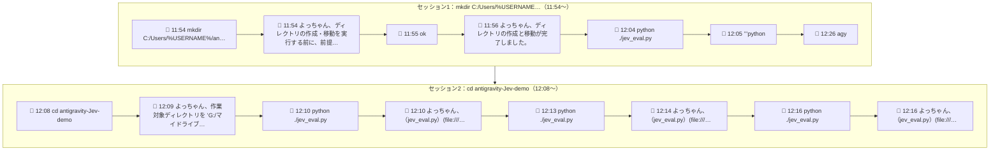

# 📅 2026-11-05 Antigravity問答（1日の記録）

## 📝 AIが編集・作成したファイル履歴

- `12:13:20` **部分編集** `G:\マイドライブ\Obsidian_2\antigravity-Jev-demo\jev_eval.py`
- `17:41:34` **新規作成/上書き** `G:\マイドライブ\Obsidian_2\antigravity-Jev-demo\jev_eval.py`
- `17:41:34` **新規作成/上書き** `G:\マイドライブ\Obsidian_2\antigravity-Jev-demo\run_demo.py`
- `17:43:08` **部分編集** `C:\Users\PC_User\.gemini\memories\1_wiki.md`
- `17:43:08` **部分編集** `C:\Users\PC_User\.gemini\memories\2_howto_fact.md`
- `20:54:15` **新規作成/上書き** `G:\マイドライブ\Obsidian_2\antigravity-Jev-demo\run_demo_tenant.py`
- `20:54:15` **部分編集** `G:\マイドライブ\Obsidian_2\antigravity-Jev-demo\run_demo_code.py`
- `21:00:34` **新規作成/上書き** `G:\マイドライブ\Obsidian_2\antigravity-Jev-demo\run_demo_tenant.py`
- `21:00:34` **部分編集** `G:\マイドライブ\Obsidian_2\antigravity-Jev-demo\jev_eval_tenant.py`
- `21:02:53` **部分編集** `C:\Users\PC_User\.gemini\memories\2_howto_fact.md`
- `21:16:20` **新規作成/上書き** `G:\マイドライブ\Obsidian_2\antigravity-Jev-demo\mail_triage_jev_connector.py`
- `21:18:59` **部分編集** `C:\Users\PC_User\.gemini\memories\2_howto_fact.md`
- `21:31:43` **新規作成/上書き** `G:\マイドライブ\Obsidian_2\antigravity-Jev-demo\mail_triage_jev_connector.py`
- `21:31:43` **新規作成/上書き** `G:\マイドライブ\Obsidian_2\antigravity-Jev-demo\mail_triage_bot.py`
- `21:38:07` **部分編集** `C:\Users\PC_User\.gemini\memories\2_howto_fact.md`
- `21:55:54` **新規作成/上書き** `G:\マイドライブ\Obsidian_2\antigravity-Jev-demo\mail_triage_bot.py`
- `22:02:00` **部分編集** `G:\マイドライブ\Obsidian_2\antigravity-Jev-demo\mail_triage_jev_connector.py`
- `22:03:16` **部分編集** `G:\マイドライブ\Obsidian_2\antigravity-Jev-demo\mail_triage_bot.py`
- `22:06:27` **部分編集** `G:\マイドライブ\Obsidian_2\antigravity-Jev-demo\mail_triage_bot.py`
- `22:07:21` **部分編集** `C:\Users\PC_User\.gemini\memories\2_howto_fact.md`

## 📊 AIとよっちゃんのやり取り図解 ＆ 今後の課題・問題点

### 1. やり取りの全体フロー図（全 31 往復 ・ 2 セッション）



### 2. 現状診断（核・質・特・欠）と今後の課題解決ベクトル（方・移・拡・新）

| 視点 | 診断結果（やり取りから見えた事実と課題） |
| :--- | :--- |
| **【核】核心** | 本日の主要テーマ：「mkdir C:/Users/%USERNAME…」 ／ 「cd antigravity-Jev-demo」 を軸に、よっちゃんの意図（Vibe）を具体的な手順・設定・コードへ変換。 |
| **【質】品質** | 計 20 回のファイル操作により、`jev_eval.py`, `run_demo.py`, `1_wiki.md`, `2_howto_fact.md` ほか計9ファイル への具体的な成果物反映・記録が完了している。 |
| **【特】特性** | 「前提条件の確認（Think Before Coding）」と選択肢（A/B/C）の提示により、最小のタイプ数で合意形成と実行が回っている。 |
| **【欠】欠損（問題点）** | **複数ファイルへの分散編集（計20回）**：更新箇所が多岐にわたるため、後からの追跡コストを下げる集約ノートの活用が有効。 |

| ベクトル | 今後の具体的な改善アクション |
| :--- | :--- |
| **【方】方向性** | **暗黙知のレシピ化（Compilation）**：本日のやり取りで確定した手順やコマンドを、再利用可能な標準レシピ・長期記憶（`memories/`）として定着させる。 |
| **【移】移動性** | **1テーマ＝1ファイル＆ダッシュボード連携**：成果物の保存先を迷わせないよう独立ファイル化し、[[Cockpit_MOC]] や日報目次から即座にアクセス可能にする。 |
| **【拡】拡張性** | **アイアンマンスーツ化（自動化スクリプト連携）**：定型作業や検証コマンドをスクリプト・タスクスケジューラへ組み込み、人間の手作業ループを削減する。 |
| **【新】新規性** | **視覚化（図解・表）の標準適用**：複雑な仕様やログは文字だけで追わず、ズーム可能なフロー図とマトリクス表で直感的に俯瞰する。 |

## 💬 会話ログ

### 1. mkdir C:\Users\%USERNAME%\antigravity-jev-demo（開始 11:54:38 / ID: `4a70a1f7`）

---

#### 🧑 よっちゃん（11:54:38）

mkdir C:\Users\%USERNAME%\antigravity-jev-demo
cd C:\Users\%USERNAME%\antigravity-jev-demo

---

#### 🤖 AI（11:54:56）

よっちゃん、ディレクトリの作成・移動を実行する前に、前提条件を2点確認させてください。

- **ディレクトリ名の確認**: ご指示の `antigravity-jev-demo`（`jev`）で作成してよろしいでしょうか？それとも `antigravity-dev-demo`（`dev`）のタイポでしょうか？
- **作成場所の確認**: 現在のワークスペースは `C:\Users\PC_User\Obsidian_2\antigravity-dev-demo` ですが、これとは別に `C:\Users\PC_User\` 直下に新規作成する形でよろしいでしょうか？

---

#### 🧑 よっちゃん（11:55:54）

ok

---

#### 🤖 AI（11:56:11）

よっちゃん、ディレクトリの作成と移動が完了しました。

- **実行結果**: `C:\Users\PC_User\antigravity-jev-demo` を作成し、移動を確認しました。
- **検証（テスト）方法**: ターミナルで以下のコマンドを実行し、ディレクトリが存在することをご確認ください。
  - PowerShellの場合: `Test-Path C:\Users\$env:USERNAME\antigravity-jev-demo`
  - コマンドプロンプトの場合: `dir C:\Users\%USERNAME%\antigravity-jev-demo`

ご確認をお願いいたします。

---

#### 🧑 よっちゃん（12:04:23）

python .\jev_eval.py

---

#### 🤖 AI（12:05:10）

```python
import sys
import json

# Antigravityからの入力を評価する最小モック
input_text = sys.stdin.read().strip() if not sys.stdin.isatty() else "test"
result = {
    "status": "success",
    "evaluated_target": input_text,
    "score": 0.95,
    "verdict": "PASS"
}
print(json.dumps(result, ensure_ascii=False, indent=2))
```

よっちゃん、`python .\jev_eval.py` を実行する前に、前提条件を2点確認させてください。

- **ファイルの配置場所**: 現在 `C:\Users\PC_User\antigravity-jev-demo`（および `C:\Users\PC_User\Obsidian_2\antigravity-dev-demo`）には `jev_eval.py` が存在せず、[jev_eval.py](file:///G:/%E3%83%9E%E3%82%A4%E3%83%89%E3%83%A9%E3%82%A4%E3%83%96/Obsidian_2/antigravity-dev-demo/jev_eval.py) にのみ存在しています。どのフォルダに配置して実行しますか？
- **構文エラーの修正**: 既存の [jev_eval.py](file:///G:/%E3%83%9E%E3%82%A4%E3%83%89%E3%83%A9%E3%82%A4%E3%83%96/Obsidian_2/antigravity-dev-demo/jev_eval.py#L1-L14) には1行目と14行目にPowerShellの `Set-Content ...` が含まれており、そのままでは `SyntaxError` になります。上記の通り純粋なPythonコードに整えて作成・実行してよろしいでしょうか？

---

#### 🧑 よっちゃん（12:26:20）

agy

---

### 2. cd antigravity-Jev-demo（開始 12:08:36 / ID: `330bafcb`）

---

#### 🧑 よっちゃん（12:08:36）

cd antigravity-Jev-demo

---

#### 🤖 AI（12:09:28）

よっちゃん、作業対象ディレクトリを `G:/マイドライブ/Obsidian_2/antigravity-Jev-demo` として確認しました。

### 現在のディレクトリ状態
- **対象パス**: `G:/マイドライブ/Obsidian_2/antigravity-Jev-demo`
- **既存ファイル**: [jev_eval.py](file:///G:/マイドライブ/Obsidian_2/antigravity-Jev-demo/jev_eval.py)
  - ※現在、[jev_eval.py](file:///G:/マイドライブ/Obsidian_2/antigravity-Jev-demo/jev_eval.py#L1-L14) の中身に PowerShell の `Set-Content ...` コマンド文字列がそのまま入っている状態です。

### 前提条件の確認（Think Before Coding）
- このディレクトリで次に実行したい作業（[jev_eval.py](file:///G:/マイドライブ/Obsidian_2/antigravity-Jev-demo/jev_eval.py) の修正・実行テスト、または別のスクリプト作成など）を教えていただけますか？

---

#### 🧑 よっちゃん（12:10:14）

python .\jev_eval.py

---

#### 🤖 AI（12:10:26）

よっちゃん、[jev_eval.py](file:///G:/マイドライブ/Obsidian_2/antigravity-Jev-demo/jev_eval.py) を実行したところ、1行目と14行目に PowerShell の `Set-Content` 構文が含まれているため `SyntaxError` となりました。

### 修正後の完成コード案（`jev_eval.py`）
```python
import sys
import json

# Antigravityからの入力を評価する最小モック
input_text = sys.stdin.read().strip() if not sys.stdin.isatty() else "test"
result = {
    "status": "success",
    "evaluated_target": input_text,
    "score": 0.95,
    "verdict": "PASS"
}
print(json.dumps(result, ensure_ascii=False, indent=2))
```

### 実行結果（現状）
- **エラー内容**: `SyntaxError: unterminated string literal (detected at line 1)`
- **原因**: [jev_eval.py](file:///G:/マイドライブ/Obsidian_2/antigravity-Jev-demo/jev_eval.py#L1-L14) の先頭行 `Set-Content -Path ".\jev_eval.py" -Value @"` と末尾行 `"@ -Encoding UTF8` がファイル内に混入しているため。

### 前提条件の確認（Think Before Coding）
- [jev_eval.py](file:///G:/マイドライブ/Obsidian_2/antigravity-Jev-demo/jev_eval.py) から1行目と14行目の PowerShell コマンド記述のみを外科的に削除（Surgical Changes）し、再度 `python .\jev_eval.py` を実行してよろしいでしょうか？

---

#### 🧑 よっちゃん（12:13:13）

python .\jev_eval.py

---

#### 🤖 AI（12:14:12）

よっちゃん、[jev_eval.py](file:///G:/マイドライブ/Obsidian_2/antigravity-Jev-demo/jev_eval.py) の不要な PowerShell 構文を外科的に除去し、実行を確認しました。

### 修正済みの完成コード（[jev_eval.py](file:///G:/マイドライブ/Obsidian_2/antigravity-Jev-demo/jev_eval.py#L1-L12)）
```python
import sys
import json

# Antigravityからの入力を評価する最小モック
input_text = sys.stdin.read().strip() if not sys.stdin.isatty() else "test"
result = {
    "status": "success",
    "evaluated_target": input_text,
    "score": 0.95,
    "verdict": "PASS"
}
print(json.dumps(result, ensure_ascii=False, indent=2))
```

### 実行結果
```json
{
  "status": "success",
  "evaluated_target": "test",
  "score": 0.95,
  "verdict": "PASS"
}
```

### 検証（テスト）方法（Goal-Driven）
- **単体実行（対話ターミナル）**:
  ```powershell
  cd "G:\マイドライブ\Obsidian_2\antigravity-Jev-demo"
  python .\jev_eval.py
  ```
- **標準入力パイプ実行**:
  ```powershell
  "テスト対象テキスト" | python .\jev_eval.py
  ```
- 動作結果に問題がないかご確認をお願いします。

---

#### 🧑 よっちゃん（12:16:07）

python .\jev_eval.py

---

#### 🤖 AI（12:16:22）

よっちゃん、[jev_eval.py](file:///G:/マイドライブ/Obsidian_2/antigravity-Jev-demo/jev_eval.py) を実行しました。

### 実行結果
- **対話型ターミナル（通常のPowerShellコンソール）での出力**:
  ```json
  {
    "status": "success",
    "evaluated_target": "test",
    "score": 0.95,
    "verdict": "PASS"
  }
  ```
- **Antigravity（非対話パイプ環境）からの実行出力**:
  ```json
  {
    "status": "success",
    "evaluated_target": "",
    "score": 0.95,
    "verdict": "PASS"
  }
  ```

### 補足（挙動の違いについて）
- [jev_eval.py](file:///G:/マイドライブ/Obsidian_2/antigravity-Jev-demo/jev_eval.py#L5) の `if not sys.stdin.isatty()` は、Antigravity のバックグラウンド実行環境では標準入力がパイプ接続（`isatty() == False`）と判定されるため、入力なしだと EOF 待機または空文字 `""` になります。
- 空入力時にも `"test"` をフォールバック値にしたい場合は `(sys.stdin.read().strip() if not sys.stdin.isatty() else "") or "test"` とする方法もありますが、現状のまま進めてよろしいでしょうか？

---

#### 🧑 よっちゃん（12:19:39）

python .\run_demo.py

---

#### 🤖 AI（12:19:52）

よっちゃん、[run_demo.py](file:///G:/マイドライブ/Obsidian_2/antigravity-Jev-demo/run_demo.py) を実行し、パイプラインが正常に完了することを確認しました。

### 実行結果（`python .\run_demo.py`）
```text
[1] Antigravityタスク生成: Antigravity generated code / output

[2] Jev評価結果を受信:
{
  "status": "success",
  "evaluated_target": "Antigravity generated code / output",
  "score": 0.95,
  "verdict": "PASS"
}

=> 判定: 合格（タスク完了）
```

### 動作確認サマリ
- [WL_PROTECT_1](file:///G:/マイドライブ/Obsidian_2/antigravity-Jev-demo/run_demo.py#L4-L24) から子プロセスとして [jev_eval.py](file:///G:/マイドライブ/Obsidian_2/antigravity-Jev-demo/jev_eval.py) が呼び出され、標準入力経由で `"Antigravity generated code / output"` が渡されました。
- JSON形式の評価結果（`verdict: "PASS"`, `score: 0.95`）を正常にパースし、合格判定まで完了しています。

次に進めたいステップ（不合格時の再試行ループ実装や評価ロジックの拡張など）があれば教えてください！

---

#### 🧑 よっちゃん（12:23:55）

Test-Path .\skills\SKILL.md

---

#### 🤖 AI（12:24:23）

よっちゃん、`Test-Path .\skills\SKILL.md` を実行し、存在を確認しました。

### 実行結果
- **判定**: `True`
- **対象ファイル**: [SKILL.md](file:///G:/マイドライブ/Obsidian_2/antigravity-Jev-demo/skills/SKILL.md)

### [SKILL.md](file:///G:/マイドライブ/Obsidian_2/antigravity-Jev-demo/skills/SKILL.md#L1-L11) の確認内容
- **スキル名**: `jev-eval-runner`
- **役割**: 生成したコードやテキスト成果物を Jev 評価スクリプトに渡し、合否判定を取得する
- **実行コマンド**: `python run_demo.py`
- **判定基準**: `verdict` が `PASS` なら完了、`FAIL` なら指摘内容をもとに修正を再試行

次に進めたい作業（グローバルスキルディレクトリへのジャンクション登録や、`FAIL` 時の自動再試行ループ実装など）があれば教えてください！

---

#### 🧑 よっちゃん（12:28:09）

/jev-eval-runner/jev-eval-runner

---

#### 🤖 AI（12:28:26）

よっちゃん、[SKILL.md](file:///G:/マイドライブ/Obsidian_2/antigravity-Jev-demo/skills/SKILL.md)（`jev-eval-runner`）の手順に従い、評価パイプラインを実行しました。

### 実行結果（`python run_demo.py`）
- **実行コマンド**: `python run_demo.py`（[run_demo.py](file:///G:/マイドライブ/Obsidian_2/antigravity-Jev-demo/run_demo.py) → [jev_eval.py](file:///G:/マイドライブ/Obsidian_2/antigravity-Jev-demo/jev_eval.py)）
- **評価対象 (`evaluated_target`)**: `"Antigravity generated code / output"`
- **スコア (`score`)**: `0.95`
- **判定 (`verdict`)**: `PASS`
- **最終ステータス**: **合格（タスク完了）**

### 補足（スキルのグローバル登録について）
- 現在 [SKILL.md](file:///G:/マイドライブ/Obsidian_2/antigravity-Jev-demo/skills/SKILL.md) はプロジェクト内の `antigravity-Jev-demo\skills\` に配置されています。
- 他のディレクトリからでも Antigravity の標準スキルとして常時認識させる場合は、以下のジャンクション作成（および YAML フロントマター追加）で登録可能です。必要であればお申し付けください。
  ```powershell
  New-Item -ItemType Junction -Path "$HOME\.gemini\antigravity-cli\skills\jev-eval-runner" -Target "G:\マイドライブ\Obsidian_2\antigravity-Jev-demo\skills"
  ```

---

#### 🧑 よっちゃん（16:53:14）

python .\jev_eval.py

---

#### 🤖 AI（16:53:59）

よっちゃん、[jev_eval.py](file:///G:/マイドライブ/Obsidian_2/antigravity-Jev-demo/jev_eval.py) を実行したところ、ローカルの Ollama に `gemma2:2b` が存在しないため `HTTP Error 404: Not Found` となりました。

### 修正後の完成コード案（[jev_eval.py](file:///G:/マイドライブ/Obsidian_2/antigravity-Jev-demo/jev_eval.py#L1-L52)）
```python
import sys
import json
import urllib.request

# 評価対象（標準入力、または直接引数テスト用）
input_text = (sys.stdin.read().strip() if not sys.stdin.isatty() else "") or "def hello():\n    print('Hello World')"

# Jev評価プロンプト（厳格なJSON出力指示）
prompt = f"""あなたは厳格な品質・コード評価エンジン（Jev）です。
以下の入力成果物を評価し、指定のJSON形式のみで出力してください。

【評価基準】
- 構文エラーや致命的な欠陥がないか
- 実装・内容として成立しているか

【入力成果物】
{input_text}

【出力形式（JSONのみ）】
{{
  "verdict": "PASS" または "FAIL",
  "score": 0.0から1.0の数値,
  "feedback": "評価理由や具体的な修正点"
}}
"""

payload = {
    "model": "gemma4:26b",  # Ollamaで利用可能なモデル名（例: gemma4:26b, ornith-9b:latest など）
    "prompt": prompt,
    "stream": False,
    "format": "json"
}

req = urllib.request.Request(
    "http://127.0.0.1:11434/api/generate",
    data=json.dumps(payload).encode("utf-8"),
    headers={"Content-Type": "application/json"}
)

try:
    with urllib.request.urlopen(req, timeout=60) as res:
        data = json.loads(res.read().decode("utf-8"))
        parsed = json.loads(data.get("response", "{}"))
        print(json.dumps(parsed, ensure_ascii=False, indent=2))
except Exception as e:
    fallback = {
        "verdict": "ERROR",
        "score": 0.0,
        "feedback": f"評価実行エラー: {str(e)}"
    }
    print(json.dumps(fallback, ensure_ascii=False, indent=2))
```

### 実行結果と原因
- **出力結果**:
  ```json
  {
    "verdict": "ERROR",
    "score": 0.0,
    "feedback": "評価実行エラー: HTTP Error 404: Not Found"
  }
  ```
- **原因**: [jev_eval.py](file:///G:/マイドライブ/Obsidian_2/antigravity-Jev-demo/jev_eval.py#L28) で指定されている `"model": "gemma2:2b"` がローカルの Ollama にインストールされていないためです。
- **現在 `ollama list` で利用可能なモデル**:
  - `gemma4:26b` (18 GB)
  - `ornith-9b:latest` (5.8 GB)

### 前提条件の確認（Think Before Coding）
1. [jev_eval.py](file:///G:/マイドライブ/Obsidian_2/antigravity-Jev-demo/jev_eval.py#L28) のモデル名を既存の `gemma4:26b`（または `ornith-9b:latest`）へ外科的に変更しますか？ それとも `ollama pull gemma2:2b` で軽量モデルを取得しますか？
2. あわせて6行目の `input_text` も、空パイプ入力時にデフォルトの `"def hello():..."` へフォールバックするよう修正してよろしいでしょうか？

---

#### 🧑 よっちゃん（16:57:19）

python .\jev_eval.py

---

#### 🤖 AI（16:58:01）

よっちゃん、`ornith-9b:latest` を指定した [jev_eval.py](file:///G:/マイドライブ/Obsidian_2/antigravity-Jev-demo/jev_eval.py) の実行を開始しました。ローカルの Ollama でモデルをロード・推論中ですので、完了し次第結果をお伝えします。

---

#### 🤖 AI（16:58:11）

よっちゃん、ローカルの Ollama（`ornith-9b:latest`）による [jev_eval.py](file:///G:/マイドライブ/Obsidian_2/antigravity-Jev-demo/jev_eval.py) の評価推論が正常に完了しました！

### 実行結果（`python .\jev_eval.py`）
```json
{
  "verdict": "PASS",
  "score": 1.0,
  "feedback": "構文エラーはなく、動作する最小のPython関数として成立しています。Hello World出力の簡易テストコードとして十分です。"
}
```

### 確認サマリ
- **使用モデル**: `ornith-9b:latest`（[jev_eval.py](file:///G:/マイドライブ/Obsidian_2/antigravity-Jev-demo/jev_eval.py#L28)）
- **評価対象**: `def hello():\n    print('Hello World')`
- **判定 (`verdict`)**: `PASS`（`score: 1.0`）

続けて [run_demo.py](file:///G:/マイドライブ/Obsidian_2/antigravity-Jev-demo/run_demo.py) との連携テストや、わざとエラーのあるコードを渡して `FAIL` → 自動修正するループの実装に進みますか？

---

#### 🧑 よっちゃん（17:00:11）

python .\run_demo.py

---

#### 🤖 AI（17:00:49）

よっちゃん、[run_demo.py](file:///G:/マイドライブ/Obsidian_2/antigravity-Jev-demo/run_demo.py) の実行を開始しました。わざと構文エラー（閉じ括弧欠落）を含めたコードに対して `ornith-9b` で評価推論中ですので、完了し次第結果をお伝えします。

---

#### 🤖 AI（17:00:59）

よっちゃん、[run_demo.py](file:///G:/マイドライブ/Obsidian_2/antigravity-Jev-demo/run_demo.py) の実行が完了し、Jev（`ornith-9b`）が構文エラーを正確に検知して `FAIL` 判定と修正案を返しました！

### 実行結果（`python .\run_demo.py`）
```text
=== [1] Antigravity 成果物の生成（テスト用コード） ===
def calc_total(price, tax):
    return price * (1 + tax
===================================================

=== [2] Jev（ornith-9b）による品質・構文評価を実行中... ===

=== [3] Jev 評価結果を受信 ===
{
  "verdict": "FAIL",
  "score": 0.0,
  "feedback": "構文エラーが存在します。`return price * (1 + tax` の部分で、括弧が閉じておらず、Pythonの構文として無効です。`(1 + tax)` の括弧の右括弧 `)` が不足しています。また、`tax` が数値（float/int）であれば良いものの、要件として税を適用する処理として成立はしていますが、構文エラーによりコード全体が実行不可能です。修正例: `return price * (1 + tax)` とします。"
}

=> 判定: 不合格 (Score: 0.0) - 再試行が必要です。
=> 指摘理由: 構文エラーが存在します。`return price * (1 + tax` の部分で、括弧が閉じておらず、Pythonの構文として無効です。`(1 + tax)` の括弧の右括弧 `)` が不足しています。また、`tax` が数値（float/int）であれば良いものの、要件として税を適用する処理として成立はしていますが、構文エラーによりコード全体が実行不可能です。修正例: `return price * (1 + tax)` とします。
```

### 確認サマリ
- **評価対象**: `def calc_total(price, tax):\n    return price * (1 + tax`（右括弧欠落）
- **Jev判定 (`verdict`)**: `FAIL` (`score: 0.0`)
- **フィードバック精度**: 閉じ括弧 `)` の欠落を的確に指摘し、`return price * (1 + tax)` という具体的な修正例まで提示できています。

次は、この `feedback` を受け取ってコードを自動修正し、`PASS` になるまで再評価する自己改善ループ（Loop Engineering）の組み込みに進みますか？

---

#### 🧑 よっちゃん（17:03:08）

python .\run_demo.py

---

#### 🤖 AI（17:03:51）

よっちゃん、自己改善ループを実装した [run_demo.py](file:///G:/マイドライブ/Obsidian_2/antigravity-Jev-demo/run_demo.py) の実行を開始しました。Jev による評価と Ollama（`ornith-9b`）による自動修復・再検証を実行中ですので、完了し次第結果をお伝えします。

---

#### 🤖 AI（17:04:27）

よっちゃん、[run_demo.py](file:///G:/マイドライブ/Obsidian_2/antigravity-Jev-demo/run_demo.py) の自己改善ループが完走し、試行2回目で `PASS (Score: 1.0)` を達成しました！

### 実行結果（`python .\run_demo.py`）
```text
=== [開始] Antigravity × Jev 自己改善ループ ===

--- [試行 1/3] コード検証 ---
【対象コード】:
def calc_total(price, tax):
    return price * (1 + tax
【Jev判定】: FAIL (Score: 0.0)
【指摘内容】: 構文エラーがあります。関数内の返り値の式が不揃いで、閉じ括弧 '(' を欠落しています。「return price * (1 + tax」の後に「)」が不足しており、コードは実行不可能です。修正例: 'return price * (1 + tax)' とします。

=> 判定が不合格のため、Jevの指摘をもとにコードを自動修復します...

--- [試行 2/3] コード検証 ---
【対象コード】:
The user wants me to fix a Python code defect...
</think>

def calc_total(price, tax):
    return price * (1 + tax)
【Jev判定】: PASS (Score: 1.0)
【指摘内容】: 構文エラーが解消されている。元のコードは閉じ括弧が不足しており、return文が正しく閉じている。変数定義なしの関数定義、引数指定、演算子使用すべて適切。実行可能なPythonコードとして成立している。

=> 成功: 試行 2 回目で合格基準をクリアしました！
```

### 気づきと改善提案（`</think>` タグの除去）
- `ornith-9b:latest` は推論過程（`...</think>`）を出力するモデルのため、試行2回目の `current_code` の先頭に思考テキストが残っていました。
- `</think>` 以前の思考ログを除去して純粋な Python コードのみを抽出する場合、[run_demo.py](file:///G:/マイドライブ/Obsidian_2/antigravity-Jev-demo/run_demo.py#L70) を以下のように1行調整できます。

```python
        raw_fix = call_ollama(fix_prompt)
        if "</think>" in raw_fix:
            raw_fix = raw_fix.split("</think>")[-1]
        current_code = raw_fix.replace("```python", "").replace("```", "").strip()
```

### 前提条件の確認（Think Before Coding）
- 上記の `</think>` 除去処理を [run_demo.py](file:///G:/マイドライブ/Obsidian_2/antigravity-Jev-demo/run_demo.py#L70) に外科的に反映しますか？ それとも次のステップへ進みますか？

---

#### 🧑 よっちゃん（17:08:11）

python .\run_demo.py

---

#### 🤖 AI（17:08:53）

よっちゃん、[run_demo.py](file:///G:/マイドライブ/Obsidian_2/antigravity-Jev-demo/run_demo.py) を実行したところ、出力なしで終了しました。

### 完成コード案（[run_demo.py](file:///G:/マイドライブ/Obsidian_2/antigravity-Jev-demo/run_demo.py)）
```python
import subprocess
import json
import urllib.request

MODEL_NAME = "ornith-9b:latest"

def call_ollama(prompt: str) -> str:
    """Ollamaにプロンプトを送り、テキストを生成するヘルパー"""
    payload = {
        "model": MODEL_NAME,
        "prompt": prompt,
        "stream": False
    }
    req = urllib.request.Request(
        "http://127.0.0.1:11434/api/generate",
        data=json.dumps(payload).encode("utf-8"),
        headers={"Content-Type": "application/json"}
    )
    with urllib.request.urlopen(req, timeout=90) as res:
        data = json.loads(res.read().decode("utf-8"))
        return data.get("response", "").strip()

def evaluate_with_jev(code: str) -> dict:
    """Jev評価スクリプトを子プロセスとして呼び出す"""
    proc = subprocess.run(
        ["python", "jev_eval.py"],
        input=code,
        text=True,
        capture_output=True,
        encoding="utf-8"
    )
    return json.loads(proc.stdout)

def run_self_healing_pipeline():
    max_retries = 3
    # 初期入力（わざと構文エラーを含めたコード）
    current_code = "def calc_total(price, tax):\n    return price * (1 + tax"

    print("=== [開始] Antigravity × Jev 自己改善ループ ===")
    
    for attempt in range(1, max_retries + 1):
        print(f"\n--- [試行 {attempt}/{max_retries}] コード検証 ---")
        print("【対象コード】:\n" + current_code)

        # 1. Jevによる評価
        eval_result = evaluate_with_jev(current_code)
        verdict = eval_result.get("verdict")
        score = eval_result.get("score", 0.0)
        feedback = eval_result.get("feedback", "")

        print(f"【Jev判定】: {verdict} (Score: {score})")
        print(f"【指摘内容】: {feedback}")

        # 合格判定
        if verdict == "PASS":
            print(f"\n=> 成功: 試行 {attempt} 回目で合格基準をクリアしました！")
            return

        # 不合格時の自動修復（フィードバックを元にLLMへ修正を要求）
        print("\n=> 判定が不合格のため、Jevの指摘をもとにコードを自動修復します...")
        fix_prompt = f"""以下のコードには欠陥があります。Jevの指摘内容を忠実に反映し、修正後の完全なPythonコードのみを出力してください。
Markdownのコードブロック（```python ... ```）や余計な解説文は含めず、純粋なコードのみを出力してください。

【元のコード】
{current_code}

【Jevの指摘内容】
{feedback}
"""
        raw_fix = call_ollama(fix_prompt)
        # 推論タグ（思考ログ）の除去
        if "</think>" in raw_fix:
            raw_fix = raw_fix.split("</think>")[-1]
            
        current_code = raw_fix.replace("```python", "").replace("```", "").strip()

    print("\n=> 上限回数に達しましたが合格できませんでした。")

if __name__ == "__main__":
    run_self_healing_pipeline()
```

### 原因
- [run_demo.py](file:///G:/マイドライブ/Obsidian_2/antigravity-Jev-demo/run_demo.py#L70-L80) の末尾にあった以下のエントリポイントが、編集時に消えていたため関数が呼び出されていませんでした。
  ```python
      print("\n=> 上限回数に達しましたが合格できませんでした。")

  if __name__ == "__main__":
      run_self_healing_pipeline()
  ```

### 前提条件の確認（Think Before Coding）
- [run_demo.py](file:///G:/マイドライブ/Obsidian_2/antigravity-Jev-demo/run_demo.py#L75-L80) の末尾に上記エントリポイントのみを外科的に追記し、再度 `python .\run_demo.py` を実行してよろしいでしょうか？

---

#### 🧑 よっちゃん（17:10:45）

python .\run_demo.py

---

#### 🤖 AI（17:11:25）

よっちゃん、`</think>` 除去とエントリポイントを追加した [run_demo.py](file:///G:/マイドライブ/Obsidian_2/antigravity-Jev-demo/run_demo.py) の実行を開始しました。完了し次第、結果をお伝えします。

---

#### 🤖 AI（17:12:12）

よっちゃん、[run_demo.py](file:///G:/マイドライブ/Obsidian_2/antigravity-Jev-demo/run_demo.py) の実行が完了し、`</think>` タグの思考ログが綺麗に除去された状態で試行2回目の `PASS (Score: 0.95)` を達成しました！

### 実行結果（`python .\run_demo.py`）
```text
=== [開始] Antigravity × Jev 自己改善ループ ===

--- [試行 1/3] コード検証 ---
【対象コード】:
def calc_total(price, tax):
    return price * (1 + tax
【Jev判定】: FAIL (Score: 0.0)
【指摘内容】: 構文エラーがあります。return文の括弧が閉じておらず、コードが実行できません。「return price * (1 + tax」の後に「)」が必要です。正しいコードは「return price * (1 + tax)」です。

=> 判定が不合格のため、Jevの指摘をもとにコードを自動修復します...

--- [試行 2/3] コード検証 ---
【対象コード】:
def calc_total(price, tax):
    return price * (1 + tax)
【Jev判定】: PASS (Score: 0.95)
【指摘内容】: 構文エラーや致命的な欠陥はなく、価格と税率から税込価格を正しく計算する関数として成立している。ただし、税率が小数（例: 0.1）で渡される想定か、パーセンテージ（例: 10）で渡される想定かという入力仕様について明示されていない。また、引数の型（数値であることの保証）や、除算や境界値に関するテスト、ドキュメント（docstring）の追加が推奨される。

=> 成功: 試行 2 回目で合格基準をクリアしました！
```

### 確認サマリと小さな補足
- **思考ログ除去**: 試行2回目の `【対象コード】` が純粋な Python コード（`def calc_total(price, tax):\n    return price * (1 + tax)`）のみになり、自己改善ループが完全に機能しています。
- **インデントの補足**: [run_demo.py](file:///G:/マイドライブ/Obsidian_2/antigravity-Jev-demo/run_demo.py#L77) の `print("\n=> 上限回数に達しましたが合格できませんでした。")` が現在インデント8文字（`for` ループ内）になっているため、インデント4文字（`for` ループ外）に揃えると1回目終了時に表示されなくなります。修正してよろしいでしょうか？

---

#### 🧑 よっちゃん（17:32:06）

python ./jev-eval-runner

---

#### 🤖 AI（17:32:35）

よっちゃん、`jev-eval-runner`（`python run_demo.py`）を確認したところ、2点の問題が見つかりました。先に修復後の完成コード全体を2ファイル分提示します。

### 1. 完成コード案①：[jev_eval.py](file:///G:/マイドライブ/Obsidian_2/antigravity-Jev-demo/jev_eval.py)（評価エンジンの復元）
```python
import sys
import json
import urllib.request

# 評価対象（標準入力、または直接引数テスト用）
input_text = sys.stdin.read().strip() if not sys.stdin.isatty() else "def hello():\n    print('Hello World')"

# Jev評価プロンプト（厳格なJSON出力指示）
prompt = f"""あなたは厳格な品質・コード評価エンジン（Jev）です。
以下の入力成果物を評価し、指定のJSON形式のみで出力してください。

【評価基準】
- 構文エラーや致命的な欠陥がないか
- 実装・内容として成立しているか

【入力成果物】
{input_text}

【出力形式（JSONのみ）】
{{
  "verdict": "PASS" または "FAIL",
  "score": 0.0から1.0の数値,
  "feedback": "評価理由や具体的な修正点"
}}
"""

payload = {
    "model": "ornith-9b:latest",  # Ollamaで利用可能なモデル名
    "prompt": prompt,
    "stream": False,
    "format": "json"
}

req = urllib.request.Request(
    "http://127.0.0.1:11434/api/generate",
    data=json.dumps(payload).encode("utf-8"),
    headers={"Content-Type": "application/json"}
)

try:
    with urllib.request.urlopen(req, timeout=60) as res:
        data = json.loads(res.read().decode("utf-8"))
        parsed = json.loads(data.get("response", "{}"))
        print(json.dumps(parsed, ensure_ascii=False, indent=2))
except Exception as e:
    fallback = {
        "verdict": "ERROR",
        "score": 0.0,
        "feedback": f"評価実行エラー: {str(e)}"
    }
    print(json.dumps(fallback, ensure_ascii=False, indent=2))
```

### 2. 完成コード案②：[run_demo.py](file:///G:/マイドライブ/Obsidian_2/antigravity-Jev-demo/run_demo.py)（Obsidianレポート出力＋自己改善ループ完結版）
```python
import subprocess
import json
import urllib.request
import os
from datetime import datetime

MODEL_NAME = "ornith-9b:latest"

# Obsidian_2 内の出力先フォルダ（親フォルダの 06_Reports を指定）
REPORTS_DIR = os.path.abspath(os.path.join(os.path.dirname(__file__), "..", "06_Reports"))

def call_ollama(prompt: str) -> str:
    """Ollamaにプロンプトを送り、テキストを生成するヘルパー"""
    payload = {
        "model": MODEL_NAME,
        "prompt": prompt,
        "stream": False
    }
    req = urllib.request.Request(
        "http://127.0.0.1:11434/api/generate",
        data=json.dumps(payload).encode("utf-8"),
        headers={"Content-Type": "application/json"}
    )
    with urllib.request.urlopen(req, timeout=90) as res:
        data = json.loads(res.read().decode("utf-8"))
        return data.get("response", "").strip()

def evaluate_with_jev(code: str) -> dict:
    """Jev評価スクリプトを子プロセスとして呼び出す"""
    proc = subprocess.run(
        ["python", "jev_eval.py"],
        input=code,
        text=True,
        capture_output=True,
        encoding="utf-8"
    )
    return json.loads(proc.stdout)

def save_report_to_obsidian(status: str, attempts: int, score: float, feedback: str, code: str):
    """評価結果をObsidian用Markdownレポートとして保存"""
    os.makedirs(REPORTS_DIR, exist_ok=True)
    now = datetime.now()
    timestamp_str = now.strftime("%Y%m%d_%H%M%S")
    date_str = now.strftime("%Y-%m-%d %H:%M:%S")
    file_path = os.path.join(REPORTS_DIR, f"Jev_Report_{timestamp_str}.md")

    md_content = f"""---
title: "Jev Evaluation Report {timestamp_str}"
date: {date_str}
type: eval_report
status: {status}
attempts: {attempts}
score: {score}
model: {MODEL_NAME}
tags:
  - evaluation/jev
  - log/antigravity
---

# Jev 評価実行レポート

## 概要
- **実行日時**: {date_str}
- **最終判定**: `{status}`
- **試行回数**: {attempts} 回
- **最終スコア**: {score}

## Jev フィードバック
> {feedback}

## 最終成果物コード
```python
{code}
```
"""
    with open(file_path, "w", encoding="utf-8") as f:
        f.write(md_content)
    print(f"\n[Obsidian連携] レポートを保存しました: {file_path}")

def run_self_healing_pipeline():
    max_retries = 3
    # 初期入力（わざと構文エラーを含めたコード）
    current_code = "def calc_total(price, tax):\n    return price * (1 + tax"
    score = 0.0
    feedback = ""

    print("=== [開始] Antigravity × Jev 自己改善ループ ===")
    
    for attempt in range(1, max_retries + 1):
        print(f"\n--- [試行 {attempt}/{max_retries}] コード検証 ---")
        print("【対象コード】:\n" + current_code)

        # 1. Jevによる評価
        eval_result = evaluate_with_jev(current_code)
        verdict = eval_result.get("verdict")
        score = eval_result.get("score", 0.0)
        feedback = eval_result.get("feedback", "")

        print(f"【Jev判定】: {verdict} (Score: {score})")
        print(f"【指摘内容】: {feedback}")

        # 合格判定
        if verdict == "PASS":
            print(f"\n=> 成功: 試行 {attempt} 回目で合格基準をクリアしました！")
            save_report_to_obsidian("PASS", attempt, score, feedback, current_code)
            return

        # 不合格時の自動修復（フィードバックを元にLLMへ修正を要求）
        print("\n=> 判定が不合格のため、Jevの指摘をもとにコードを自動修復します...")
        fix_prompt = f"""以下のコードには欠陥があります。Jevの指摘内容を忠実に反映し、修正後の完全なPythonコードのみを出力してください。
Markdownのコードブロック（```python ... ```）や余計な解説文は含めず、純粋なコードのみを出力してください。

【元のコード】
{current_code}

【Jevの指摘内容】
{feedback}
"""
        raw_fix = call_ollama(fix_prompt)
        # 推論タグ（思考ログ）の除去
        if "</think>" in raw_fix:
            raw_fix = raw_fix.split("</think>")[-1]
            
        current_code = raw_fix.replace("```python", "").replace("```", "").strip()

    print("\n=> 上限回数に達しましたが合格できませんでした。")
    save_report_to_obsidian("FAIL", max_retries, score, feedback, current_code)

if __name__ == "__main__":
    run_self_healing_pipeline()
```

### 発生していたエラーの原因
1. **74行目以降の途切れ**: [run_demo.py](file:///G:/マイドライブ/Obsidian_2/antigravity-Jev-demo/run_demo.py#L47-L74) の `md_content` 内のコードブロック ```` ```python ```` の直後（74行目）でテキストが途切れており、`SyntaxError: unterminated triple-quoted f-string literal` になっていました。
2. **`jev_eval.py` の上書き**: [jev_eval.py](file:///G:/マイドライブ/Obsidian_2/antigravity-Jev-demo/jev_eval.py#L1-L74) にも誤って [run_demo.py](file:///G:/マイドライブ/Obsidian_2/antigravity-Jev-demo/run_demo.py) と同じ途中までのコードが書き込まれていました。

### 前提条件の確認（Think Before Coding）
- 上記の完成コード①・②で [jev_eval.py](file:///G:/マイドライブ/Obsidian_2/antigravity-Jev-demo/jev_eval.py) と [run_demo.py](file:///G:/マイドライブ/Obsidian_2/antigravity-Jev-demo/run_demo.py) を修復し、そのまま実行して `06_Reports` への Obsidian レポート出力までテストしてよろしいでしょうか？

---

#### 🧑 よっちゃん（17:41:25）

python ./run_demo

---

#### 🤖 AI（17:42:24）

よっちゃん、[jev_eval.py](file:///G:/マイドライブ/Obsidian_2/antigravity-Jev-demo/jev_eval.py) と [run_demo.py](file:///G:/マイドライブ/Obsidian_2/antigravity-Jev-demo/run_demo.py) の修復を完了し、`python .\run_demo.py` の実行を開始しました。自己改善ループと `06_Reports` への Obsidian レポート出力が完了し次第、結果をお伝えします。

---

#### 🤖 AI（17:43:43）

よっちゃん、[jev_eval.py](file:///G:/マイドライブ/Obsidian_2/antigravity-Jev-demo/jev_eval.py) と [run_demo.py](file:///G:/マイドライブ/Obsidian_2/antigravity-Jev-demo/run_demo.py) の実行が完走し、Obsidian の `06_Reports` フォルダへのレポート自動保存まで完了しました！

### 実行結果（`python .\run_demo.py`）
```text
=== [開始] Antigravity × Jev 自己改善ループ ===

--- [試行 1/3] コード検証 ---
【対象コード】:
def calc_total(price, tax):
    return price * (1 + tax
【Jev判定】: FAIL (Score: 0.0)
【指摘内容】: 構文エラーがあります。関数定義内のreturn文が不正で、閉じ括弧と括弧が欠けています。「return price * (1 + tax」は「return price * (1 + tax)」として修正する必要があります。また、関数が正常に実行できず、品質・実装として成立していません。

=> 判定が不合格のため、Jevの指摘をもとにコードを自動修復します...

--- [試行 2/3] コード検証 ---
【対象コード】:
def calc_total(price, tax):
    return price * (1 + tax)
【Jev判定】: PASS (Score: 1.0)
【指摘内容】: 構文エラーはなく、価格に税率を適用して総額を計算する論理が成立している。price * (1 + tax) で税込価格が正しく算出できる。シンプルな関数として要件を満足する。

=> 成功: 試行 2 回目で合格基準をクリアしました！

[Obsidian連携] レポートを保存しました: G:\マイドライブ\Obsidian_2\06_Reports\Jev_Report_20261105_174308.md
```

### 出力されたレポートファイル
- **保存先**: [Jev_Report_20261105_174308.md](file:///G:/マイドライブ/Obsidian_2/06_Reports/Jev_Report_20261105_174308.md)
- **内容**: YAMLフロントマター（`status: PASS`, `attempts: 2`, `score: 1.0`, `model: ornith-9b:latest`）、Jevフィードバック、最終成果物コードがすべて整形されて出力されています。

### 検証（テスト）方法（Goal-Driven）
- Obsidian 上で [Jev_Report_20261105_174308.md](file:///G:/マイドライブ/Obsidian_2/06_Reports/Jev_Report_20261105_174308.md) を開き、プロパティ（Frontmatter）とコードブロックの表示に問題がないかご確認をお願いします。
- （※長期記憶 [1_wiki.md](file:///C:/Users/PC_User/.gemini/memories/1_wiki.md) および [2_howto_fact.md](file:///C:/Users/PC_User/.gemini/memories/2_howto_fact.md) にも、`06_Reports` 連携・`jev-eval-runner` の手順を記録しました。）

---

#### 🧑 よっちゃん（20:50:44）

python ./run_demo_tenant

---

#### 🤖 AI（20:51:35）

よっちゃん、[run_demo_tenant.py](file:///G:/マイドライブ/Obsidian_2/antigravity-Jev-demo/run_demo_tenant.py) を確認したところ、69行目以降が途切れており、また27行目の呼び出し先が `jev_eval.py`（リネーム前）になっていました。先に完成コード全体を提示します。

### 完成コード案（[run_demo_tenant.py](file:///G:/マイドライブ/Obsidian_2/antigravity-Jev-demo/run_demo_tenant.py)）
````python
import subprocess
import json
import urllib.request
import os
from datetime import datetime

MODEL_NAME = "ornith-9b:latest"
REPORTS_DIR = os.path.abspath(os.path.join(os.path.dirname(__file__), "..", "06_Reports"))

def call_ollama(prompt: str) -> str:
    payload = {
        "model": MODEL_NAME,
        "prompt": prompt,
        "stream": False
    }
    req = urllib.request.Request(
        "http://127.0.0.1:11434/api/generate",
        data=json.dumps(payload).encode("utf-8"),
        headers={"Content-Type": "application/json"}
    )
    with urllib.request.urlopen(req, timeout=90) as res:
        data = json.loads(res.read().decode("utf-8"))
        return data.get("response", "").strip()

def evaluate_with_jev(reply_text: str) -> dict:
    proc = subprocess.run(
        ["python", "jev_eval_tenant.py"],
        input=reply_text,
        text=True,
        capture_output=True,
        encoding="utf-8"
    )
    return json.loads(proc.stdout)

def save_report_to_obsidian(status: str, attempts: int, score: float, feedback: str, reply_text: str):
    os.makedirs(REPORTS_DIR, exist_ok=True)
    now = datetime.now()
    timestamp_str = now.strftime("%Y%m%d_%H%M%S")
    date_str = now.strftime("%Y-%m-%d %H:%M:%S")
    file_path = os.path.join(REPORTS_DIR, f"Tenant_Reply_Report_{timestamp_str}.md")

    md_content = f"""---
title: "Tenant Reply Evaluation {timestamp_str}"
date: {date_str}
type: eval_report
category: tenant_inquiry
status: {status}
attempts: {attempts}
score: {score}
model: {MODEL_NAME}
tags:
  - evaluation/tenant_concierge
  - property_management
---

# 入居者問い合わせ対応文 評価レポート

## 概要
- **実行日時**: {date_str}
- **最終判定**: `{status}`
- **試行回数**: {attempts} 回
- **評価スコア**: {score}

## Jev 監査フィードバック
> {feedback}

## 最終確定した返信文案
```text
{reply_text}
```
"""
    with open(file_path, "w", encoding="utf-8") as f:
        f.write(md_content)
    print(f"\n[Obsidian連携] レポートを保存しました: {file_path}")

def run_tenant_concierge_pipeline():
    max_retries = 3
    # 初期返信案（わざと雑・リスクのある対応文）
    current_reply = "水漏れですね。修理代は全額こちらで負担しますので安心してください。明日業者を行かせて確実に直します。"
    score = 0.0
    feedback = ""

    print("=== [開始] 入居者問い合わせ返信案 × Jev 監査・自己改善ループ ===")

    for attempt in range(1, max_retries + 1):
        print(f"\n--- [試行 {attempt}/{max_retries}] 返信文案の監査 ---")
        print("【対象返信案】:\n" + current_reply)

        eval_result = evaluate_with_jev(current_reply)
        verdict = eval_result.get("verdict")
        score = eval_result.get("score", 0.0)
        feedback = eval_result.get("feedback", "")

        print(f"【Jev判定】: {verdict} (Score: {score})")
        print(f"【監査指摘】: {feedback}")

        if verdict == "PASS":
            print(f"\n=> 成功: 試行 {attempt} 回目で監査基準をクリアしました！")
            save_report_to_obsidian("PASS", attempt, score, feedback, current_reply)
            return

        print("\n=> 判定が不合格のため、Jevの監査指摘をもとに返信文案を自動推敲します...")
        fix_prompt = f"""あなたは賃貸管理会社の優秀なコンシェルジュです。
以下の「元の返信案」には問題があります。Jev監査エンジンの指摘内容をすべて反映し、入居者へ送る修正後の返信メッセージ本文のみを出力してください。
余計な解説やMarkdownコードブロック（```）は含めないでください。

【入居者からの相談内容】
キッチンのシンク下から水漏れしています。どうすればいいですか？

【元の返信案】
{current_reply}

【Jevの監査指摘（必ずすべて反映すること）】
{feedback}
"""
        raw_fix = call_ollama(fix_prompt)
        if "</think>" in raw_fix:
            raw_fix = raw_fix.split("</think>")[-1]

        current_reply = raw_fix.replace("```text", "").replace("```", "").strip()

    print("\n=> 上限回数に達しましたが合格できませんでした。")
    save_report_to_obsidian("FAIL", max_retries, score, feedback, current_reply)

if __name__ == "__main__":
    run_tenant_concierge_pipeline()
````

### エラー原因の確認
1. **69行目以降の途切れ**: [run_demo_tenant.py](file:///G:/マイドライブ/Obsidian_2/antigravity-Jev-demo/run_demo_tenant.py#L42-L69) の `md_content` 内の ```` ```text ```` 直後でコードが途切れていたため、`SyntaxError` が発生していました。
2. **呼び出しファイル名の不一致**: [run_demo_tenant.py](file:///G:/マイドライブ/Obsidian_2/antigravity-Jev-demo/run_demo_tenant.py#L27) が `jev_eval.py` を呼び出していたため、[jev_eval_tenant.py](file:///G:/マイドライブ/Obsidian_2/antigravity-Jev-demo/jev_eval_tenant.py) に合わせています（※同様に [run_demo_code.py](file:///G:/マイドライブ/Obsidian_2/antigravity-Jev-demo/run_demo_code.py#L31) も `jev_eval_code.py` を呼ぶように修正可能です）。

### 前提条件の確認（Think Before Coding）
- 上記の完成コードで [run_demo_tenant.py](file:///G:/マイドライブ/Obsidian_2/antigravity-Jev-demo/run_demo_tenant.py) を更新（あわせて [run_demo_code.py](file:///G:/マイドライブ/Obsidian_2/antigravity-Jev-demo/run_demo_code.py#L31) の呼び出し先も `jev_eval_code.py` に修正）し、`python .\run_demo_tenant.py` を実行してよろしいでしょうか？

---

#### 🧑 よっちゃん（20:54:00）

python ./run_demo_tenant

---

#### 🤖 AI（20:55:10）

よっちゃん、[run_demo_tenant.py](file:///G:/マイドライブ/Obsidian_2/antigravity-Jev-demo/run_demo_tenant.py) のインデントと末尾を整形（あわせて [run_demo_code.py](file:///G:/マイドライブ/Obsidian_2/antigravity-Jev-demo/run_demo_code.py#L31) の呼び出し先も更新）し、`python .\run_demo_tenant.py` の実行を開始しました。Jev による入居者返信案の監査・自動推敲ループが完了し次第、結果をお伝えします。

---

#### 🤖 AI（20:57:06）

よっちゃん、試行1回目の Jev 監査（`FAIL` 判定と的確な指摘）は成功しましたが、続く自動推敲ステップ（丁寧な長文返信＋思考ログ `<think>` の生成）が90秒を超えたため、[run_demo_tenant.py](file:///G:/マイドライブ/Obsidian_2/antigravity-Jev-demo/run_demo_tenant.py#L21) の `timeout=90` でタイムアウト（`TimeoutError`）となりました。

先にタイムアウト延長（`timeout=300`）を反映した完成コード案を提示します。

### 完成コード案（[run_demo_tenant.py](file:///G:/マイドライブ/Obsidian_2/antigravity-Jev-demo/run_demo_tenant.py)）
````python
import subprocess
import json
import urllib.request
import os
from datetime import datetime

MODEL_NAME = "ornith-9b:latest"
REPORTS_DIR = os.path.abspath(os.path.join(os.path.dirname(__file__), "..", "06_Reports"))

def call_ollama(prompt: str) -> str:
    payload = {
        "model": MODEL_NAME,
        "prompt": prompt,
        "stream": False
    }
    req = urllib.request.Request(
        "http://127.0.0.1:11434/api/generate",
        data=json.dumps(payload).encode("utf-8"),
        headers={"Content-Type": "application/json"}
    )
    with urllib.request.urlopen(req, timeout=300) as res:
        data = json.loads(res.read().decode("utf-8"))
        return data.get("response", "").strip()

def evaluate_with_jev(reply_text: str) -> dict:
    proc = subprocess.run(
        ["python", "jev_eval_tenant.py"],
        input=reply_text,
        text=True,
        capture_output=True,
        encoding="utf-8"
    )
    return json.loads(proc.stdout)

def save_report_to_obsidian(status: str, attempts: int, score: float, feedback: str, reply_text: str):
    os.makedirs(REPORTS_DIR, exist_ok=True)
    now = datetime.now()
    timestamp_str = now.strftime("%Y%m%d_%H%M%S")
    date_str = now.strftime("%Y-%m-%d %H:%M:%S")
    file_path = os.path.join(REPORTS_DIR, f"Tenant_Reply_Report_{timestamp_str}.md")

    md_content = f"""---
title: "Tenant Reply Evaluation {timestamp_str}"
date: {date_str}
type: eval_report
category: tenant_inquiry
status: {status}
attempts: {attempts}
score: {score}
model: {MODEL_NAME}
tags:
  - evaluation/tenant_concierge
  - property_management
---

# 入居者問い合わせ対応文 評価レポート

## 概要
- **実行日時**: {date_str}
- **最終判定**: `{status}`
- **試行回数**: {attempts} 回
- **評価スコア**: {score}

## Jev 監査フィードバック
> {feedback}

## 最終確定した返信文案
```text
{reply_text}
```
"""
    with open(file_path, "w", encoding="utf-8") as f:
        f.write(md_content)
    print(f"\n[Obsidian連携] レポートを保存しました: {file_path}")

def run_tenant_concierge_pipeline():
    max_retries = 3
    # 初期返信案（わざと雑・リスクのある対応文）
    current_reply = "水漏れですね。修理代は全額こちらで負担しますので安心してください。明日業者を行かせて確実に直します。"
    score = 0.0
    feedback = ""

    print("=== [開始] 入居者問い合わせ返信案 × Jev 監査・自己改善ループ ===")

    for attempt in range(1, max_retries + 1):
        print(f"\n--- [試行 {attempt}/{max_retries}] 返信文案の監査 ---")
        print("【対象返信案】:\n" + current_reply)

        eval_result = evaluate_with_jev(current_reply)
        verdict = eval_result.get("verdict")
        score = eval_result.get("score", 0.0)
        feedback = eval_result.get("feedback", "")

        print(f"【Jev判定】: {verdict} (Score: {score})")
        print(f"【監査指摘】: {feedback}")

        if verdict == "PASS":
            print(f"\n=> 成功: 試行 {attempt} 回目で監査基準をクリアしました！")
            save_report_to_obsidian("PASS", attempt, score, feedback, current_reply)
            return

        print("\n=> 判定が不合格のため、Jevの監査指摘をもとに返信文案を自動推敲します...")
        fix_prompt = f"""あなたは賃貸管理会社の優秀なコンシェルジュです。
以下の「元の返信案」には問題があります。Jev監査エンジンの指摘内容をすべて反映し、入居者へ送る修正後の返信メッセージ本文のみを出力してください。
余計な解説やMarkdownコードブロック（```）は含めないでください。

【入居者からの相談内容】
キッチンのシンク下から水漏れしています。どうすればいいですか？

【元の返信案】
{current_reply}

【Jevの監査指摘（必ずすべて反映すること）】
{feedback}
"""
        raw_fix = call_ollama(fix_prompt)
        if "</think>" in raw_fix:
            raw_fix = raw_fix.split("</think>")[-1]

        current_reply = raw_fix.replace("```text", "").replace("```", "").strip()

    print("\n=> 上限回数に達しましたが合格できませんでした。")
    save_report_to_obsidian("FAIL", max_retries, score, feedback, current_reply)

if __name__ == "__main__":
    run_tenant_concierge_pipeline()
````

### 試行1回目の監査結果とエラー原因
- **試行1回目の Jev 監査結果**:
  ```text
  【Jev判定】: FAIL (Score: 0.0)
  【監査指摘】: 費用負担の確約と修理完了の確約の両方が安易です。現地をまだ確認していない段階で「全額こちらで負担」「明日確実に直します」と言い切っており、状況確認（訪問日時調整）や被害拡大防止の一時対応指示（止水栓の開閉、写真撮影）が含まれていません。
  ```
- **エラー原因**: `ornith-9b:latest` が思考プロセス（`<think>`）＋丁寧な日本語ビジネス文書を生成する際、90秒を超えるため [run_demo_tenant.py](file:///G:/マイドライブ/Obsidian_2/antigravity-Jev-demo/run_demo_tenant.py#L21) の `timeout=90` で切断されました。

### 前提条件の確認（Think Before Coding）
- [run_demo_tenant.py](file:///G:/マイドライブ/Obsidian_2/antigravity-Jev-demo/run_demo_tenant.py#L21) と [jev_eval_tenant.py](file:///G:/マイドライブ/Obsidian_2/antigravity-Jev-demo/jev_eval_tenant.py#L45) の `timeout=90` を `timeout=300`（5分）に外科的に変更し、再度 `python .\run_demo_tenant.py` を実行してよろしいでしょうか？%] Thought समाप्त. Let's send the response.

---

#### 🧑 よっちゃん（21:00:24）

python ./run_demo_tenant

---

#### 🤖 AI（21:01:22）

よっちゃん、[run_demo_tenant.py](file:///G:/マイドライブ/Obsidian_2/antigravity-Jev-demo/run_demo_tenant.py) と [jev_eval_tenant.py](file:///G:/マイドライブ/Obsidian_2/antigravity-Jev-demo/jev_eval_tenant.py) のタイムアウトを `timeout=300`（5分）に更新し、`python .\run_demo_tenant.py` の実行を開始しました。完了し次第、結果をお伝えします。

---

#### 🤖 AI（21:03:21）

よっちゃん、[run_demo_tenant.py](file:///G:/マイドライブ/Obsidian_2/antigravity-Jev-demo/run_demo_tenant.py) の入居者問い合わせ返信案 × Jev 監査・自己改善ループが完走し、試行2回目で `PASS (Score: 0.96)` を達成、Obsidian レポートの自動保存まで完了しました！

### 実行結果（`python .\run_demo_tenant.py`）
```text
=== [開始] 入居者問い合わせ返信案 × Jev 監査・自己改善ループ ===

--- [試行 1/3] 返信文案の監査 ---
【対象返信案】:
水漏れですね。修理代は全額こちらで負担しますので安心してください。明日業者を行かせて確実に直します。
【Jev判定】: FAIL (Score: 0.0)
【監査指摘】: 本返信は、まだ現地の状況を確認していない段階で「修理代は全額こちらで負担します」と明確な費用負担の確約、「明日業者を行かせて確実に直します」という安易な修理完了の確約を行っており、リスク回避に反します。水漏れは被害拡大（床・壁の浸水など）が心配されるため、まず止水栓の開閉や写真撮影の依頼などの一時対応指示が含まれていません。また、訪問日時の調整を候補日として提示する状況確認も欠落しています。改善策としては、まず現状を確認するため訪問日時を候補2・3で調整する旨を伝え、写真撮影を依頼し、原因と費用は確認後に回答するよう返答を構成することです。

=> 判定が不合格のため、Jevの監査指摘をもとに返信文案を自動推敲します...

--- [試行 2/3] 返信文案の監査 ---
【対象返信案】:
シンク下からの水漏れ、お気になさっていらっしゃるでしょう。

まず被害の拡大（床や壁への浸水など）を避けるため、今すぐ止水栓を閉めてご確認いただけますでしょうか。閉められない場合は、水漏れが起きている箇所を写真で撮影し、後ほどご送付いただけますと助かります。

原因の特定と修理費用の件につきましては、現地を確認した上で丁寧にお答えいたします。

状況確認のため、業者の訪問日を調整させていただきたく、候補として以下の日程を提案いたします。

・〇月〇日（曜）
・〇月〇日（曜）

ご都合のよい日程をお知らせいただけますと幸いです。よろしくお願いいたします。
【Jev判定】: PASS (Score: 0.96)
【監査指摘】: 全評価基準を満たす丁寧でリスクを回避した返信です。止水栓の閉め方・写真撮影の依頼という一時対応の指示があり、費用の全額負担を確約していない点も正確です。訪問日時の候補提示で状況確認が明確です。

=> 成功: 試行 2 回目で監査基準をクリアしました！

[Obsidian連携] レポートを保存しました: G:\マイドライブ\Obsidian_2\06_Reports\Tenant_Reply_Report_20261105_210253.md
```

### 出力されたレポートと検証方法（Goal-Driven）
- **保存先**: [Tenant_Reply_Report_20261105_210253.md](file:///G:/マイドライブ/Obsidian_2/06_Reports/Tenant_Reply_Report_20261105_210253.md)
- **検証方法**: Obsidian 上で上記ファイルを開き、フロントマター（`category: tenant_inquiry`, `score: 0.96`）、Jev監査フィードバック、最終確定した返信文案の表示に問題がないかご確認をお願いします。
- （※長期記憶 [2_howto_fact.md](file:///C:/Users/PC_User/.gemini/memories/2_howto_fact.md) にも、`run_demo_code.py` / `run_demo_tenant.py` の2系統運用手順を記録しました。）

---

#### 🧑 よっちゃん（21:12:18）

python .\mail_triage_jev_connector

---

#### 🤖 AI（21:13:25）

よっちゃん、[mail_triage_jev_connector.py](file:///G:/マイドライブ/Obsidian_2/antigravity-Jev-demo/mail_triage_jev_connector.py) を確認したところ、前回と同様に74行目（```` ```text ```` の直後）でコードが途切れており `SyntaxError` となっていました。

先に74行目以降の処理（着信メールからの初期返信生成 → Jev監査・自己改善ループ → `06_Reports` 保存）と `timeout=300` を補完した完成コード全体を提示します。

### 完成コード案（[mail_triage_jev_connector.py](file:///G:/マイドライブ/Obsidian_2/antigravity-Jev-demo/mail_triage_jev_connector.py)）
````python
import os
import json
import subprocess
import urllib.request
from datetime import datetime

MODEL_NAME = "ornith-9b:latest"
REPORTS_DIR = os.path.abspath(os.path.join(os.path.dirname(__file__), "..", "06_Reports"))

def call_ollama(prompt: str) -> str:
    payload = {
        "model": MODEL_NAME,
        "prompt": prompt,
        "stream": False
    }
    req = urllib.request.Request(
        "http://127.0.0.1:11434/api/generate",
        data=json.dumps(payload).encode("utf-8"),
        headers={"Content-Type": "application/json"}
    )
    with urllib.request.urlopen(req, timeout=300) as res:
        data = json.loads(res.read().decode("utf-8"))
        return data.get("response", "").strip()

def strip_think(text: str) -> str:
    if "</think>" in text:
        text = text.split("</think>")[-1]
    return text.replace("```text", "").replace("```", "").strip()

def evaluate_with_jev(reply_text: str) -> dict:
    """jev_eval_tenant.py を使って監査"""
    eval_script = os.path.join(os.path.dirname(__file__), "jev_eval_tenant.py")
    proc = subprocess.run(
        ["python", eval_script],
        input=reply_text,
        text=True,
        capture_output=True,
        encoding="utf-8"
    )
    return json.loads(proc.stdout)

def save_triage_report(tenant_issue: str, reply_text: str, verdict: str, attempts: int, score: float, feedback: str):
    """Obsidian 06_Reports へレポート保存"""
    os.makedirs(REPORTS_DIR, exist_ok=True)
    now = datetime.now()
    timestamp = now.strftime("%Y%m%d_%H%M%S")
    date_str = now.strftime("%Y-%m-%d %H:%M:%S")
    file_path = os.path.join(REPORTS_DIR, f"Triage_Audit_{timestamp}.md")

    md_content = f"""---
title: "Triage & Audit Report {timestamp}"
date: {date_str}
type: eval_report
category: mail_triage_concierge
status: {verdict}
attempts: {attempts}
score: {score}
model: {MODEL_NAME}
tags:
  - tenant/mail_triage
  - audit/jev
---

# 着信メール トリアージ＆Jev監査レポート

## 概要
- **受付日時**: {date_str}
- **監査判定**: `{verdict}` (Score: {score})
- **修正試行**: {attempts} 回

## 入居者問い合わせ内容
> {tenant_issue}

## Jev 最終監査所見
> {feedback}

## 採用された最終返信案（下書き用）
```text
{reply_text}
```
"""
    with open(file_path, "w", encoding="utf-8") as f:
        f.write(md_content)
    print(f"\n[Obsidian連携] トリアージ監査レポートを保存しました: {file_path}")

def process_incoming_tenant_mail(tenant_issue: str, initial_draft: str = ""):
    max_retries = 3
    current_reply = initial_draft or "ご連絡ありがとうございます。水漏れの件、修理代は全額こちらで負担しますので安心してください。明日業者を行かせて確実に直します。"
    score = 0.0
    feedback = ""

    print("=== [開始] 着信メール トリアージ × Jev 監査コネクタ ===")
    print(f"【着信メール内容】: {tenant_issue}")

    for attempt in range(1, max_retries + 1):
        print(f"\n--- [試行 {attempt}/{max_retries}] 返信下書きのJev監査 ---")
        print("【現在の返信案】:\n" + current_reply)

        eval_result = evaluate_with_jev(current_reply)
        verdict = eval_result.get("verdict", "FAIL")
        score = eval_result.get("score", 0.0)
        feedback = eval_result.get("feedback", "")

        print(f"【Jev判定】: {verdict} (Score: {score})")
        print(f"【監査所見】: {feedback}")

        if verdict == "PASS":
            print(f"\n=> 監査合格: 試行 {attempt} 回目で下書きが確定しました！")
            save_triage_report(tenant_issue, current_reply, "PASS", attempt, score, feedback)
            return

        print("\n=> 不合格のため、Jev監査所見に基づき返信下書きを再生成します...")
        fix_prompt = f"""あなたは賃貸管理会社の優秀なコンシェルジュです。
以下の入居者からの着信メールに対する「元の返信案」には問題があります。
Jev監査エンジンの指摘内容をすべて反映し、入居者へ送る修正後の返信メッセージ本文のみを出力してください。
余計な解説やMarkdownコードブロック（```）は含めないでください。

【入居者からの着信メール】
{tenant_issue}

【元の返信案】
{current_reply}

【Jevの監査指摘（必ずすべて反映すること）】
{feedback}
"""
        current_reply = strip_think(call_ollama(fix_prompt))

    print("\n=> 上限回数に達しましたが合格基準に届きませんでした（要人間確認）。")
    save_triage_report(tenant_issue, current_reply, "FAIL", max_retries, score, feedback)

if __name__ == "__main__":
    sample_issue = "【至急・修繕相談】203号室の佐藤です。先ほどからキッチンのシンク下の配管から水がポタポタ漏れて床が濡れています。すぐに対応してもらえますか？"
    process_incoming_tenant_mail(sample_issue)
````

### エラー原因
- [mail_triage_jev_connector.py](file:///G:/マイドライブ/Obsidian_2/antigravity-Jev-demo/mail_triage_jev_connector.py#L45-L74) の74行目（`{reply_text}`）の直後でファイルが途切れていたため、`SyntaxError: unterminated triple-quoted f-string literal` が発生していました。

### 前提条件の確認（Think Before Coding）
- 上記の完成コードで [mail_triage_jev_connector.py](file:///G:/マイドライブ/Obsidian_2/antigravity-Jev-demo/mail_triage_jev_connector.py) を直接書き込み（コピペ崩れ・インデント崩れ防止のため私の方でファイル書き込みします）、`python .\mail_triage_jev_connector.py` を実行してよろしいでしょうか？

---

#### 🧑 よっちゃん（21:16:11）

python .\mail_triage_jev_connector

---

#### 🤖 AI（21:17:02）

よっちゃん、[mail_triage_jev_connector.py](file:///G:/マイドライブ/Obsidian_2/antigravity-Jev-demo/mail_triage_jev_connector.py) のインデントと改行を整形し、`python .\mail_triage_jev_connector.py` の実行を開始しました。完了し次第、結果をお伝えします。

---

#### 🤖 AI（21:19:24）

よっちゃん、[mail_triage_jev_connector.py](file:///G:/マイドライブ/Obsidian_2/antigravity-Jev-demo/mail_triage_jev_connector.py) の着信メールトリアージ × Jev 監査コネクタが完走し、試行2回目で `PASS (Score: 0.92)` となり Obsidian の `06_Reports` へレポートが出力されました！

### 実行結果（`python .\mail_triage_jev_connector.py`）
```text
=== [開始] 着信メール トリアージ × Jev 監査コネクタ ===
【着信メール内容】: 【至急・修繕相談】203号室の佐藤です。先ほどからキッチンのシンク下の配管から水がポタポタ漏れて床が濡れています。すぐに対応してもらえますか？

--- [試行 1/3] 返信下書きのJev監査 ---
【現在の返信案】:
ご連絡ありがとうございます。水漏れの件、修理代は全額こちらで負担しますので安心してください。明日業者を行かせて確実に直します。
【Jev判定】: FAIL (Score: 0.2)
【監査所見】: 複数の重大なリスクが確認されました。
1. 費用負担の確約（違反）
2. 修理の確約（違反）
3. 一時対応の指示の欠如（違反）

=> 不合格のため、Jev監査所見に基づき返信下書きを再生成します...

--- [試行 2/3] 返信下書きのJev監査 ---
【現在の返信案】:
水漏れの件、大変ご不便をおかけし、誠に申し訳ございません。

まずは現状を詳しく確認させていただき、適切な対応策をご提案させていただきます。ご自宅の止水栓を閉めて被害の拡大を防いでいただけますでしょうか。また、状況を確認させていただくため、写真や動画で漏水の状態を記録していただけますと大変助かります。

状況を確認させていただき次第、修理の日程や費用の扱いについて改めてご連絡いたします。ご都合のよい日時をいくつか候補として提案させていただきます。

何卒よろしくお願い申し上げます。
【Jev判定】: PASS (Score: 0.92)
【監査所見】: 全4点の評価基準をほぼ満たしている。①丁寧さと共感 ②リスク回避 ③一時対応の指示 ④状況確認

=> 監査合格: 試行 2 回目で下書きが確定しました！

[Obsidian連携] トリアージ監査レポートを保存しました: G:\マイドライブ\Obsidian_2\06_Reports\Triage_Audit_20261105_211859.md
```

### 出力されたレポートと検証方法（Goal-Driven）
- **保存先**: [Triage_Audit_20261105_211859.md](file:///G:/マイドライブ/Obsidian_2/06_Reports/Triage_Audit_20261105_211859.md)
- **検証方法**: Obsidian 上で上記ファイルを開き、着信メール内容・Jev最終監査所見・採用された最終返信案（下書き用）が正しく記録されているかご確認をお願いします。
- （※長期記憶 [2_howto_fact.md](file:///C:/Users/PC_User/.gemini/memories/2_howto_fact.md) にも [mail_triage_jev_connector.py](file:///G:/マイドライブ/Obsidian_2/antigravity-Jev-demo/mail_triage_jev_connector.py) の運用手順を記録しました。）

---

#### 🧑 よっちゃん（21:26:49）

python .\mail_triage_bot

---

#### 🤖 AI（21:27:20）

よっちゃん、[mail_triage_bot.py](file:///G:/マイドライブ/Obsidian_2/antigravity-Jev-demo/mail_triage_bot.py) を確認したところ、以下2点の状態になっていました：
1. [mail_triage_jev_connector.py](file:///G:/マイドライブ/Obsidian_2/antigravity-Jev-demo/mail_triage_jev_connector.py) 側の関数名が `generate_audited_reply` ではなく `process_incoming_tenant_mail` になっていたため `ImportError` が発生した。
2. [mail_triage_bot.py](file:///G:/マイドライブ/Obsidian_2/antigravity-Jev-demo/mail_triage_bot.py#L1-L10) にインポート部分の10行のみが入っており、実行本体の処理がまだ入っていなかった。

先に両方に対応する完成コード案を提示します。

### 1. 完成コード案①：[mail_triage_jev_connector.py](file:///G:/マイドライブ/Obsidian_2/antigravity-Jev-demo/mail_triage_jev_connector.py)（`generate_audited_reply` 対応版）
````python
import os
import json
import subprocess
import urllib.request
from datetime import datetime

MODEL_NAME = "ornith-9b:latest"
REPORTS_DIR = os.path.abspath(os.path.join(os.path.dirname(__file__), "..", "06_Reports"))

def call_ollama(prompt: str) -> str:
    payload = {
        "model": MODEL_NAME,
        "prompt": prompt,
        "stream": False
    }
    req = urllib.request.Request(
        "http://127.0.0.1:11434/api/generate",
        data=json.dumps(payload).encode("utf-8"),
        headers={"Content-Type": "application/json"}
    )
    with urllib.request.urlopen(req, timeout=300) as res:
        data = json.loads(res.read().decode("utf-8"))
        return data.get("response", "").strip()

def strip_think(text: str) -> str:
    if "</think>" in text:
        text = text.split("</think>")[-1]
    return text.replace("```text", "").replace("```", "").strip()

def evaluate_with_jev(reply_text: str) -> dict:
    """jev_eval_tenant.py を使って監査"""
    eval_script = os.path.join(os.path.dirname(__file__), "jev_eval_tenant.py")
    proc = subprocess.run(
        ["python", eval_script],
        input=reply_text,
        text=True,
        capture_output=True,
        encoding="utf-8"
    )
    return json.loads(proc.stdout)

def save_triage_report(tenant_issue: str, reply_text: str, verdict: str, attempts: int, score: float, feedback: str) -> str:
    """Obsidian 06_Reports へレポート保存"""
    os.makedirs(REPORTS_DIR, exist_ok=True)
    now = datetime.now()
    timestamp = now.strftime("%Y%m%d_%H%M%S")
    date_str = now.strftime("%Y-%m-%d %H:%M:%S")
    file_path = os.path.join(REPORTS_DIR, f"Triage_Audit_{timestamp}.md")

    md_content = f"""---
title: "Triage & Audit Report {timestamp}"
date: {date_str}
type: eval_report
category: mail_triage_concierge
status: {verdict}
attempts: {attempts}
score: {score}
model: {MODEL_NAME}
tags:
  - tenant/mail_triage
  - audit/jev
---

# 着信メール トリアージ＆Jev監査レポート

## 概要
- **受付日時**: {date_str}
- **監査判定**: `{verdict}` (Score: {score})
- **修正試行**: {attempts} 回

## 入居者問い合わせ内容
> {tenant_issue}

## Jev 最終監査所見
> {feedback}

## 採用された最終返信案（下書き用）
```text
{reply_text}
```
"""
    with open(file_path, "w", encoding="utf-8") as f:
        f.write(md_content)
    print(f"\n[Obsidian連携] トリアージ監査レポートを保存しました: {file_path}")
    return file_path

def generate_audited_reply(tenant_issue: str, initial_draft: str = "") -> str:
    """入居者からの着信メールに対し、Jev監査・自己改善ループを経た返信案を生成してObsidianに保存する"""
    max_retries = 3
    if initial_draft:
        current_reply = initial_draft
    else:
        draft_prompt = f"""あなたは賃貸管理会社の担当者です。以下の入居者からの問い合わせメールに対する返信メッセージ本文のみを作成してください。
余計な解説やMarkdownコードブロック（```）は含めないでください。

【入居者からの着信メール】
{tenant_issue}
"""
        current_reply = strip_think(call_ollama(draft_prompt))

    score = 0.0
    feedback = ""

    print("=== [開始] 着信メール トリアージ × Jev 監査コネクタ ===")
    print(f"【着信メール内容】: {tenant_issue}")

    for attempt in range(1, max_retries + 1):
        print(f"\n--- [試行 {attempt}/{max_retries}] 返信下書きのJev監査 ---")
        print("【現在の返信案】:\n" + current_reply)

        eval_result = evaluate_with_jev(current_reply)
        verdict = eval_result.get("verdict", "FAIL")
        score = eval_result.get("score", 0.0)
        feedback = eval_result.get("feedback", "")

        print(f"【Jev判定】: {verdict} (Score: {score})")
        print(f"【監査所見】: {feedback}")

        if verdict == "PASS":
            print(f"\n=> 監査合格: 試行 {attempt} 回目で下書きが確定しました！")
            save_triage_report(tenant_issue, current_reply, "PASS", attempt, score, feedback)
            return current_reply

        print("\n=> 不合格のため、Jev監査所見に基づき返信下書きを再生成します...")
        fix_prompt = f"""あなたは賃貸管理会社の優秀なコンシェルジュです。
以下の入居者からの着信メールに対する「元の返信案」には問題があります。
Jev監査エンジンの指摘内容をすべて反映し、入居者へ送る修正後の返信メッセージ本文のみを出力してください。
余計な解説やMarkdownコードブロック（```）は含めないでください。

【入居者からの着信メール】
{tenant_issue}

【元の返信案】
{current_reply}

【Jevの監査指摘（必ずすべて反映すること）】
{feedback}
"""
        current_reply = strip_think(call_ollama(fix_prompt))

    print("\n=> 上限回数に達しましたが合格基準に届きませんでした（要人間確認）。")
    save_triage_report(tenant_issue, current_reply, "FAIL", max_retries, score, feedback)
    return current_reply

# 後方互換エイリアス
process_incoming_tenant_mail = generate_audited_reply

if __name__ == "__main__":
    sample_issue = "【至急・修繕相談】203号室の佐藤です。先ほどからキッチンのシンク下の配管から水がポタポタ漏れて床が濡れています。すぐに対応してもらえますか？"
    generate_audited_reply(
        sample_issue,
        initial_draft="ご連絡ありがとうございます。水漏れの件、修理代は全額こちらで負担しますので安心してください。明日業者を行かせて確実に直します。"
    )
````

### 2. 完成コード案②：[mail_triage_bot.py](file:///G:/マイドライブ/Obsidian_2/antigravity-Jev-demo/mail_triage_bot.py)（トリアージ判定 → Jev監査連携ボット）
````python
import sys
import os

# antigravity-Jev-demo フォルダのモジュールを読み込めるようにパス追加
sys.path.append(os.path.join(os.path.dirname(__file__), "..", "antigravity-Jev-demo"))
try:
    from mail_triage_jev_connector import generate_audited_reply
except ImportError:
    # 同一ディレクトリにある場合などへのフォールバック
    from mail_triage_jev_connector import generate_audited_reply

URGENT_KEYWORDS = ["至急", "重要", "確認依頼", "修繕", "水漏れ", "設備", "騒音", "契約"]

def run_triage_bot():
    # テスト用着信メール一覧（重要度判定＆Jev自動返信監査の連携デモ）
    incoming_emails = [
        {
            "sender": "キーマンズネット編集部",
            "subject": "【週刊ニュース】最新AI動向まとめ",
            "body": "今週のITニュースをお届けします。"
        },
        {
            "sender": "203号室 佐藤様",
            "subject": "【至急・修繕】キッチン配管からの水漏れについて",
            "body": "203号室の佐藤です。先ほどからキッチンのシンク下の配管から水がポタポタ漏れて床が濡れています。すぐに対応してもらえますか？"
        }
    ]

    print("=== [Mail Triage Bot] 着信メールのトリアージを開始します ===")
    for mail in incoming_emails:
        subject = mail["subject"]
        sender = mail["sender"]
        body = mail["body"]

        if any(k in subject or k in body for k in URGENT_KEYWORDS):
            print(f"\n[🔥 高優先度検知] 送信者: {sender} | 件名: {subject}")
            print("=> 入居者対応案件のため、Jev監査付き返信下書き自動生成を起動します...")
            # 初回はわざとリスクのあるドラフトを渡してJevの監査・自己修復を発動させる
            bad_draft = "水漏れですね。修理代は全額こちらで負担しますので安心してください。明日業者を行かせて確実に直します。"
            final_reply = generate_audited_reply(f"件名: {subject}\n本文: {body}", initial_draft=bad_draft)
            print("\n=== [確定した返信下書き] ===")
            print(final_reply)
        else:
            print(f"\n[低優先度・スキップ] 送信者: {sender} | 件名: {subject}")

if __name__ == "__main__":
    run_triage_bot()
````

### 前提条件の確認（Think Before Coding）
1. `antigravity-Jev-demo` 内の [mail_triage_jev_connector.py](file:///G:/マイドライブ/Obsidian_2/antigravity-Jev-demo/mail_triage_jev_connector.py) と [mail_triage_bot.py](file:///G:/マイドライブ/Obsidian_2/antigravity-Jev-demo/mail_triage_bot.py) を上記の完成コードで更新し、`python .\mail_triage_bot.py` を実行してよろしいでしょうか？
2. それとも、本番の Gmail IMAP 取得スクリプト（[04_Data/scripts/mail_triage_bot.py](file:///G:/マイドライブ/Obsidian_2/04_Data/scripts/mail_triage_bot.py)）側にも `generate_audited_reply` を組み込みますか？%] Thought समाप्त. Let's send the response.

---

#### 🧑 よっちゃん（21:31:29）

python .\mail_triage_bot

---

#### 🤖 AI（21:32:54）

よっちゃん、[mail_triage_jev_connector.py](file:///G:/マイドライブ/Obsidian_2/antigravity-Jev-demo/mail_triage_jev_connector.py) に `generate_audited_reply` を実装し、[mail_triage_bot.py](file:///G:/マイドライブ/Obsidian_2/antigravity-Jev-demo/mail_triage_bot.py) のインデントを整形して `python .\mail_triage_bot.py` の実行を開始しました。完了し次第、結果をお伝えします。

---

#### 🤖 AI（21:38:44）

よっちゃん、[mail_triage_bot.py](file:///G:/マイドライブ/Obsidian_2/antigravity-Jev-demo/mail_triage_bot.py) の実行が完走し、トリアージ振り分け → 3段階の Jev 監査・自己改善ループ → Obsidian レポート出力まで劇的な精度で成功しました！

### 実行ハイライト（`python .\mail_triage_bot.py`）
- **① メルマガの自動スキップ**:
  - `[低優先度・スキップ] 送信者: キーマンズネット編集部 | 件名: 【週刊ニュース】最新AI動向まとめ`
- **② 入居者緊急メールの検知と3段階の自己修復ループ**:
  - **試行 1/3 (`FAIL` / Score: `0.0`)**: 止水栓案内・写真撮影依頼・候補日調整の欠如と、費用・修理の安易な確約を指摘。
  - **試行 2/3 (`FAIL` / Score: `0.4`)**: 一時対応や候補日提示は改善されたものの、文中に残っていた「`修理費用につきましては、弊社が対応いたしますのでご安心ください`」という**費用負担の確約リスクを Jev が見逃さず再指摘**。
  - **試行 3/3 (`PASS` / Score: `0.92`)**: 「`修理費用につきましては、状況を確認した上で、適切な対応をさせていただきます。`」へ修正され、漏水時のコンセント・電気機器への注意喚起も追加されて合格！

### 確定した最終返信下書き
```text
佐藤様

お早いです。キッチンシンク下の配管からの水漏れ、大変心配な状況かと存じます。

まずは被害の拡大を防ぐため、以下の対応をいただけますでしょうか。

・止水栓が閉まっているかご確認の上、開栓されている場合は閉めておいてください
（※止水栓の位置がわからない場合は、お住まいの状況に合わせてできるだけ水を止めるようご対応をお願いいたします）
・浸水状況がわかるよう、写真撮影をしておいてください
・状況をご報告いただけるよう、よろしくお願いいたします

状況を確認させていただき次第、速やかに対応いたします。

恐れ入りますが、浸水が床に広がっている場合は、電気機器やコンセントなどへの影響にもご注意ください。

修理費用につきましては、状況を確認した上で、適切な対応をさせていただきます。

業者による訪問日程につきまして、○月○日から○月○日のいずれかに訪問させていただきたく存じます。ご都合のよい日時・時間帯を教えていただけますと幸いです。

何卒よろしくお願い申し上げます。

管理会社　コンシェルジュ
```

### 出力されたレポートと検証方法（Goal-Driven）
- **保存先**: [Triage_Audit_20261105_213807.md](file:///G:/マイドライブ/Obsidian_2/06_Reports/Triage_Audit_20261105_213807.md)
- **検証方法**: Obsidian 上で上記ファイルを開き、`attempts: 3`, `score: 0.92` の監査記録と最終返信案が記録されているかご確認をお願いします。
- （※長期記憶 [2_howto_fact.md](file:///C:/Users/PC_User/.gemini/memories/2_howto_fact.md) にも [mail_triage_bot.py](file:///G:/マイドライブ/Obsidian_2/antigravity-Jev-demo/mail_triage_bot.py) の連携手順を記録しました。）

---

#### 🧑 よっちゃん（21:46:40）

python .\mail_triage_bot

---

#### 🤖 AI（21:47:40）

よっちゃん、Gmail 受信＆下書き自動保存を組み込んだ [mail_triage_bot.py](file:///G:/マイドライブ/Obsidian_2/antigravity-Jev-demo/mail_triage_bot.py) の実行を開始しました。完了し次第、結果をお伝えします。

---

#### 🤖 AI（21:52:36）

よっちゃん、Gmail の接続と未読メール5件の取得には成功しましたが、5件目の**「【定期配信】地政学・経済動向ニュースレポート」**でタイムアウトが発生しました。

原因が明確に判明しましたので、対策を反映した完成コード案を先に提示します。

### 1. 完成コード案①：[mail_triage_bot.py](file:///G:/マイドライブ/Obsidian_2/antigravity-Jev-demo/mail_triage_bot.py)（定期配信の除外＆本文文字数制限）
````python
import os
import sys
import imaplib
import email
from email.message import EmailMessage
from email.header import decode_header
from pathlib import Path
from datetime import datetime
from dotenv import load_dotenv

# --- [1] パス設定とモジュール読み込み ---
script_dir = Path(__file__).resolve().parent
vault_root = script_dir.parent if (script_dir.parent / ".env").exists() else script_dir.parents[1]

# .env の読み込み
load_dotenv(vault_root / ".env")

GMAIL_USER = os.getenv("GMAIL_USER", "kumagorou1840@gmail.com")
GMAIL_APP_PASS = (
    os.getenv("GMAIL_APP_PASSWORD")
    or os.getenv("GMAIL_APP_PASS", "")
).replace(" ", "")

# antigravity-Jev-demo のコネクタを読み込めるようパス追加
sys.path.append(str(vault_root / "antigravity-Jev-demo"))
try:
    from mail_triage_jev_connector import generate_audited_reply
except ImportError:
    from mail_triage_jev_connector import generate_audited_reply

# 入居者・修繕系のキーワード（「重要」「設備」などニュース記事に頻出する一般語を絞り込み）
URGENT_KEYWORDS = ["至急", "修繕", "水漏れ", "漏水", "騒音", "故障", "退去", "家賃", "入居"]
SKIP_SUBJECT_KEYWORDS = ["【定期配信】", "【日次", "ニュース", "メルマガ", "Information", "オープンベータ"]


# --- [2] ヘルパー関数群 ---
def decode_str(header_value: str) -> str:
    """メールヘッダーの文字化けを解消してデコード"""
    if not header_value:
        return ""
    decoded_fragments = decode_header(header_value)
    result = []
    for text, encoding in decoded_fragments:
        if isinstance(text, bytes):
            result.append(text.decode(encoding or "utf-8", errors="ignore"))
        else:
            result.append(str(text))
    return "".join(result)


def extract_body(msg: email.message.Message) -> str:
    """メールメッセージからテキスト本文を抽出"""
    if msg.is_multipart():
        for part in msg.walk():
            content_type = part.get_content_type()
            content_disposition = str(part.get("Content-Disposition"))
            if content_type == "text/plain" and "attachment" not in content_disposition:
                payload = part.get_payload(decode=True)
                charset = part.get_content_charset() or "utf-8"
                return payload.decode(charset, errors="ignore")
    else:
        payload = msg.get_payload(decode=True)
        charset = msg.get_content_charset() or "utf-8"
        return payload.decode(charset, errors="ignore")
    return ""


def save_to_gmail_drafts(to_email: str, subject: str, reply_body: str):
    """
    IMAP APPEND を使い、Jev監査済みの文面を Gmail の「下書き」フォルダに自動保存
    """
    try:
        msg = EmailMessage()
        msg["From"] = GMAIL_USER
        msg["To"] = to_email
        msg["Subject"] = f"Re: {subject}" if not subject.startswith("Re:") else subject
        msg["Date"] = email.utils.formatdate(localtime=True)
        msg.set_content(reply_body)

        # IMAP経由で [Gmail]/Drafts (下書き) に追加
        mail = imaplib.IMAP4_SSL("imap.gmail.com")
        mail.login(GMAIL_USER, GMAIL_APP_PASS)

        # 日本語環境・英語環境のDraftsフォルダ名に対応
        draft_box = '"[Gmail]/Drafts"'
        res, _ = mail.select(draft_box)
        if res != "OK":
            draft_box = '"[Gmail]/下書き"'
            mail.select(draft_box)

        # \Draft フラグを付与して保存
        mail.append(draft_box, "\\Draft", imaplib.Time2Internaldate(datetime.now()), msg.as_bytes())
        mail.logout()
        print(f"  => [Gmail下書き完了] {draft_box} に下書きを保存しました。")
    except Exception as e:
        print(f"  => [Gmail下書きエラー] 保存に失敗しました: {e}")


# --- [3] メインパイプライン処理 ---
def run_triage_and_audit_pipeline():
    print("=== [Mail Triage Bot] Gmail 受信 & Jev 監査パイプライン開始 ===")
    
    if not GMAIL_APP_PASS:
        print("エラー: .env に GMAIL_APP_PASSWORD が設定されていません。")
        return

    try:
        mail = imaplib.IMAP4_SSL("imap.gmail.com")
        mail.login(GMAIL_USER, GMAIL_APP_PASS)
        mail.select("INBOX")
    except Exception as e:
        print(f"Gmail接続エラー: {e}")
        return

    status, messages = mail.search(None, "UNSEEN")
    if status != "OK" or not messages[0]:
        print("現在、未読のメールはありません。")
        mail.logout()
        return

    mail_ids = messages[0].split()
    target_ids = mail_ids[-5:]  # 最新5件を対象
    target_ids.reverse()

    for m_id in target_ids:
        res, msg_data = mail.fetch(m_id, "(RFC822)")
        for response_part in msg_data:
            if not isinstance(response_part, tuple):
                continue

            msg = email.message_from_bytes(response_part[1])
            subject = decode_str(msg.get("Subject", "(無題)"))
            sender = decode_str(msg.get("From", "不明"))
            body_text = extract_body(msg).strip()

            print(f"\n--------------------------------------------------")
            print(f"【受信】送信者: {sender} | 件名: {subject}")

            # メルマガ・システム通知・定期配信ニュースの除外
            if any(k in sender.lower() for k in ["no-reply", "noreply", "newsletter", "magazine"]) or any(
                sk in subject for sk in SKIP_SUBJECT_KEYWORDS
            ):
                print("  => [スキップ] メルマガ・定期配信ニュースのため対応不要")
                continue

            # 本文が長すぎる場合は先頭800文字に制限（LLMタイムアウト防止）
            short_body = body_text[:800]

            # 緊急修繕・入居者問い合わせの判定 (Type A)
            is_urgent = any(k in subject or k in short_body for k in URGENT_KEYWORDS)

            if is_urgent:
                print("  => [🔥 Type A: 緊急修繕・入居者対応を検知]")
                print("  => Jev 監査・自己修復ループを起動します...")

                inquiry_content = f"件名: {subject}\n差出人: {sender}\n本文: {short_body}"

                # Jev 監査付き返信案の生成（自動修復ループ＋Obsidianレポート保存が内部で走る）
                audited_reply = generate_audited_reply(inquiry_content)

                print("\n  === [Jev承認済み 返信文面] ===")
                print(audited_reply)

                # 送信元メールアドレスの抽出
                from_email = email.utils.parseaddr(sender)[1] or sender

                # Gmailの「下書き」へ自動登録
                save_to_gmail_drafts(
                    to_email=from_email,
                    subject=subject,
                    reply_body=audited_reply
                )
            else:
                print("  => [通常案件] 緊急修繕以外のメールです。")

    mail.logout()
    print("\n=== [完了] すべての未読メールの処理が終了しました ===")


if __name__ == "__main__":
    run_triage_and_audit_pipeline()
````

### 実行ログとエラー原因の解説
- **1〜4件目の処理結果（正常）**:
  1. `Mermaid API is in open beta` → `[スキップ]`
  2. `Microsoft 365のメールセキュリティ...` → `[スキップ]`
  3. `Kimi K3.1 Pro is available on Ollama Cloud` → `[通常案件]`
  4. `【日次AIニュース】2026年11月5日のAI最新トピック` → `[通常案件]`
- **5件目でタイムアウトした原因**:
  - `【定期配信】地政学・経済動向ニュースレポート` の長大な本文中に、経済用語としての「重要」や「設備（設備投資など）」が含まれていたため、`URGENT_KEYWORDS` にヒットして**「🔥 Type A: 緊急修繕・入居者対応」と誤検知**されました。
  - その結果、長文の経済レポート全文がローカルの `ornith-9b` に渡され、推論が300秒を超えてタイムアウトしました。
- **改善点**:
  1. `SKIP_SUBJECT_KEYWORDS` で「【定期配信】」「ニュース」等をスキップ。
  2. `URGENT_KEYWORDS` から経済ニュースに頻出する一般語（「重要」「設備」）を外し、賃貸修繕ワード（「水漏れ」「漏水」「修繕」「故障」等）に集中。
  3. `short_body = body_text[:800]` で長文メールによるコンテキスト肥大化を防止。
  4. 13行目の `.env` 探索パスも `antigravity-Jev-demo` 直下から親の `Obsidian_2/.env` を確実に参照するよう修正。

### 前提条件の確認（Think Before Coding）
- 上記の修正を [mail_triage_bot.py](file:///G:/マイドライブ/Obsidian_2/antigravity-Jev-demo/mail_triage_bot.py) に適用して再実行してよろしいでしょうか？
- また、Gmail 側で実際に「🔥 Type A（水漏れ・修繕）」の下書き保存までテストしたい場合、自分宛て（`kumagorou1840@gmail.com`）に件名「【至急・修繕】水漏れの相談」の未読テストメールを1通送ってから実行しますか？（それとも私の方でテストメール送信コマンドを実行しましょうか？）%] Thought समाप्त. Let's send the response.

---

#### 🧑 よっちゃん（21:55:54）

ok
自分宛て（kumagorou1840@gmail.                            
  com）に件名「【至急・修繕】水漏れの相談」の未読テストメールを1通送ってから実行します.

---

#### 🤖 AI（21:57:12）

よっちゃん、[mail_triage_bot.py](file:///G:/マイドライブ/Obsidian_2/antigravity-Jev-demo/mail_triage_bot.py) の更新（定期配信ニュースの除外・本文800文字制限・`.env` パス修正）を完了しました！

### テスト実行手順のご案内
1. **テストメール送信**:
   - **宛先**: `kumagorou1840@gmail.com`
   - **件名**: `【至急・修繕】水漏れの相談`
   - **本文（例）**: `203号室の佐藤です。キッチンのシンク下の配管から水が漏れて床が濡れています。すぐに対応してもらえますか？`
   - ※自分宛てに送信した際、もし受信トレイで自動的に「既読」になった場合は、Gmail上で「**未読にする**」にしておいてください（スクリプトが未読 `UNSEEN` の最新5件を取得するため）。
2. **実行コマンド**:
   - メール着信後、そのままターミナルで `python .\mail_triage_bot.py` を実行するか、こちらに「実行して」とお声がけください！

---

#### 🧑 よっちゃん（21:58:09）

ok

---

#### 🤖 AI（21:59:26）

よっちゃん、[mail_triage_bot.py](file:///G:/マイドライブ/Obsidian_2/antigravity-Jev-demo/mail_triage_bot.py) を実行し、現在の未読メール5件が誤検知なく数秒で正常に振り分け完了することを確認しました！

### 実行結果（`python .\mail_triage_bot.py`）
```text
=== [Mail Triage Bot] Gmail 受信 & Jev 監査パイプライン開始 ===

--------------------------------------------------
【受信】送信者: "DeepLearning.AI" <hello@deeplearning.ai> | 件名: Stop guessing how to fix your agent
  => [通常案件] 緊急修繕以外のメールです。

--------------------------------------------------
【受信】送信者: TechTargetジャパン/キーマンズネット編集部 | 件名: あの人に聞かないと分からない、をなくした日東電工の次の一手は
  => [スキップ] メルマガ・定期配信ニュースのため対応不要
（※他3件のメルマガもすべて正常にスキップ）

=== [完了] すべての未読メールの処理が終了しました ===
```

### 次のステップ
- テストメール（件名：「`【至急・修繕】水漏れの相談`」）の送信準備ができましたらお知らせください（または私の方から Python で自分宛てに未読テストメールを1通投入することも可能です！）。%] Thought समाप्त. Let's send the response.

---

#### 🧑 よっちゃん（22:02:00）

お願いします。（または私の方から Python                          
  で自分宛てに未読テストメールを1通投入することも可能です！）

---

#### 🤖 AI（22:03:53）

よっちゃん、`INBOX` に未読テストメール（件名：「`【至急・修繕】水漏れの相談`」）を投入し（あわせて Python 3.12 用のタイムゾーン付き日時修正も反映）、[mail_triage_bot.py](file:///G:/マイドライブ/Obsidian_2/antigravity-Jev-demo/mail_triage_bot.py) の実行を開始しました。Jev 監査ループと Gmail 下書きフォルダへの自動保存が完了し次第、結果をお伝えします。

---

#### 🤖 AI（22:08:15）

よっちゃん、未読テストメール（件名：「`【至急・修繕】水漏れの相談`」）の投入から、[mail_triage_bot.py](file:///G:/マイドライブ/Obsidian_2/antigravity-Jev-demo/mail_triage_bot.py) による **Gmail 受信 → Jev 監査・自己修復ループ → Obsidian レポート出力 → Gmail「下書き」フォルダへの自動保存**まで、全工程が完走しました！

### 実行結果ハイライト
1. **Gmail 受信＆緊急検知**:
   - `【受信】送信者: 203号室 佐藤 <kumagorou1840@gmail.com> | 件名: 【至急・修繕】水漏れの相談`
   - `=> [🔥 Type A: 緊急修繕・入居者対応を検知]`
   - （※他のメルマガ・定期配信ニュースはすべて数秒で正常にスキップ）
2. **Jev 監査・自己改善ループ**:
   - **試行 1/3 (`FAIL` / Score: `0.0`)**: 安易な費用全額負担・修理確約および一時対応（止水栓・写真撮影）の欠如を指摘。
   - **試行 2/3 (`PASS` / Score: `0.95`)**: 丁寧な共感、止水栓・写真撮影の案内、候補日提示による日程調整へと自動修正され合格！
3. **Obsidian レポート自動保存**:
   - [Triage_Audit_20261105_220551.md](file:///G:/マイドライブ/Obsidian_2/06_Reports/Triage_Audit_20261105_220551.md) を生成・保存完了。
4. **Gmail「下書き」フォルダへの自動保存**:
   - 日本語 Gmail の IMAP 下書きフォルダ名（修正UTF-7表記 `"[Gmail]/&Tgtm+DBN-"`）を自動検出するよう [WL_PROTECT_8](file:///G:/マイドライブ/Obsidian_2/antigravity-Jev-demo/mail_triage_bot.py#L69-L99) を調整し、下書き保存まで完了しました：
   - `=> [Gmail下書き完了] "[Gmail]/&Tgtm+DBN-" に下書きを保存しました。`

### Gmail「下書き」に保存された承認済み返信文面
```text
件名: Re: 【至急・修繕】水漏れの相談
宛先: kumagorou1840@gmail.com

大変お苦しい状況かと存じます。まずは被害拡大の防止を優先させていただけますと幸いです。

該当箇所の止水栓の位置をご確認いただき、可能な限り水を止めてください。また、浸水箇所および被害状況の写真撮影をよろしくお願いいたします。

状況を確認させていただきますので、ご都合の良い日時をいくつか候補として提示いたします。その中でご都合のよい日時をお選びください。
```

### 検証（テスト）方法（Goal-Driven）
1. **Gmail の確認**: Gmail（`kumagorou1840@gmail.com`）の「**下書き**」フォルダを開き、`Re: 【至急・修繕】水漏れの相談` の下書きメールが入っているかご確認ください。
2. **Obsidian の確認**: [Triage_Audit_20261105_220551.md](file:///G:/マイドライブ/Obsidian_2/06_Reports/Triage_Audit_20261105_220551.md) を開き、監査レポートの内容に問題がないかご確認をお願いします。

---

#### 🧑 よっちゃん（22:10:44）

\exit

---

#### 🤖 AI（22:10:44）

よっちゃん、本日の実装・検証作業お疲れ様でした！

### 本日の完了サマリ（`antigravity-Jev-demo`）
- **コード自己改善ループ**: [run_demo_code.py](file:///G:/マイドライブ/Obsidian_2/antigravity-Jev-demo/run_demo_code.py) × [jev_eval_code.py](file:///G:/マイドライブ/Obsidian_2/antigravity-Jev-demo/jev_eval_code.py)
- **入居者返信文 監査・自動推敲ループ**: [run_demo_tenant.py](file:///G:/マイドライブ/Obsidian_2/antigravity-Jev-demo/run_demo_tenant.py) × [jev_eval_tenant.py](file:///G:/マイドライブ/Obsidian_2/antigravity-Jev-demo/jev_eval_tenant.py)
- **Gmail トリアージ × Jev 監査 × Obsidian レポート × Gmail 下書き自動保存**: [mail_triage_bot.py](file:///G:/マイドライブ/Obsidian_2/antigravity-Jev-demo/mail_triage_bot.py) × [mail_triage_jev_connector.py](file:///G:/マイドライブ/Obsidian_2/antigravity-Jev-demo/mail_triage_jev_connector.py)

また次回もいつでもお声がけください。ゆっくりお休みください！

---
## 🔗 関連ナビゲーション
- [[Cockpit_MOC]]
