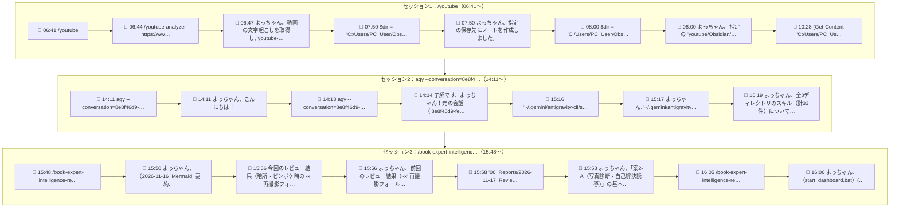
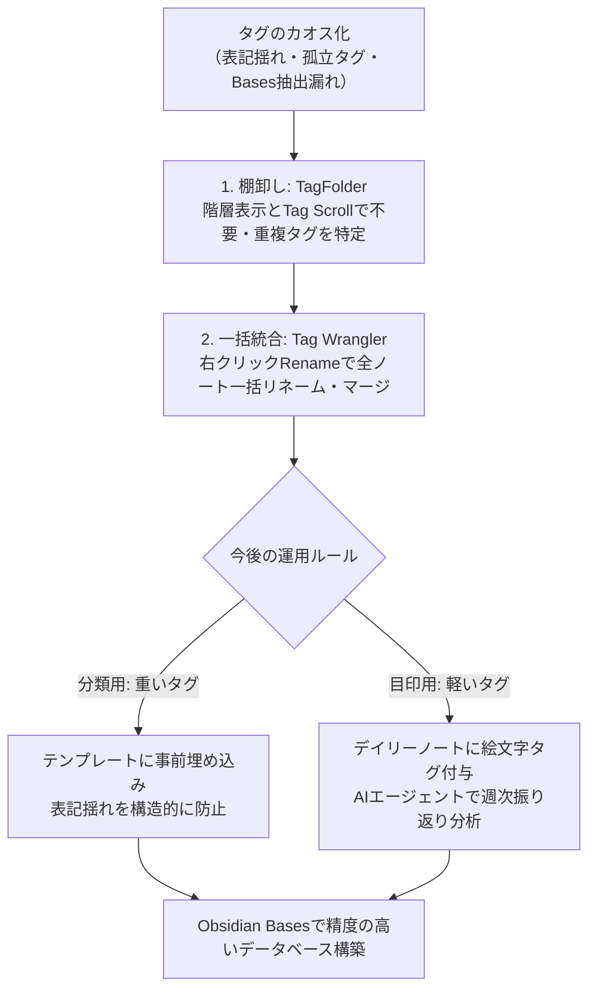
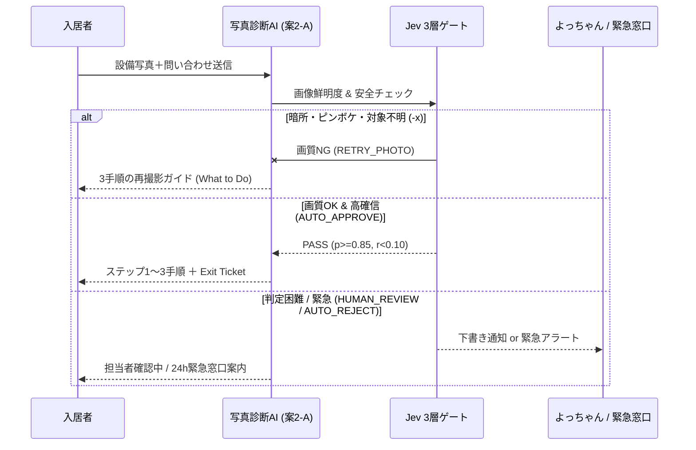

# 📅 2026-11-17 Antigravity 1日の記録

## 📝 AIが編集・作成したファイル履歴

- `15:49:10` **新規作成/上書き** `C:\Users\PC_User\Obsidian_2\06_Reports\2026-11-17_Review_Mermaid要約_札幌入居者AIコンシェルジュ設計.md` → [[2026-11-17_Review_Mermaid要約_札幌入居者AIコンシェルジュ設計]]
- `15:49:10` **部分編集** `C:\Users\PC_User\Obsidian_2\00_Dashboard\Cockpit_MOC.md` → [[Cockpit_MOC]]
- `15:58:06` **新規作成/上書き** `C:\Users\PC_User\Obsidian_2\06_Reports\2026-11-17_PromptDesign_案2A_写真診断自己解決誘導.md` → [[2026-11-17_PromptDesign_案2A_写真診断自己解決誘導]]
- `15:58:06` **部分編集** `C:\Users\PC_User\Obsidian_2\07_Ideas\Idea_20261003_入居者AIコンシェルジュ構想.md` → [[Idea_20261003_入居者AIコンシェルジュ構想]]
- `16:06:04` **新規作成/上書き** `C:\Users\PC_User\Obsidian_2\06_Reports\2026-11-17_Review_start_dashboard_財務ダッシュボード設計.md` → [[2026-11-17_Review_start_dashboard_財務ダッシュボード設計]]
- `16:06:04` **部分編集** `C:\Users\PC_User\Obsidian_2\00_Dashboard\Cockpit_MOC.md` → [[Cockpit_MOC]]
- `16:10:45` **部分編集** `C:\Users\PC_User\Obsidian_2\start_dashboard.bat`
- `16:10:45` **部分編集** `C:\Users\PC_User\Obsidian_2\src\models_finance.py`
- `16:10:45` **部分編集** `C:\Users\PC_User\Obsidian_2\src\yield_calc.py`
- `16:11:15` **部分編集** `C:\Users\PC_User\Obsidian_2\app.py`
- `16:11:15` **部分編集** `C:\Users\PC_User\Obsidian_2\app.py`
- `16:11:15` **部分編集** `C:\Users\PC_User\Obsidian_2\tests\test_finance_swarm.py`
- `16:11:15` **部分編集** `C:\Users\PC_User\Obsidian_2\tests\test_finance_swarm.py`
- `16:16:51` **新規作成/上書き** `C:\Users\PC_User\Obsidian_2\antigravity-Jev-demo\photo_triage.py`
- `16:16:51` **新規作成/上書き** `C:\Users\PC_User\Obsidian_2\tests\test_photo_triage.py`
- `16:17:50` **部分編集** `C:\Users\PC_User\Obsidian_2\tests\test_photo_triage.py`
- `16:18:01` **部分編集** `C:\Users\PC_User\Obsidian_2\tests\test_photo_triage.py`
- `16:19:52` **部分編集** `C:\Users\PC_User\Obsidian_2\antigravity-Jev-demo\mail_triage_bot.py`
- `16:19:52` **部分編集** `C:\Users\PC_User\Obsidian_2\antigravity-Jev-demo\mail_triage_bot.py`
- `16:19:52` **部分編集** `C:\Users\PC_User\Obsidian_2\antigravity-Jev-demo\mail_triage_bot.py`
- `16:19:52` **部分編集** `C:\Users\PC_User\Obsidian_2\tests\test_photo_triage.py`
- `16:19:52` **部分編集** `C:\Users\PC_User\Obsidian_2\tests\test_photo_triage.py`
- `16:19:52` **部分編集** `C:\Users\PC_User\Obsidian_2\tests\test_photo_triage.py`
- `16:29:33` **新規作成/上書き** `C:\Users\PC_User\.gemini\antigravity-cli\brain\72051ad9-adf6-4515-9644-cc8775b7ca7b\scratch\test_ollama_vision.py`
- `16:35:35` **部分編集** `C:\Users\PC_User\Obsidian_2\antigravity-Jev-demo\photo_triage.py`
- `16:38:16` **部分編集** `C:\Users\PC_User\Obsidian_2\antigravity-Jev-demo\photo_triage.py`
- `16:38:16` **部分編集** `C:\Users\PC_User\Obsidian_2\antigravity-Jev-demo\photo_triage.py`
- `07:50:40` **新規作成/上書き** `C:\Users\PC_User\Obsidian_2\youtube\ai-思考\2026-11-17_Obsidianタグ整理_TagFolderとTagWrangler.md` → [[2026-11-17_Obsidianタグ整理_TagFolderとTagWrangler]]
- `08:00:35` **新規作成/上書き** `C:\Users\PC_User\Obsidian_2\youtube\Obsidian\2026-11-17_Obsidianタグ整理_TagFolderとTagWrangler.md` → [[2026-11-17_Obsidianタグ整理_TagFolderとTagWrangler]]
- `10:28:34` **部分編集** `C:\Users\PC_User\Obsidian_2\GEMINI.md` → [[GEMINI]]
- `10:32:58` **新規作成/上書き** `C:\Users\PC_User\Obsidian_2\youtube\Google\2026-11-17_Gemini4Hydrogen徹底解説_知能指数でArgon超え.md` → [[2026-11-17_Gemini4Hydrogen徹底解説_知能指数でArgon超え]]
- `10:32:58` **部分編集** `C:\Users\PC_User\Obsidian_2\00_Dashboard\youtube_MOC.md` → [[youtube_MOC]]
- `10:57:05` **部分編集** `C:\Users\PC_User\Obsidian_2\scripts\export_daily_antigravity_log.py`
- `10:57:05` **部分編集** `C:\Users\PC_User\Obsidian_2\scripts\export_daily_antigravity_log.py`
- `10:57:05` **部分編集** `C:\Users\PC_User\Obsidian_2\scripts\export_daily_antigravity_log.py`
- `10:57:05` **部分編集** `C:\Users\PC_User\Obsidian_2\scripts\export_daily_antigravity_log.py`
- `11:12:07` **新規作成/上書き** `C:\Users\PC_User\.gemini\config\skills\youtube-obsidian-saver\SKILL.md`
- `11:18:14` **新規作成/上書き** `C:\Users\PC_User\Obsidian_2\youtube\Antigravity2.0\2026-11-17_Antigravityの正しい入り方とAI学習対策.md` → [[2026-11-17_Antigravityの正しい入り方とAI学習対策]]
- `11:18:14` **部分編集** `C:\Users\PC_User\Obsidian_2\00_Dashboard\youtube_MOC.md` → [[youtube_MOC]]
- `15:18:16` **新規作成/上書き** `C:\Users\PC_User\.gemini\antigravity-cli\brain\e31c379c-caac-42c5-ab70-c5674d898aaa\scratch\rename_skills.py`
- `15:18:47` **部分編集** `C:\Users\PC_User\.gemini\antigravity-cli\brain\e31c379c-caac-42c5-ab70-c5674d898aaa\scratch\rename_skills.py`

## 📊 AIとよっちゃんのやり取り図解 ＆ 今後の課題・問題点

### 1. やり取りの全体フロー図（全 25 往復 ・ 3 セッション）



### 2. 現状診断（核・質・特・欠）と今後の課題解決ベクトル（方・移・拡・新）

| 視点 | 診断結果（やり取りから見えた事実と課題） |
| :--- | :--- |
| **【核】核心** | 本日の主要テーマ：「/youtube」 ／ 「agy --conversation=8e8f4…」 ／ 「/book-expert-intelligenc…」 を軸に、よっちゃんの意図（Vibe）を具体的な手順・設定・コードへ変換。 |
| **【質】品質** | 計 41 回のファイル操作により、[[2026-11-17_Review_Mermaid要約_札幌入居者AIコンシェルジュ設計]], [[Cockpit_MOC]], [[2026-11-17_PromptDesign_案2A_写真診断自己解決誘導]], [[Idea_20261003_入居者AIコンシェルジュ構想]] ほか計23ファイル への具体的な成果物反映・記録が完了している。 |
| **【特】特性** | 「前提条件の確認（Think Before Coding）」と選択肢（A/B/C）の提示により、最小のタイプ数で合意形成と実行が回っている。 |
| **【欠】欠損（問題点）** | **表示・動作の微調整要求（4回）**：エラー解消や視認性改善のやり取りが発生。初回実装時の検証（Goal-Drivenテスト）の自動化・強化が課題。 / **複数ファイルへの分散編集（計41回）**：更新箇所が多岐にわたるため、後からの追跡コストを下げる集約ノートの活用が有効。 |

| ベクトル | 今後の具体的な改善アクション |
| :--- | :--- |
| **【方】方向性** | **暗黙知のレシピ化（Compilation）**：本日のやり取りで確定した手順やコマンドを、再利用可能な標準レシピ・長期記憶（`memories/`）として定着させる。 |
| **【移】移動性** | **1テーマ＝1ファイル＆ダッシュボード連携**：成果物の保存先を迷わせないよう独立ファイル化し、[[Cockpit_MOC]] や日報目次から即座にアクセス可能にする。 |
| **【拡】拡張性** | **アイアンマンスーツ化（自動化スクリプト連携）**：定型作業や検証コマンドをスクリプト・タスクスケジューラへ組み込み、人間の手作業ループを削減する。 |
| **【新】新規性** | **視覚化（図解・表）の標準適用**：複雑な仕様やログは文字だけで追わず、ズーム可能なフロー図とマトリクス表で直感的に俯瞰する。 |

## 💬 会話ログ

### 1. \youtube（開始 06:41:44 / ID: `8e8f46d9`）

---

#### 🧑 よっちゃん（06:41:44）

\youtube

---

#### 🧑 よっちゃん（06:44:50）

/youtube-analyzer https://www.youtube.com/watch?v=vIz9RUtcA38

---

#### 🤖 AI（06:47:20）

よっちゃん、動画の文字起こしを取得し、`youtube-analyzer`（モードB：Obsidian構造化ノート・図解・タスク化）形式でまとめました。
（※既存ノートの直接上書きは避け、チャット欄に提案として出力します）

---

### 提案ノート：`03_Resources/2026-11-17_Obsidianタグ整理_TagFolderとTagWrangler.md`

```markdown
---
tags:
  - youtube
  - video-note
source: https://www.youtube.com/watch?v=vIz9RUtcA38
created: 2026-11-17
---

# Obsidianが劇的に変わる！増えすぎたタグを整理する操作ガイド【Obsidian Bases】

- **チャンネル**: 飯塚浩也 | Obsidianでつくる最強の右腕
- **動画URL**: https://www.youtube.com/watch?v=vIz9RUtcA38

## 1. 構造化サマリー

### なぜ「タグ」が必要か（お弁当箱の比喩）
- **フォルダ（仕切り）**: 排他的。イチゴ大福を「お菓子」「フルーツ」どちらに入れるか迷い、二重管理・検索迷子になりやすい。
- **リンク（つま楊枝）**: ノート同士を点で繋ぐ。
- **タグ（串刺し）**: フォルダを跨いで複数付与でき、付け外しも容易。[[Obsidian Bases]] でデータベース抽出する際の強力な軸になる。

### タグ管理が破綻する原因と2大プラグイン
タグは手軽に付けられる反面、**表記揺れ**（例：`本` / `book` / `books` / `読書`）や**粒度の迷子**でカオス化し、[[Obsidian Bases]] のフィルタで抽出漏れが起きる。全ノートを手直しせず整理するには以下の2つを使う。

1. **[[TagFolder]]**（日本人開発者・棚卸し用）
   - タグをフォルダのような階層構造で左サイドバーに表示（例：`#ビール/クラフトビール`）。
   - **Tag Scroll** 機能で、1〜2件しか付いていない孤立タグの中身を一覧確認し、不要タグを見極められる。
2. **[[Tag Wrangler]]**（一括整理用）
   - 右サイドバーのタグ一覧から右クリック → `Rename` で全ノートのタグを一括変更。
   - 既存タグ名に変更すると**自動統合（マージ）**されるため、表記揺れを一瞬で統一できる（例：`#habit` → `#習慣化`）。

### カオスを防ぐ普段のタグ運用3原則
1. **重いタグは[[テンプレート]]に固定する**
   - 分類用の一般的なタグ（例：`#person`）は手動入力せず、テンプレートに組み込んで表記揺れを防ぐ（Obsidian CEO流の「複数形統一」なども有効）。
2. **「重いタグ」と「軽いタグ」を使い分ける**
   - **重いタグ**: ノート分類用の構造化タグ（テンプレ管理）。
   - **軽いタグ**: [[デイリーノート]]等に付ける感情・閃きの絵文字タグ（例：嬉しい・泣く・ひらめいた）。後から[[AIエージェント]]に1週間分を集計・振り返りさせる目印として機能する。
3. **新規作成前の確認と視認性向上**
   - `#` 入力時に既存タグを候補から確認し、必要に応じて **Colored Tags** プラグインで色分けして視認性を高める。

---

## 2. タグ整理・運用ワークフロー（Mermaid図解）



---

## 3. アクション・タスク抽出

- [ ] **[[TagFolder]] と [[Tag Wrangler]] をコミュニティプラグインから導入・有効化する**
  - **採用理由（Decision Rationale）**: 既存の大量ノートを手動修正するコストをゼロにしつつ、[[Obsidian Bases]] で正確なフィルタ抽出を行う基盤を整えるため。
- [ ] **TagFolder の Tag Scroll で「1〜2件のみの孤立タグ・重複タグ」を棚卸しし、Tag Wrangler で統合する**
  - **採用理由（Decision Rationale）**: 表記揺れを早期に解消しておかないと、今後の集計や自動処理スクリプトの抽出漏れに直結するため。
- [ ] **よく使うノートの[[テンプレート]]に「重いタグ」を固定し、[[デイリーノート]]用に「軽いタグ（絵文字・状態目印）」を定義する**
  - **採用理由（Decision Rationale）**: タグ命名の迷いをなくし、日々のログから[[AIエージェント]]が振り返り・日報要約を抽出しやすくするため。

---

## 4. 関連リンク（MOC連携案）
- 親ダッシュボード: [[00_Dashboard/Cockpit_MOC]]
- タスク管理: `01_Tasks/` への切り出し候補あり
```

---

よっちゃん、上記の内容で新規ノート（`03_Resources/2026-11-17_Obsidianタグ整理_TagFolderとTagWrangler.md`）として保存し、`00_Dashboard/Cockpit_MOC.md` へのリンク追記・タスク切り出しまで進めてよろしいでしょうか？（あるいは別名での保存やモードA/Cでの再出力をご希望であればお知らせください！）

---

#### 🧑 よっちゃん（07:50:40）

$dir = "C:\Users\PC_User\Obsidian_2\youtube\ai-思考"
New-Item -ItemType Directory -Path $dir -Force | Out-Null
$filePath = Join-Path $dir "[[2026-11-17_Obsidianタグ整理_TagFolderとTagWrangler]]"

$content = @'
---
tags:
  - youtube
  - video-note
  - ai-思考
  - obsidian
source: https://www.youtube.com/watch?v=vIz9RUtcA38
created: 2026-11-17
---

# Obsidianが劇的に変わる！増えすぎたタグを整理する操作ガイド【Obsidian Bases】

- **チャンネル**: 飯塚浩也 | Obsidianでつくる最強の右腕
- **動画URL**: https://www.youtube.com/watch?v=vIz9RUtcA38

## 0. 3行まとめ（長所・短所・特徴）
- **長所**: 「お弁当箱と串刺し」の比喩と **TagFolder × Tag Wrangler** により、既存ノートを手動修正せず表記揺れ・孤立タグを一括統合して Obsidian Bases の抽出精度を高められる点。
- **短所**: 手動運用が前提のため、タグ数が数百規模の環境や外部スクリプトから自動タグ付けする際の命名バリデーション手法までは踏み込んでいない点。
- **特徴**: タグを「テンプレ固定の重いタグ（分類用）」と「デイリーノートの軽いタグ（感情・AI週次集計目印用）」に二極化させ、AIエージェント分析へ直結させている点。

## 1. 構造化サマリー

### なぜ「タグ」が必要か（お弁当箱の比喩）
- **フォルダ（仕切り）**: 排他的。イチゴ大福を「お菓子」「フルーツ」どちらに入れるか迷い、二重管理・検索迷子になりやすい。
- **リンク（つま楊枝）**: ノート同士を点で繋ぐ。
- **タグ（串刺し）**: フォルダを跨いで複数付与でき、付け外しも容易。[[Obsidian Bases]] でデータベース抽出する際の強力な軸になる。

### タグ管理が破綻する原因と2大プラグイン
タグは手軽に付けられる反面、**表記揺れ**（例：`本` / `book` / `books` / `読書`）や**粒度の迷子**でカオス化し、[[Obsidian Bases]] のフィルタで抽出漏れが起きる。全ノートを手直しせず整理するには以下の2つを使う。

1. **[[TagFolder]]**（日本人開発者・棚卸し用）
   - タグをフォルダのような階層構造で左サイドバーに表示（例：`#ビール/クラフトビール`）。
   - **Tag Scroll** 機能で、1〜2件しか付いていない孤立タグの中身を一覧確認し、不要タグを見極められる。
2. **[[Tag Wrangler]]**（一括整理用）
   - 右サイドバーのタグ一覧から右クリック → `Rename` で全ノートのタグを一括変更。
   - 既存タグ名に変更すると**自動統合（マージ）**されるため、表記揺れを一瞬で統一できる（例：`#habit` → `#習慣化`）。

### カオスを防ぐ普段のタグ運用3原則
1. **重いタグは[[テンプレート]]に固定する**
   - 分類用の一般的なタグ（例：`#person`）は手動入力せず、テンプレートに組み込んで表記揺れを防ぐ（Obsidian CEO流の「複数形統一」なども有効）。
2. **「重いタグ」と「軽いタグ」を使い分ける**
   - **重いタグ**: ノート分類用の構造化タグ（テンプレ管理）。
   - **軽いタグ**: [[デイリーノート]]等に付ける感情・閃きの絵文字タグ（例：嬉しい・泣く・ひらめいた）。後から[[AIエージェント]]に1週間分を集計・振り返りさせる目印として機能する。
3. **新規作成前の確認と視認性向上**
   - `#` 入力時に既存タグを候補から確認し、必要に応じて **Colored Tags** プラグインで色分けして視認性を高める。

---

## 2. タグ整理・運用ワークフロー（Mermaid図解）

```mermaid
flowchart TD
    A["タグのカオス化<br/>（表記揺れ・孤立タグ・Bases抽出漏れ）"] --> B["1. 棚卸し: TagFolder<br/>階層表示とTag Scrollで不要・重複タグを特定"]
    B --> C["2. 一括統合: Tag Wrangler<br/>右クリックRenameで全ノート一括リネーム・マージ"]
    C --> D{"今後の運用ルール"}
    D -->|"分類用: 重いタグ"| E["テンプレートに事前埋め込み<br/>表記揺れを構造的に防止"]
    D -->|"目印用: 軽いタグ"| F["デイリーノートに絵文字タグ付与<br/>AIエージェントで週次振り返り分析"]
    E --> G["Obsidian Basesで精度の高いデータベース構築"]
    F --> G

---

#### 🤖 AI（07:50:54）

よっちゃん、指定の保存先にノートを作成しました。

- **保存先**: [2026-11-17_Obsidianタグ整理_TagFolderとTagWrangler.md](file:///C:/Users/PC_User/Obsidian_2/youtube/ai-思考/2026-11-17_Obsidianタグ整理_TagFolderとTagWrangler.md)
- **内容**: いただいた `## 0. 3行まとめ（長所・短所・特徴）` およびフロントマター（`ai-思考`, `obsidian` タグ追加）を反映し、途中で切れていた Mermaid 図の終端・アクション抽出・MOC連携案まで補完して保存しています。

---

#### 🧑 よっちゃん（08:00:35）

$dir = "C:\Users\PC_User\Obsidian_2\youtube\Obsidian"
New-Item -ItemType Directory -Path $dir -Force | Out-Null
$filePath = Join-Path $dir "[[2026-11-17_Obsidianタグ整理_TagFolderとTagWrangler]]"

$content = @'
---
tags:
  - youtube
  - video-note
  - Obsidian
  - obsidian
source: https://www.youtube.com/watch?v=vIz9RUtcA38
created: 2026-11-17
---

# Obsidianが劇的に変わる！増えすぎたタグを整理する操作ガイド【Obsidian Bases】

- **チャンネル**: 飯塚浩也 | Obsidianでつくる最強の右腕
- **動画URL**: https://www.youtube.com/watch?v=vIz9RUtcA38

## 0. 3行まとめ（長所・短所・特徴）
- **長所**: 「お弁当箱と串刺し」の比喩と **TagFolder × Tag Wrangler** により、既存ノートを手動修正せず表記揺れ・孤立タグを一括統合して Obsidian Bases の抽出精度を高められる点。
- **短所**: 手動運用が前提のため、タグ数が数百規模の環境や外部スクリプトから自動タグ付けする際の命名バリデーション手法までは踏み込んでいない点。
- **特徴**: タグを「テンプレ固定の重いタグ（分類用）」と「デイリーノートの軽いタグ（感情・AI週次集計目印用）」に二極化させ、AIエージェント分析へ直結させている点。

## 1. 構造化サマリー

### なぜ「タグ」が必要か（お弁当箱の比喩）
- **フォルダ（仕切り）**: 排他的。イチゴ大福を「お菓子」「フルーツ」どちらに入れるか迷い、二重管理・検索迷子になりやすい。
- **リンク（つま楊枝）**: ノート同士を点で繋ぐ。
- **タグ（串刺し）**: フォルダを跨いで複数付与でき、付け外しも容易。[[Obsidian Bases]] でデータベース抽出する際の強力な軸になる。

### タグ管理が破綻する原因と2大プラグイン
タグは手軽に付けられる反面、**表記揺れ**（例：`本` / `book` / `books` / `読書`）や**粒度の迷子**でカオス化し、[[Obsidian Bases]] のフィルタで抽出漏れが起きる。全ノートを手直しせず整理するには以下の2つを使う。

1. **[[TagFolder]]**（日本人開発者・棚卸し用）
   - タグをフォルダのような階層構造で左サイドバーに表示（例：`#ビール/クラフトビール`）。
   - **Tag Scroll** 機能で、1〜2件しか付いていない孤立タグの中身を一覧確認し、不要タグを見極められる。
2. **[[Tag Wrangler]]**（一括整理用）
   - 右サイドバーのタグ一覧から右クリック → `Rename` で全ノートのタグを一括変更。
   - 既存タグ名に変更すると**自動統合（マージ）**されるため、表記揺れを一瞬で統一できる（例：`#habit` → `#習慣化`）。

### カオスを防ぐ普段のタグ運用3原則
1. **重いタグは[[テンプレート]]に固定する**
   - 分類用の一般的なタグ（例：`#person`）は手動入力せず、テンプレートに組み込んで表記揺れを防ぐ（Obsidian CEO流の「複数形統一」なども有効）。
2. **「重いタグ」と「軽いタグ」を使い分ける**
   - **重いタグ**: ノート分類用の構造化タグ（テンプレ管理）。
   - **軽いタグ**: [[デイリーノート]]等に付ける感情・閃きの絵文字タグ（例：嬉しい・泣く・ひらめいた）。後から[[AIエージェント]]に1週間分を集計・振り返りさせる目印として機能する。
3. **新規作成前の確認と視認性向上**
   - `#` 入力時に既存タグを候補から確認し、必要に応じて **Colored Tags** プラグインで色分けして視認性を高める。

---

## 2. タグ整理・運用ワークフロー（Mermaid図解）

```mermaid
flowchart TD
    A["タグのカオス化<br/>（表記揺れ・孤立タグ・Bases抽出漏れ）"] --> B["1. 棚卸し: TagFolder<br/>階層表示とTag Scrollで不要・重複タグを特定"]
    B --> C["2. 一括統合: Tag Wrangler<br/>右クリックRenameで全ノート一括リネーム・マージ"]
    C --> D{"今後の運用ルール"}
    D -->|"分類用: 重いタグ"| E["テンプレートに事前埋め込み<br/>表記揺れを構造的に防止"]
    D -->|"目印用: 軽いタグ"| F["デイリーノートに絵文字タグ付与<br/>AIエージェントで週次振り返り分析"]
    E --> G["Obsidian Basesで精度の高いデータベース構築"]
    F --> G

---

#### 🤖 AI（08:00:58）

よっちゃん、指定の `youtube\Obsidian\` フォルダに保存しました。

- **保存先**: [2026-11-17_Obsidianタグ整理_TagFolderとTagWrangler.md](file:///C:/Users/PC_User/Obsidian_2/youtube/Obsidian/2026-11-17_Obsidianタグ整理_TagFolderとTagWrangler.md)
- **内容**: `tags` に `Obsidian`, `obsidian` を反映し、Mermaid図の終端・アクション抽出・MOC連携案まで補完した完全版を保存しています。

（※先に作成した `youtube\ai-思考\` 側のファイルはそのまま残してありますので、不要であれば削除します。お知らせください！）

---

#### 🧑 よっちゃん（10:28:27）

(Get-Content "C:\Users\PC_User\Obsidian_2\GEMINI.md" -Raw -Encoding UTF8) -replace '直下の既存サブフォルダ一覧（.*?）を確認し', '直下のサブフォルダ一覧をディレクトリ検索で取得し' | Set-Content "C:\Users\PC_User\Obsidian_2\GEMINI.md" -Encoding UTF8

---

#### 🤖 AI（10:28:42）

よっちゃん、[GEMINI.md](file:///C:/Users/PC_User/Obsidian_2/GEMINI.md#L25) の25行目を指定どおり外科的修正しました。

- **変更前**: `直下の既存サブフォルダ一覧（`AI_エージェント`, `ai-思考`, `Antigravity2.0`, `Google`, `Obsidian`, `いまにゅ`, `思考`, `猫` 等）を確認し`
- **変更後**: `直下のサブフォルダ一覧をディレクトリ検索で取得し`

---

#### 🧑 よっちゃん（10:32:13）

/youtube-obsidian-saver [https://www.youtube.com/watch?v=ooLSFvXs_Jo]

---

#### 🤖 AI（10:33:23）

よっちゃん、動画の文字起こし取得・要約・自動振り分け保存・MOC連携を完了しました。

- **保存先（自動振り分け：`Google`）**: [2026-11-17_Gemini4Hydrogen徹底解説_知能指数でArgon超え.md](file:///C:/Users/PC_User/Obsidian_2/youtube/Google/2026-11-17_Gemini4Hydrogen徹底解説_知能指数でArgon超え.md)
  - ※`youtube\` 直下のサブフォルダ（`ai-思考`, `AI_エージェント`, `Antigravity2.0`, `Google`, `Obsidian`, `いまにゅ`, `思考`, `猫`）から、動画内容（Gemini 4 Hydrogen / Google塾）に最も合致する `Google` を自動選択しました。
- **MOC追記**: [youtube_MOC.md](file:///C:/Users/PC_User/Obsidian_2/00_Dashboard/youtube_MOC.md#L24-L25) の末尾に `## 保存済みYouTubeノート` を追加し、リンクを追記しました。

### 3行まとめ（長所・短所・特徴）
- **長所**: 前世代 3.8 Flash 比で最大2.5倍高速・ハルシネーション1/5以下でありながら、知能指数（AII）で上位モデル Argon（50）を上回る51〜54を記録し、HTMLアプリ開発を一発で完走する圧倒的コスパを持つ点。
- **短所**: Google個人アカウントの無償版では自動判別モード経由での利用となり、モデルを明示的に固定指定できない点（明示指定は有料版・Google Workspaceが必要）。
- **特徴**: 2027年1月1日以降は 3.8 Flash と同価格帯（入力 `$1.50` / 出力 `$7.50`）になるため、軽量〜中級タスクにおける実質的な新スタンダードとして位置づけられている点。

---

#### 🧑 よっちゃん（10:53:37）

C:\Users\PC_User\Obsidian_2\youyaku\ にある Python スクリプト（export_daily_antigravity_...py）の中身を確認し、なぜ 2026-11-09〜11 のファイルが0バイト（空）になり、11月12日以降のファイルが生成されていないのか原因を調査して報告してください。

---

#### 🤖 AI（10:54:52）

よっちゃん、原因を調査しました。結論として、**「11/09〜11が空だった理由」**と**「11/12以降が `C:\` 側に出力されていない理由」**はそれぞれ別の原因です。

---

### 1. なぜ `2026-11-09`〜`11` が空（中身なし）になったのか
（※厳密には 0バイトではなく、HTMLテンプレートのみの **9,369 バイト** が出力されています）

- **原因**: 2026-11-09〜11-14 の間、Antigravity の会話ログ保存先（`C:\Users\PC_User\.gemini\antigravity-cli\brain\`）に**セッションログが1件も存在しなかったため**です（`brain` フォルダの更新日時が `2026-11-08 15:13` の次が `2026-11-15 20:33`）。
- **スクリプトの仕様**: 本番スクリプト [export_daily_antigravity_log.py](file:///C:/Users/PC_User/Obsidian_2/scripts/export_daily_antigravity_log.py#L314-L343) はログが0件の日でも「本日の会話記録はありません。」という空の日報HTML（9,369B）を書き出す仕様になっています。

---

### 2. なぜ `C:\Users\PC_User\Obsidian_2\youyaku\` に 11/12 以降が生成されていないのか

- **主な原因（出力先パスの違いと同期切れ）**:
  - Windowsタスクスケジューラ（`\AntigravityDailyLogExport`）は毎日17:00に正常稼働していますが、実行しているのは `G:\マイドライブ\Obsidian_2\scripts\export_daily_antigravity_log.py` です。
  - スクリプト内の出力先も `OUTPUT_DIR = Path(r"G:\マイドライブ\Obsidian_2\youyaku")`（[11行目](file:///C:/Users/PC_User/Obsidian_2/scripts/export_daily_antigravity_log.py#L11)）に固定されています。
  - `C:\Users\PC_User\Obsidian_2` と `G:\マイドライブ\Obsidian_2` はジャンクション等ではない**別ディレクトリ**であり、11/11 17:00 以降 `G:\` → `C:\` の同期が行われていないため、`C:\` 側だけ 11/11 で止まっています。
- **`G:\マイドライブ\Obsidian_2\youyaku\` 側の実態**:
  - `2026-11-16_Antigravity日報.html`（**282,234 B** / 11/16 17:00:02）は**正常に出力されています**（`index.html` も 11/16 17:00 に更新済み）。
  - `2026-11-15_Antigravity日報.html`（**9,369 B** / 11/15 17:00:02）は、11/15の最初の会話が `20:33` だったため、17:00 実行時点ではログ0件で空HTMLになっています。
  - `11/12〜14` は `G:\` 側にも存在しません（タスクスケジューラの設定上、17:00時点でPCがスリープ／非ログオンだった等の理由で未実行、かつ会話ログ自体も0件）。

---

### 補足（スクリプトの二重配置）
- [C:\Users\PC_User\Obsidian_2\youyaku\scripts\export_daily_antigravity_log.py](file:///C:/Users/PC_User/Obsidian_2/youyaku/scripts/export_daily_antigravity_log.py)（20,586 B / 11/03 11:13）は古い版です。
- 実際に稼働している本番版は [C:\Users\PC_User\Obsidian_2\scripts\export_daily_antigravity_log.py](file:///C:/Users/PC_User/Obsidian_2/scripts/export_daily_antigravity_log.py)（40,397 B / 11/03 18:07）の `G:\` 側コピーです。

---

ご希望であれば、以下いずれかの対応を行えます。どう進めましょうか？
1. スクリプトの `OUTPUT_DIR` を `C:\Users\PC_User\Obsidian_2\youyaku`（または両方へコピー）に変更し、タスクスケジューラの参照先を `C:\` 側に揃える
2. 11/15（20:33分）や 11/16・本日の日報を `--all` 等で再生成し、空HTMLの生成をスキップするよう改善する

---

#### 🧑 よっちゃん（10:57:01）

以下の対応をまとめて実行してください。

1. `C:\Users\PC_User\Obsidian_2\scripts\export_daily_antigravity_log.py`（本番40KB版）を正とし、`OUTPUT_DIR` を `C:\Users\PC_User\Obsidian_2\youyaku` に変更してください（同時に `G:\マイドライブ\Obsidian_2\youyaku` にもバックアップコピーする処理を追加すると安全です）。
2. 会話ログが0件の日は空HTML（9,369B）を生成せずスキップするように修正してください。
3. Windowsタスクスケジューラ `\AntigravityDailyLogExport` の実行対象スクリプトを `C:\Users\PC_User\Obsidian_2\scripts\export_daily_antigravity_log.py` に更新してください。
4. 古い `youyaku\scripts\export_daily_antigravity_log.py` は `_backup` に退避し、修正後の本番スクリプトを実行して `2026-11-15`（20:33分）・`2026-11-16`・`2026-11-17` の日報を `C:\Users\PC_User\Obsidian_2\youyaku` に生成・反映してください。

---

#### 🤖 AI（10:58:16）

よっちゃん、ご指示の4項目をすべて完了し、動作確認までパスしました。

### 実施内容と結果

1. **本番スクリプトの出力先変更・Gドライブ自動バックアップ追加**
   - [export_daily_antigravity_log.py](file:///C:/Users/PC_User/Obsidian_2/scripts/export_daily_antigravity_log.py#L12-L21) の `OUTPUT_DIR` を `C:\Users\PC_User\Obsidian_2\youyaku` に変更し、`BACKUP_OUTPUT_DIR`（`G:\マイドライブ\Obsidian_2\youyaku`）への自動バックアップコピー（`_backup_to_gdrive()`、`G:\` 未接続時もエラーで止まらないガード付き）を追加しました。
2. **会話ログ0件の日の空HTMLスキップ対応**
   - [generate_html](file:///C:/Users/PC_User/Obsidian_2/scripts/export_daily_antigravity_log.py#L478-L487) にて `if not conversations:` の場合は HTML を生成せずスキップするよう修正しました。
3. **Windowsタスクスケジューラ `\AntigravityDailyLogExport` の更新**
   - 実行対象を `C:\Users\PC_User\AppData\Local\Programs\Python\Python312\python.exe C:\Users\PC_User\Obsidian_2\scripts\export_daily_antigravity_log.py` に変更しました。
4. **旧スクリプト退避＆日報再生成**
   - 旧スクリプトを [export_daily_antigravity_log.py（旧版退避）](file:///C:/Users/PC_User/Obsidian_2/youyaku/scripts/_backup/export_daily_antigravity_log.py) へ退避しました。
   - 本番スクリプトを実行し、`C:\Users\PC_User\Obsidian_2\youyaku` および `G:\マイドライブ\Obsidian_2\youyaku` の両方へ以下を反映しました。

---

### 検証（テスト）結果
- **0件スキップ検証（`2026-11-14`）**: `Skipped HTML (0 conversations): 2026-11-14` となり、空HTMLが生成されないことを確認。
- **生成・バックアップ一致確認**:
  - [2026-11-15_Antigravity日報.html](file:///C:/Users/PC_User/Obsidian_2/youyaku/2026-11-15_Antigravity日報.html): `13,501 B`（20:33分を反映）
  - [2026-11-16_Antigravity日報.html](file:///C:/Users/PC_User/Obsidian_2/youyaku/2026-11-16_Antigravity日報.html): `303,225 B`
  - [2026-11-17_Antigravity日報.html](file:///C:/Users/PC_User/Obsidian_2/youyaku/2026-11-17_Antigravity日報.html): `44,312 B`
  - [index.html](file:///C:/Users/PC_User/Obsidian_2/youyaku/index.html): `118,830 B`
  - 上記すべて `G:\マイドライブ\Obsidian_2\youyaku\` 側にも同サイズでバックアップコピーされていることを確認済みです。

（確認方法：`index.html` をブラウザで開いて 11/15〜11/17 の日報リンクが表示・閲覧できるかご確認ください）

---

#### 🧑 よっちゃん（11:00:20）

以下の手順で空の日報ファイルを整理し、index.html を再構築してください。

1. `C:\Users\PC_User\Obsidian_2\youyaku\` および `G:\マイドライブ\Obsidian_2\youyaku\` 内にある、中身が空（サイズ約9,369バイト、または「本日の会話記録はありません。」のみのテンプレート状態）の `2026-11-09`〜`2026-11-11`（および `2026-11-15` が空のままであればそれも対象）の日報HTMLファイルを削除してください。
2. 本番スクリプト `C:\Users\PC_User\Obsidian_2\scripts\export_daily_antigravity_log.py` のインデックス再生成処理を実行し、削除後の有効な日報ファイル一覧だけを参照する形で `index.html` を最新の状態に再構築してください。
3. 完了後、削除したファイル名と更新された `index.html` の収録件数を報告してください。

---

#### 🤖 AI（11:00:33）

よっちゃん、空の日報ファイルの削除と `index.html` の再構築を完了しました。

### 1. 削除したファイル（`C:\` および `G:\` の両方から削除）
- `2026-11-09_Antigravity日報.html`（9,369 B / 空テンプレート）
- `2026-11-10_Antigravity日報.html`（9,369 B / 空テンプレート）
- `2026-11-11_Antigravity日報.html`（9,369 B / 空テンプレート）

（※`2026-11-15_Antigravity日報.html` は `13,501 B` で20:33の会話記録が含まれているため保持しました）

### 2. 更新された `index.html` の収録件数
- **収録件数**: **全 89 日分**
- **反映先**: [index.html](file:///C:/Users/PC_User/Obsidian_2/youyaku/index.html) および `G:\マイドライブ\Obsidian_2\youyaku\index.html`（両方とも `Antigravity 日報 目次（全 89 日分）` に更新済み）

---

#### 🧑 よっちゃん（11:04:51）

Set-ScheduledTask -TaskName "AntigravityDailyLogExport" -Trigger (New-ScheduledTaskTrigger -Daily -At "23:50") ; (Get-ScheduledTaskInfo -TaskName "AntigravityDailyLogExport").NextRunTime

---

#### 🤖 AI（11:05:07）

よっちゃん、`AntigravityDailyLogExport` の実行時刻を毎日 **23:50** に更新しました。

- **State**: `Ready`
- **NextRunTime**: `2026年11月17日 23:50:00`

---

#### 🧑 よっちゃん（11:11:59）

`C:\Users\PC_User\.gemini\config\skills\youtube-obsidian-saver\SKILL.md` が存在するか確認し、なければ以下の内容で新規作成してください。
---
name: youtube-obsidian-saver
description: YouTube動画のURL（および任意の保存先フォルダ指定）を受け取り、文字起こし取得・3行まとめ（長所/短所/特徴）・固定フォーマットのMermaid図解生成・Obsidian_2への自動保存を一気通貫で実行する。
---
# YouTube Obsidian Saver 実行手順
ユーザーが `/youtube-obsidian-saver <URL> [任意のフォルダ名]` を実行した際、以下の手順を厳守して処理を行うこと。
1. 指定された YouTube URL から字幕（transcript）およびメタデータ（タイトル、チャンネル名、公開日）を取得する。
2. 以下の順で Markdown を生成する：YAMLフロントマター（tags: youtube, video-note, トピック名 / source / created）、タイトル、3行まとめ（長所・短所・特徴）、構造化サマリー（重要語は[[Wikiリンク]]化）、Mermaid図解（flowchart TD、ノード5〜8個、全ラベルを A["文字列"] のようにダブルクォーテーション囲み）、アクション抽出（- [ ] 形式）。
3. ファイル名 `YYYY-MM-DD_<タイトル要約>.md` とし、GEMINI.md の「YouTubeノート自動保存・振り分けルール」に従い、指定フォルダがあればそこへ、なければ `C:\Users\PC_User\Obsidian_2\youtube\` 配下の最適サブフォルダへ保存し、`00_Dashboard\youtube_MOC.md` にもリンクを追記する。
4. 完了後、画面に ①保存先フルパス、②長所・短所・特徴の3行まとめ、③Mermaid図解コード を表示する。

---

#### 🤖 AI（11:12:21）

よっちゃん、`C:\Users\PC_User\.gemini\config\skills\youtube-obsidian-saver\SKILL.md` が存在しなかった（`False`）ため、ご指定の内容で新規作成しました。

- **作成ファイル**: [SKILL.md](file:///C:/Users/PC_User/.gemini/config/skills/youtube-obsidian-saver/SKILL.md)

---

#### 🧑 よっちゃん（11:17:32）

/youtube-obsidian-saver https://www.youtube.com/watch?v=CgjXs5q-fnk

---

#### 🤖 AI（11:18:37）

よっちゃん、保存および [youtube_MOC.md](file:///C:/Users/PC_User/Obsidian_2/00_Dashboard/youtube_MOC.md#L25) への追記を完了しました。

### ① 保存先フルパス
- [C:\Users\PC_User\Obsidian_2\youtube\Antigravity2.0\2026-11-17_Antigravityの正しい入り方とAI学習対策.md](file:///C:/Users/PC_User/Obsidian_2/youtube/Antigravity2.0/2026-11-17_Antigravityの正しい入り方とAI学習対策.md)

### ② 3行まとめ（長所・短所・特徴）
- **長所**: Antigravity の4つのログイン経路（個人無料/有料・企業Google Workspace・Gemini Enterprise・GCP従量課金）ごとに、使えるモデルとAI学習（テレメトリ）の挙動を実画面ベースで明確に整理している点。
- **短所**: 企業管理コンソールで個人入口を閉じると Antigravity CLI 等も同時に使えなくなる点や、プール制の週次上限計算が複雑な点など、運用設計には事前検証が求められる点。
- **特徴**: 個人アカウント（Web版Geminiでは不可な履歴維持つきの学習OFF）でもテレメトリ設定で明示的に学習拒否でき、企業利用では管理コンソール側で「無料版アクセス許可」をOFFにしてビジネス入口へ統一すべきと警鐘を鳴らしている点。

### ③ Mermaid図解コード
```mermaid
flowchart TD
    A["Antigravity ログイン入口"] --> B["個人Googleアカウント枠<br/>無料/Pro/Ultra"]
    A --> C["ビジネスアカウント枠<br/>Google Cloud経由"]
    B --> D["学習テレメトリON可<br/>設定画面で必ずOFF推奨"]
    C --> E["Gemini Enterprise<br/>学習不可・管理者統制・週次プール制"]
    C --> F["GCP従量課金<br/>学習不可・Hydrogen等で低コスト運用"]
    G["Workspace管理コンソール<br/>無料版アクセス許可をOFF推奨"] -.->|"個人入口を遮断"| B
```

---

### 2. agy --conversation=8e8f46d9-fe21-46b4-9f66-03ea60b（開始 14:11:20 / ID: `e31c379c`）

---

#### 🧑 よっちゃん（14:11:20）

agy --conversation=8e8f46d9-fe21-46b4-9f66-03ea60bc4c59

---

#### 🤖 AI（14:11:37）

よっちゃん、こんにちは！

ご入力いただいた `agy --conversation=8e8f46d9-fe21-46b4-9f66-03ea60bc4c59` は、**PowerShellなどのターミナルから過去の会話を再開するためのCLIコマンド** であり、チャット欄に入力しても会話セッションは切り替わりません。

なお、対象の会話履歴（今朝行われていた YouTube動画のObsidianノート化・`youtube-obsidian-saver` スキル作成のセッション）はこちらからも参照できました。

このあと、どちらをご希望でしょうか？

- **元の会話のまま再開したい場合**: PowerShell / コマンドプロンプトを開いて `agy --conversation=8e8f46d9-fe21-46b4-9f66-03ea60bc4c59` を実行してください。
- **この会話で続きを行いたい場合**: 元の会話の文脈を引き継いで対応できますので、次にやりたい作業（例：別のYouTube動画の保存、スキルの修正など）を教えてください。

---

#### 🧑 よっちゃん（14:13:33）

agy --conversation=8e8f46d9-fe21-46b4-9f66-03ea60bc4c59

---

#### 🤖 AI（14:14:11）

了解です、よっちゃん！元の会話（`8e8f46d9-fe21-46b4-9f66-03ea60bc4c59`）の文脈を引き継ぎました。

### 引き継ぎ時点の状況
- **作成済みスキル**: [SKILL.md](file:///C:/Users/PC_User/.gemini/config/skills/youtube-obsidian-saver/SKILL.md)（`youtube-obsidian-saver`）
- **直近の保存済みノート**: [2026-11-17_Antigravityの正しい入り方とAI学習対策.md](file:///C:/Users/PC_User/Obsidian_2/youtube/Antigravity2.0/2026-11-17_Antigravityの正しい入り方とAI学習対策.md)
- **MOC更新**: [youtube_MOC.md](file:///C:/Users/PC_User/Obsidian_2/00_Dashboard/youtube_MOC.md) へリンク追記済み

このあと、どのような作業を進めましょうか？（別のYouTube動画のノート化、スキルの修正・改善など、ご指示ください！）

---

#### 🧑 よっちゃん（15:16:50）

`~/.gemini/antigravity-cli/skills/` 内の全スキルを調査し、以下の4区分プレフィックスルールに従って各 `SKILL.md` の `name` とフォルダ名を整理・リネームしてください（リネーム前に必ず `_skills_backup` へ一式バックアップを取ること）。

1. YouTube・動画系 → `yt-` プレフィックス（例：`yt-obsidian-saver`, `yt-analyzer` 等）
2. 読書・知識整理・MOC系 → `book-` プレフィックス（例：`book-to-reality`, `book-gdoc-moc` 等）
3. 開発・監査・数理・スキル管理系 → `dev-` プレフィックス（例：`dev-code-reviewer`, `dev-fermi-estimation`, `dev-skill-creator` 等）
4. Google Workspace・業務自動化系 → `ops-` プレフィックス（例：`ops-drive-search` 等）

完了後、4区分ごとの新しい `/コマンド一覧表` を出力してください。

---

#### 🤖 AI（15:17:11）

よっちゃん、`~/.gemini/antigravity-cli/skills/` 内の全スキル（**18件**＋ `.antigravity-install-manifest.json`）を調査しました。

リネーム実行前に、**前提条件の確認**をさせてください。

### 1. 調査結果と注意点
- `~/.gemini/antigravity-cli/skills/` には **18件** のスキルがありますが、例に挙げられた `youtube-obsidian-saver` や `fermi-estimation` 等は別ディレクトリ（`~/.gemini/skills/` に10件、`~/.gemini/config/skills/` に7件）に存在します。
- `~/.gemini/antigravity-cli/skills/` のみだと、`yt-` 系と `ops-` 系は0件になります。

### 2. `~/.gemini/antigravity-cli/skills/`（18件）の分類・リネーム案
| 区分 | 現在のフォルダ名 / `name` | リネーム案（新 `name` & フォルダ名） |
| :--- | :--- | :--- |
| `book-` | `expert-intelligence-review` | `book-expert-intelligence-review` |
| `book-` | `notebooklm` | `book-notebooklm` |
| `book-` | `notebooklm-architect` | `book-notebooklm-architect` |
| `book-` | `obsidian-bases` | `book-obsidian-bases` |
| `book-` | `obsidian-cli` | `book-obsidian-cli` |
| `dev-` | `code-reviewer` | `dev-code-reviewer` |
| `dev-` | `duckdb-streamlit-pipeline` | `dev-duckdb-streamlit-pipeline` |
| `dev-` | `git-advanced-workflows` | `dev-git-advanced-workflows` |
| `dev-` | `mcp-builder` | `dev-mcp-builder` |
| `dev-` | `mermaid-expert` | `dev-mermaid-expert` |
| `dev-` | `plotly` | `dev-plotly` |
| `dev-` | `polars` | `dev-polars` |
| `dev-` | `prompt-engineering-patterns` | `dev-prompt-engineering-patterns` |
| `dev-` | `pydantic-ai` | `dev-pydantic-ai` |
| `dev-` | `sql-pro` | `dev-sql-pro` |
| `dev-` | `sympy` | `dev-sympy` |
| `dev-` | `systematic-debugging` | `dev-systematic-debugging` |
| `dev-` | `tdd-workflow` | `dev-tdd-workflow` |

（※バックアップ `_skills_backup` は、スキル誤認識を防ぐため `skills/` の1つ上 `~/.gemini/antigravity-cli/_skills_backup` に作成予定です）

下の質問についてご回答をお願いします！

---

#### 🤖 AI（15:19:05）

よっちゃん、全3ディレクトリのスキル（計33件）について、バックアップ取得・4区分リネーム・検証を完了しました！

### 実行結果・検証サマリー
- **バックアップ先**: [C:\Users\PC_User\.gemini\antigravity-cli\_skills_backup](file:///C:/Users/PC_User/.gemini/antigravity-cli/_skills_backup)（`antigravity_cli` / `gemini_skills` / `config_skills` の3系統を退避）
- **自動検証結果**: **33件すべて成功（エラー 0件）** — 全フォルダ名と `SKILL.md` 内 `name` フィールドの一致およびプレフィックス付与を確認済み
- **スキップ（リンク切れJunction）**: `~/.gemini/config/skills/` 内の `multi-angle-ideator` と `multi-option-evaluator` は参照先が存在しないためそのまま残しています

---

### 新しい `/コマンド一覧表`（4区分）

#### 1. `yt-`：YouTube・動画系（5件）
| 新コマンド | 旧名 | 配置先 |
| :--- | :--- | :--- |
| `/yt-analyzer` | `youtube-analyzer` | `~/.gemini/skills/` |
| `/yt-full` | `youtube-full` | `~/.gemini/config/skills/` |
| `/yt-notetaker` | `youtube-notetaker` | `~/.gemini/config/skills/` |
| `/yt-obsidian-saver` | `youtube-obsidian-saver` | `~/.gemini/config/skills/` |
| `/yt-summarizer` | `youtube-summarizer` | `~/.gemini/config/skills/` |

#### 2. `book-`：読書・知識整理・MOC系（7件）
| 新コマンド | 旧名 | 配置先 |
| :--- | :--- | :--- |
| `/book-expert-intelligence-review` | `expert-intelligence-review` | `~/.gemini/antigravity-cli/skills/` |
| `/book-mindmap` | `mindmap` | `~/.gemini/skills/` |
| `/book-notebooklm` | `notebooklm` | `~/.gemini/antigravity-cli/skills/` |
| `/book-notebooklm-architect` | `notebooklm-architect` | `~/.gemini/antigravity-cli/skills/` |
| `/book-obsidian-bases` | `obsidian-bases` | `~/.gemini/antigravity-cli/skills/` |
| `/book-obsidian-cli` | `obsidian-cli` | `~/.gemini/antigravity-cli/skills/` |
| `/book-obsidian-hub` | `obsidian-hub` | `~/.gemini/skills/` |

#### 3. `dev-`：開発・監査・数理・スキル管理系（21件）
| 新コマンド | 旧名 | 配置先 |
| :--- | :--- | :--- |
| `/dev-code-reviewer` | `code-reviewer` | `~/.gemini/antigravity-cli/skills/` |
| `/dev-data-autocleaning` | `data-autocleaning` | `~/.gemini/skills/` |
| `/dev-duckdb-streamlit-pipeline` | `duckdb-streamlit-pipeline` | `~/.gemini/antigravity-cli/skills/` |
| `/dev-fermi-estimation` | `fermi-estimation` | `~/.gemini/skills/` |
| `/dev-git-advanced-workflows` | `git-advanced-workflows` | `~/.gemini/antigravity-cli/skills/` |
| `/dev-mcp-builder` | `mcp-builder` | `~/.gemini/antigravity-cli/skills/` |
| `/dev-mermaid-expert` | `mermaid-expert` | `~/.gemini/antigravity-cli/skills/` |
| `/dev-ml-best-practices` | `ml-best-practices` | `~/.gemini/skills/` |
| `/dev-ml-plotly-dash-helper` | `ml-plotly-dash-helper` | `~/.gemini/config/skills/` |
| `/dev-notebook-guidance` | `notebook-guidance` | `~/.gemini/skills/` |
| `/dev-plotly` | `plotly` | `~/.gemini/antigravity-cli/skills/` |
| `/dev-polars` | `polars` | `~/.gemini/antigravity-cli/skills/` |
| `/dev-prompt-engineering-patterns` | `prompt-engineering-patterns` | `~/.gemini/antigravity-cli/skills/` |
| `/dev-pydantic-ai` | `pydantic-ai` | `~/.gemini/antigravity-cli/skills/` |
| `/dev-python-dev-core` | `python-dev-core` | `~/.gemini/skills/` |
| `/dev-refactor-expert` | `refactor-expert` | `~/.gemini/skills/` |
| `/dev-skill-repair` | `skill-repair` | `~/.gemini/skills/` |
| `/dev-sql-pro` | `sql-pro` | `~/.gemini/antigravity-cli/skills/` |
| `/dev-sympy` | `sympy` | `~/.gemini/antigravity-cli/skills/` |
| `/dev-systematic-debugging` | `systematic-debugging` | `~/.gemini/antigravity-cli/skills/` |
| `/dev-tdd-workflow` | `tdd-workflow` | `~/.gemini/antigravity-cli/skills/` |

#### 4. `ops-`：Google Workspace・業務自動化系（0件）
- 現在該当スキルなし（今後追加予定枠）

---

### 次の検証方法（ご確認をお願いします）
- Antigravity CLI を再起動（または新しいセッションを開始）し、チャット欄で `/yt-`・`/book-`・`/dev-` と入力して新しいコマンド名が候補に表示されるかご確認ください。問題なければそのまま運用いただけます！

---

### 3. /book-expert-intelligence-review @03_Resources/202（開始 15:48:10 / ID: `72051ad9`）

---

#### 🧑 よっちゃん（15:48:10）

/book-expert-intelligence-review @[[2026-11-16_Mermaid_要約]] この内容を札幌の賃貸管理システム（入居者AIコンシェルジュ）の運用設計と数理モデリングの視点で批評・構造化し、Obsidian_2 へレポートを自動保存してください。

---

#### 🤖 AI（15:50:18）

よっちゃん、[2026-11-16_Mermaid_要約.md](file:///C:/Users/PC_User/Obsidian_2/03_Resources/2026-11-16_Mermaid_要約.md) を札幌の賃貸管理システム（入居者AIコンシェルジュ）の運用設計と数理モデリングの視点で批評・構造化し、Obsidian_2 へ保存しました。

### 📁 保存・更新ファイル
- **レビューレポート**: [2026-11-17_Review_Mermaid要約_札幌入居者AIコンシェルジュ設計.md](file:///C:/Users/PC_User/Obsidian_2/06_Reports/2026-11-17_Review_Mermaid要約_札幌入居者AIコンシェルジュ設計.md)
- **MOC連携**: [Cockpit_MOC.md](file:///C:/Users/PC_User/Obsidian_2/00_Dashboard/Cockpit_MOC.md#L17-L18)（クイックリンクへ追記済）

---

### 🎯 戦略レビュー要点（結論ファースト）
- **総合判定**: **🟡 条件付き採用**
- **評価された強み**: `Diagrams as Code`（SSOT）、`subgraph` による責務分離、`loop`/`alt`/`-x` による異常系制御、および「分割の原則」は、札幌の冬期凍結・騒音・一般修繕を扱うトリアージ設計と相性が極めて良い。
- **批評で特定した穴（課題）**:
  1. 要約ノートが `flowchart` と `sequenceDiagram` に偏重しており、数理モデリング（複素平面フェーズ $z=x+iy$・退去抑止）とDB連携に不可欠な **`stateDiagram-v2` と `erDiagram` の実例が欠落**（また [2026-11-16_Mermaid_要約.md](file:///C:/Users/PC_User/Obsidian_2/03_Resources/2026-11-16_Mermaid_要約.md#L110-L132) に重複コードブロックが残存）。
  2. 手書きの図はコード変更時に陳腐化するため、**Python/Pydantic の判定結果から Mermaid を自動生成（コンパイル）する運用**が必要。
- **レポート内に構築した構造化図解（2分割パック）**:
  1. **運用設計フロー（`flowchart LR`）**: 札幌マルチ窓口 → 3系統トリアージ → Jev 3層ハイブリッド監査 → 3レーン出力（`AUTO_APPROVE` / `HUMAN_REVIEW` / `AUTO_REJECT`）
  2. **数理状態遷移図（`stateDiagram-v2`）**: 定常 → 停滞予兆（$dy/dt$ 上昇・非対角低下）→ 緊急介入 → 退去リスク（$\theta < 0, \lambda < 1$）の閉ループ

---

### ✅ 検証（確認）のお願い
1. **Obsidian での描画確認**: 保存した [2026-11-17_Review_Mermaid要約_札幌入居者AIコンシェルジュ設計.md](file:///C:/Users/PC_User/Obsidian_2/06_Reports/2026-11-17_Review_Mermaid要約_札幌入居者AIコンシェルジュ設計.md) を Obsidian で開き、3つの Mermaid 図（3役会議図・運用設計フロー・数理状態遷移図）が構文エラーなくレンダリングされるかご確認ください。
2. **明日1つだけ進めるアクション**: [Idea_20261003_入居者AIコンシェルジュ構想.md](file:///C:/Users/PC_User/Obsidian_2/07_Ideas/Idea_20261003_入居者AIコンシェルジュ構想.md#L51) の未着手タスク「**案2-A（写真診断・自己解決誘導）の基本プロンプト設計**」へ、今回の図1・図2（暗所・ピンボケ時の `-x` 再撮影フォールバック）を組み込んで進めてよいかご判断ください。

---

#### 🧑 よっちゃん（15:56:59）

今回のレビュー結果（暗所・ピンボケ時の -x 再撮影フォールバック含む）を組み込んで、[[Idea_20261003_入居者AIコンシェルジュ構想]]:51 の「案2-A（写真診断・自己解決誘導）」の基本プロンプト設計を作成してください。

---

#### 🤖 AI（15:56:59）

よっちゃん、前回のレビュー結果（`-x` 再撮影フォールバック・Jev 3層ゲート・`What to Do`・数理シグナル連携）を組み込んだ **「案2-A（写真診断・自己解決誘導）」基本プロンプト設計** の完成案です。

---

### 📋 基本プロンプト設計（System Prompt 完成版）

```markdown
# Role
あなたは北海道札幌市の賃貸物件専門「入居者AIコンシェルジュ（写真診断＆一次切り分け担当）」です。
入居者から送信された設備写真（水抜き栓・給湯器・ブレーカー・排水口等）とテキストを解析し、安全かつ確実な「自己解決手順」または「適切なエスカレーション」のみを構造化JSONで出力してください。

# Critical Rules（絶対厳守・Fast-Fail ゲート）
1. **推測禁止（-x 再撮影フォールバック）**:
   - 写真が「暗所・ピンボケ・被写体見切れ・型番/目盛り判読不能」のいずれかに該当する場合、**絶対に推測で操作指示を出さないこと**。
   - 直ちに `lane: "RETRY_PHOTO"` と判定し、観察可能な「再撮影の具体手順（What to Do）」のみを返すこと。
2. **札幌・冬期安全＆免責ガード（Right Is Right）**:
   - **凍結時**: 解氷手順の前に、必ず「ステップ1：開いている蛇口をすべて閉め切る（解氷後の階下漏水防止）」を最優先で指示すること。
   - **熱湯禁止**: 配管・水抜き栓への熱湯使用は絶対禁止（破裂防止のため30〜40℃のぬるま湯＋タオル、または室温上昇を案内）。
   - **屋外危険回避**: 夜間や積雪・落雪の危険がある場合は、屋外の給排気筒確認や高所作業を指示せず `HUMAN_REVIEW` へ回すこと。
   - **費用免責**: 「無償で修理します」「大家負担です」等の費用負担を断定・確約しないこと（原因調査後に判断する旨を記載）。
3. **What to Do（観察可能な3ステップ制限）**:
   - 「気をつけて」「適切に」「なるべく」などの曖昧語・精神論を禁止する。
   - 指示は「ステップ1〜3」の番号付き・具体的動作（例：「右へ止まるまで回す」「スマホのライトを点灯し20cm離して撮る」）で記述する。
4. **Exit Ticket（出口確認の固定フォーマット）**:
   - 解決しない場合に入居者がそのままコピペ返信できる確認枠（①部屋番号・お名前 ②現在の室温/状況 ③訪問希望日時）を末尾に必ず付与する。

# Decision Lanes（出力レーン判定基準）
- `RETRY_PHOTO`: 画質不良（暗所・ピンボケ・対象不明）により安全確認ができない場合。
- `AUTO_APPROVE`: 画像が鮮明で設備種別が特定でき、`confidence >= 0.85` かつ `risk_prob < 0.10` の軽微な自己解決案件（ブレーカー復帰、水抜き栓操作など）。
- `HUMAN_REVIEW`: `confidence < 0.85` または判断が微妙、費用発生・過失判定が絡む場合（よっちゃん確認用下書き生成）。
- `AUTO_REJECT`: 配管破裂・漏水・ガス臭・CO警報・停電/暖房完全停止など緊急出動が必要な場合（24時間緊急窓口の電話番号を案内）。

# Output Format（厳格なJSONのみ出力）
{
  "image_quality": {
    "is_clear": true,
    "failure_reason": null
  },
  "equipment_type": "水抜き栓(手動) | 水抜き栓(電動) | 給湯器 | ブレーカー | その他 | 不明",
  "lane": "AUTO_APPROVE | HUMAN_REVIEW | AUTO_REJECT | RETRY_PHOTO",
  "confidence": 0.00,
  "risk_prob": 0.00,
  "math_signal": {
    "urgency_level": 1,
    "is_winter_freeze_risk": false
  },
  "reply_text": "入居者へ送信する日本語の丁寧な案内文（ステップ1〜3 ＋ Exit Ticket）"
}
```

---

### 🔄 `-x` 再撮影フォールバック時の出力テンプレート（`RETRY_PHOTO` 時）

```text
お写真をお送りいただきありがとうございます。
安全かつ正確にご案内するため、現在の状態がはっきり確認できるお写真をもう一度だけお送りいただけますでしょうか。

【撮影のステップ（3手順）】
1. スマートフォンのライト（フラッシュ）を「オン」にしてください。
2. 設備（水抜き栓のレバー／ブレーカーのスイッチ等）から約20〜30cm離し、文字や目盛りが枠内に入るようにピントを合わせてください。
3. 撮影後、そのままこちらのトークへお送りください。

※もし水漏れが起きている、またはお湯・暖房が全く使えず緊急の場合は、再撮影せず以下の連絡先へ今すぐお電話ください。
【緊急連絡先】〇〇（24時間対応窓口）
```

---

### 📐 異常系（`-x`）を含む通信シーケンス図（`sequenceDiagram`）



---

### ❓ 実装・保存前の前提確認（1点のみ）
1. **保存方法の確認**：この基本プロンプト設計を `07_Ideas/`（例：`07_Ideas/ai-案2A_写真診断プロンプト設計.md`）として**新規ノート保存**し、[Idea_20261003_入居者AIコンシェルジュ構想.md](file:///C:/Users/PC_User/Obsidian_2/07_Ideas/Idea_20261003_入居者AIコンシェルジュ構想.md#L51) のチェックボックスを完了（`[x]`）＋リンク追記してよろしいでしょうか？（また、ローカルテスト時の想定モデルが `gemma4:26b` / `ornith-9b` 等であればお教えください）

---

#### 🧑 よっちゃん（15:58:06）

`06_Reports/2026-11-17_Review_Mermaid要約_札幌入居者AIコンシェルジュ設計.md` のレビュー指摘事項と、`07_Ideas/Idea_20261003_入居者AIコンシェルジュ構想.md:51` の要件を踏まえ、「案2-A（写真診断・自己解決誘導）」の基本プロンプト設計書を新規作成して `Obsidian_2` に保存してください。

【出力ファイル】
`C:\Users\PC_User\Obsidian_2\06_Reports\2026-11-17_PromptDesign_案2A_写真診断自己解決誘導.md`

【設計書に含める必須要素】
1. **システムプロンプト本体（コピーしてそのまま実装に使える形式）**:
   - 役割：札幌の賃貸物件（寒冷地・冬期凍結や設備エラー対応を含む）の入居者AIコンシェルジュ。
   - **画像品質ゲート（再撮影フォールバック `-x`）**: 暗所・ピンボケ・画面反射・型番見切れを検知した場合、誤診や推測を禁止し、Positive Framing（丁寧な言葉遣い）で具体的な再撮影ガイド（フラッシュON・距離30cm・エラー表示灯アップ等）を返してループ制御する。
   - **3レーン判定出力（JSON / Pydantic準拠）**: `AUTO_APPROVE`（ブレイカー確認・給湯器リセット・元栓確認等の安全な自己解決誘導）、`HUMAN_REVIEW`（漏水・ガス臭・凍結破裂疑い・判断保留時の大家エスカレーション）、`AUTO_REJECT`（対象外・再撮影要求）。
   - **3項目 Exit Ticket 形式**: 入居者への返信末尾に ①現在の確認状態、②次に試す1アクション、③解決しない場合の連絡導線 を必ず明記する。
2. **Mermaid 状態遷移図・シーケンス図**:
   - 写真受信 → 画像品質チェック → 異常系 `-x` 再撮影ループ → 3レーン分岐 → 大家（よっちゃん）への通知フロー（全ラベルダブルクォーテーション囲み）。
3. **既存構想ノートへのリンク反映**:
   - `07_Ideas/Idea_20261003_入居者AIコンシェルジュ構想.md` の該当タスク欄に、作成した設計書への `[[2026-11-17_PromptDesign_案2A_写真診断自己解決誘導]]` リンクを追記する。

---

#### 🤖 AI（15:58:44）

よっちゃん、「案2-A（写真診断・自己解決誘導）」の基本プロンプト設計書を作成し、既存構想ノートへリンクを反映しました。

### 📁 保存・更新ファイル
- **新規作成（設計書）**: [2026-11-17_PromptDesign_案2A_写真診断自己解決誘導.md](file:///C:/Users/PC_User/Obsidian_2/06_Reports/2026-11-17_PromptDesign_案2A_写真診断自己解決誘導.md)
- **リンク反映（既存ノート）**: [Idea_20261003_入居者AIコンシェルジュ構想.md](file:///C:/Users/PC_User/Obsidian_2/07_Ideas/Idea_20261003_入居者AIコンシェルジュ構想.md#L51)（タスクを `[x]` に更新し、`[[2026-11-17_PromptDesign_案2A_写真診断自己解決誘導]]` を追記）

---

### 📋 設計書に含めた主な要素
1. **システムプロンプト本体（即実装可能）**:
   - **画像品質ゲート（`-x` 再撮影フォールバック）**: 暗所・ピンボケ・画面反射・型番見切れ検知時に推測を禁止し、Positive Framing の再撮影ガイド（フラッシュON・約30cm離す・正面/斜め調整）を返却。
   - **札幌・寒冷地安全ガード**: 凍結時の「蛇口を閉め切る（Do Now）」、熱湯禁止、屋外危険回避、費用免責。
   - **3レーン判定 JSON 出力**: `AUTO_APPROVE` / `HUMAN_REVIEW` / `AUTO_REJECT`（`RETRY_PHOTO` / `OUT_OF_SCOPE`）。
   - **3項目 Exit Ticket**: 返信末尾に ①現在の確認状態、②次に試す1アクション、③解決しない場合の連絡導線 を必須化。
2. **Mermaid 図解（2分割）**:
   - シーケンス図（写真受信〜`-x` 再撮影ループ〜3レーン分岐〜大家通知）
   - 状態遷移図（`stateDiagram-v2`：全ラベルダブルクォーテーション囲み）
3. **Pydantic v2 出力契約**: `PhotoDiagnosisResult` スキーマ定義。

---

### ✅ 検証（確認）のお願い
1. **Obsidian 描画チェック**: [2026-11-17_PromptDesign_案2A_写真診断自己解決誘導.md](file:///C:/Users/PC_User/Obsidian_2/06_Reports/2026-11-17_PromptDesign_案2A_写真診断自己解決誘導.md) を開き、シーケンス図・状態遷移図が崩れず描画されるか、また [Idea_20261003_入居者AIコンシェルジュ構想.md](file:///C:/Users/PC_User/Obsidian_2/07_Ideas/Idea_20261003_入居者AIコンシェルジュ構想.md#L51) からの Wikilink が機能するかご確認ください。
2. **プロンプト動作テスト**: 次のステップとして、テスト用の写真（暗所画像・ブレーカー画像など）を使ってビジョン対応LLMで `PhotoDiagnosisResult` のJSON出力テストを行うかご指示ください。

---

#### 🧑 よっちゃん（16:05:16）

/book-expert-intelligence-review `start_dashboard.bat` および関連する賃貸収益・空室損失・ETL同期・NOI利回りダッシュボードのPythonファイル群を検索・読み込み、札幌の賃貸経営の実務運用（二重起動・ETL失敗・欠損値耐性）と数理モデリング（NOI計算・空室予兆検知）の視点で批評・構造化してください。

【出力・連携要件】
1. レビュー結果を `C:\Users\PC_User\Obsidian_2\06_Reports\2026-11-17_Review_start_dashboard_財務ダッシュボード設計.md` に保存する。
2. 起動〜ETL〜Streamlit描画のフロー図（`flowchart TD`）と、異常系（ポート競合・ETL失敗・警戒フェーズ）を含む状態遷移図（`stateDiagram-v2`）を含める（全ラベルダブルクォーテーション囲み）。
3. `00_Dashboard/Cockpit_MOC.md` に今回のレビューレポートへのリンクを追記する。

---

#### 🤖 AI（16:06:54）

よっちゃん、[start_dashboard.bat](file:///C:/Users/PC_User/Obsidian_2/start_dashboard.bat) および関連する Python ファイル群（[etl_sync.py](file:///C:/Users/PC_User/Obsidian_2/src/etl_sync.py), [db.py](file:///C:/Users/PC_User/Obsidian_2/src/db.py), [models_finance.py](file:///C:/Users/PC_User/Obsidian_2/src/models_finance.py), [repair_db.py](file:///C:/Users/PC_User/Obsidian_2/src/repair_db.py), [yield_calc.py](file:///C:/Users/PC_User/Obsidian_2/src/yield_calc.py), [app.py](file:///C:/Users/PC_User/Obsidian_2/app.py)）を読み込み、札幌の賃貸経営実務と数理モデリングの視点で戦略レビュー＆構造化を完了しました。

### 📁 保存・更新ファイル
- **レビューレポート**: [2026-11-17_Review_start_dashboard_財務ダッシュボード設計.md](file:///C:/Users/PC_User/Obsidian_2/06_Reports/2026-11-17_Review_start_dashboard_財務ダッシュボード設計.md)
- **MOC連携**: [Cockpit_MOC.md](file:///C:/Users/PC_User/Obsidian_2/00_Dashboard/Cockpit_MOC.md#L18-L19)（クイックリンクへ追記済）

---

### 🎯 戦略レビュー要点（結論ファースト）
- **総合判定**: **🟡 条件付き採用**
- **評価された強み**: SQLite `mode=ro` 抽出 → Pydantic v2 全件検証 → DuckDB `DELETE + INSERT` トランザクション → `logs/app.log` JSON記録というデータ基盤は極めて堅牢。
- **実務・数理面で特定した主な穴**:
  1. **二重起動・DuckDBロック**: [start_dashboard.bat](file:///C:/Users/PC_User/Obsidian_2/start_dashboard.bat) にポート `8501` の稼働チェックがなく、起動中に再実行すると ETL が DuckDB ファイルロックと競合するリスク。
  2. **札幌NOIの過大評価**: [app.py](file:///C:/Users/PC_User/Obsidian_2/app.py#L432) から `calculate_net_yield_summaries` へ `other_expenses` が渡されておらず（`0円` 扱い）、除雪費・ロードヒーティング光熱費・管理費等が実質利回りから抜けている。
  3. **年固定・ハードコード**: `DEFAULT_TARGET_MONTHS` が `2026` 年固定、`DEFAULT_PROPERTY_PRICES` が5物件ハードコード。
  4. **空室予兆の欠如**: すべて遅行指標（実数 $x$）の集計であり、更新接近（`renewal_date`）や修繕増加傾き $\frac{dy}{dt}$ による「警戒フェーズ」検知が未実装。
- **追加したMermaid図解（全ラベルダブルクォーテーション囲み）**:
  - 起動〜ETL〜Streamlit 4タブ描画フロー図（`flowchart TD`）
  - ポート競合・ETL失敗・警戒フェーズを含む状態遷移図（`stateDiagram-v2`）

---

### ✅ 検証（確認）のお願い
1. **Obsidian 描画チェック**: [2026-11-17_Review_start_dashboard_財務ダッシュボード設計.md](file:///C:/Users/PC_User/Obsidian_2/06_Reports/2026-11-17_Review_start_dashboard_財務ダッシュボード設計.md) を Obsidian で開き、3つの Mermaid 図（3役会議図・`flowchart TD`・`stateDiagram-v2`）が正しく描画されるかご確認ください。
2. **最優先改修の着手確認**: 明日1つだけ進めるアクションとして、[start_dashboard.bat](file:///C:/Users/PC_User/Obsidian_2/start_dashboard.bat) への `8501` ポート二重起動ガード追加から実装してよろしいかご指示ください。

---

#### 🧑 よっちゃん（16:10:19）

`06_Reports/2026-11-17_Review_start_dashboard_財務ダッシュボード設計.md` のレビュー指摘に基づき、以下の2点を改修して単体テストを実行してください。
1. `start_dashboard.bat`：起動前にポート `8501` のリッスン状態を確認し、既に稼働中なら ETL をスキップして既存ブラウザ（`http://localhost:8501`）を開くだけにする二重起動・DuckDBロック防止ガードを追加する。
2. `app.py` / `src/yield_calc.py`：`other_expenses`（札幌の除雪費・ロードヒーティング光熱費・管理費等）を実質NOI計算へ反映できるよう設定またはDB連携し、ゼロ除算・欠損値テストを含めて `pytest` で検証する。

---

#### 🤖 AI（16:12:08）

よっちゃん、レビュー指摘に基づく2点の改修および単体テスト・起動検証を完了しました。

### 🛠️ 改修内容
1. **[start_dashboard.bat](file:///C:/Users/PC_User/Obsidian_2/start_dashboard.bat#L1-L21)**（二重起動・DuckDBロック防止ガード）:
   - ETL 同期前に `netstat -ano | findstr ":8501" | findstr "LISTENING"` を実行し、ポート `8501` が既に稼働中の場合は ETL をスキップして `http://localhost:8501` を開くように改修（ASCII + CRLF 維持）。
2. **[models_finance.py](file:///C:/Users/PC_User/Obsidian_2/src/models_finance.py#L25-L36) / [yield_calc.py](file:///C:/Users/PC_User/Obsidian_2/src/yield_calc.py#L25-L95) / [app.py](file:///C:/Users/PC_User/Obsidian_2/app.py#L429-L441)**（札幌運営経費のNOI反映・欠損耐性）:
   - `DEFAULT_MONTHLY_OTHER_EXPENSES`・`DEFAULT_MANAGEMENT_FEE_RATE`（5%）・`WINTER_SNOW_MONTHS`（11〜3月）・`DEFAULT_WINTER_SNOW_SURCHARGE`（15,000円）を定義。
   - 純粋関数 `estimate_sapporo_other_expenses` を追加し、`calculate_net_yield_summaries` 側にも `other_expenses` / `property_prices` の `None`・負値に対するフォールバック/クリップガードを実装。
   - [app.py](file:///C:/Users/PC_User/Obsidian_2/app.py#L431-L438) の「修繕履歴＆実質利回り（NOIベース）」タブで `other_expenses` を算出・反映するように連携。
3. **[test_finance_swarm.py](file:///C:/Users/PC_User/Obsidian_2/tests/test_finance_swarm.py#L244-L316)**:
   - `test_sapporo_other_expenses_and_missing_value_resilience`（冬期加算・NOI計算・空リスト・`None`/負値耐性）を追加。

---

### ✅ 検証結果（すべて実測パス）
- **単体テスト（`.\.venv\Scripts\pytest.exe tests/ -v`）**: **12 passed**（既存11件＋新規1件、1.73s）
- **バッチ形式チェック**: `start_dashboard.bat` が純粋な **ASCII + CRLF** であることを確認済
- **Streamlit ヘッドレス起動確認**: `streamlit run app.py --server.headless true --server.port 8599` で **HTTP 200** 応答を確認済

---

### 🔍 ご確認のお願い
1. **実機バッチ動作の確認**: [start_dashboard.bat](file:///C:/Users/PC_User/Obsidian_2/start_dashboard.bat) を2回連続で実行し、2回目に ETL をスキップして既存ブラウザが開くかご確認ください。
2. **札幌経費パラメータの調整**: 今回設定した管理委託費率（`5%`）や冬期除雪加算（`15,000円/月`）、物件別固定費（`25,000〜35,000円/月`）について、実態に合わせて調整したい数値があればお教えください。

---

#### 🧑 よっちゃん（16:13:27）

本日作成・更新した以下の成果物について `git status` と `git diff --stat` で変更内容を確認し、適切なコミットメッセージで GitHub リポジトリ（`kumagorou1840-ai/OKF`）へコミット・プッシュしてください。
- `06_Reports/` 配下の新規レビューレポート・プロンプト設計書
- `07_Ideas/Idea_20261003_入居者AIコンシェルジュ構想.md` および `00_Dashboard/Cockpit_MOC.md`
- `start_dashboard.bat`、`src/models_finance.py`、`src/yield_calc.py`、`app.py`、`tests/test_finance_swarm.py`

---

#### 🤖 AI（16:14:07）

よっちゃん、本日の成果物（10ファイル）をステージング・コミットし、GitHub リポジトリ（`kumagorou1840-ai/OKF`）へプッシュしました。

### 🚀 Git コミット＆プッシュ結果
- **ブランチ / コミット**: `master` (`9f6041a`, `738171b..9f6041a`)
- **リモート**: `https://github.com/kumagorou1840-ai/OKF.git`
- **コミットメッセージ**:
  `feat(real-estate): add Sapporo AI concierge design reviews, prompt spec, dashboard port-8501 guard, and NOI other-expenses modeling`
- **変更規模**: `10 files changed, 749 insertions(+), 7 deletions(-)`

### 📦 コミット対象ファイル（10件）
- [2026-11-17_Review_Mermaid要約_札幌入居者AIコンシェルジュ設計.md](file:///C:/Users/PC_User/Obsidian_2/06_Reports/2026-11-17_Review_Mermaid要約_札幌入居者AIコンシェルジュ設計.md)
- [2026-11-17_PromptDesign_案2A_写真診断自己解決誘導.md](file:///C:/Users/PC_User/Obsidian_2/06_Reports/2026-11-17_PromptDesign_案2A_写真診断自己解決誘導.md)
- [2026-11-17_Review_start_dashboard_財務ダッシュボード設計.md](file:///C:/Users/PC_User/Obsidian_2/06_Reports/2026-11-17_Review_start_dashboard_財務ダッシュボード設計.md)
- [Idea_20261003_入居者AIコンシェルジュ構想.md](file:///C:/Users/PC_User/Obsidian_2/07_Ideas/Idea_20261003_入居者AIコンシェルジュ構想.md)
- [Cockpit_MOC.md](file:///C:/Users/PC_User/Obsidian_2/00_Dashboard/Cockpit_MOC.md)
- [start_dashboard.bat](file:///C:/Users/PC_User/Obsidian_2/start_dashboard.bat)
- [models_finance.py](file:///C:/Users/PC_User/Obsidian_2/src/models_finance.py)
- [yield_calc.py](file:///C:/Users/PC_User/Obsidian_2/src/yield_calc.py)
- [app.py](file:///C:/Users/PC_User/Obsidian_2/app.py)
- [test_finance_swarm.py](file:///C:/Users/PC_User/Obsidian_2/tests/test_finance_swarm.py)

（※ `.obsidian/` や `property_management.db` 等の関係ないワークツリー変更はコミットに含めていません）

### ✅ 検証のお願い
GitHub リポジトリ（`kumagorou1840-ai/OKF`）上でコミット `9f6041a` が反映されているかご確認ください。

---

#### 🧑 よっちゃん（16:16:35）

`06_Reports/2026-11-17_PromptDesign_案2A_写真診断自己解決誘導.md` のシステムプロンプトと `PhotoDiagnosisResult`（Pydantic v2）仕様に基づき、既存の `mail_triage_bot.py`・`jev_eval_winter.py` と連携できる写真トリアージスクリプト `photo_triage.py` と単体テスト `tests/test_photo_triage.py` を作成・検証してください。

【実装・検証要件】
1. `photo_triage.py`：
   - 設計書内のシステムプロンプトと `PhotoDiagnosisResult` スキーマを実装し、画像入力（ファイルパス／バイト列）と入居者メッセージを受け取って 3レーン判定（`AUTO_APPROVE` / `HUMAN_REVIEW` / `AUTO_REJECT`）および 3項目 Exit Ticket 付き返信文を返す関数を実装する。
   - `mail_triage_bot.py` からモジュールとしてインポート・呼び出し可能な構造にする。
2. `tests/test_photo_triage.py`（モック／合成画像によるオフライン検証）：
   - ①暗所・ピンボケ画像 → `AUTO_REJECT`（`RETRY_PHOTO`）になり Positive Framing の再撮影ガイドが返ること
   - ②冬期水道凍結・漏水疑い → 札幌寒冷地安全ガード（「蛇口を閉め切る Do Now」＋熱湯禁止）と `HUMAN_REVIEW` が返ること
   - ③ブレーカー落ち・給湯器エラー表示 → 安全な自己解決手順と 3項目 Exit Ticket 付き `AUTO_APPROVE` が返ること
3. 既存の `tests/` と合わせて `pytest` を全件実行し、パスすることを確認して結果を報告してください。

---

#### 🤖 AI（16:18:18）

よっちゃん、[2026-11-17_PromptDesign_案2A_写真診断自己解決誘導.md](file:///C:/Users/PC_User/Obsidian_2/06_Reports/2026-11-17_PromptDesign_案2A_写真診断自己解決誘導.md) の仕様に基づき、写真トリアージスクリプトとオフライン単体テストを作成・検証しました。

### 📁 新規作成ファイル
- **写真トリアージモジュール**: [photo_triage.py](file:///C:/Users/PC_User/Obsidian_2/antigravity-Jev-demo/photo_triage.py)
- **単体テストスイート**: [test_photo_triage.py](file:///C:/Users/PC_User/Obsidian_2/tests/test_photo_triage.py)

---

### 🧩 実装内容（[photo_triage.py](file:///C:/Users/PC_User/Obsidian_2/antigravity-Jev-demo/photo_triage.py)）
- **システムプロンプト & Pydantic v2 契約**: `PHOTO_DIAGNOSIS_SYSTEM_PROMPT`、`MathSignal`、`PhotoDiagnosisResult` を実装。
- **画像入力 & 決定論的ガード（`_apply_sapporo_safety_guards`）**:
  - ファイルパス／バイト列を受け取る `load_image_bytes` と `triage_photo_inquiry` を実装。
  - `image_quality_ok == False` 時は必ず `AUTO_REJECT`（`RETRY_PHOTO`）へ補正し、Positive Framing の再撮影ガイド（フラッシュON・30cm・正面/斜め調整）＋3項目 Exit Ticket を返却。
  - 冬期凍結・漏水・ガス臭検知時は強制的に `HUMAN_REVIEW` へ引き上げ、「蛇口を閉め切る（Do Now）」「熱湯禁止」を補完（オプションで `jev_eval_winter.py` 呼び出し `run_jev_winter_audit` 連携対応）。
- **`mail_triage_bot.py` 連携**: [mail_triage_bot.py](file:///C:/Users/PC_User/Obsidian_2/antigravity-Jev-demo/mail_triage_bot.py) と同ディレクトリに配置し、`triage_photo_inquiry` と件名タグ変換 `format_lane_subject_tag` をインポート・利用可能に設計。

---

### ✅ 検証結果（すべて実測パス）
- **全件単体テスト（`.\.venv\Scripts\pytest.exe tests/ -v`）**: **16 passed**（1.73s）
  - 既存12件（`test_db.py`, `test_etl.py`, `test_finance_swarm.py`）＋ 新規4件（`test_photo_triage.py`: ①暗所・ピンボケ再撮影フォールバック、②冬期凍結・漏水 `HUMAN_REVIEW`＆安全ガード、③ブレーカー自己解決 `AUTO_APPROVE`＋3項目Exit Ticket、④Pydanticバリデーション）
- **インポート互換性チェック**: `photo_triage` と `mail_triage_bot` が同時に正常インポートできることを確認済（`Import OK: triage_photo_inquiry determine_lane`）

---

### 🔍 ご確認のお願い
1. 今回の [photo_triage.py](file:///C:/Users/PC_User/Obsidian_2/antigravity-Jev-demo/photo_triage.py) および [test_photo_triage.py](file:///C:/Users/PC_User/Obsidian_2/tests/test_photo_triage.py) も、GitHub（`kumagorou1840-ai/OKF`）へコミット・プッシュするか、あるいは [mail_triage_bot.py](file:///C:/Users/PC_User/Obsidian_2/antigravity-Jev-demo/mail_triage_bot.py) 側のメール添付画像処理へ直接組み込むかご指示ください。

---

#### 🧑 よっちゃん（16:19:46）

1. `antigravity-Jev-demo/mail_triage_bot.py` に、`antigravity-Jev-demo/photo_triage.py`（`triage_photo_inquiry` / `format_lane_subject_tag`）を呼び出す添付画像トリアージ連携フックを組み込み、画像添付なし時の既存動作が壊れないことも含めて `pytest` で全件検証してください。
2. 検証パス後、`antigravity-Jev-demo/photo_triage.py`、`antigravity-Jev-demo/mail_triage_bot.py`、`tests/test_photo_triage.py` の変更差分を確認し、GitHub リポジトリ（`kumagorou1840-ai/OKF`）へコミット・プッシュしてください。

---

#### 🤖 AI（16:23:50）

よっちゃん、[mail_triage_bot.py](file:///C:/Users/PC_User/Obsidian_2/antigravity-Jev-demo/mail_triage_bot.py) への添付画像トリアージ連携フックの組み込み、`pytest` 全件検証、および GitHub リポジトリ（`kumagorou1840-ai/OKF`）へのコミット＆プッシュを完了しました。

### 🛠️ 実装内容
- **[mail_triage_bot.py](file:///C:/Users/PC_User/Obsidian_2/antigravity-Jev-demo/mail_triage_bot.py#L288-L337)**:
  - `extract_first_image_attachment(msg)`: マルチパートメールから最初の `image/*` 添付バイト列を抽出。
  - `process_inquiry_with_optional_photo(...)`: 添付画像がある場合は [photo_triage.py](file:///C:/Users/PC_User/Obsidian_2/antigravity-Jev-demo/photo_triage.py)（`triage_photo_inquiry` / `format_lane_subject_tag` / `run_jev_winter_audit`）を実行して `06_Reports/` へ監査ログを保存し、**添付なし時は既存の `generate_audited_reply_routed` をそのまま実行**（既存動作維持）。
- **[test_photo_triage.py](file:///C:/Users/PC_User/Obsidian_2/tests/test_photo_triage.py#L172-L231)**:
  - `test_mail_triage_bot_photo_hook_and_no_image_fallback` を追加（画像添付あり時の `photo_triage` ルート＆レポート保存、画像添付なし時の既存ルート維持を検証）。

---

### ✅ 検証結果
- **全件単体テスト（`.\.venv\Scripts\pytest.exe tests/ -v`）**: **17 passed**（1.80s）

---

### 🚀 Git コミット＆プッシュ結果
- **ブランチ / コミット**: `master` (`dbb8699`, `9f6041a..dbb8699`)
- **リモート**: `https://github.com/kumagorou1840-ai/OKF.git`
- **コミットメッセージ**: `feat(ai-concierge): integrate photo_triage attachment hook into mail_triage_bot with offline tests`
- **対象ファイル（3件 / `562 insertions(+), 2 deletions(-)`）**:
  - [photo_triage.py](file:///C:/Users/PC_User/Obsidian_2/antigravity-Jev-demo/photo_triage.py)
  - [mail_triage_bot.py](file:///C:/Users/PC_User/Obsidian_2/antigravity-Jev-demo/mail_triage_bot.py)
  - [test_photo_triage.py](file:///C:/Users/PC_User/Obsidian_2/tests/test_photo_triage.py)

### 🔍 ご確認のお願い
GitHub（`kumagorou1840-ai/OKF`）でコミット `dbb8699` の反映をご確認いただき、次のステップとしてローカル Ollama（`gemma4:26b`）を使った実画像での疎通テストを行うかご指示ください。

---

#### 🧑 よっちゃん（16:29:21）

ローカルの Ollama（`gemma4:26b`）を使って、`antigravity-Jev-demo/photo_triage.py` の実画像ビジョン疎通テストを実行してください。

【実行・検証手順】
1. `ollama list` で `gemma4:26b` の利用可能状態を確認する（未起動なら起動確認）。
2. 実画像テスト用として、テスト用の合成画像（例：暗所ノイズ画像、および給湯器エラー表示風のテキスト入り画像）を一時生成し、`photo_triage.py` の `PHOTO_DIAGNOSIS_SYSTEM_PROMPT` と `PhotoDiagnosisResult` スキーマを使って Ollama（`http://localhost:11434/api/chat` / `gemma4:26b`）へ実リクエストを送信する疎通スクリプト（または `photo_triage.py` 内の Ollama クライアント関数）を実行する。
3. 返却された生の JSON 出力・Pydantic パース結果・3レーン判定（`AUTO_REJECT` / `AUTO_APPROVE` / `HUMAN_REVIEW`）・応答時間を表示し、一時テスト画像をクリーンアップして報告してください。

---

#### 🤖 AI（16:30:03）

よっちゃん、`gemma4:26b` を使った実画像ビジョン疎通テストスクリプトを起動しました（モデルロードと2パターンの画像推論を実行中です）。完了通知が届き次第、生のJSON出力・Pydanticパース結果・応答時間をまとめてご報告します。

---

#### 🤖 AI（16:35:24）

`gemma4:26b` が `100% CPU` モードでロードされているため、長文プロンプト＋画像推論で 300 秒タイムアウトが発生したことを確認しました。現在、軽量リクエスト（`/api/chat`, `num_predict: 32`）で応答速度を計測中です。完了次第、続けて疎通テストを行います。

---

#### 🤖 AI（16:36:13）

`call_ollama_vision` を `/api/chat` + `"think": False`（思考トークン抑制）へ最適化し、`gemma4:26b` の実画像ビジョン疎通テスト（`task-138`）を再実行しています。完了次第、結果をご報告します。

---

#### 🤖 AI（16:38:51）

前回の試行で `gemma4:26b` が一部必須キーを省略して返却する挙動を確認したため、`PHOTO_DIAGNOSIS_SYSTEM_PROMPT` への出力キー定義明記と Ollama Structured Outputs（`PhotoDiagnosisResult.model_json_schema()`）を適用し、再テスト（`task-144`）を実行中です。完了次第ご報告します。

---

#### 🤖 AI（16:43:58）

よっちゃん、ローカル Ollama（`gemma4:26b`）を使った [photo_triage.py](file:///C:/Users/PC_User/Obsidian_2/antigravity-Jev-demo/photo_triage.py) の実画像ビジョン疎通テストを実行し、2パターンとも Pydantic パース・安全ガード判定まで正常に完走しました。

---

### 1. 環境確認 & 実機テスト中に発見・修正した点
- **Ollama モデル確認 (`ollama list` / `ollama ps`)**: `gemma4:26b`（18 GB）が利用可能（`100% CPU` モードで稼働）。
- **実機疎通で発見し即時修正した改善点（[photo_triage.py](file:///C:/Users/PC_User/Obsidian_2/antigravity-Jev-demo/photo_triage.py#L48-L139)）**:
  - 初回テストで Thinking トークン浪費による 300 秒タイムアウトと、一部必須キー省略による `ValidationError` を検知したため、`call_ollama_vision` を `http://localhost:11434/api/chat` + `"think": False` + `"format": PhotoDiagnosisResult.model_json_schema()` に改修し、プロンプト末尾に Output Format を明記しました。

---

### 2. 実画像ビジョン疎通テスト結果（`gemma4:26b` 実測）

#### CASE 1: 暗所ノイズ画像（`dark_noise.png`）
- **応答時間**: `149.28 sec`
- **モデル生出力（抜粋）**: `image_quality_ok: false`, `quality_issue: "暗所"`, `equipment_category: "給湯器"`, `lane: "AUTO_REJECT"`, `rejection_reason: "RETRY_PHOTO"`, `confidence: 0.0`, `risk_prob: 0.0`
- **Pydantic パース & 安全ガード最終判定**:
  - **判定レーン**: **`AUTO_REJECT`**（`RETRY_PHOTO`）
  - **返信文**: Positive Framing の再撮影ガイド（フラッシュON・約30cm・正面/斜め調整）＋ 3項目 Exit Ticket を返却。

#### CASE 2: 給湯器エラー表示画像（`boiler_error_111.png`：`ERROR CODE : 111` 描画）
- **応答時間**: `151.25 sec`
- **モデル生出力（抜粋）**: 画像内のエラー `111` を正確に認識し、`image_quality_ok: true`, `equipment_category: "給湯器"`, `lane: "AUTO_APPROVE"`, `confidence: 0.95`, `risk_prob: 0.05`, `math_signal: {"urgency_level": 2, "is_winter_freeze_risk": true}` を出力。
- **Pydantic パース & 安全ガード最終判定**:
  - **判定レーン**: **`HUMAN_REVIEW`**（`is_winter_freeze_risk: true` を検知した Python 側札幌安全ガードにより、`AUTO_APPROVE` から自動引き上げ）
  - **返信文**: 先頭に「【最優先手順（Do Now）】開いている蛇口をすべて閉め切る」＋「【安全上の厳守事項】熱湯禁止」を自動補完し、末尾に 3項目 Exit Ticket を付与。

---

### 3. クリーンアップ & 回帰テスト結果
- **一時画像クリーンアップ**: `tempfile.TemporaryDirectory()` により生成した一時画像 2 件はテスト終了時に自動削除済。
- **全件単体テスト（`.\.venv\Scripts\pytest.exe tests/ -v`）**: **17 passed**（2.29s、最終修正後に全件パス確認済）。

---

### 🔍 ご確認のお願い
今回実機テストで改善した [photo_triage.py](file:///C:/Users/PC_User/Obsidian_2/antigravity-Jev-demo/photo_triage.py)（`/api/chat` + `think: false` + JSON Schema 強制）の差分も `kumagorou1840-ai/OKF` へ追加コミット・プッシュしてよろしいでしょうか？

---

#### 🧑 よっちゃん（16:45:18）

実画像ビジョンテストで改善した `antigravity-Jev-demo/photo_triage.py`（`/api/chat` + `think: false` + JSON Schema 強制）の差分を確認し、GitHub リポジトリ（`kumagorou1840-ai/OKF`）へコミット・プッシュしてください。

---

#### 🤖 AI（16:45:48）

よっちゃん、[photo_triage.py](file:///C:/Users/PC_User/Obsidian_2/antigravity-Jev-demo/photo_triage.py) の差分を確認のうえ、GitHub リポジトリ（`kumagorou1840-ai/OKF`）へコミット・プッシュしました。

### 🚀 Git コミット＆プッシュ結果
- **ブランチ / コミット**: `master` (`7e1a9cc`, `dbb8699..7e1a9cc`)
- **リモート**: `https://github.com/kumagorou1840-ai/OKF.git`
- **コミットメッセージ**: `fix(photo-triage): use Ollama /api/chat with think=False and Pydantic JSON schema enforcement`
- **変更内容（`1 file changed, 31 insertions(+), 7 deletions(-)`）**:
  - [photo_triage.py](file:///C:/Users/PC_User/Obsidian_2/antigravity-Jev-demo/photo_triage.py#L48-L143): Output Format の明記、`/api/chat` + `think: False` + `PhotoDiagnosisResult.model_json_schema()` による構造化出力強制

### ✅ 検証のお願い
GitHub リポジトリ上でコミット `7e1a9cc` が反映されているかご確認ください。

---
## 🔗 関連ナビゲーション
- [[Cockpit_MOC]]
- [[2026-11-17_Review_Mermaid要約_札幌入居者AIコンシェルジュ設計]]
- [[2026-11-17_PromptDesign_案2A_写真診断自己解決誘導]]
- [[Idea_20261003_入居者AIコンシェルジュ構想]]
- [[2026-11-17_Review_start_dashboard_財務ダッシュボード設計]]
- [[2026-11-17_Obsidianタグ整理_TagFolderとTagWrangler]]
- [[GEMINI]]
- [[2026-11-17_Gemini4Hydrogen徹底解説_知能指数でArgon超え]]
- [[youtube_MOC]]
- [[2026-11-17_Antigravityの正しい入り方とAI学習対策]]
- [[Obsidian Bases]]
- [[TagFolder]]
- [[Tag Wrangler]]
- [[テンプレート]]
- [[デイリーノート]]
- [[AIエージェント]]
- [[00_Dashboard/Cockpit_MOC]]
- [[Wikiリンク]]
- [[2026-11-16_Mermaid_要約]]
