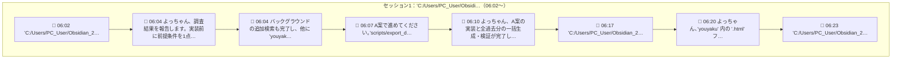
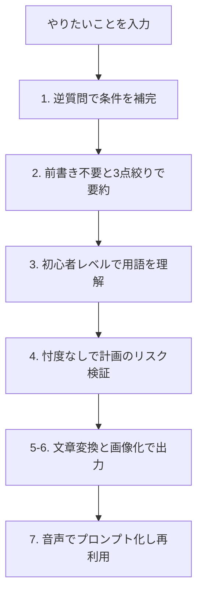

# 📅 2026-11-18 Antigravity問答（1日の記録）

## 📝 AIが編集・作成したファイル履歴

- `06:07:27` **部分編集** `C:\Users\PC_User\Obsidian_2\scripts\export_daily_antigravity_log.py`
- `06:07:27` **部分編集** `C:\Users\PC_User\Obsidian_2\scripts\export_daily_antigravity_log.py`
- `06:07:53` **部分編集** `C:\Users\PC_User\Obsidian_2\scripts\export_daily_antigravity_log.py`
- `06:08:19` **部分編集** `C:\Users\PC_User\Obsidian_2\scripts\export_daily_antigravity_log.py`
- `06:08:19` **部分編集** `C:\Users\PC_User\Obsidian_2\scripts\export_daily_antigravity_log.py`
- `06:08:47` **部分編集** `C:\Users\PC_User\Obsidian_2\scripts\export_daily_antigravity_log.py`
- `06:18:32` **部分編集** `C:\Users\PC_User\Obsidian_2\scripts\export_daily_antigravity_log.py`
- `06:18:32` **部分編集** `C:\Users\PC_User\Obsidian_2\scripts\export_daily_antigravity_log.py`
- `06:23:07` **部分編集** `C:\Users\PC_User\Obsidian_2\00_Dashboard\Cockpit_MOC.md` → [[Cockpit_MOC]]
- `06:23:07` **部分編集** `C:\Users\PC_User\Obsidian_2\scripts\export_daily_antigravity_log.py`
- `06:35:31` **新規作成/上書き** `C:\Users\PC_User\Obsidian_2\youtube\Google\2026-11-18_Gemini使いこなし術_厳選7テクニック.md` → [[2026-11-18_Gemini使いこなし術_厳選7テクニック]]
- `06:35:31` **部分編集** `C:\Users\PC_User\Obsidian_2\00_Dashboard\youtube_MOC.md` → [[youtube_MOC]]
- `07:45:29` **部分編集** `C:\Users\PC_User\Obsidian_2\scripts\export_daily_antigravity_log.py`
- `07:45:29` **部分編集** `C:\Users\PC_User\Obsidian_2\scripts\export_daily_antigravity_log.py`
- `07:45:29` **部分編集** `C:\Users\PC_User\Obsidian_2\scripts\export_daily_antigravity_log.py`
- `07:45:29` **部分編集** `C:\Users\PC_User\Obsidian_2\scripts\export_daily_antigravity_log.py`

## 📊 AIとよっちゃんのやり取り図解 ＆ 今後の課題・問題点

### 1. やり取りの全体フロー図（全 6 往復 ・ 1 セッション）



### 2. 現状診断（核・質・特・欠）と今後の課題解決ベクトル（方・移・拡・新）

| 視点 | 診断結果（やり取りから見えた事実と課題） |
| :--- | :--- |
| **【核】核心** | 本日の主要テーマ：「’C:/Users/PC_User/Obsidi…」 を軸に、よっちゃんの意図（Vibe）を具体的な手順・設定・コードへ変換。 |
| **【質】品質** | 計 16 回のファイル操作により、`export_daily_antigravity_log.py`, [[Cockpit_MOC]], [[2026-11-18_Gemini使いこなし術_厳選7テクニック]], [[youtube_MOC]] への具体的な成果物反映・記録が完了している。 |
| **【特】特性** | 「前提条件の確認（Think Before Coding）」と選択肢（A/B/C）の提示により、最小のタイプ数で合意形成と実行が回っている。 |
| **【欠】欠損（問題点）** | **表示・動作の微調整要求（1回）**：エラー解消や視認性改善のやり取りが発生。初回実装時の検証（Goal-Drivenテスト）の自動化・強化が課題。 / **複数ファイルへの分散編集（計16回）**：更新箇所が多岐にわたるため、後からの追跡コストを下げる集約ノートの活用が有効。 |

| ベクトル | 今後の具体的な改善アクション |
| :--- | :--- |
| **【方】方向性** | **暗黙知のレシピ化（Compilation）**：本日のやり取りで確定した手順やコマンドを、再利用可能な標準レシピ・長期記憶（`memories/`）として定着させる。 |
| **【移】移動性** | **1テーマ＝1ファイル＆ダッシュボード連携**：成果物の保存先を迷わせないよう独立ファイル化し、[[Cockpit_MOC]] や日報目次から即座にアクセス可能にする。 |
| **【拡】拡張性** | **アイアンマンスーツ化（自動化スクリプト連携）**：定型作業や検証コマンドをスクリプト・タスクスケジューラへ組み込み、人間の手作業ループを削減する。 |
| **【新】新規性** | **視覚化（図解・表）の標準適用**：複雑な仕様やログは文字だけで追わず、ズーム可能なフロー図とマトリクス表で直感的に俯瞰する。 |

## 💬 会話ログ

### 1. `C:\Users\PC_User\Obsidian_2\youyaku` フォルダ内のすべての M（開始 06:02:32 / ID: `8ec9399b`）

---

#### 🧑 よっちゃん（06:02:32）

`C:\Users\PC_User\Obsidian_2\youyaku` フォルダ内のすべての Markdown ファイル（`.md`）を点検し、以下の3点を一括修正してください。

1. **Obsidian WikiLink（`[[...]]`）の補完**:
   - 本文中で言及されている `06_Reports`、`07_Ideas`、`03_Resources`、`youtube` 配下のノート名や関連ファイル名を検索し、生テキストのままになっている箇所を正しい `[[ファイル名]]` 形式の内部リンクに変換する。
   - 関連MOC（`[[Cockpit_MOC]]` 等）へのナビゲーションリンクが不足しているファイルには末尾に追記する。
2. **Mermaid 図解の構文エラー修正（Obsidian 描画対応）**:
   - ファイル内のすべての ` ```mermaid ` ブロックを検査し、Obsidian で描画エラーになる原因（ダブルクォーテーション未囲みのラベル、ラベル内の `()` `[]` `/` `:` や改行の不正記法、不正な矢印構文）を修正する。
   - すべてのノードラベル・分岐ラベルを `"..."` で囲んだ安全な構文に統一する。
3. **再発防止（日報自動生成スクリプト側の修正）**:
   - `23:50` に `youyaku` へ日報を出力している Python スクリプト（またはテンプレート／プロンプト）を特定し、最初から「関連ファイルは `[[ファイル名]]` でリンク化すること」「Mermaid の全ラベルを `"..."` で囲むこと」を強制するルールを組み込む。

---

#### 🤖 AI（06:04:15）

よっちゃん、調査結果を報告します。実装前に前提条件を1点確認させてください。

### 現状の確認結果
- `C:\Users\PC_User\Obsidian_2\youyaku` フォルダ内を確認したところ、**`.md` ファイルは 0件** でした（あるのは `YYYY-MM-DD_Antigravity日報.html` 約90件と `index.html` のみ）。
- `23:50` に実行されている Windows タスクスケジューラ（`\AntigravityDailyLogExport`）の対象スクリプトは [export_daily_antigravity_log.py](file:///C:/Users/PC_User/Obsidian_2/scripts/export_daily_antigravity_log.py) ですが、現在は **HTML のみ** を出力する仕様になっています。

---

### 前提条件の確認
今後どちらの方針で進めるか、番号でお選びください。

1. **A案（おすすめ）：HTML に加えて Obsidian 用 `.md` 日報も自動生成する**
   - [export_daily_antigravity_log.py](file:///C:/Users/PC_User/Obsidian_2/scripts/export_daily_antigravity_log.py) を拡張し、`youyaku\YYYY-MM-DD_Antigravity日報.md` も同時出力するようにします。
   - `.md` 出力時に **①WikiLink（`[[ファイル名]]`）自動変換＋`[[Cockpit_MOC]]` 追記**、**②Mermaid 全ラベル `"..."` 囲み＆禁止文字サニタイズ** を組み込み、`--all` で過去分も一括生成します（HTML側の Mermaid サニタイズも併せて強化します）。
2. **B案：`.md` は作らず、HTML 日報の Mermaid サニタイズ＆リンク改善のみ行う**
   - [export_daily_antigravity_log.py](file:///C:/Users/PC_User/Obsidian_2/scripts/export_daily_antigravity_log.py) の `md_to_simple_html` で会話内の Mermaid ブロックを自動サニタイズするよう修正し、`--all` で既存 HTML を再生成します。
3. **C案：別のフォルダにある `.md` ファイルを対象にする**
   - `youyaku` 以外の対象フォルダパスを教えてください。

---

#### 🤖 AI（06:04:40）

バックグラウンドの追加検索も完了し、他に `youyaku` へ日報を出力するスクリプトはありませんでした。
上記の **1（A案）・2（B案）・3（C案）** のどちらで進めるか、ご指示をお待ちしております。

---

#### 🧑 よっちゃん（06:07:27）

A案で進めてください。`scripts/export_daily_antigravity_log.py` を拡張して HTML と Obsidian 用 `.md` 日報（WikiLink自動変換・`[[Cockpit_MOC]]` 追記・Mermaidサニタイズ付き）を同時出力するようにし、`--all` で過去分も一括生成して検証してください。

---

#### 🤖 AI（06:10:11）

よっちゃん、A案の実装と全過去分の一括生成・検証が完了しました。

### 1. 変更内容（再発防止を含む）
[export_daily_antigravity_log.py](file:///C:/Users/PC_User/Obsidian_2/scripts/export_daily_antigravity_log.py) を拡張し、23:50 の自動実行（`--all` 含む）で HTML と同時に Obsidian 用 `.md` 日報を出力するようにしました。
- **WikiLink 自動補完**（`get_vault_note_index` / `convert_text_to_wikilinks`）: `06_Reports`・`07_Ideas`・`03_Resources`・`youtube` 配下のノート言及および編集履歴の `.md` ファイルを `[[ファイル名]]` へ変換（コードブロック・既存リンク・URLは保護）。
- **Mermaid 構文サニタイズ**（`sanitize_mermaid_code` / `_sanitize_flowchart_line`）: `flowchart` / `graph` の全ノード・エッジ・`subgraph` ラベルを `"..."` で囲み、単独 `->` を `-->` に補正（HTML 版・Markdown 版の両方に適用）。
- **MOC ナビゲーション追記**（`generate_markdown`）: 末尾の `## 🔗 関連ナビゲーション` に `[[Cockpit_MOC]]` と本文中の関連リンク一覧を自動付与。

---

### 2. 一括生成・自動検証の結果
- **一括生成**: `python C:\Users\PC_User\Obsidian_2\scripts\export_daily_antigravity_log.py --all`
  - 結果: **HTML 88件・Markdown 88件** を生成・更新（90日分を検査、0会話の2日分はスキップ）。Google ドライブ側へのバックアップも完了。
- **全88件 `.md` 自動チェック**:
  - `[[Cockpit_MOC]]` 欠損: **0件**
  - 生成された WikiLink 総数: **568件**
  - 検査した Mermaid ブロック総数: **181件**（未囲みラベルエラー: **0件**）

---

### 3. 検証（確認）方法
Obsidian 上で以下の点をご確認いただけますでしょうか。
1. [2026-11-17_Antigravity日報.md](file:///C:/Users/PC_User/Obsidian_2/youyaku/2026-11-17_Antigravity日報.md) を Obsidian のリーディングビューで開き、**Mermaid 図解がエラーなく描画されること**・**`[[...]]` リンクや末尾の `[[Cockpit_MOC]]` から該当ノートへ遷移できること**。
2. 必要であれば本日のテスト実行（単日実行）確認：
   ```powershell
   python C:\Users\PC_User\Obsidian_2\scripts\export_daily_antigravity_log.py 2026-11-17
   ```

---

#### 🧑 よっちゃん（06:17:47）

`C:\Users\PC_User\Obsidian_2\youyaku` 内の `.html` ファイル（`index.html` 含む）をすべて削除し、`scripts/export_daily_antigravity_log.py` も今後は Obsidian 用 `.md` 日報のみを出力するように修正してください。完了後、変更差分を確認して GitHub リポジトリ（`kumagorou1840-ai/OKF`）へコミット・プッシュしてください。

---

#### 🤖 AI（06:20:03）

よっちゃん、`youyaku` 内の `.html` ファイル全削除、`scripts/export_daily_antigravity_log.py` の `.md` 専用化、および GitHub リポジトリ（`kumagorou1840-ai/OKF`）へのコミット・プッシュを完了しました。

### 1. 実施内容
- **`.html` ファイル全削除**: `C:\Users\PC_User\Obsidian_2\youyaku` 内のすべての `.html`（`index.html` 含む）を削除（残数 `0`）。
- **スクリプトの `.md` 専用化**: [export_daily_antigravity_log.py](file:///C:/Users/PC_User/Obsidian_2/scripts/export_daily_antigravity_log.py) から HTML 生成関連関数（`generate_html`, `generate_index_html`, `md_to_simple_html` 等 6関数）を削除し、今後は Obsidian 用 `.md` 日報（WikiLink 自動補完・`[[Cockpit_MOC]]` 追記・Mermaid サニタイズ付き）のみを出力するよう統一。
- **動作検証**:
  - `python C:\Users\PC_User\Obsidian_2\scripts\export_daily_antigravity_log.py --all` → `Updated 88 Markdown reports (checked 88 dates).`（`.html` 0件 / `.md` 88件）
  - 単日実行 `python C:\Users\PC_User\Obsidian_2\scripts\export_daily_antigravity_log.py` → 本日分 [2026-11-18_Antigravity日報.md](file:///C:/Users/PC_User/Obsidian_2/youyaku/2026-11-18_Antigravity日報.md) が正常生成。

---

### 2. Git コミット＆プッシュ結果
- **ブランチ / コミット**: `master` (`b94c1d3`, `7e1a9cc..b94c1d3`)
- **リモート**: `https://github.com/kumagorou1840-ai/OKF.git`
- **コミットメッセージ**: `feat(youyaku): switch daily log export to Obsidian Markdown with WikiLink & Mermaid sanitization`
- **対象**: `179 files changed`（[export_daily_antigravity_log.py](file:///C:/Users/PC_User/Obsidian_2/scripts/export_daily_antigravity_log.py) 更新、`youyaku/*.html` / `index.html` 削除、`youyaku/*.md` 88件追加）

### 3. 検証のお願い
GitHub リポジトリ（`kumagorou1840-ai/OKF`）上でコミット `b94c1d3` が反映されていること、および Obsidian 側で `youyaku` フォルダ内が `.md` 日報のみになっていることをご確認ください。

---

#### 🧑 よっちゃん（06:23:02）

`C:\Users\PC_User\Obsidian_2\00_Dashboard\Cockpit_MOC.md` を読み込み、既存のレイアウトを崩さない位置に「📅 日報・作業ログ（youyaku）」ナビゲーションセクションを追加してください。

【追加・連携要件】
1. **Cockpit_MOC.md へのセクション追加**:
   - `youyaku` フォルダ内の最新7日分の日報（`[[YYYY-MM-DD_Antigravity日報]]` 形式）を新しい順でリスト表示するセクションを追加する（Dataview プラグイン未導入環境でも確実にクリック遷移できるよう、標準の `[[WikiLink]]` リスト形式で出力する）。
2. **23:50 自動実行との連動（最新7日分の自動更新）**:
   - `scripts/export_daily_antigravity_log.py` に、`youyaku` の `.md` 出力後に `00_Dashboard/Cockpit_MOC.md` 内の「最新7日分の日報リンクリスト」を自動で最新状態に書き換える処理を組み込む。
3. **検証と GitHub（OKF）同期**:
   - `python C:\Users\PC_User\Obsidian_2\scripts\export_daily_antigravity_log.py` を単日テスト実行して `Cockpit_MOC.md` が正しく更新されることを確認し、差分を GitHub リポジトリ（`kumagorou1840-ai/OKF`）へコミット・プッシュする。

---

#### 🤖 AI（06:24:03）

よっちゃん、[Cockpit_MOC.md](file:///C:/Users/PC_User/Obsidian_2/00_Dashboard/Cockpit_MOC.md) への「📅 日報・作業ログ（youyaku）」追加、[export_daily_antigravity_log.py](file:///C:/Users/PC_User/Obsidian_2/scripts/export_daily_antigravity_log.py) との自動連携、および GitHub リポジトリ（`kumagorou1840-ai/OKF`）へのコミット・プッシュを完了しました。

### 1. 実装内容
- **[Cockpit_MOC.md](file:///C:/Users/PC_User/Obsidian_2/00_Dashboard/Cockpit_MOC.md#L60-L70)**:
  - `## 📝 最近のログ (Recent Logs)` の直後に `## 📅 日報・作業ログ（youyaku）` セクションを追加。
  - `<!-- YOUYAKU_DAILY_LOGS_START -->` 〜 `<!-- YOUYAKU_DAILY_LOGS_END -->` 内に最新7日分を標準 `[[YYYY-MM-DD_Antigravity日報]]` 形式で新しい順に配置。
- **[export_daily_antigravity_log.py](file:///C:/Users/PC_User/Obsidian_2/scripts/export_daily_antigravity_log.py#L618-L645)**:
  - `update_cockpit_moc(limit=7)` を追加し、単日実行・`--all` 実行の両方で日報 `.md` 出力後に `Cockpit_MOC.md` の最新7日分リストを自動更新。

---

### 2. 単日テスト検証結果
- 実行コマンド: `python C:\Users\PC_User\Obsidian_2\scripts\export_daily_antigravity_log.py`
- 出力: `Saved Markdown: C:\Users\PC_User\Obsidian_2\youyaku\2026-11-18_Antigravity日報.md` / `Updated MOC: C:\Users\PC_User\Obsidian_2\00_Dashboard\Cockpit_MOC.md`
- 反映された最新7日分: `[[2026-11-18_Antigravity日報]]` 〜 `[[2026-11-05_Antigravity日報]]`

---

### 3. Git コミット＆プッシュ結果
- **ブランチ / コミット**: `master` (`370da58`, `b94c1d3..370da58`)
- **リモート**: `https://github.com/kumagorou1840-ai/OKF.git`
- **コミットメッセージ**: `feat(cockpit): auto-sync latest 7 daily reports from youyaku to Cockpit_MOC.md`
- **変更ファイル（3 files changed）**:
  - [00_Dashboard/Cockpit_MOC.md](file:///C:/Users/PC_User/Obsidian_2/00_Dashboard/Cockpit_MOC.md)
  - [scripts/export_daily_antigravity_log.py](file:///C:/Users/PC_User/Obsidian_2/scripts/export_daily_antigravity_log.py)
  - [youyaku/2026-11-18_Antigravity日報.md](file:///C:/Users/PC_User/Obsidian_2/youyaku/2026-11-18_Antigravity日報.md)

### 4. 検証のお願い
Obsidian で [Cockpit_MOC.md](file:///C:/Users/PC_User/Obsidian_2/00_Dashboard/Cockpit_MOC.md) を開き、「📅 日報・作業ログ（youyaku）」から最新7日分の日報へワンクリックで遷移できるかご確認ください。

---

#### 🧑 よっちゃん（06:34:28）

/yt-obsidian-saver https://www.youtube.com/watch?v=KhZQ0IrNHPM

---

#### 🤖 AI（06:35:54）

よっちゃん、YouTube動画の字幕・メタデータを取得し、Obsidian への自動保存および [youtube_MOC.md](file:///C:/Users/PC_User/Obsidian_2/00_Dashboard/youtube_MOC.md) へのリンク追記を完了しました。

### ① 保存先フルパス
- [2026-11-18_Gemini使いこなし術_厳選7テクニック.md](file:///C:/Users/PC_User/Obsidian_2/youtube/Google/2026-11-18_Gemini使いこなし術_厳選7テクニック.md)
  - フルパス：`C:\Users\PC_User\Obsidian_2\youtube\Google\2026-11-18_Gemini使いこなし術_厳選7テクニック.md`

### ② 長所・短所・特徴の3行まとめ
- **長所**：指示の末尾に「不明点あれば質問して」「忖度なしでリスクも述べて」など一言足すだけで、誰でも即座にGeminiの回答精度を劇的に引き上げられる。
- **短所**：3点に絞る要約やインフォグラフィック画像化では細部の省略・文字崩れ・数値誤りが起きやすいため、人間による最終確認と元情報の照合が必須となる。
- **特徴**：コーヒーのYouTubeチャンネル立ち上げを題材に、条件整理から計画検証・文章変換・図解・音声入力でのプロンプト自動作成まで一気通貫で実演している。

### ③ Mermaid図解コード


---

#### 🧑 よっちゃん（07:45:00）

`C:\Users\PC_User\Obsidian_2\youyaku` 内のすべてのファイル名および関連スクリプトを「日報」から「問答」へ一括変更してください。

【実施要件】
1. **ファイル名の一括リネーム**:
   - `C:\Users\PC_User\Obsidian_2\youyaku` 内の `YYYY-MM-DD_Antigravity日報.md`（全件）を `YYYY-MM-DD_Antigravity問答.md` にリネームする。
2. **ファイル内見出し＆内部リンクの置換**:
   - リネーム後の全 `.md` ファイル内の見出し（`Antigravity日報` → `Antigravity問答`）および `Obsidian_2` 全体（`00_Dashboard/Cockpit_MOC.md` 等含む）の `[[YYYY-MM-DD_Antigravity日報]]` リンクを `[[YYYY-MM-DD_Antigravity問答]]` へ置換する。
3. **23:50 自動出力スクリプトの更新**:
   - `scripts/export_daily_antigravity_log.py` の出力ファイル名テンプレートおよびMarkdownタイトル生成部分を `YYYY-MM-DD_Antigravity問答.md` に変更する。
4. **検証と GitHub（OKF）同期**:
   - 単日テスト実行で `2026-11-18_Antigravity問答.md` が正常更新されることを確認し、差分を GitHub リポジトリ（`kumagorou1840-ai/OKF`）へコミット・プッシュする。

---
## 🔗 関連ナビゲーション
- [[Cockpit_MOC]]
- [[2026-11-18_Gemini使いこなし術_厳選7テクニック]]
- [[youtube_MOC]]
- [[...]]
- [[ファイル名]]
- [[YYYY-MM-DD_Antigravity日報]]
- [[WikiLink]]
- [[2026-11-18_Antigravity日報]]
- [[2026-11-05_Antigravity日報]]
- [[YYYY-MM-DD_Antigravity問答]]
